# 计算机编程：从入门到实战：05：面向对象编程（第一部分）


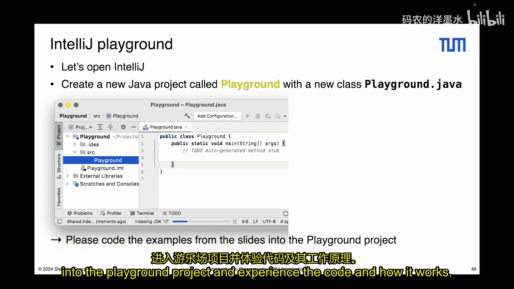

在本节课中，我们将要学习面向对象编程（OOP）的基础概念。我们将了解什么是对象和类，如何定义它们，以及如何在Java程序中创建和使用对象实例。课程内容将从基本概念开始，逐步深入到对象间的交互和引用语义。

## 概述：面向对象的世界

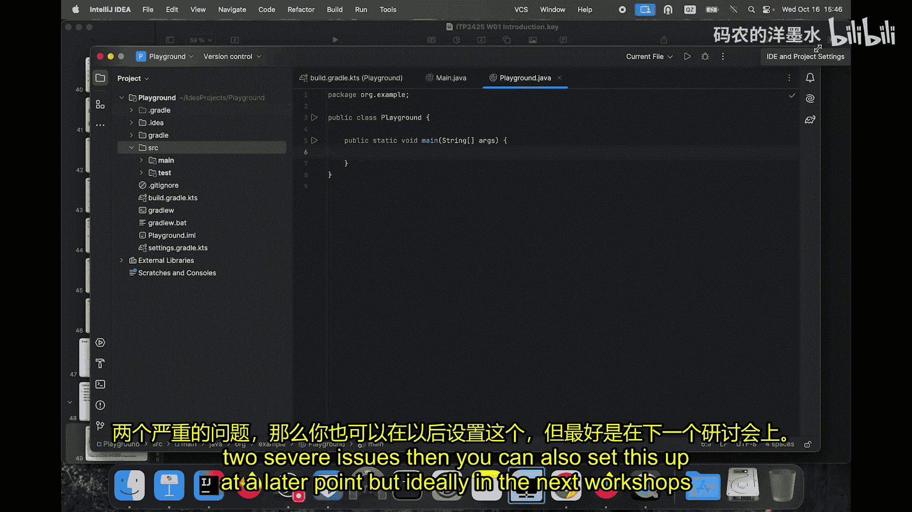

面向对象编程的核心思想是，我们感知的世界由对象构成。在程序中，我们尝试理解现实世界的这些对象，并将它们作为虚拟的对应物放入我们的程序。这些对象拥有属性，并且通过数据交换和调用服务（或方法）来相互协作。

例如，一把椅子是一个对象。它的属性可能包括材质（如木材）和颜色（如棕黄色）。我们可以对这个对象执行某些操作，例如“坐在椅子上”。在编程中，我们创建类作为对象的蓝图，然后根据这个蓝图实例化出具体的对象。

## 创建第一个Java类

上一节我们介绍了面向对象的基本思想，本节中我们来看看如何在代码中实现一个简单的类。

以下是一个`Book`类的定义示例。这个类代表了图书馆中的一本书，它包含三个属性：作者、标题和版本号。

```java
class Book {
    // 属性（实例变量）
    String author;
    String title;
    int edition;

    // 方法：借出书籍
    void borrow(java.time.LocalDate startDate) {
        // 实现借书逻辑的代码
    }

    // 方法：归还书籍
    void giveBack(java.time.LocalDate endDate) {
        // 实现还书逻辑的代码
    }
}
```

在这个类定义中：
*   `author`, `title`, `edition` 是**属性**，用于存储对象的状态。
*   `borrow` 和 `giveBack` 是**方法**，定义了对象的行为。
*   `void` 表示该方法不返回任何值。

## 实例化与使用对象

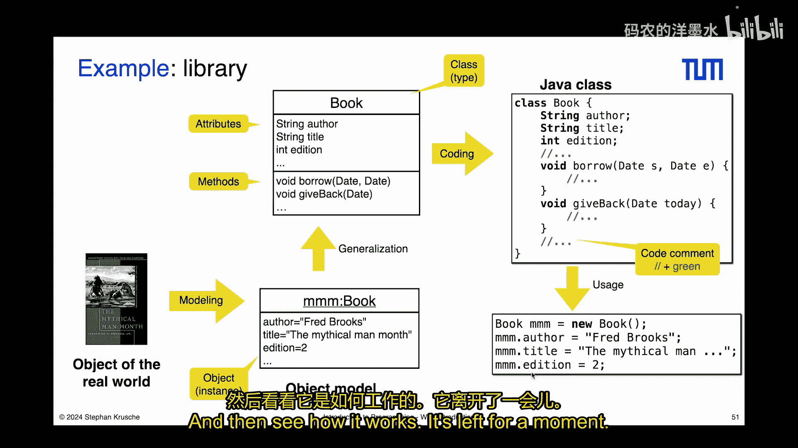

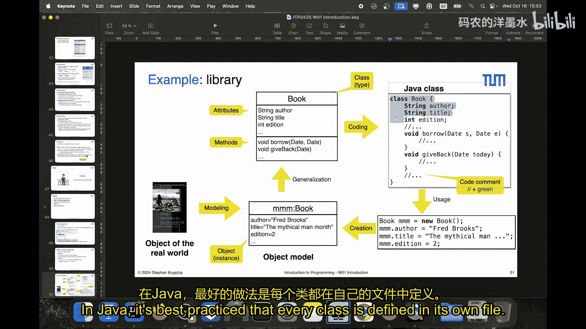

定义了类之后，我们需要创建具体的对象实例才能使用它。这个过程称为实例化。

以下是创建和使用`Book`对象的代码：

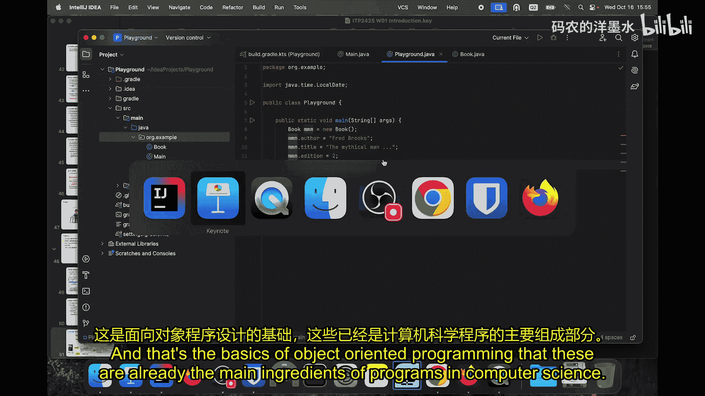

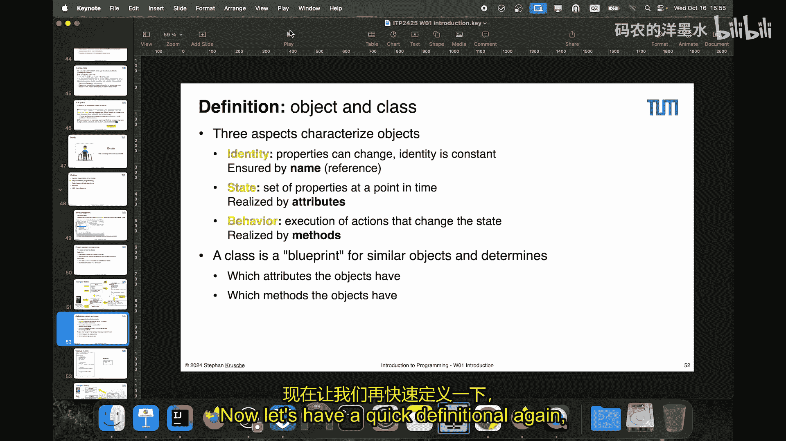

```java
public class Playground {
    public static void main(String[] args) {
        // 使用 new 关键字和构造函数创建对象
        Book mythicalManMonth = new Book();

        // 为对象的属性赋值
        mythicalManMonth.author = "Fred Brooks";
        mythicalManMonth.title = "The Mythical Man-Month";
        mythicalManMonth.edition = 2;

        // 调用对象的方法
        mythicalManMonth.borrow(java.time.LocalDate.now());
    }
}
```

关键点：
*   `new Book()` 调用构造函数，在内存中创建一个新的`Book`对象。
*   `mythicalManMonth` 是一个**引用变量**，它指向内存中那个具体的对象。
*   使用点运算符 `.` 来访问对象的属性和方法。

## 对象的核心特征

每个对象都有三个核心特征，理解它们对掌握面向对象编程至关重要。

1.  **标识**：每个对象都有一个唯一的身份，通常通过其引用变量名来体现。即使对象的属性值改变，其标识保持不变。
2.  **状态**：由对象在特定时间点的属性值决定。例如，一本书的`edition`是2。
3.  **行为**：通过对象的方法来定义。执行方法可能会改变对象的状态。例如，调用`borrow()`方法会将书的状态标记为“已借出”。

而**类**则是创建这些对象的蓝图。它定义了该类所有对象将拥有哪些属性和方法。

## 对象间的关联

在现实世界中，对象很少孤立存在，它们之间会有关联。在程序中，我们可以通过在一个类中包含另一个类的引用来建模这种关系。

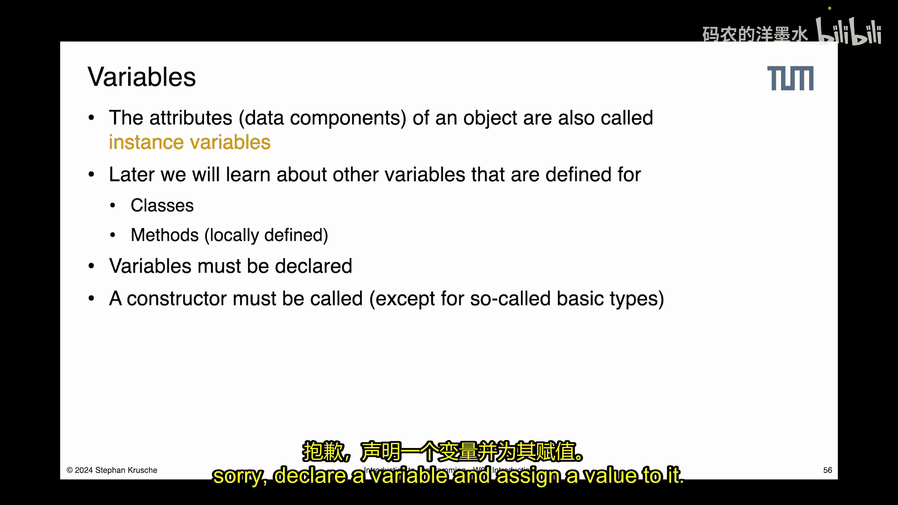

例如，一个`Library`（图书馆）可以包含多本`Book`（书）。这种关系可以通过关联来表示。

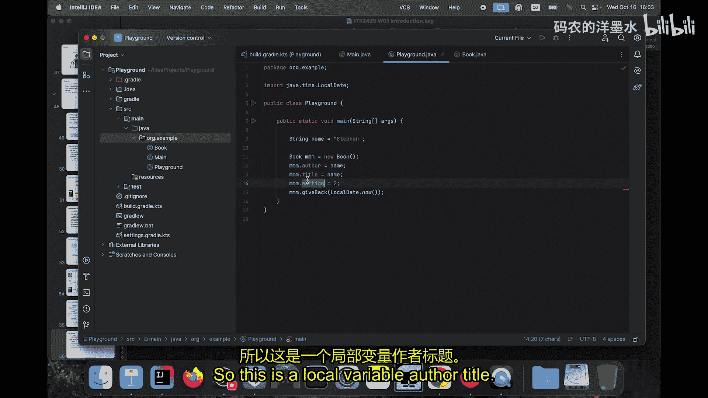

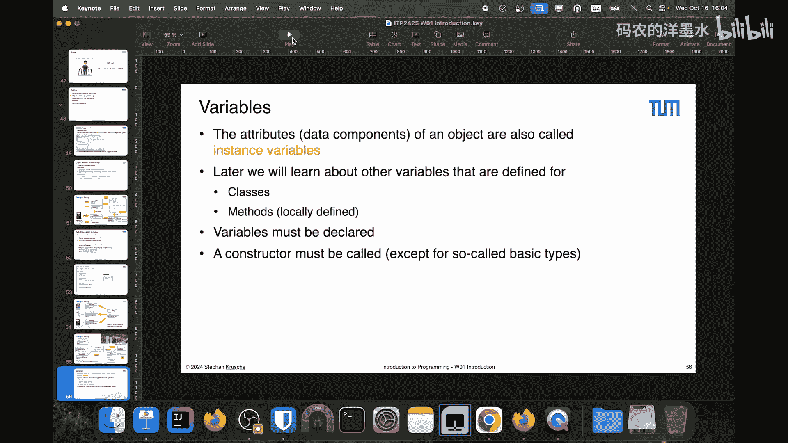

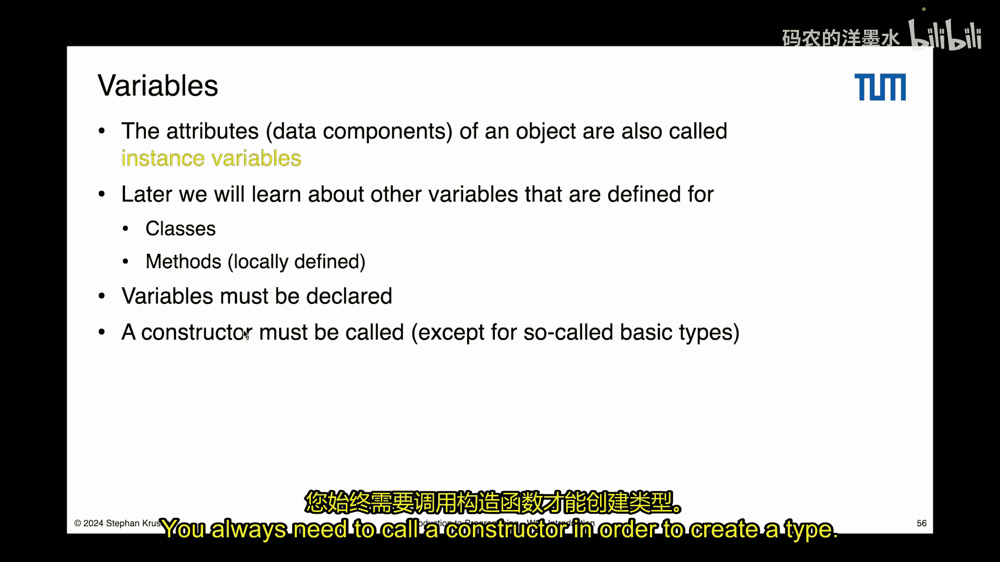

```java
class Library {
    String name;
    Book[] books; // 图书馆拥有一个书籍数组（关联）

    void visit() {
        // 实现访问图书馆的逻辑
    }
}
```

在UML（统一建模语言）图中，这种关系用一条连接两个类的线表示，并可以标注数量关系（如一个图书馆对应多本书）。

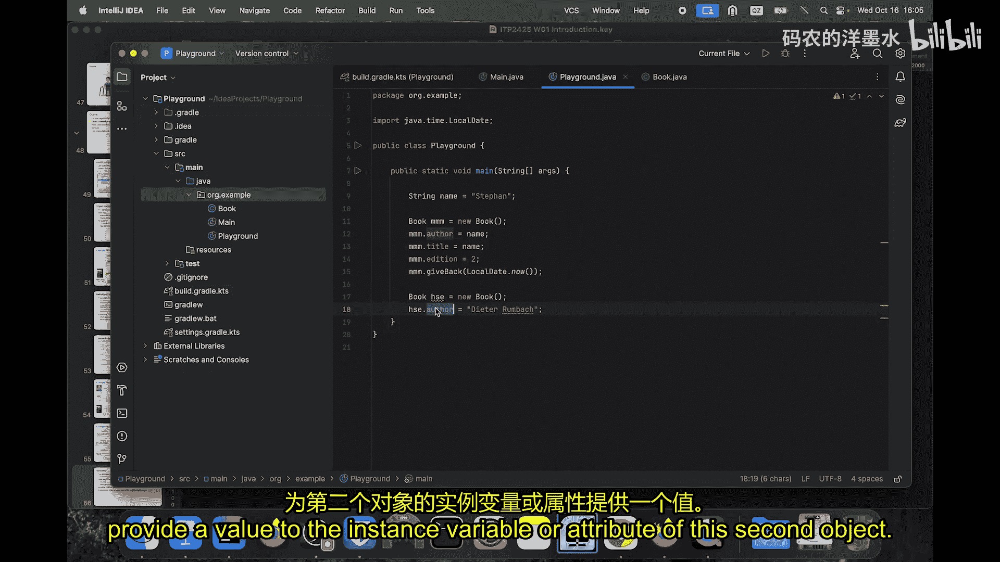

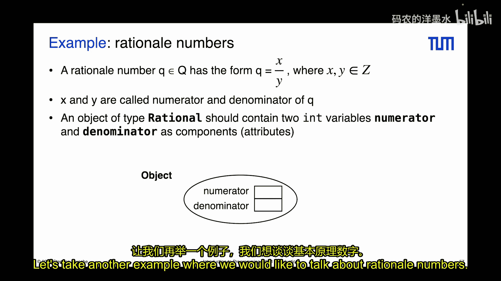

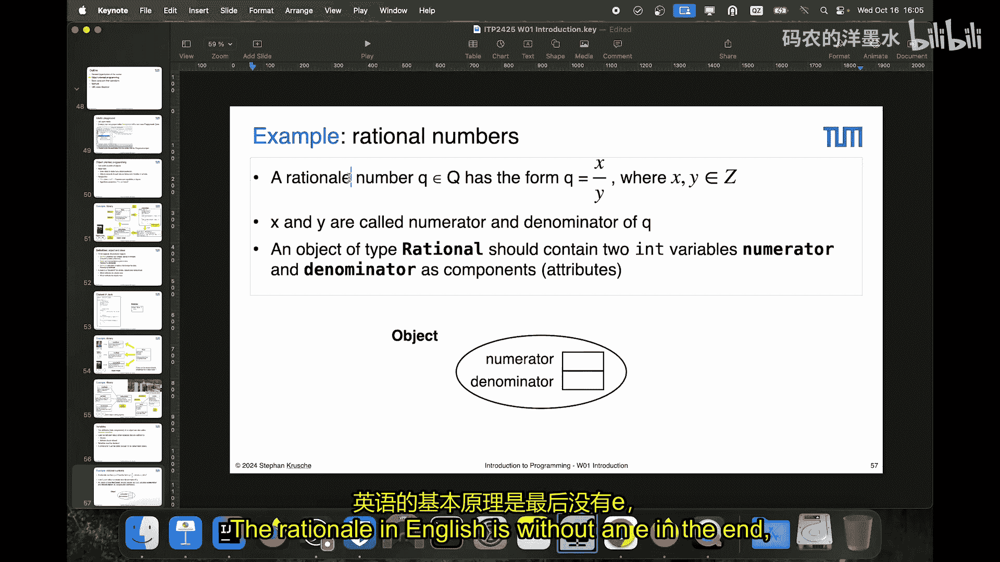

## 变量类型：实例变量、局部变量与引用

在类中，我们会遇到几种不同的变量，理解它们的区别很重要。

*   **实例变量**：在类内部、方法外部声明的变量。每个对象实例都拥有自己的一份副本。例如`Book`类中的`author`。
*   **局部变量**：在方法内部声明的变量。其生命周期仅限于该方法执行期间。
*   **引用变量**：用于指向对象的变量，如`Book mythicalManMonth`。它存储的是对象在内存中的地址，而非对象本身。

## 引用语义与原始数据类型

这是面向对象编程中的一个关键概念。对象使用**引用语义**，而原始数据类型（如`int`, `double`）使用**值语义**。

```java
Book bookA = new Book();
Book bookB = bookA; // bookB 指向与 bookA 相同的对象（引用复制）

bookA.title = "New Title";
System.out.println(bookB.title); // 输出 "New Title"，因为两者引用同一对象

int x = 5;
int y = x; // y 获得 x 值的一个副本（值复制）
x = 10;
System.out.println(y); // 输出 5，y 的值不受 x 后续改变的影响
```

重要结论：多个引用变量可以指向同一个对象，通过任何一个引用修改对象，其他所有引用都会“看到”这个变化。这被称为**别名**。

## 构造方法与 `this` 关键字

**构造方法**是一种特殊的方法，用于在创建对象时初始化其状态。它的名称必须与类名完全相同。

```java
class Point {
    double x;
    double y;

    // 构造方法
    Point(double x, double y) {
        this.x = x; // 使用 this 区分实例变量和参数
        this.y = y;
    }
}
```

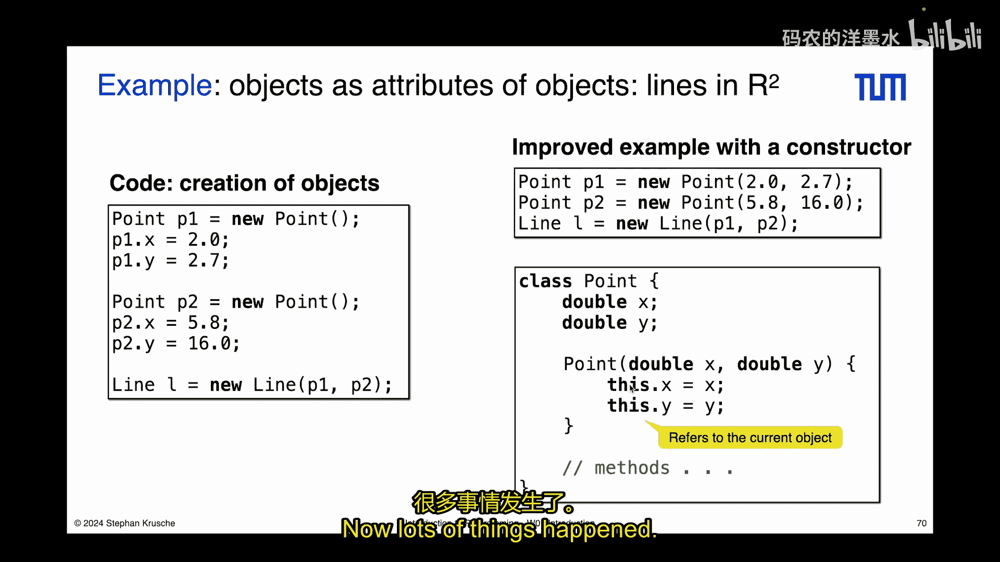

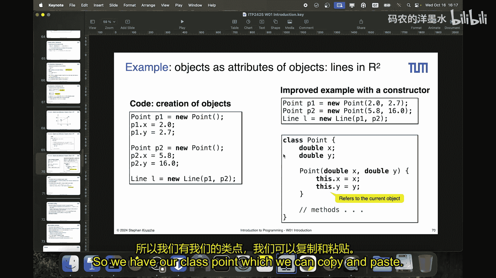

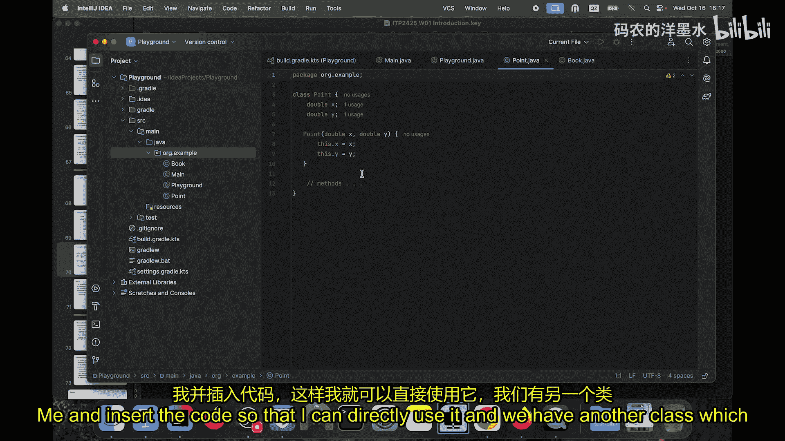

*   如果你没有定义任何构造方法，Java会提供一个默认的无参数构造方法。
*   一旦你定义了自己的构造方法，默认构造方法将不再自动提供。
*   `this` 关键字指向当前对象的实例。当方法参数名与实例变量名冲突时，可以用 `this.variableName` 来明确指代实例变量。

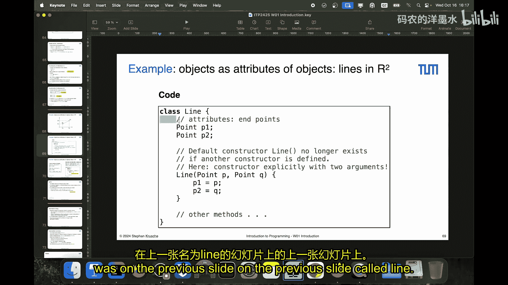

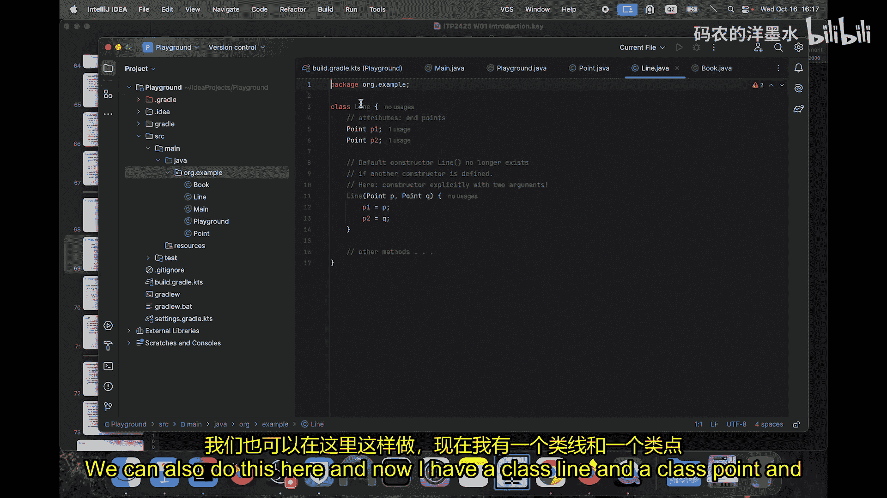

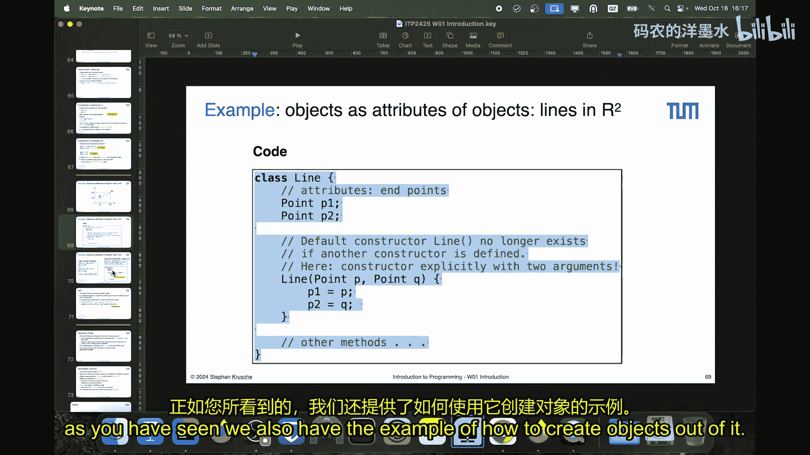

## 组合对象：更复杂的结构

我们可以通过组合简单的类来构建更复杂的结构。例如，一条`Line`（线段）可以由两个`Point`（点）来定义。

```java
class Line {
    Point start; // 起点
    Point end;   // 终点

    Line(Point start, Point end) {
        this.start = start;
        this.end = end;
    }
}

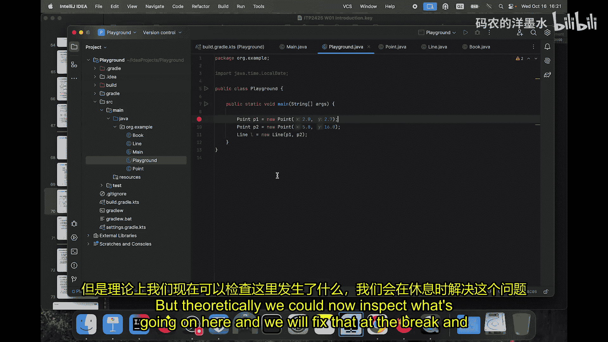

// 使用方式
Point p1 = new Point(2.0, 2.7);
Point p2 = new Point(5.8, 16.0);
Line myLine = new Line(p1, p2);
```

这种设计体现了**信息隐藏**和**代码复用**的原则。`Line`类不需要关心`Point`内部如何实现，它只需要使用`Point`提供的功能。

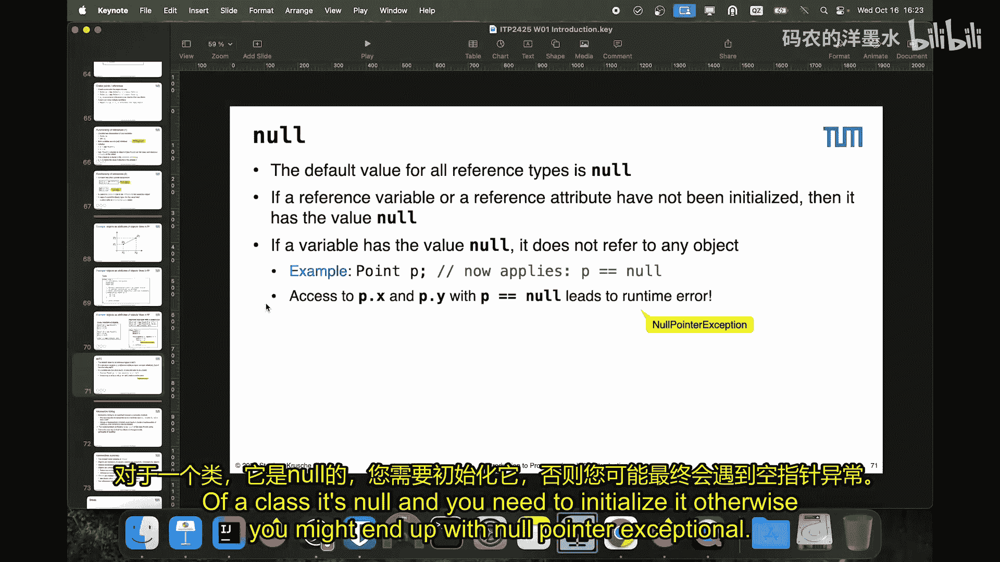

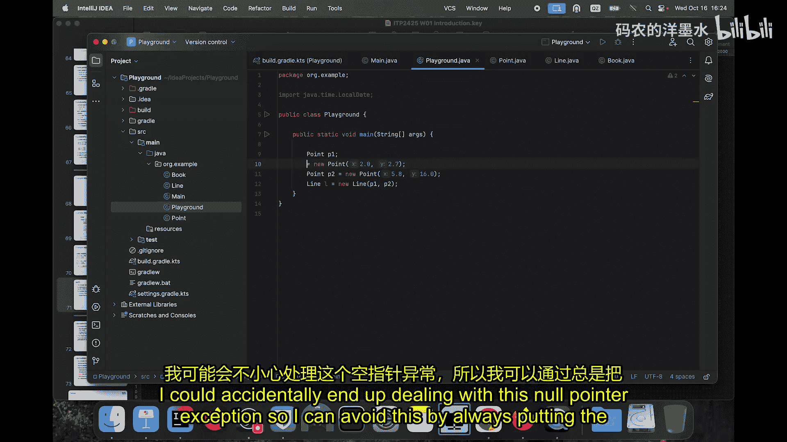

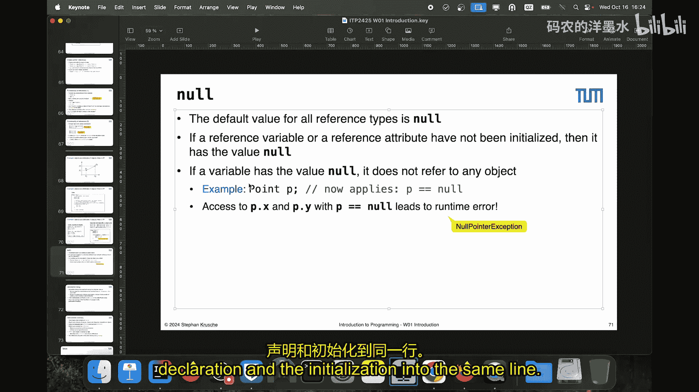

## 空引用 `null` 与信息隐藏

*   **空引用 `null`**：这是引用类型变量的默认值，表示该引用当前不指向任何对象。尝试通过一个值为`null`的引用调用方法或访问属性，会导致 `NullPointerException`。最佳实践是在声明引用变量时立即初始化它。
*   **信息隐藏**：通过将类的内部细节（属性）声明为`private`，可以防止外部代码直接访问和修改它们，从而保护对象状态的完整性，并降低类与类之间的耦合度。我们将在后续课程中详细学习访问修饰符。

## 总结

本节课中我们一起学习了面向对象编程的基础知识。我们了解到程序中的虚拟世界由对象构成，而类是创建对象的蓝图。对象封装了数据（属性）和行为（方法）。我们学会了如何定义类、使用`new`关键字和构造方法实例化对象，以及如何使用点运算符与对象交互。

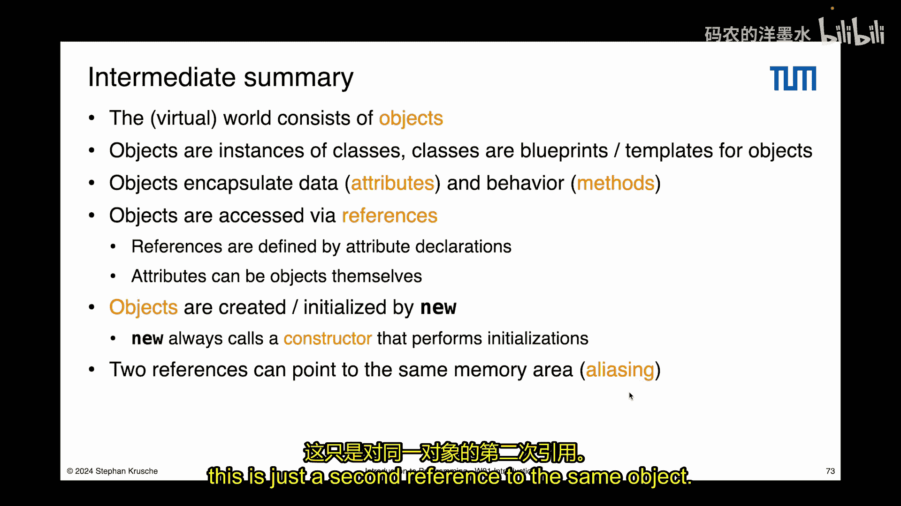

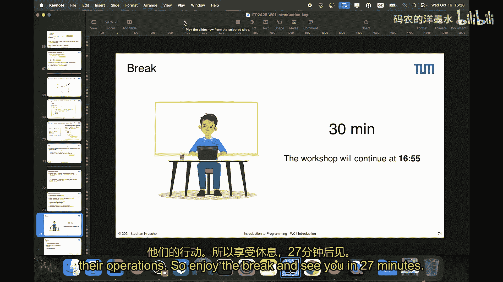

关键收获包括理解了**引用语义**（多个变量可指向同一对象）与原始数据类型的**值语义**的区别，以及对象之间可以通过**关联**和**组合**来建立关系。我们还初步接触了`this`关键字、`null`值以及信息隐藏的重要性。这些概念是构建更复杂、更模块化Java程序的基石。在接下来的课程中，我们将在此基础上，继续探索面向对象编程的更多特性。