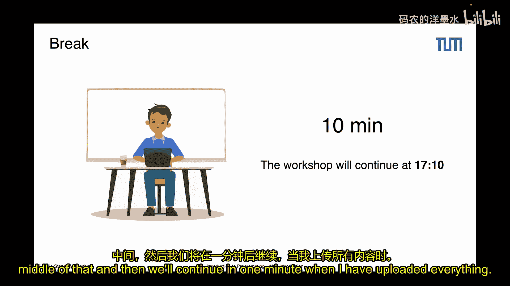

# 【全集】慕尼黑工业大学 计算机编程：从入门到实战 中英字幕 p06 Lecture 6 - 类型及其运算 -BV1WFrTBZExY_p6-

Okay， we like to continue in the next unit。 we' will talk about basic types and their operations。

 And I kindly ask you to use the back doors to get out and in into the lecture hall because it's a bit disturbing if everyone comes out and in during the lecture on this side and on this side。

 there there are doors in the first floor。Please use those if you would like to get out and get in。

In the next unit， we'll talk about basic types and the operations。

 basic data types in Javava allow us to define。Variables that have a set of possible values and a set of possible operations on these types。

Remember that all variables and attributes need to have a type and Java offers us certain basic data types。

 but we can also define our own data types， classes。When it comes to the basic data types。

 Javava has eight of them， for example， in and double as we have seen before。

And each of those basic types basically requires a certain amount of memory or space to store。

And the space is measure measured measured in bits and the bit is typically either 0 or one。

 And if you have multiple bits after each other， for example，8 bits。

 you have one bite and one bite can then store certain amount of information， for example，255 values。

 And you see here that。A buy it is actually also a data type that has 8 digits and can have the smallest value。

-120。 Can you use the other door， please， This is not。For entrance。

So the byte goes from -128 to plus 127。 You use it。In a very few places only。

 if you really need to save space， normally you use an int。

 or if the int is not having enough values because you need to store really large values。

 you use a long。Using smaller types can save space。

 but in most programs and you only use simple programs throughout discourse。

 this is typically not a requirement。Notice that those types can overflow and underflow if you have a byte with the value 127 and you add one additional value。

 it automatically goes to minus 128 and Chava will not warn you there's no error or warning regarding that you have to deal with this on your own and this is a typical mistake in programs。

Here's an example。 if you have the largest int value here， and we add one additional。

Ditchit to it using this addition here， x equals x plus1。

 we have an overflow and if we then use system out print line that helps us to it's a method call or function call in Java but it helps us to print everything that is in this rounded places to the console。

 we'll see that we have the small as intership value。

There are also floating point numbers float and double with a very specific precisioner。

 so float is not as precise， but is mostly enough for many different cases。

 except you really do mathematical things then you might need to use a double which can really store a very high precisioner。

AndBoth。Are approximate types， so they are not absolutely precise。

 Yeah they are only precise up to certain amount of digits， but if you need complete precision。

 you need to use different data types， underflow and overflow is also possible。

 but this representative with infinity and minus infinity and if you just have numbers you need to append the letter F for float or the letter D for double to distinguish them。

 So 3。14 F would be a float while 3。1 D would be a double。

You also have two more basic data types So in total8， we have the Boolean。

 which is only one digit long or one bit long， which represents true and false values for logical operations。

 This is particularly important in the next lecture when we talk on the next workshop when we talk about control flow and control structures and we have the character which represents one letter or one element of the alphabet。

 Yeah， basically all kind of unicord characters can be encoded here。 even Chinese characters。

 Egyptianian hicphs and so on。And this is basically the underlying data type for a string。

 so a string is nothing else than multiple characters after each other。

Basic types do not really use constructors。 You can directly assign values to it in memory， the。Data。

Or the， the the areas or the space of the data type is reserved for the value。

 but we do not have a reference。 So it's directly saved at the place we in memory。

And we also cannot reference simple data types it's not possible。When it comes to。

Copying values and referencing values there an important distinction in programming。

 And this is equality and identity。Two different objects can be equal。Yeah。

 you can have the same rationale number 3 divided by 4 is the same as 6 divided by 8。

 So even if those objects have different attribute values， they can be equal。

But they might not be identical。So that's an important distinction。

 You check for equality of basic data types with the double equals operator。

So if you would like to compare if x equals5， you use2 double as2 to m equal operators， not one。

 one is always the assignment。But for reference types， the reference is compared。

 so it's compared if it's the same identity。Not necessarily and at the same identity leads always to an equal object。

 right， But if you have two different objects。That are equal。They do not have the same identity。

Right， and then the double equals operator could be false。 Now， we have an example here。

Yeah if we have i1，5， I2，6 and I 3，5 we can use this comp。

 it is compare operator or double equals quality operator。

 and then you see i1 is not the same as I25 is not the same as6， so this is false。While I1 equals。

 i3 is true。Because。5 is the same as 5。 Now， when it comes to the reference types。

 we have two points， P1 and P2， those are。Different identities， different instances。

 They might be equal。In terms of their values， But they have two different identities。

While P3 is an alias for P1。Now， if we check for the。Identity here， yeah。

 whether the reference types are identical or not， P1 is not identical to P2。

 Those are two different references。 So even if those points represent the same instance from the real world。

 which would be possible， I can initialize them with the same values， they are not identical。

 So from equality， you don't really have identity on the other hand。

 while you can have identical values as here， P3 and P1， those are identical references。

 or they are also equal。So make sure that you understand the difference， equality and identity。

And we have basic operations， in particular， the four simple math operations plus minus multiplication and divisioner and the fifth one for modular。

 if you knows what modular is， raise your hands。So what is 5 divided by 3。When we do， when we do in。

Division 5 divided by3。I's one exactly。 It's not 1。66666， as you would assume。 No， it's one。

 If we do integer divisional， we only get the value before the comma， so to speak。Now。

 what is5 more you do 3。2， exactly。 Yeah， that that's the remainder of the division。 Yeah。

3 works1 time and 5。 and then the remainder two。 That's the mod operation。Now。

 if you have two arguments with the same data type， this is typically quite easy。

 but if you have two different data types， the more specific one is converted to the more general one。

With an implicit typecast and this works like that。

 the most generic one is double and the most specific one is spite。 Now。

 if I add an integer to a short I automatically get the more generic data type the integer。

Because the short and because the result might not fit into a short if we have already used an intership。

If I add a floating data type to a long， I automatically get a float。Right， so when we have。

On two sides of the mathematical equation， if we have different data typess。

 You always get the more generic one than one that is。Upper the higher in the， in the hierarchy here。

Here's another example we have the short x equals one， and then we say in x equals7 times 9。

9999999 and so on， and a result would be an integer because short plus integer would lead to theary one integer。

Same here for float and。In yeah， while this would basically be9 times 9。

 Yeah we get a floating point in the end， even if we could represent it as an integer。

 we get a floating point。So if you use mathematical equations in。Java。

 you always get a more generic data type。Then we have a few elementary operations next to the ones that we have seen the arithmetic operations you can see here。

 and then we have a few other things we can compare the size of basic data types。

 we can check for equality inequality， we can do a lot of bit operations。

And if you would like to learn more about that， we have a nice reference where all of this is explained most of the time。

Only one to 6 is relevant for you， and。The operators on true values here， like the negational， not。

 not true equals falses， not falses equals true。 Then the sequential end falses and true equals。Fors。

Fals or2 equals 2。Right so those are quite important operators like this bitwise and bitwise or or left shift rightshift are not so important。

 they sometimes appear， but most of the times you do not really use them comparison is also important if you would like to know if one number is larger and the other one do this if the other one is larger do that you can use it and on the left side you see those numbers here。

And those numbers stand for the precedent or priority。So if you do not use braces。

 then the multiplication is always more important than the addition。So the smaller the numbers。

 the more important is the operation， and this means that this operation is executed first。Right。

 multiplication is preferred for addition I say 5 plus 5 times 5。 Then first。

 the multiplication is done 25。 and then the additional5 plus 25， and we have 30。

It's not the other way around， and this is specified with this precedence。

How can you avoid the precedentnce by using braces like in mathematical equation。

 If I would like to first do the additional opening brace 5 plus 5， closing brace times 5。

 then I have 10。 I would first do the addition。 times 5 is 50。

So we can overwride the precedentnce by using rounded praises。Here's another example。We have strings。

As we have seen before， a string is nothing else than a chain of characters in quotes。

And for those strings， we can also use the plus operator。

But the plus operator does not add the strings to each other in the way that we add numbers。 No。

 it concatenateates the string。 So if we have something like this。

 it would simply put the characters in the individual strings after each other and build a chain。

And then we would write hello world to output。Notice that system out converts all those things at some point to a string。

 but you could still do multiplication and addition inside that。

 so it can be quite confusing if you have integers here。

 whether you first do the addition and or whether you do dual concatenation， be careful with that。

Here's an example if we here we have an implicit conversion to a string， we have double x。

Yeah and if we put this with a plus here into the system out line。

 it's automatically converted into a string and you see that the string representation might be slightly different than the one that we use here for initializing the value because doubles are always converted into this for here example 5。

5 E12 where E stands for there。嗯。Power number in this example here。

Great little exercise for the whole audience。 Have a look at the following code。

 We have two variables。 X equals 2， Y equals 5。😊，And then we do two calculations。

And I'd like you to come up with the answer。And if someone has the answer。

 please raise your hands and let me know。And then I'll show you a solution in a few seconds。

Any volunteer， anyone good in math？5， who of you thinks the first suicide is5， okay。Second result。

 four， who if you think it's four。Who fewer thinks it's different。What would Pera answer then。😊，1。

Can you say it loud。5。Okay， I'll show you the solution。 It's 5 and 4。 Why is it the case。 Yeah。

 we have two times 5。Divided by2。 So this is relatively easy。 They both have the same precedes。

Which means we do it from left to right。Now we first multiply。Two times 5 is 10， divided by2 is 5。

Now， in the second case， we use rounded braces in order to do this the right one first and we do5 divided by2。

 so some of you might think this is 2。5 no， because we're using integers and integers cannot represent floating numbers。

 so the result is actually two，5 divided by 2 is 2 in Javava if you use integers and in two times 2 is 4。

If another little。Program。Think about it and tell me the output。

Who if you can tell me what the first line will print and who of you。喂。Sa loud。The first one，20。

 Who of you thinks it's 20， Raise your hands。Okay， that's a few Second line。10。

 if you thinks 10 is correct。Oh， no one， you're the only one。😊，What else could be the second one？20。

Who if you thinks the second one is 20 as well， Okay， Who if you has no clue， be honest。

So good thing is if you have no clue， you have a playground。

 you can copy and paste all the code into your playground and let it print with the IDE and you know that's the power of programming Yeah I'm also sometimes confused about those things and I also have to really think about it and this is really nice if I know how to program I can program it in the end and I can find it out。

So the solution here would be 20 and 20。 Who of you would like to explain it。Any volunteer？

Let me quickly re that for everyone。 So very good。 Thank you for the answer。 We say 10 divided by 5。

Is 2 and again，10 divided by5 is 2。2 plus2 is 4 and then5 times4 is 20。 Very good。 Second one。 Great。

 Yeah， let me rephrase that。 Yeah here we go from left to right。 Yeah，10 multiply of 5 is 50 again。

 divided by。5 is 10。 Yeah So why is if you would write this as a mathematical equation， you would。

Remove it actually from the equation。 and you simply have x same here We have x plus x 10 plus 10 is 20。

Okay， is that understandable to everyone， is that clear？Any questions regarding this？Okay。

 so there you have to look up a little bit of things in order to get this right。

 in particular when it comes to this little。Table， yeah。

 make sure to study it in case you are unsure and then get used to all the different operators here。

 I know this is a lot of information for now。 And you have to get it into your brain。

 but you will use it in the upcoming tutorial exercise and homework exercises。Great， now。

 as we are a little bit late， I would suggest that we skip the next break。 I that okay for everyone。

 We just had a long break and that we continue so we can finish early。

 We do actually one minute break。 Yeah， So you can talk。

 and I need to upload the slides in the middle of that。

 and then we'll continue in one minute when I have uploaded everything。😊。

