# 【全集】慕尼黑工业大学 计算机编程：从入门到实战 中英字幕 p07 Lecture 7 - 方法 -BV1WFrTBZExY_p7-

Okay， slides are available for the next unit。Let's continue so that we can wrap up the session。

Quickly and the next。Around 20 to 30 minutes。And next unit we'll talk a little bit more about methods。

 you've already seen them as part of the declaration， but we didn't talk enough about how to。

Dclare them how to invoke them and how they actually work。Remember。

 methods realize dynamic behavior of objects and allow us to define so called functions on those objects。

A function in a mathematical way is something that converts an input into an output。In Shaba。

 all those functions are typically referring to a class or an object。

So you cannot have global functions like in other programming languages。

Everything is bound towards a class or towards an object。And we typically talk about object methods。

 so-called dynamic methods， there are also static class methods and we will cover them later for now everything is relating to dynamic methods that work on specific objects so before we can invoke the method。

 we first have to instantiate an object and then on this object we can invoke the method。O。

And you see a couple of examples here， the first one is called Ever， that's the name of the method。

Then methods can have arguments or input parameters。In this case， they have。 their method has 2。

 an integer B 1 and an integer V 2。And it has a return type in so we get two integers as input and we produce one integer as output。

 That's basically what we do with this method。 And then in within the method， we have code yeah。

 for example， a mathematical equation like we've seen before。

 and we have a socalled return statement。Return is only necessary if you have a return type。

 if you have void， you don't return anything and you can leave it out。And in this case。

 we simply sum up the two values and divide it by two in order to build the average。

From an integer point of view， what is the average of 8 at 9。In this。So you say it's8。5。

 This is wrong。Yeah， what is the average of 8 and 9 in integer in Javava， It's 8 exactly。 Yeah。

 remember again， we're not talking about floating point numbers talking about integer numbers。

 question。No， you declare so the question is， do you need to declare them here or can you declare them before the method。

 No， you have to declare them here。If you have another variable before the method。

Then it would be an attribute of the object。 You can use that within the method。

But this would be then an attribute of the method of of the corresponding object。

 you cannot have a local variable that you declare before the method。 This is not possible。

 So either you have those input variables or you declare local variables within the method and those local variables are only available as long as the method has the current focus。

Here's another one Fahrenheit， we have one input parameter， again one output parameter。

 and again integer base， so not very precise， especially if you have times 9 divided by5。

 you might end up with wrong values。And last but not least， we have voltage that。

Calculates the voltage based on the resistance and the current。

And here we simply multiply those two values and use doubles to have a very precise calculation。

So those are simple functions， because。Even if you would need to define them in an object context。

 they do not use anything that is provided by the object or by a class definition。So in some sense。

 those are pure mathematical functions。Now， methods or functions are basically interfaces that allow us to invoke certain dynamic behavior。

 and we do that by defining a name。Dfining a list of so calledled formal parameters or arguments。

With a type and a name。 And here， the order is important。 So this is an order list。And in addition。

 we need to define the return type so those are the three aspects， name。

 input output now part of the so called method signature and Javava is only the name and the order list。

 the return type is not part of the signature。And the reason is that you can have the same method with the same name。

 but different parameters。 This is called overloading。 We will learn more about and later on。But。

Overloading is only possible if the method signature is different。The method signature is the same。

 You can't do that。 You can't have the same two methods of the same signatures。

 but different implementations。 This is not possible because then you can't refer anymore more to the concrete method。

So in that sense， we could have a Frenheit conversion method with integer and with thumb。

Here's another one， Om's law that we've seen before with voltage， current and resistant。

And now we would， we declare this method。 This is a declaration。And as with objects。

 we also would like to invoke or call it。 So a method invocation or method call means that you simply use the name。

Followed by rounded braces。 And then you pass all the concrete values as arguments。

And you can either have concrete values or local variables as argument。

So the syntax of the method call is that you always put the method name and the actual parameters。

 So we distinguished between the formal parameters here and the actual parameters here。 remember。

 like in a class， I define it once。 I can invoke it multiple times， same with a method。

 I declare the method once， I can invoke it multiple times。 the formal parameters stay the same。

 but the actual parameters are different for every method。

And the result is then based on a return type here。 so I can immediately assign the result。

To another local variable in this case called we want。

 What would be the value of we want in this example， What do you think。6。0， exactly。Form parameters。

 actual parameters。And here's another example， so we have another mathematical notationer that we can transform into a method。

 and this is the volumeume calculation for cylinders。

A cylinder volume is defined by the radius squared times P times the height of the cylinder。

 So my water bottle could be seen as a cylinder。It has a radius Yeah， probably like， I don't know，3。

4 centimeters and a height， probably， I'd say，30 is。30 cm。 And based on those two values。

 we can calculate its volume。 Yeah the volume。 I know the volume， it's actually exactly1 lit。

 So I can also do the reverse calculation。 And this is the formula to do that。 Now。

 how would we implement this in Javava。 Well， in Javava， we could divide this into two methods。

 And this is also best practice to have very small methods with a specific purpose。

 because the first part of the calculation R squared times P actually calculates the。

Aria of to circle。Right， and maybe in another place of our program。

 we need to calculate the area of a circle as well。

So we can have one method that calculates the circle area based on radius。

 radius times radius times pi。And then we can have a cylinder volume。

 And here we reuse the other method for the circle area。 So instead of。

Simply pasting in this method here， we say the cylinder volume is the height times the circle area。

And we pass the radius for the formal parameter for the cylinder volume method as an actual parameter to the circle area。

And how would that work now， Well， circle area 2 would return 12。5 and clinder volume 1。52。

0 would then evaluate 1。5 times circle area 2 then we jump to this method calculated value which would be returned and then we have 1。

5 times 12。5664 and then this would result in 18。8496。

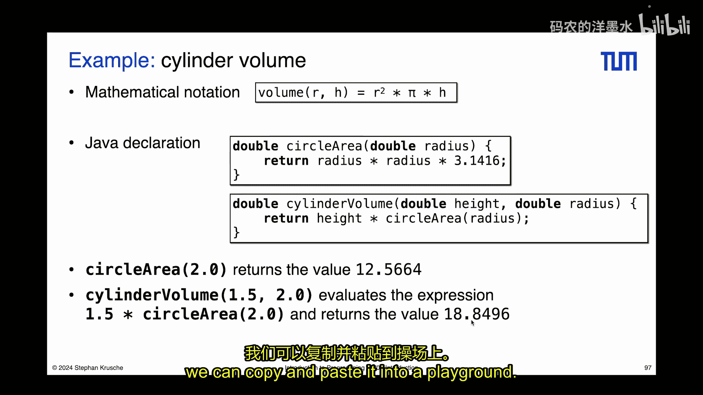

Now， if you don't understand that， we can copy and paste it into a playground I was able to resolve the issue that we had beforehand。

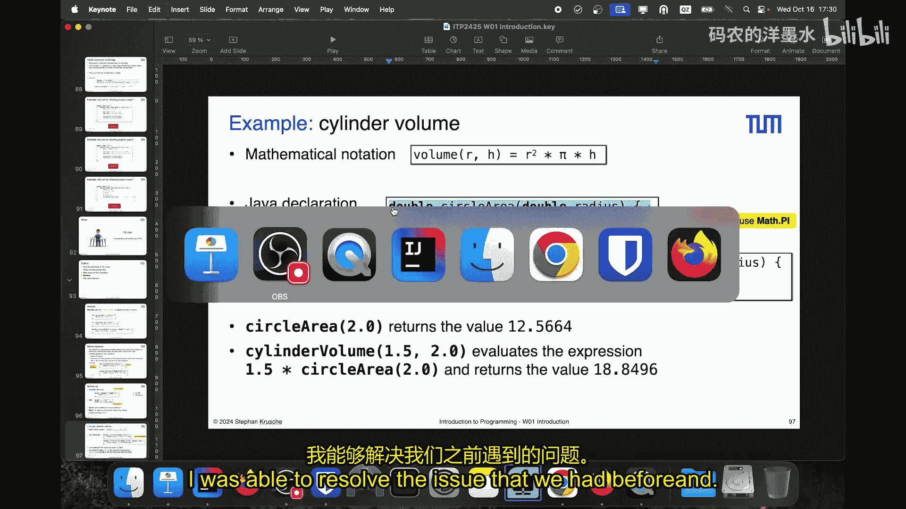

So let me go into my playground class， get rid of this。

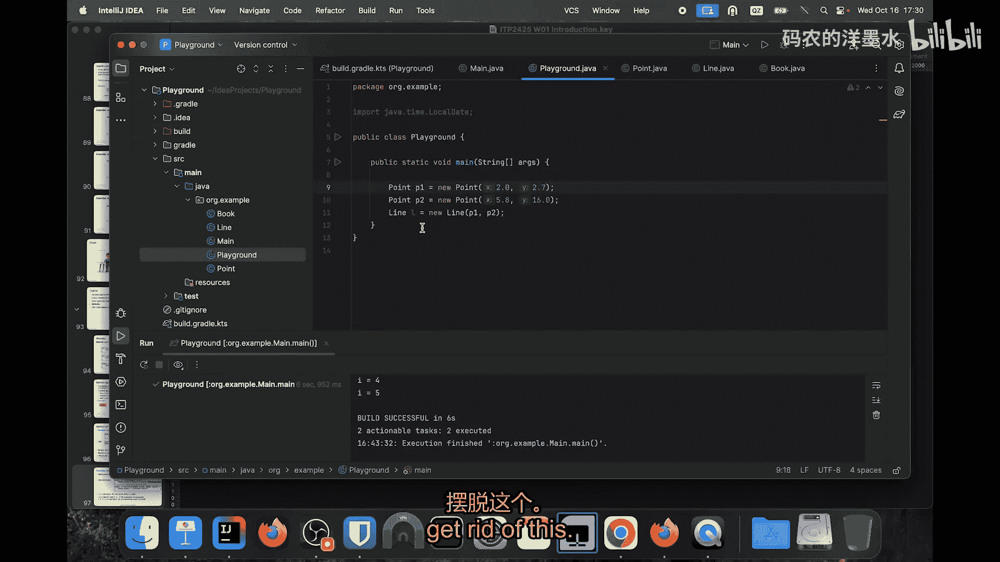

And now I define circular area and cylinder volume based on how we did that here。

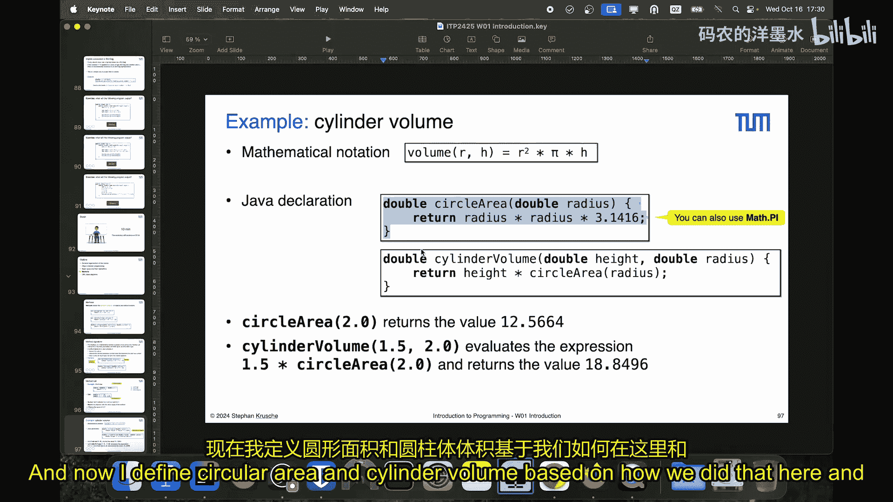

And what I need to do now those are dynamic methods， as I told you before。

 I need to create a playground。Object， the up equals new。Playground， here we go。

 And then I could say playground cylinder volume。 and we wanted to evaluate。1。5 N。2。0。

And now we can put the break points to see how that works。And if we debug the application。

 we'll see that the program actually evaluates this one and then evaluates this one here we have a method called。

 we can also do that in Inche with command， click or control， click。

 and then it jumps right into the method。And now we stop the calculation at this particular point in this method called。

 so what you can see here now is the debug。Area， and in the debug area。

 we can see all the values that are currently valid。

 This is the object in which we are currently in playground。

 This is the one that we initialized up here。 It's just a reference。 doesn't have any values。

 no attributes。And additionally， we have the actual parameters of the class where you can see the concrete values。

 1。5 and 2。0 that we have passed in here。Now， when I debug。

 I can jump into the next method call Yeah， So even if I don't have a break point here。

 I can jump into it。 and now you see hide it is not available anymore because I'm in a different method context。

And in this method context， only radios and the out outer object with its attributes that are not existing is available。

 so only radius is available。I can calculate the value， go back。

 and now we have the value here for circle area。 It's inserted into this calculation。And we have 1。

5 times 12 point whatsoever。And then we return and now as we don't save the value。

 the value is actually lost and we don't see it in our program。Or do we need to store it？ Well。

 we could say double。And this was the volume。 So we abbreviated with V equals。

 and then we could say system out print line。We and we do it a bit better。 We say volume。Plus we。

 so that we can also see that。 And now if I write again， you see 18。

8496 is the one that you get here。I hope you understand it， we have a nested method call here。

And this is hardworks。 Now it's a bit cumbersome that we have to create the playground object here because we're not really using the class at all。

 You can circumvent that and see that the main method is actually a static method。

 So it's defined on the class level。 you could also define those methods as static。

And then we can get rid of the playground and directly invoke the method as well。And。If we do that。

 yeah， let me。Debug this again。 We see that then the context of this that you have seen before here in the debugger is not available anymore。

Okay， that's the difference between dynamic and static methods。

 So even if you've not covered it yet in the slides， you should have a rough understanding on that。

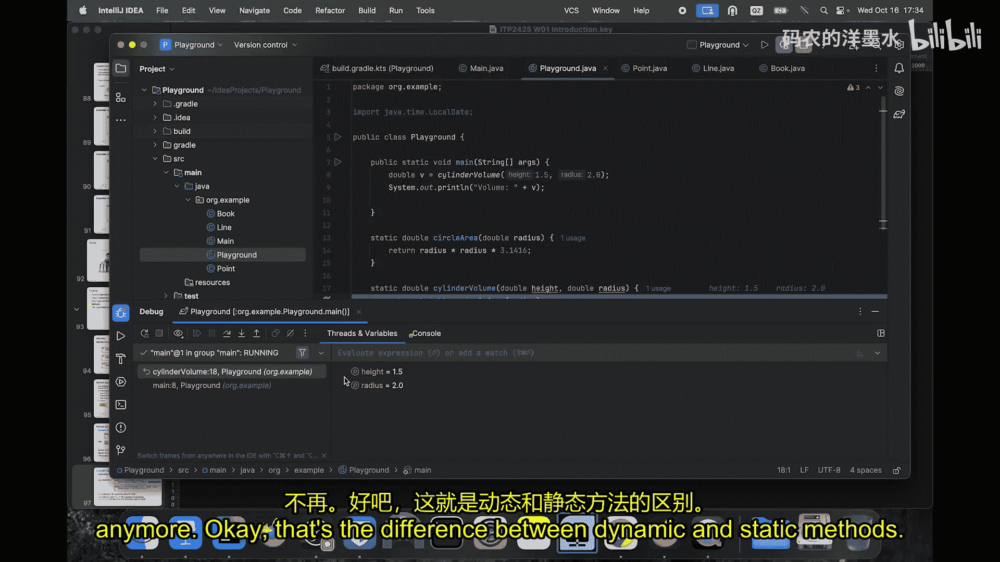

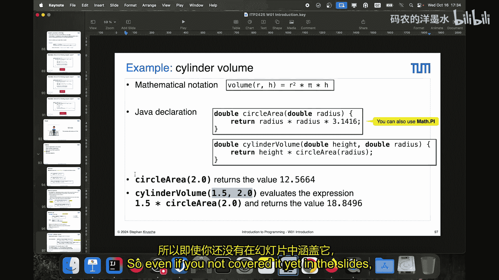

Let's continue， we've seen constructors， constructors are nothing else than special methods that initialize the object by reserving memory based on the new operator。

 constructors do not define a return type because they don't really return anything in the program here。

 but they kind of automatically create the object and return it。

The formal parameters can use to initialize the object as we see it in the rationale class where we have formal parameters and and to initialize the numerator and the denominator。

Now， we've also said that sometimes you have methods that do not return anything。Then you use void。

If you have void， there is also no need to have a return statement。

If you have a return time like here and you leave out the return statement。

 you have I just say double area equals。

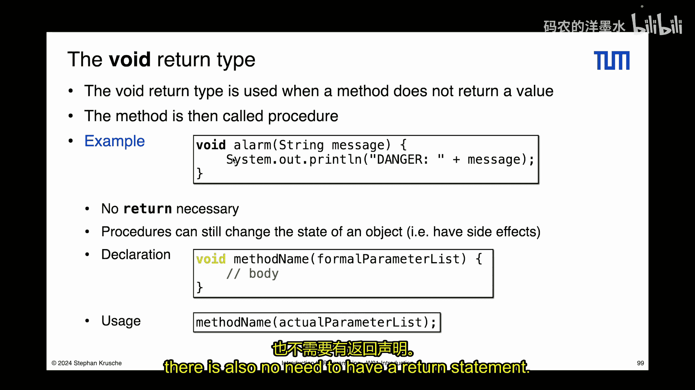

Then you will get an  error message here。 missing return statement。 I need to return something。

If I declare this method as void。This。Arrow message disappears because a void method doesn't return anything。

So that's your choice。 You design a method， but you need to stick to the rules。

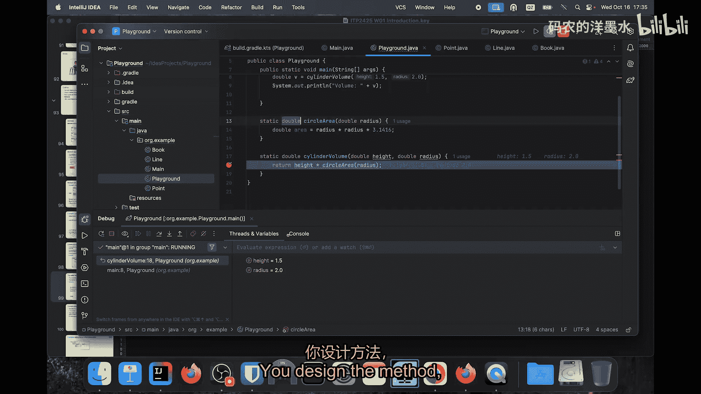

A void method can still change the state of an object if it's a dynamic method so it can have so-called side effects right so I can。

 for example， change the value Yeah let's assume I have a person that has an attribute age and I celebrate birth date and celebrate birth。

 it simply prints a nice message to the console and increases age by one then it can be a void method。

 but it still has the side effect because if I invoke it the person is one year older。

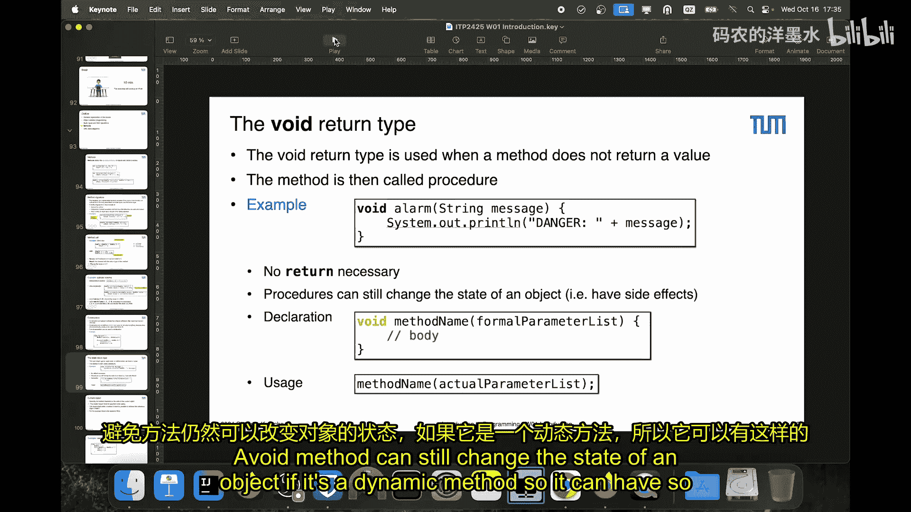

Right。Boid methods cannot be assigned to a variable because they do not return anything。

That's important。You also talked about this， this keyword。

 normally dynamic methods depend on the state of the current object。

 except you have those pure functions that you can define as static and when we explicitly want to refer the current object。

 we can use this keyword。We've seen that before with the constructor in the point here we have to use it because the formal parameters and the attributes have the same names and otherwise we could not distinguish them。

There are also cases where you can optionally use it。 So if I go back into the my playground。

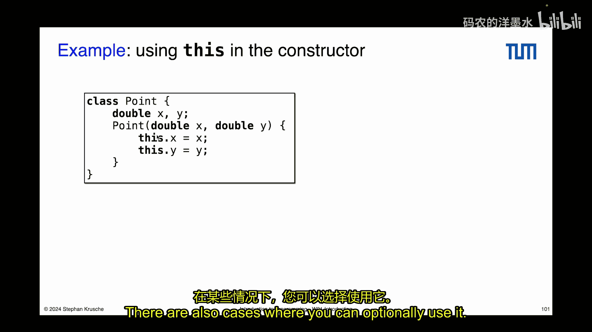

And。Get rid of this for a moment。So I don't have any compile errors。And I go to my point。

 So even if I call this x1 and y1。I could still use this operator， but it's optional。

 I could also leave it out， right， And some people prefer to use this because it's more explicit that they actually access this object of the current method。

 Some others say， leave it out if you don't need it。 So best practice。

 as our recommendation is only use it when you have method calls or。😊。

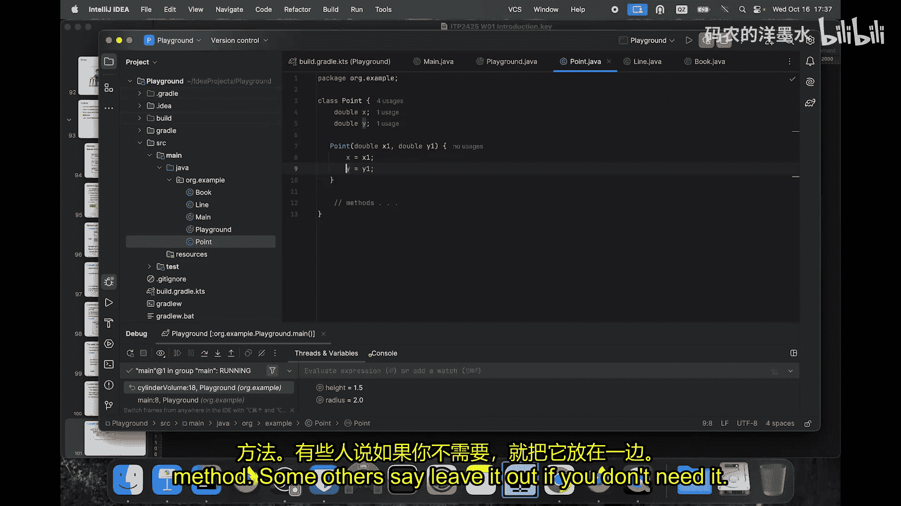

Constructors where you use the same names and where it's really obvious。

 otherwise leave it out because many people completely understand that if you access attributes in a method。

 there's no this key necessary。Here's another example we can define another object method in our point called shift shift simply adds additional values to our X and Y coordinates of the point。

 so by shifting a point， we move it in the coordinate system。By adding Dx and D Y。

 and this is how you could do it， notice that in the shift method。

 we could leave out this as well because it's obvious that you refer to the attribute because there would not be any local variable or formal parameter X that is valid here。

Now we can create a point with the coordinates3 and4， and we can shift it by2 and4。

 and this would result in five and8 as the new coordinates of the point P after invoking the method。

You can also try this out in your playground and use the debugger as you've seen it before in order to better understand this。

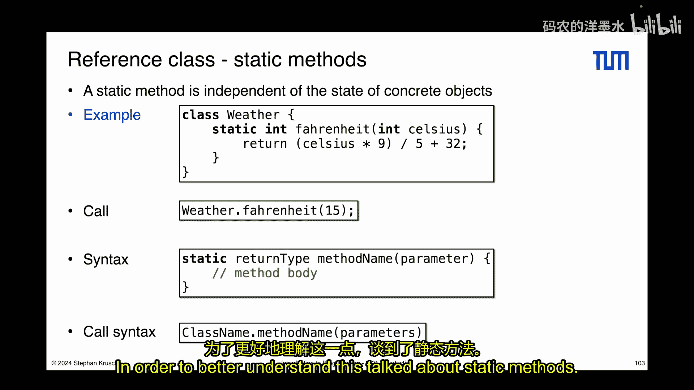

Talked about static methods。 The main method。 The entry point in Javava is a static method。

 So you have to deal with at least one static method。

 but you can also define your own static methods。 for example。

 we could say the Fahrenheit conversion does not really depend on an object， you can always do it。

 So we put it into a class whether it still needs a class context。

 So either you put it in playground main or in weather。

 And then you can invoke it by calling weather dot Fahrenheit。 So there's no object involved。

 but you have to use a class name， except you're in the same class。

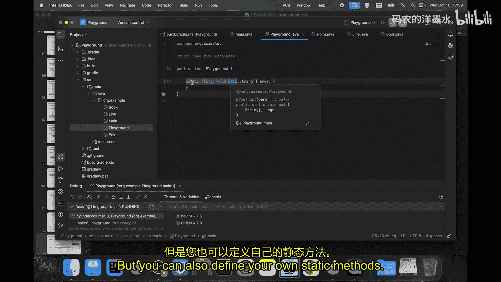

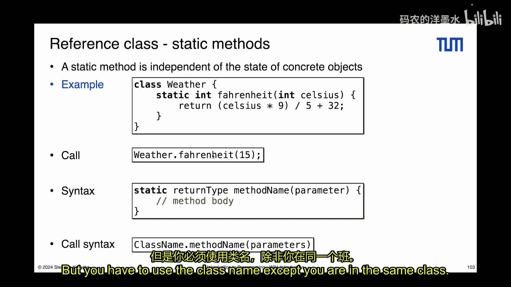

RightSo if I go back and let's see if I still have to code， Yes， I still have to code here。

So those are static methods and you see I'm in the playground method。

 so I don't need to write playground dot cylinder volume。

But if I would access this from another class， and here I can leave it out。

But if I would access this from another class here， maybe from the main class。Then it would not work。

 Yeah， And then I need to write playground dot cylinder volume， because otherwise。

 Chava does not know where this method is coming from。

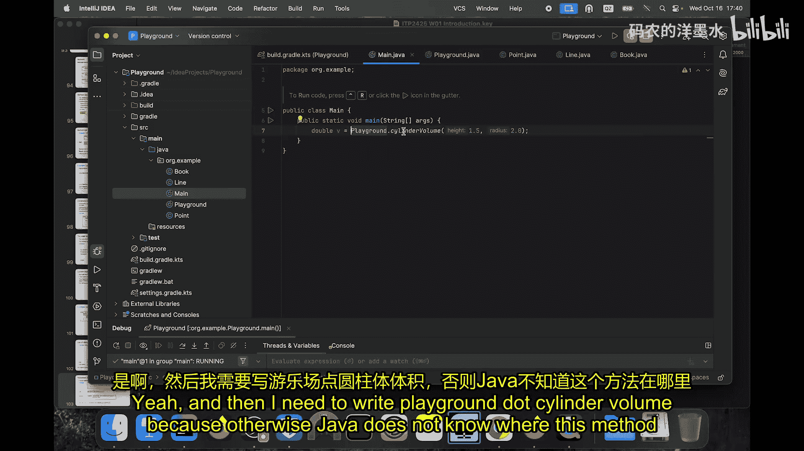

So typically if you have a static method， you always use class name， dot static method name。

 and quick questions to you， can a static method have side effects on an object？

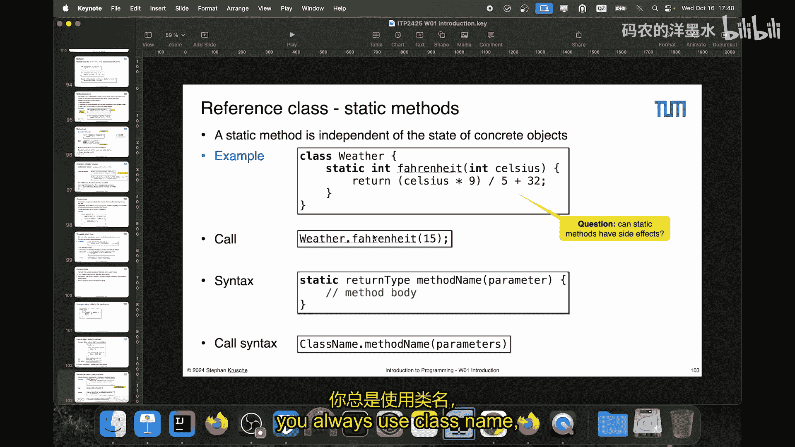

What do you think？Who thinks this is possible， Who thinks static methods can have side effects。

Few who or few think that static methods cannot have side effects。Who has no clue。Okay， so。

Side effects always appear in terms of objects。Athe method refers to a class there no object involved。

 so a static method cannot have side effects。That's the idea。We've seen the main method。

 which is aesthetic method， the main method has this string array with multiple arguments。

 and this means that you can pass multiple arguments into the method basically as many as you want。

And then。If you compile each of program， the main method will automaticallybe be involvedvoked based on the arguments that you pass to this program and those arguments P1 to PN are then stored in this so-called array。

 string array where you can have multipleable arguments after each other。

 but we'll explain you what arrays are in the next lecture。

 so I'll keep that short to not overload you for now。

Here's an example for a very simple application called in the playground and what you can see here is that we already introduce if and else those are also topics that become a next workshop or next week and what we basically do here is we access the arguments of the main method here if you're interested in that copy and paste it into In chain and then you can try it out。

 but for now I'd like to move on due to time reasons。

 but what you can do in Inch that you have a run configuration。

 I'll show you how to access this one here you simply click here and say edit configuration and then you have a run configuration and then you can pass program arguments and with this it's possible that the person who's using the program can customize it by passing certain arguments to your program and then you can act based on the。

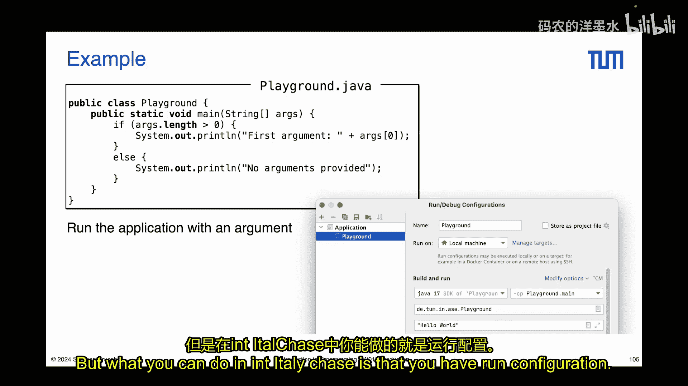

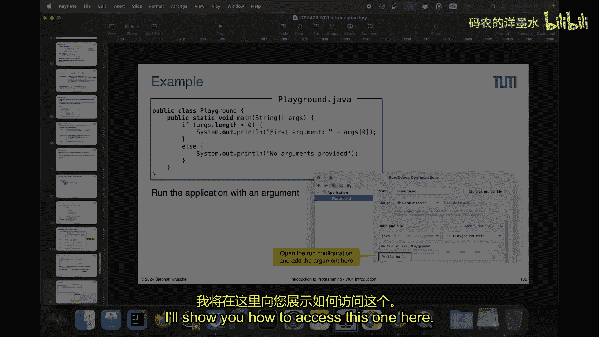

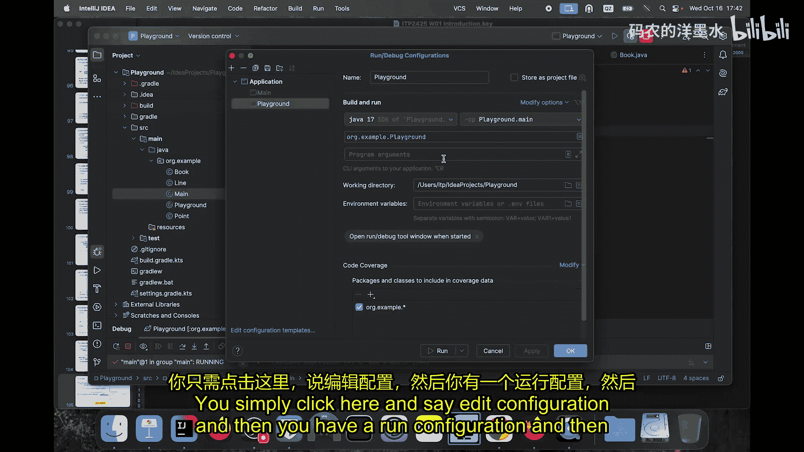

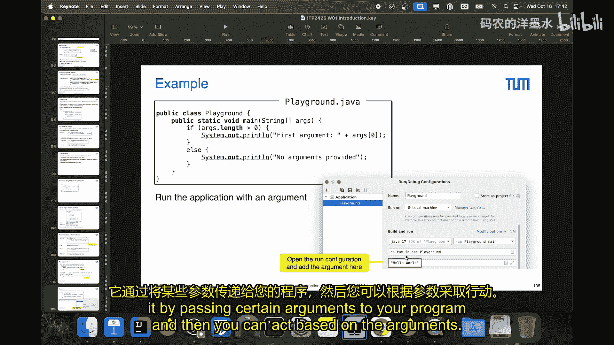

It's given by the end user。Great， another example for method calls。 we want to move points。

We've already seen the shift method， we've implemented it。

We can also create so-called get us and set for x and Y in order to make those available to the outside world。

 those would simply return X and y。 So it's nothing very special but now the interesting part comes we do not only want to move points。

 we also want to move lines。 How do we move lines Well。

 we create a shift method past D X and D Y as double。And in order to move the whole line。

 for example， up five points and to the right five points。

 we simply need to invoke shift method on P1 and P2。 and this is how you would realize it。

So one method call。Can actually be implemented by calling other methods again。

 an example where you have nested method calls。 And in this example。

 even multiple objects are involved。 Now， we have the class point and the class line and the method shift in the class line invokes the shift method on the point。

In the point class。Two times。 again， if you copy and paste those two classes here。

 the class point and the class 9， you can debug this in order to better understand what's going on。

One important aspect for Cha is that we have references and how does Cha deal with those references in method？

Well， Chava only uses the so called call by value for passing parameters in method callss。

 and the definition of call by value means that when you call a method。

 all statements in the parameters are first evaluated completely。

So that we can have actual values as arguments。And those values are then statements or the values sorry the values of those statements are passed as a copy to the called method。

Now， when it comes to primitive well use。A copy of those is passed to the method。

And the original value can't be accessed。Now， when it comes to references to object data types。

 a copy of the reference is passed。But this means we can still manipulate the values of this object。

We cannot manipulate the original reference， but we can manipulate the attributes。

 So it's possible to pass an object。Into a method， manipulate the object based on the copyied reference。

And then after the method， still work on the manipulated object。

What we also need to understand are local variables。

 local variables in methods act as auxiliary memory for intermediate results。

 and they are core stored on the so called runtime stack。

And the runtimet only exists as long as the method exists。

 so if you declare a variable radius square， it only exists from the beginning of the curly braces or from the statement when you create it until the end of the curly braces afterwards you cannot access radius square anymore。

 and you can only access values that you basically return as part of the method call。

So when we have this method through here and we pass an integer A， we could theoretically。

Use a and assign it another value。 This is something that you can do。

 even if it's bad programming style。But if we return it afterwards。

A will not be available anymore because we use a copy of the original value。

 So if you assign a value here。It doesn't really make any difference。 Yeah， Of course。

 if you use it in further computations， Yeah， it makes a difference。 But outside of the method。

 it has no influence。And。If you do that， this is considered bad programming style。

 So whenever you have an input parameter in a method。

 you should not change it as part of the method implementation。

So differences between local variables and attributes。

 a local variable is only available within a method call。

 while an attribute is also available outside of a method。

 basically the lifetime of the associated object。The local variable allows us to cache certain values for later computation。

 while the attributes allow us to create a state for the objects and to be available for all the methods of the class。

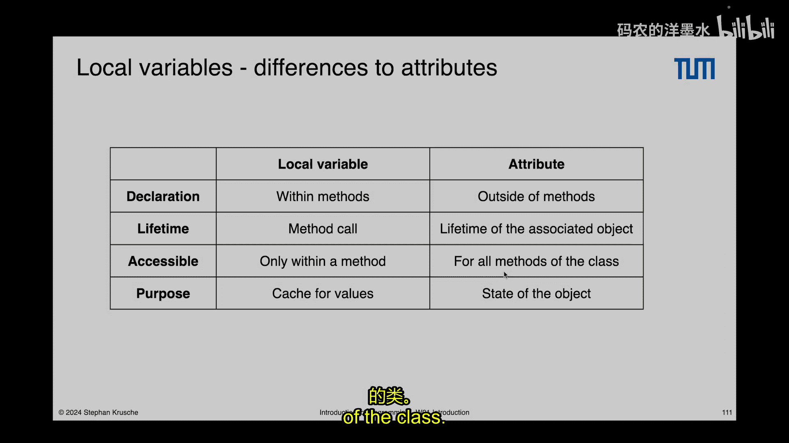