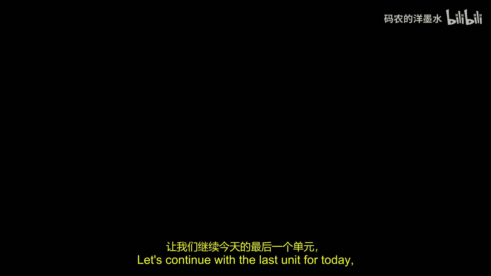
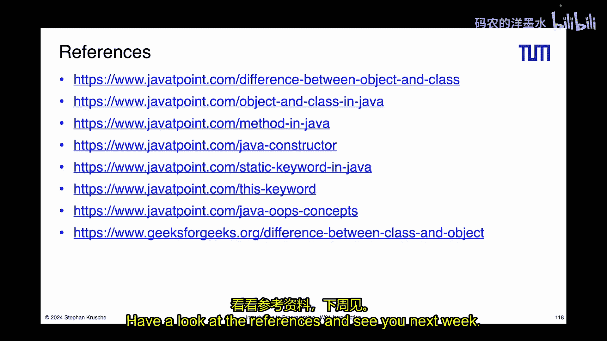

# 【全集】慕尼黑工业大学 计算机编程：从入门到实战 中英字幕 p08 Lecture 8 - UML 类图 -BV1WFrTBZExY_p8-

Let's。

Continue with the last unit for today and this is a rather short one， so we'll finish before six。

 and this is about UL class diagrams。We already have seen them in the beginning when we talked about books and libraries and they are basically a graphical representation of the program here you could see a graphical visualization of the rationale class that we discussed before。

 a rationale class with its name and its attribute numerator a denominator and certain methods。

And for the methods， we can also define the signature with the name and the input parameters and the return type。

Now we can also。Have multiple objects connected with each other。

 And this is the power of such class diagrams because we can understand the structure of the code by looking at a visual representation that is much simpler as the whole code structure。

And software developers and programmers use it in order to communicate about what the program does and what the structure of the program is。

While this is not really necessary if you just have a single class。

It really makes sense if you have multiple classes to understand how they interact with each other。

And UML is not specifically developed for Javava， it's also applicable for other programming languages and that's the power so in every programming language you can use UML in order to define the main structure or the main dynamic behavior of the program。

 they are much more diagram types than class diagrams。

 but for now we focus on class diagrams in order to represent the structure of the code in terms of classes。

 attributes， methods and relationships between those classes。

Here's an example for a program that we already created， we have the class line。Now。

 the line has two attributes point。 P1 and P2， those are represented with the。

Relationships here with the references or associations。It has a method shift。

And a point has also a method shift。 and we could implement another method rotate， for example。

And by looking at this little UL diagram， if I understand the syntax behind it。

 I can immediately understand what the program is about without looking at the code。

And that's basically the idea here。Great， so much about UL class diagrams。

 We will use them more often， and I'll show you more examples in later workshops。😊。

What are the next steps after this first initial encounter in this course introduction to programming。

 well we will publish the tutorial group exercises and we kindly ask you to work on those as part of your tutorial groups we kindly ask you to get your setup for your preferred integrated development environment done in the first tutorial group。

 make sure that you set it up so that you can use it。

 we'll also show you how to participate in those exercises in ArtemIS。

And what you need to do in order to use Iis in order to get AI help in case you're stuck or you do not understand what's going on。

You also get some homework exercise that you can start working on if you have no clue how to get started。

 you also might want to use IIS or communicate on artemists with your fellow students and tutors they can help you。

 and we also kindly ask you to read two articles about the essentials of programming。

 object oriented programming and methods。I can only explain it to you once in the lecture。

 but I cannot integrate all the different perspectives。

 So it's important in my opinion that you read an online tutorial。

 This is what many programmers do later on when they learn more advanced concepts。

 And this is also something that you can do as a beginner。 So please， please。

 please read those articles until next week。 All those exercises， the tutorial group exercises。

 the homework exercises and readings are due until Wednesday October 23 next week。1 PM。 And remember。

 at 2 PM， we will have a quiz。 Okay， don't be surprised。 we will have a little quiz。

Summary for today we talked about object oriented programming， basic data types。

 methods and UL diagrams， all the basics that you need to get started。

 I know it's overwhelming but keep it up you will understand it soon。

 thank you for listening have a look at the references and see you next week。

