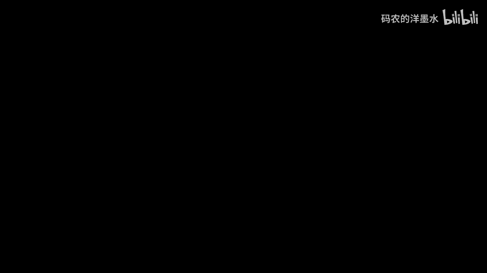
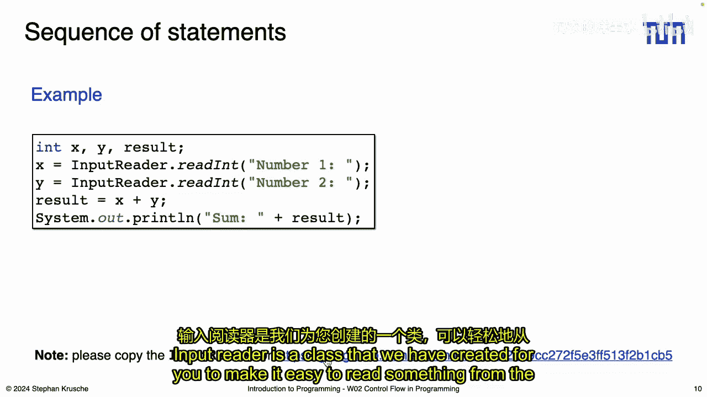
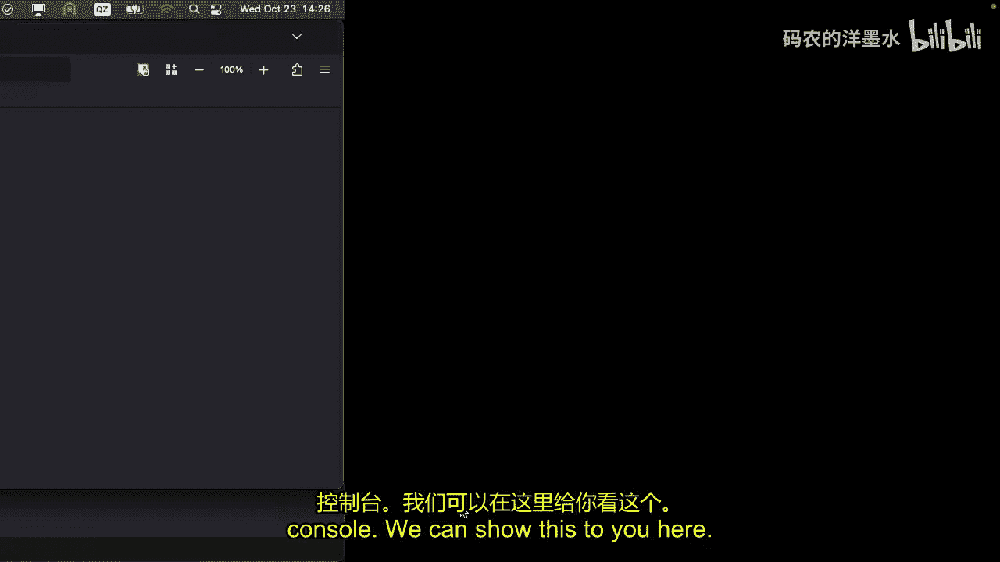
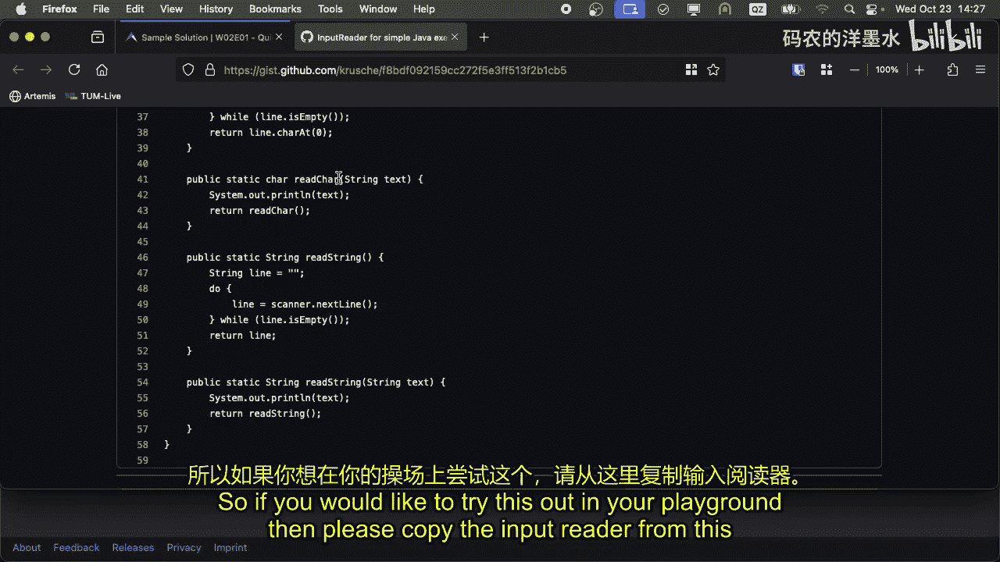
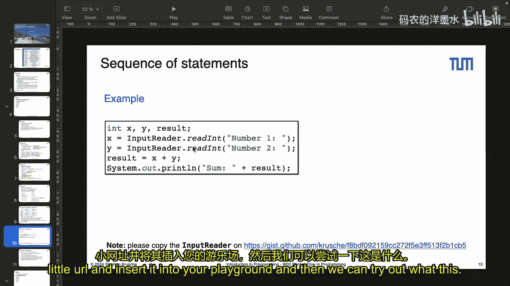
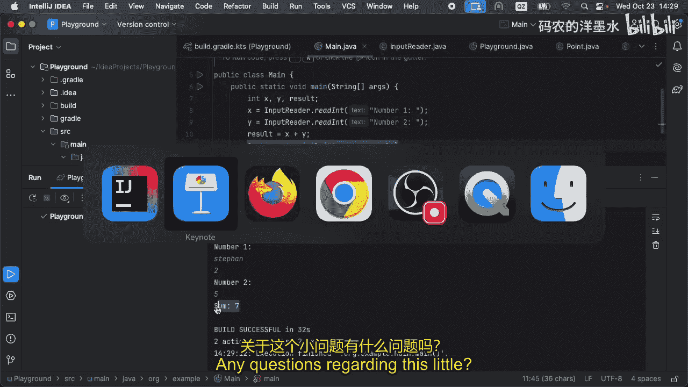
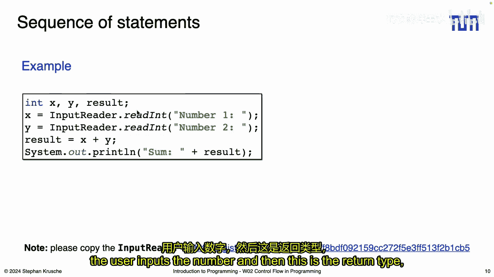
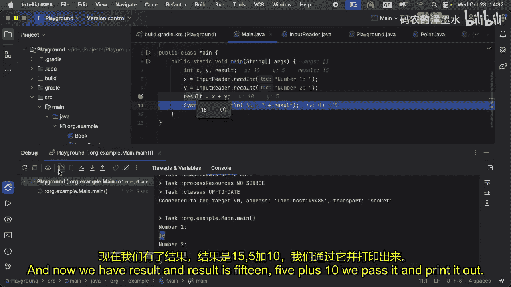
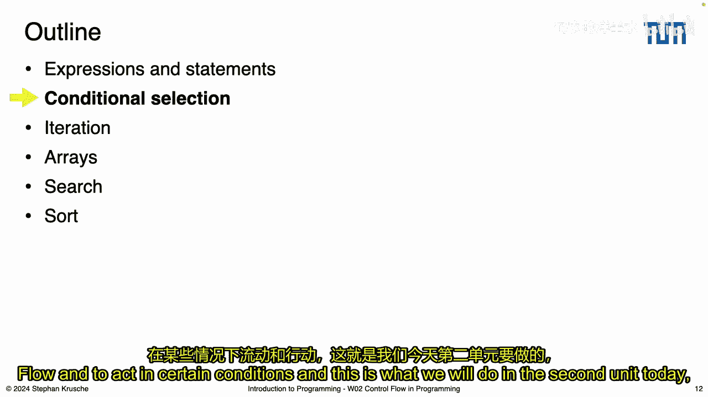

# 【全集】慕尼黑工业大学 计算机编程：从入门到实战 中英字幕 p09 Lecture 9 - 表达式与语句 -BV1WFrTBZExY_p9-

Thank you and welcome to today's workshop in the course introductiontrouction to programming。

 we will talk about control flow today。This is our second workshop we started with an introduction last week where you got to know the general course concept and where we talked about object oriented programming。

 all the basics， how we create classes， attributes。

 methods and constructors and how we can instantiate objects。

 instances of classes and how we can invoke methods on those objects， today。

 we will talk about iteration and。About conditional selection。

 so we will learn if else statements switch statements for loops and Y loops as the main concepts。

So we assume you have a good understanding about the previous concepts in particular about instantiating objects and invoking methods。

 and today we'll talk about if and switch in more detail so you should be able at the end of the lecture to implement conditional statements so that you can have a control flow in your program。

😊，We will talk a little bit about null， a nasty little thing in programming that you will deal over and over again and that will lead to many headaches for you in the future and we'll try to equip you with a couple of tools so that the headaches get reduced it's like a little pill or drug so that you can hopefully reduce the headaches based on null values。

 we will talk about loops in particular four while and dovi loops and at the end of the lecture you should be able to implement them for simple algorithms on your own and we talk about a new data structure arrays that allow you to store multiple elements of the same type in a data structure。

Let's get started this is our outline for today and we'll start with a little bit of theory about the differences between expressions and statements in programming well to better motivate why this is necessary lets。

😊，Think a little bit about what a programming language should offer us。

You need data structures in order to store data， so the programming language needs to offer us those data structures。

 it should also allow us to invoke certain operations on those data structures。

 you learn very simple ones with basic data types you can use mathematical functions like plus minus division multiplication those are operations on the data types and then the programming language also needs needs to provide some kind of control structures for you to。

Deal with certain situations and with certain conditions， because sometimes based on the conditions。

 you would like to execute different code。And this is what those control structures are for we've already looked at first data structures and operations in particular basic data types we will learn more data types in the future and more operations for the predefined data types like strings in the future and those control structures that you need and basically use statements and expressions so let's first think about what is actually an statement and what is actually an expression expressions appear all over in your program and you have a couple of examples here。

😊，Basically on the right side of an assignment， if you write int X equals on the right side there can be an expression。

 it can also be just a value， yeah you can say in x equals 2， but it can also be an expression。

 something like2 plus2， and then the result is assigned to the variable on the left side。😊。

An expression can also be part of the argument of a method。

 we've seen method in vocations with the input parameters and the input parameter can just be a value。

 can be a variable or it can also be a full expression so I can also write I invoke function F and I say 2 plus2 here and 3 plus3 here and then this expression will be evaluated and then the result of the expression will be inserted into the input parameter of the method。

😊，You can also use it in the body of the function or of the methods and doing any kind of calculations and for example。

 also as part of the return statement， so if you return something。

 then there might be an expression that is evaluated。😊，Each expression has a type。

Only then it can work out。 we have a couple of examples at the bottom of the slide here。

 the first one is of type double 3。0 plus y。😊，In rounded braces。

 so the plus operation is executed first and then times 4。

0 and this is an expression and the read result is A double， no matter what y has and value。

 y could be an end， why could be a short， it will result in A double。

Then we have expressions for strings here we concatenate strings and we have seen that before as well。

 and you see that there's also an automatic conversion of the int at the end here into a string and this is also an expression of type string。

😊，The new operator is also leading us to an instance that has a type yeah。

 so this can also be seen as an expression of type point and if we compare x equals equals2。

 which is something that we will use later on an if statements， then this is a Boolean expression。

 so keep that in mind， whenever you have a type we call this an expression。😊。

Expressions are composed of variables or attributes。They can be。Composed of function calls。

 you can use the new operator， you can use any binary operator like plus or minus to create one or also so-called unary operators like for example the minus if you have minus Fahrenheit of 15 then first of all Fahrenheit 15 will be evaluated。

 Yeah let's assume I don't know what the value is， let's assume it's 23 and then it's minus 23 at the end and this is then as so-called unary operator。

They are also。Other expressions in Chava which we will learn at a later point。

 just to give you a glimpse， you don't need to fully understand them right now。

 we can use instance off and we can use a so calledled ternary operator as a conditional expression。

 but as I said you don't really need to understand them now it's just so that you have seen those are also expressions in Chava。

😊，Then on the other hand we have statements， statements typically cause a change of a state of an object。

 but it doesn't have to be the case here， sometimes it is the case， sometimes not。

 they should end with a semimic colon。And do not have a type， but they can consist of expressions。

 That's basically the idea。 A declaration of a local variable is an。Okay great。

 he's going the other way around and a declaration of a local variable is a statement so if you write in X。

 even if you do not initialize it， it's a statement if you assign something if x is now assigned to a value based on the variable y this is also an assignment and while the right side could be an expression the whole thing including the semimicolon is a statement。

😊，A method call is a statement if and only if the return type is void。

 otherwise it would be an expression that you could assign to a local variable a so-called block statement。

 this is what you do with curly braces where you have a method call and then you have curly braces and then you can have multiple statements after each other here we have statements and we also have the return statement as a whole。

😊，You have an expression here， but the whole thing return expression semi me call on that's a statement okay just to get clear here and to keep that in mind so if you compare it an expression always has a type while a statement does not have a type and expression is used to calculate something typically because you have a result value in the end while a statement is typically there to execute some code and potentially execute a couple of expressions as well。

😊，The expression typically evaluates something and produces a value。

While the statement has the main purpose of changing the state of the program。

The expression is without a semi colon and the statement is with a colon as you've seen statements may contain expressions that's for sure and the body of each method and also the block for each if statement else statement and so on that we will see later on is a sequence of statements so whenever we have those curly braces you can have a sequence of statements after each other and in Javava the convention is to have just one statement in a line with a semi colon and then the next statement is on the next line you could potentially also write five statements into the same line but this is bad practice because then the code is hard to read and we would like it to be easy to read。

😊，There's a small exception that you need to understand they are also so-called expression statements。

 these are statements that can also be used as an expression at the same time and we will cover this at a later point when you have this double plus operator it basically means I equals I plus one so while we actually increment I by one which is an expression it's also a statement in the end and it needs a semimi colon but don't worry about this this is already a bit more advanced and we'll use that a bit later。

😊，Here's an example of a sequence of statements so that you are a bit familiar how this can be used in practice。

 we basically initially or sort declare three variables， x， y and result。😊，Without initializing them。

 So they all have their default value。 Who if you knows what a default value of an int data type is。

 any ideas。Now， like。The novel in Chava or。A basic data type cannot become null。Yeah。

0ero exactly zero is the default value so if you declare an int and you don't give it a value。

 the program makes sure it has a value because all basic data types need to have a value they can't exist without a value and we also don't want the previous memory still be written in there that would be a security issue。

 so Javava or any other programming language makes sure to initialize it and here we have zero as a default value。

😊，And then we use input reader inputread is a class that we have created for you to make it easy to read something from the console we can show this to you here this is a little file that we have online we have different versions of this it's not very consistent but the main idea is that we use some buildin functionality。

 the so-called scanner class in Javava in order to read an integer from the console and to parse the console which is typically based out of strings into this integer now this is what this parse method does can also go wrong so therefore we catch certain exceptions and then you can basically use this and there's also read a character or read a full string so you have a couple of convenience methods so if you would like to try this out in your playground then please copy the input reader from this little URL and insert it into your playground and then we can try out what。

😊。

This code is actually doing。 So let me open Inche。And open the playground。And then I。

Copy and paste this whole file。And In Teleliche， you know a little trick。

 I can just click on my package here。And paste this。

 And if there is already a class definition inside， Java will automatically do that。 okay。

 I didn't copy everything。 so that's not good。So let me put that in here yeah。Great。

 so you don't need to fully understand what input reader does。 Yeah， just take it as a black box。

 so to speak， Yeah which works for you。 And then in my main。😊，Class with the main method。

 I can also copy and paste this code here。And then we can try it out and we will see we read a first number from the console and assign it to x。

 so we have an expression on the right side and the value is assigned to x and the whole thing is a statement。

😊，And then we do the same for y， and then we sum up both values and we print them again to the console。

 So let's see how that works。 Let's run the program。 I hope it works。😊，And now， you'll see that。

This is something where you have to interact now for your first interactive program and after some console statements here you see that there is this number one and now I can type in any number that I want I can also type in some illegal values yeah。

 so maybe I say Stean should be the number。😊，This won't work。

 yeah unfortunately there's no error message here so I can do another one， let's say two。

 this worked， and now I use five， this worked as well and the program will then calculate the sum and print it to the console so the sum is7。

Any questions regarding this little？

Example program of the input reader。Anything that is unclear， Yeah， go ahead。Okay。

 so the question is， how does that exactly work。 So again。

 you don't need to fully understand what this input reader does。

 I'll explain you just the basic things。 You pass the statement that is。

Print it to the console for the user。 You pass this here。 Yeah。

 because maybe you have a more specific request to the end user。 Maybe you don't want a number。

 Maybe you want a string。 Maybe you want a name。 Maybe you want a。

Po lights cell in Germany yeah or something like that。

 Yeah so we give you the opportunity to specify what you want here。

 you specify that and the input reader does the magic the user inputs the number and then this is the return type right So if you doubleche that it's a static method you can see that because it's written in italics and if you click on it you see public static int read in so you should already be able to understand that even if you don't understand all the details but you should understand that this returns and integer value。

😊。

So we give it a string， this is printed to the console and then it reads the integer however it does that and it returns an in to our program right and we can' ignore that we could also just write it like that then it's a pure statement。

😊，But we can also use it as an expression and assign it to x and then x gets the value that the induceuser is putting in here。

 so I first tried it with my name， didn't work。😊，Then I tried it with the2， and then x will be 2。

And then I say number two， yeah the user puts in five and then y will be5。

 and then you say x plus y2 plus 5 is 7， and then we use the result。

 put it in here and then it says sum colon space7。That's basically the idea so make sure that you are able to copy and paste the code in your program in your playground and try this out yeah you can also debug this yeah if you would like to better understand it open set a break point here in the lines and open it in the debug mode and then you'll see that we still need to。

Potentially pass something here。 Let's see what's going on。Debugging typically takes some time。Yeah。

 I think。Let me double check。Yeah， I was already in the line here。 Yeah， and then I can say。

 I don't know 10。Enter。And then you see number two， Maybe we'll do a break point here。

 And now let me try out if a float is working。 5。0。 No， it's not。

But five should work and now we'll stop here and then you see x is 10。

 another input that we have here， y is5 result。It。Potentially0 with the default value。

 but the debuger can't really use it。And now we have result and result is 15，5 plus 10。

 and we pass it and print it out。

Great。😊，So much about this little example。Some additional theory。

Make sure that only one operation is performed at any time and because our program runs sequentially for now。

 it is possible to write concurrent programs and to execute multiple operations at the same time。

 but this is out of scope for now we will cover this later on so now assume that only one operation is performed at any time。

😊，And each of those operations is performed exactly once after the other， one after the other。

 right so none of them is repeated， none of them is emit。

 and the order of execution is completely defined， so it's not very flexible right if we have certain conditions。

😊，We can't really work with this at the moment with the things we learned until now and at the end of the last operation the program quits。

 the execution is finished， you also see that and that's it so we need more powerful control structures in order to implement control flow and to act in certain conditions and this is what we will do in second unit today conditional selection。

😊。

