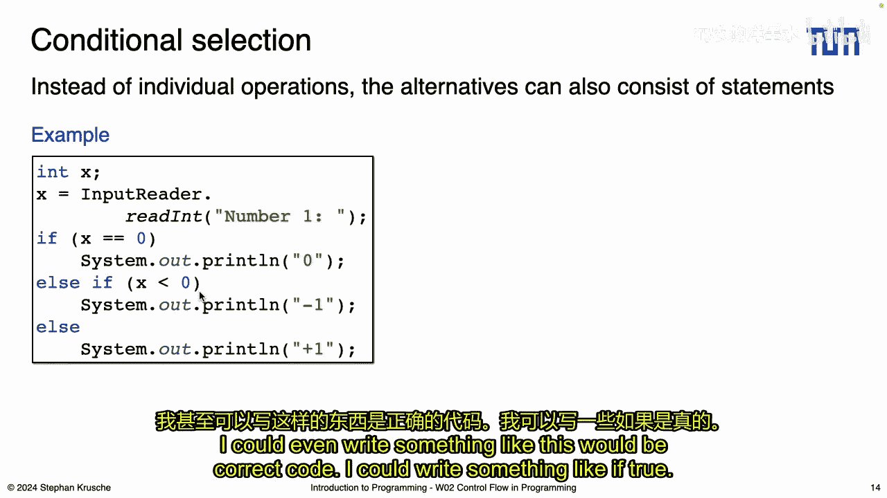
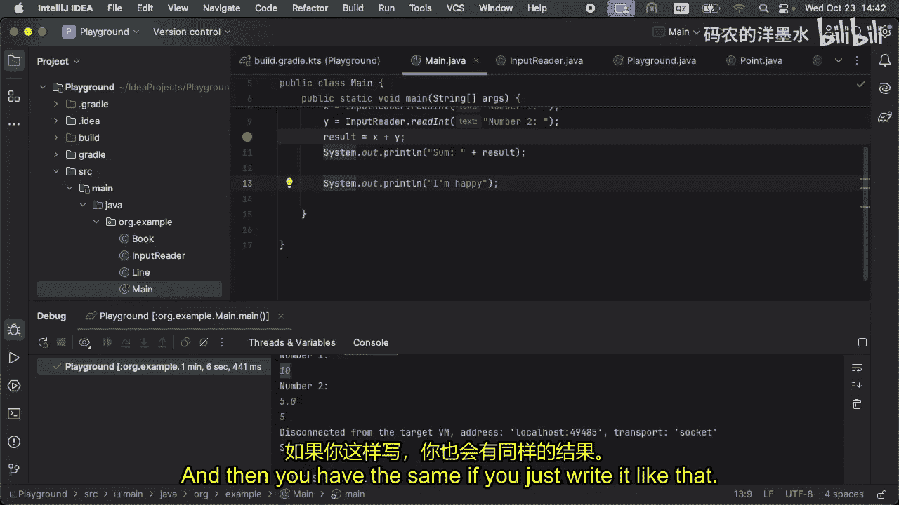
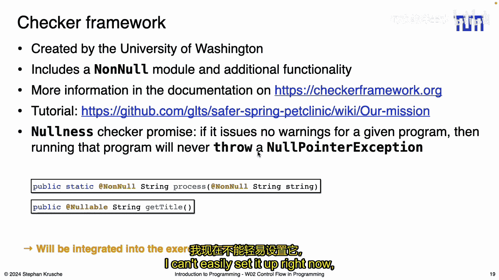
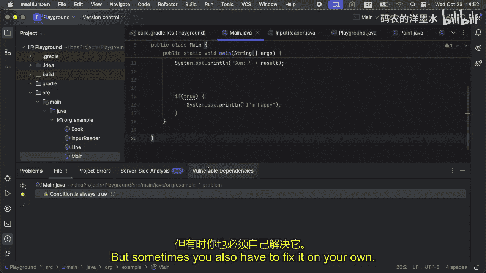
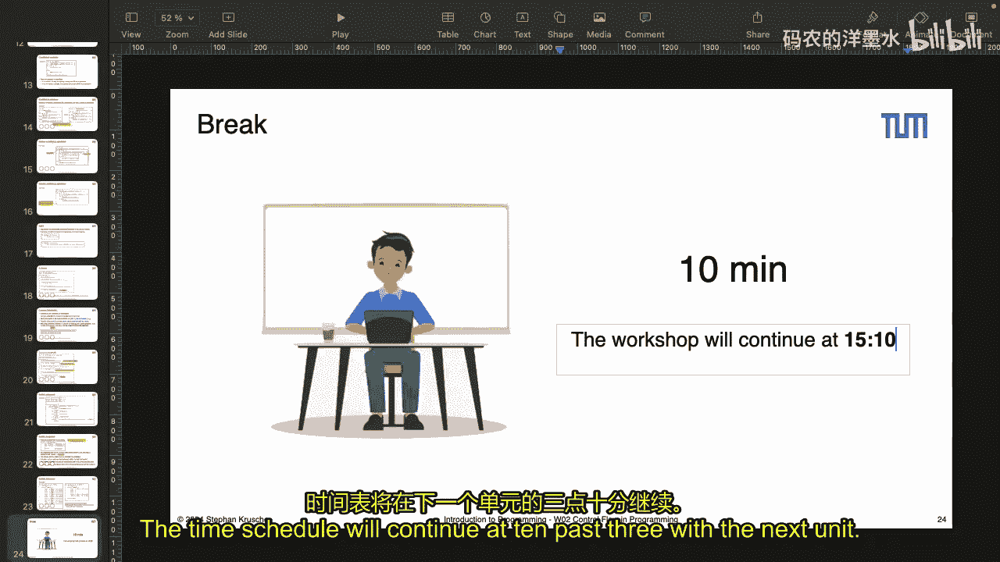

# 【全集】慕尼黑工业大学 计算机编程：从入门到实战 中英字幕 p10 Lecture 10 - 条件选择 -BV1WFrTBZExY_p10-

Conditional selection。

Here's an example， we'll start with an example for conditional selection。

 it's basically the same program that you have seen in the previous slide， however。

 after reading X and y we do a distinction based on whether x is larger than y or not。😊。

And you can really read this。In the language， right？ So we produce the same。

or we declared the same three variables， read the values for x and y from the end user exactly the same。

 and then you can read the program in natural language if X is larger than y。

 the program will jump into this。😊，Statement。And use x plus y as an expression to determine result。

If this is not the case， otherwise or else。Will'll jump into this line。And produce the result by。

Invoking the expression X minus y。And then， we print out the result。

And this is basically conditional selection。Might look a bit difficult， but it is really。

 really easy when you get used to it and at some point you don't even think about it anymore。

So the idea is if the conditioner here is fulfilled， we jump into the branch， we open a branch。

 and we jump into it if the condition is fulfilled。😊，If it's not fulfilled。

 we jump into the branch after the LS statement， and while you see that we only have one statement here。

 we have curly brace this so we could again have a sequence of statements。😊，And。

We could also have a so called else if statement， so we could say when we read just one number x。

 we could say if x equals0， we'll print 0 else， if x is negative is if it's smaller than0。

 we print minus-1。And in all other cases。We print plus one。

 And here we could really have lots of different if， else， if， else， if， else， if。

Statements in order to distinguish。Now you see that we do not have curly braces here and that's actually bad practice。

 so even if there's only one statement。😊，You should also always use curly braces。

 this is just best practice when programming Javava and other programming languages are implemented that if there's only one statement you could leave them out but it's quite dangerous because the next developer might just add a second statement and then this is not part of the branch anymore and you might get confused and people just don't know what's going on so my recommendation for you always use curly braces even if there's just one statement。

We can also nest conditional selections within each other。 So in this branch here， when x is not0。😊。

We can have another if else' branch or if else's statement with two branches。

 and within this if statement and its branch， we could have another if else， right。

 so we can basically arbitrarily nest if else' statements into each other。😊。

And while it's not good practice to have too many nestings。

 it can happen that you have two or three levels of indirects and then you see this with those taps here or white space we typically have four spaces or one tap people discuss a lot whether to use taps or white space or spaces but it's typically good practice to have some space in here to make it easier to understand because all the code that is indented is part of this if branch and here we have a second level of indentation and this is then part of this inner if branch and here of this inner else branch and then we also have the outer else branch so the first if statement is the outer condition and then we also have an inner condition。

😊，And with that， it's quite powerful because you can really have a lot of different conditional selections and have the control flow that works best for your program。

😊，So the question is can we leave out else and instead return so you can leave out else。

 I think this is on the next slide yeah so I knew that you were asking this question I can really see into your brain。

So you can always leave out else， but there's no return here。

 return is really reserved keyword for method calls。

 so you don't need to return an if or else statement， you just finish it by closing the bras。😊。

That's basically the if is really a statement， it does not return a value yeah that that's why I call it a statement。

 it's not a loop， some people call it a loop， but it's not an if loop。

 and it's also not an expression。😊，It's a statement。 It does not return anything。

 It does not have a type。NowThis is why we integrated this into the beginning of the lecture so that you really know the terms here。

 when I call it a statement， I mean a statement， right？😊，Yeah， and what do we do here。

 we read two numbers x and y， but we only read the second one if x is not zero so if x is either negative or positive and then we compare x and y and if x is larger than y for example。

 x is2 and y is3， we would print x， otherwise we would print y。

 so we basically print the larger number of the two of them。😊，What happens if both numbers are equal。

Yes， so the answer is y is printed， we would go into the else statement yeah so also make sure that you get those conditions right here sometimes we write x larger than y。

 sometimes we write x large equals y and this is sometimes a bit tricky to get this right you really have to think and sometimes those conditions can also overlap and then the compiler typically warrants you because sometimes branches might not be reachable if I for example check for here if if I already have checked all the possible cases here then maybe the else branches is not reachable anymore or the else if branch here is not reachable anymore it this really depends on your conditions sometimes you can even end up with conditions that are always true I could even write something like this would be correct code。

 I could write something like if true。😊。

System out print line。 I don't know。 I'm happy。And this would be it doesn't make any sense because it's always executed。

 but this would be valid code。 And then I could write else。I'm not happy， also perfectly valid。

 but the else branch is。Nonreachable。 It can never be reached。

 Yeah And this happens sometimes because your logic is not as good as you have thought of。

 And then it will it will war you。 Yeah， So he says condition is always true。 This is the nice thing。

 if you use this integrated development environment。 And this is basically。

Nonreachable code so you could even delete it and you could basically delete this as well and then you have the same if you just write it like that so keep that in mind。

 getting the conditions right is sometimes a bit tricky。

Great， so one thing that is also quite helpful when using if statements is to check for now。

 you've learned already in the last workshop that。😊，Object types。

 if they are not initialized with the new operator。ha the initial value null and on null。

 you cannot invoke any operations and the basic purpose of an object is to create it and to invoke an operation or method on it。

😊，But if you have an object type which is not initialized。

 it's null and if you invoke a method on it， you get a null point exception and while this is something that is clear。

 it always makes mistakes。😊，And it always leads to headaches and issues and even very large and complex software systems produce many。

 many null point exceptions and sometimes programs crash because of that and a lot of money is lost or even in the worst case people are in danger because the system is not working anymore and this is why Nll is considered to be bad in some sense and some programming languages they even have mechanisms to prevent Nll and the inventor of Nll。

 the person who has initially dealt with this and design the programming languages to deal with Nll actually regrets his decisioner to make this possible and he says that so much money was lost based on his decision back then and so many people struggle with this based on his decision that he would actually love to go back in time and change this but of course this is not not possible and you all have to deal。

😊，personnelal。And using if statements， we can at least make sure that the object is null or is not null and then we can safely invoke methods on this object。

 but of course sometimes we forget it and sometimes it's also quite cumbersome to check every object instance。

 is it null or is it not null so we need a better solution。😊，There are different solutions in Java。

 you can， for example， use optionals to wrap null in an object type that is not null in the end。😊。

But some of them are also quite cumbersome I'll show you another solution but before that I'd like to introduce you a little program and this uses a class called PET a pet has a name and a birth date and to get us get name and get birth date where we simply return those attributes or instance variables we have a set up for name so that after the creation of the pet we can change the name and then we have two methods calculate age。

 we don't need to fully understand that about the code basically just。

Calculates the difference between now and the birth date。 Yeah， so if the birth date， for example。

 is 1986， you will get 38 years here。 and then we also have another helper method to get the uppercase name。

 Yeah， maybe we need to print upper case name somewhere。 and this is something that we can use here。

😊，Now， is this code that we have produced here， is it good code？Is it nu safe。

 would it lead to potential crashes Well maybe this is tricky for you to immediately understand that I hope at the end of this course you are able to quickly see that。

 so I'll help you out。😊，First problem here， the code is not null safe and can easily lead to null point exceptions because name might not be initialized if I create a new pet with the default constructor。

 then no one forces me to set a name and if I immediately afterwards invoke uppercase name I'll get a null point exception because name is null and I can't invoke two uppercase on it so not very good code。

😊，And in order to prevent such mistakes that happen even to experienced developers if they don't。

Take the time to control that code very intensely。We have a really nice framework。

 it's called the Checker Frame， and it was created by the University of Washington。😊。

It includes a module that helps you to deal better with N null or non null values and there's a quite good documentation online and a tutorial if you're interested in that。

 and the basic promise is if you use this framework properly，😊。

And there are no warnings for a given program then。

The program will never throw an null point exception。Which is the dream of all developers。

 in the end， because this is a nasty issue that happens all time。How do they do that Well。

 they have socalled annotations and those annotations allow us to annotate whether a type or a return type。

 well basically an expression can become null or not。😊，And you can either say at non null。

 which means this method will never return something that is null。Or you can use the add nullable。

 and then this method or this type can become null or can return null。

We will integrate this into future exercises where it makes sense to make it easier for you to deal with null values。

 and we might also ask you to use those annotations at some point。😊，Now。

 if we look again at our example， well we can improve it a lot， we can， for example。

 say the name is nullable， so maybe we find a pet on the street and it doesn't have a name yet。😊。

And later on， we can set the name， and then we can also make sure that get name is annotated with nullable。

But we can say， well， the birth date is not really knowledgeable。 Yeah， every pet has a birth date。

 even if we don't know it， and we can even make it mandatory to specify it in the construct。

 So instead of using the default constructor， we now say the。

Person the developer who is initiating a pet has to specify the birth date。

And then the birth is even final， that's a keyboard in Javaba that tells you you can't change it so you can assign bond value to it。

 and then this is the final value， you can never change it again。

 which makes sense because the birth date typically doesn't change， you get born once。

 and maybe it's wrong in your documents， but the actual birth date does not change。

And then we can annotate everything in this class that would lead to potential issues。

 and you see also here that based on the nullable name we now have an if else statement。

 so we verify if the name is not null， we can convert it to uppercase and return it。😊，If it is null。

 so in the else case in the otherwise case， we also return null and with that we don't get an null point to exception anymore。

 the person still needs to deal with this null value。

 but our method is annotated with aNable so we also communicate us properly and at the end those annotations are basically intenses to communicate with other developers。

 whether things can become null or not。😊，And this is good practice。

 And I urge you to use this checker framework or similar frameworks。

 That's not the only possible solution for that in every program that you develop in the future to improve the situation with dealing with now。

 There's a question here。😊，Okay the question is what is the difference to just providing a comment well with the comment you can also communicate with other developers but the difference here is that the compiler also verifies that so if you accidentally invoke something on name without doing the null check the compiler and the integrated development environment then would give you a warning。

😊，And you would see that immediately。And then we can come back to this promise here if there is no warning in your code。

Then the program will never throw an all point exception。

 if you properly annotate use the annotations。 If you don't use the annotations， it will not work。

 if you probably use the annotations and there's no warning。

 you can't really get an all point exception。Follow up， I can't easily set it up right now。

But it's basically a similar warning as if you use something like this， yeah， if I say no if true。😊。

And then again， system out printline I'm happy。Then you see it's underlined and then there is this problem view and then you see it would look like this would just be a different statement if you forgot the Nll check or something like this or Nll point exception is possible。

 something like this， and then you can click on it。

 read it and sometimes there are those auto completions where you can fix it then automatically。😊。

But sometimes you also have to fix it on your own。

The thing is if you know how it works， it's relatively straightforward to set it up。

 but you need to deal with the build Gradle file and this is a little bit out of scope for now for you。

 so if this is part of the exercise we will set it up for you。

 if you're already interested go to the documentation and then you can read more about this。😊，Great。

 any more questions regarding this example。 Yeah， go ahead。Yeah。

 so the question is about specific examples how this can be used in practice。

You have to think about this when you design your program， do you allow？

Certain aspects to be not specified or do they have to be specified and for example。

 if you think about to Online， every one of you has this log in and every one of you has a matriculation number。

But maybe some values into terms online are optional and then this is fine for the users。

 yeah you can also put that into the user interface， but maybe the developers are not aware of this。

 and then if you say nullable for the middle name because not everyone has a middle name。

 then it would help other developers to understand this and if they for some reason need a middle name or want to compute something based on the middle name。

 they can deal with this information。😊，So it's really about communicating with other developers。

 This is the main intent here。Okay， I see no more questions that we have to continue based on the time if you have more questions feel free to ask them on Artemis there's another conditional selectioner statement that basically simplifies if。

 else， if， else if， else if else if statement for you and this is the so-called switch statement。😊。

The switch statement basically defines a case for every little if statement that you could have。😊。

And we have four different cases here。For different operations， the new operation。

 the open operation， the safe operation， the quit operation。 And we have shortcuts to basically。😊。

Invoke them。 Yeah， so if you press N on your keyboard。

 you invoke the new operator or the new operation。 If you press O， you open a file， If you press S。

 you save a file and so on， and we can implement that using the switch statement。

 So we read a command based on our input reader。 This is a character now。 This is not an integer。

And then we used the switch statement so that we can distinguish the different cases。

 This can be completely defined with if else already。

 but the if else statement is quite cumbersome because you always need to say if command equals。😊。

N or new， if command equals open else。 If command equals safe。

 So there's a lot of boiler plate code necessary。 And this is simplified with the switch statement。

 So we just instead of if we should write switch， we put the same condition。 in this case。

 it's just a character。😊，That's also a bit easier to understand here。

 and then we have cases and each case is followed by a colon。

And then you can have one statement again， or multiple statements with curly braces。

 and at the end you have a break。Statement that basically makes sure that the switch statement finishes at this point。

 If you don't have a break statement， it will fall through and the next case will also be evaluated。

 So this is also a little bit difficult to understand。

It has also a default case for everything that was not covered before。

 this is like the generic else if statement。😊，And let's see how that works in theory。

 So the switch statement realizes another form of branching。 It's as powerful as if statements。

 So we do not add additional。Power into our programming language。

 but it allows us to write a bit more readable code。 We have an expression here。

 so this is not just a condition this can even be like in the if statement。

 it can be an expression and it can either be a number or a character for example。

 and then we have multiple cases。😊，And multiple statements。

 So we always have the value and then the statement， value statement。

 and we can have a default statement。😊，The expression must have a certain type， either a char。

 a bite， a shorter end， a string， or an enum， which we will cover later on。😊。

The values after the case must be constant， they can't be variables。

 This is an important thing to understand。 you can't put X or Y in here。 you have to have constants。

 And if you go back to the previous slide， all those。Final characters here are constants。 Yeah。

 we just have them。Defined up here。 So we do do not mess it up later on。

The case value is then the entry point within the switch block and you need to have a break statement otherwise the thing will fall through and the statements in the following case blocks will also be executed heres another example if you would like to calculate how many days a month has you all know that January has different number of days than February and so on and we basically have the different months from one January to 12 December here and define how many days they have yeah January 31。

 February normally 28 and so on and then we always have this break statement and if we do it like that its and if you understand a syntax it's relatively easy to read if I would have an if else statement if month equals equals one。

😊，Days equals 31 else， if month equals equals 2 days equals 28 and so on。

 this would be quite cumbersome。 So the switch statement really helps us here。 Nowadays， still some。

😊，Kind of duplication。 We have lots of months， lots of months with 31 days， January， March。

 May and so on， and lots of months with 30 days， April， June， September and November。

 So we can simplify this。😊，But now the question is which of those two variants is easier to understand and easier to read。

 Well， the right one is shorter， and what does it do just for you to understand how switch works。

 It starts with the case too， because that's an exception in some sense。And then we break。

 then it basically covers all the days with all the months with 30 days， April， June。

 September and November， and it doesn't provide a break statement。

 so all those cases will fall through and are covered in case 11 and we set days to 30 and then we break。

😊，And then it covers all the others or the months with 31 days。

 which is the maturity of months in the default statement。😊，Now， if you know the logic behind it。

 this is shorter， but if you are unsure about this， whether it's correct or not。

 the left side is a bit easier to read， even if it's more webbo in the end。😊。

And there's another issue， the left one is very accurate if you insert 0 or 13， an invalid value。😊。

Then days will still be0 it's still not defined yet there's no error handling here but at least you don't have a wrong value while on the right side the default case covers all other cases so if someone enters days of month minus-7 or 1 million or 500 it will still get 31 because it's covered in the default case which is basically wrong so then you would need to do some input validation and make sure that month is larger equal1 and smaller equal 12。

😊，Any questions regarding the switch statement？Great， then we'll do a break now。

 were a little bit behind the time schedule， we'll continue at 10 past three with the next unit。😊。

