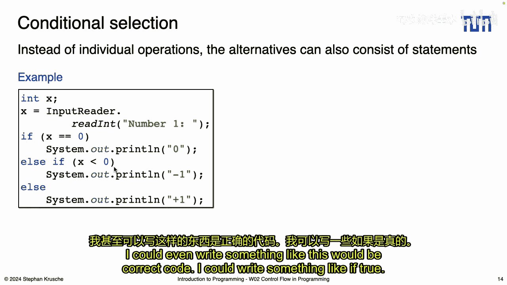
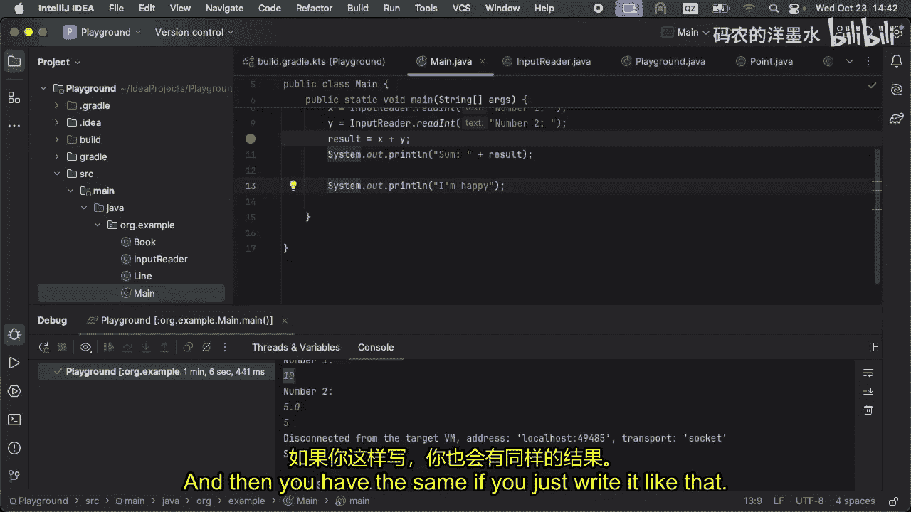
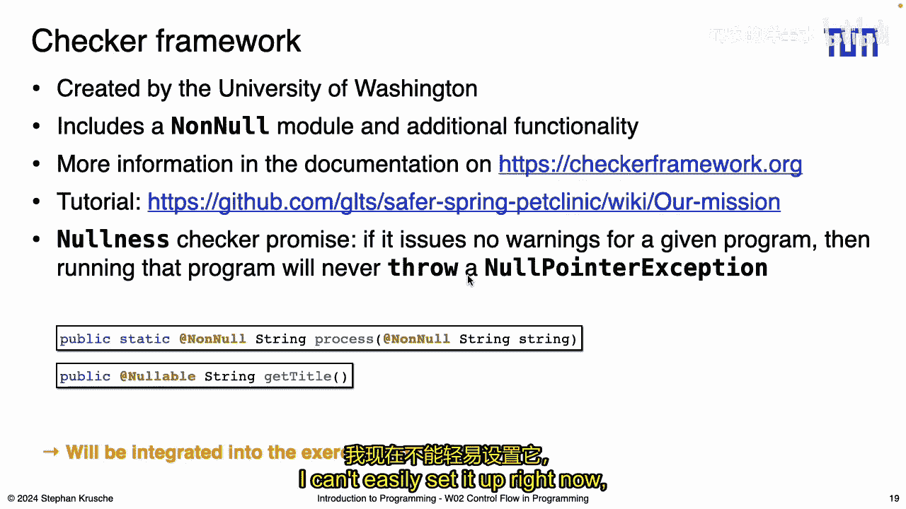
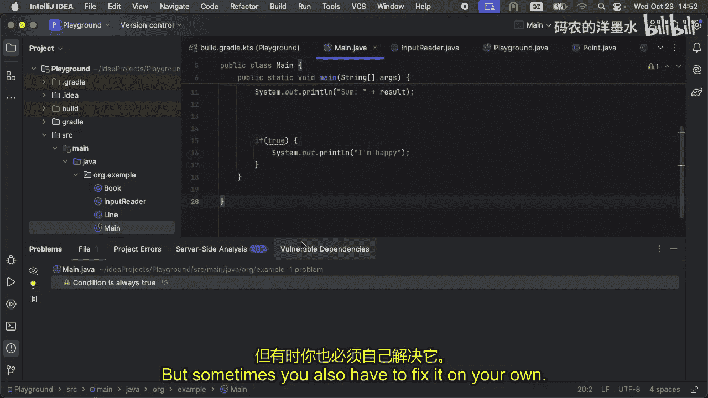
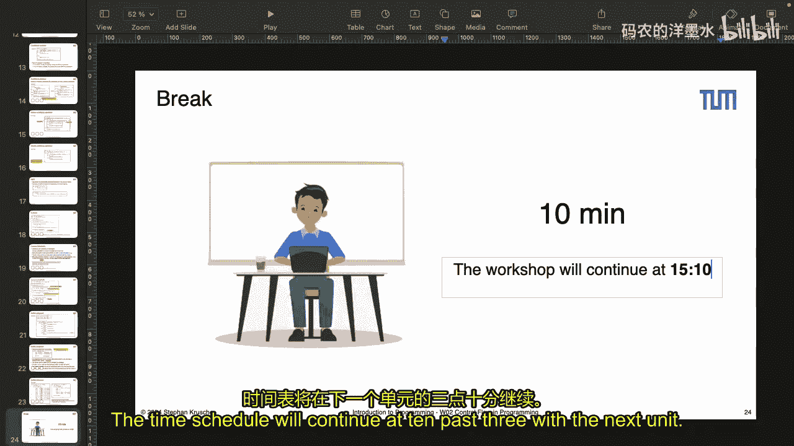

# 计算机编程：从入门到实战：10：条件选择


在本节课中，我们将要学习条件选择。条件选择是编程中的核心概念，它允许程序根据不同的情况执行不同的代码块。我们将从基础的 `if-else` 语句开始，探讨其语法和最佳实践，然后介绍用于简化多条件判断的 `switch` 语句，最后讨论如何利用条件选择来处理程序中常见的 `null` 值问题。

## 条件选择示例

上一节我们介绍了条件选择的概念，本节中我们来看看一个具体的例子。

以下是一个条件选择的基本示例。这个程序与之前幻灯片中的程序类似，但在读取变量 `x` 和 `y` 的值后，它会根据 `x` 是否大于 `y` 来执行不同的操作。

```java
int x, y, result;
x = readInt();
y = readInt();
if (x > y) {
    result = x + y;
} else {
    result = x - y;
}
print(result);
```

这个程序声明了三个变量，并从用户那里读取 `x` 和 `y` 的值。然后，程序会像自然语言一样判断：如果 `x` 大于 `y`，程序将跳入 `if` 分支，使用表达式 `x + y` 来计算 `result`。否则，程序将跳入 `else` 分支，使用表达式 `x - y` 来计算 `result`。最后，程序打印出结果。

这就是条件选择的基本形式。它初看起来可能有点复杂，但当你习惯后就会觉得非常简单，甚至不再需要刻意思考。

## if-else 语句详解

上一节我们看了一个简单的例子，本节中我们来详细解析 `if-else` 语句的结构和用法。

`if-else` 语句的核心思想是：如果 `if` 后面的条件成立，程序就跳入对应的分支执行代码。如果条件不成立，程序则跳入 `else` 语句后的分支执行。

我们还可以使用 `else if` 语句来处理多个条件。例如，当我们只读取一个数字 `x` 时，可以这样写：

```java
if (x == 0) {
    print(0);
} else if (x < 0) {
    print(-1);
} else {
    print(1);
}
```

在这个例子中，我们可以使用多个 `else if` 语句来区分不同的情况。

你可能会注意到，上面的代码中没有使用花括号 `{}`。虽然当分支中只有一条语句时，Java 允许省略花括号，但这是一种不好的实践。即使只有一条语句，也建议始终使用花括号。这是因为如果后续开发者添加了第二条语句，而忘记添加花括号，那么第二条语句将不属于这个分支，这会导致混淆和错误。因此，我的建议是：**始终使用花括号**。

## 嵌套条件选择



上一节我们学习了单层的条件选择，本节中我们来看看如何将条件选择嵌套在一起。

我们可以在一个条件选择的分支内，再放入另一个条件选择语句。例如，在下面的代码中，当 `x` 不为 0 时，内部又有一个 `if-else` 语句。



```java
if (x != 0) {
    y = readInt();
    if (x > y) {
        print(x);
    } else {
        print(y);
    }
} else {
    print(“x is zero”);
}
```

在这个 `if` 语句的分支里，我们嵌套了另一个 `if-else` 语句。理论上，我们可以无限地嵌套 `if-else` 语句。

虽然嵌套太多层不是好的实践，但有两到三层的嵌套是很常见的。我们通常使用缩进（四个空格或一个制表符）来使代码结构更清晰。所有缩进的代码都属于对应的分支。通过缩进，我们可以清楚地看到外层条件、内层条件以及各个分支的范围。

这种嵌套结构非常强大，因为它允许你根据程序的需要，构建复杂的控制流程。

关于 `else` 分支，有一个常见问题：是否可以省略 `else` 并使用 `return`？答案是：你可以省略 `else`，但不能用 `return` 来代替。`return` 是用于方法调用的保留关键字。`if` 是一个语句，它不返回值，也没有类型。它只是通过闭合花括号来结束。

## 处理边界条件与逻辑陷阱

在编写条件时，正确处理边界情况和避免逻辑重叠非常重要。让我们通过一个例子来探讨。

考虑这段代码：

```java
if (x > y) {
    print(x);
} else {
    print(y);
}
```

如果两个数字相等会怎样？答案是会执行 `else` 分支，打印 `y`。因此，确保条件正确设置有时需要仔细思考。有时条件可能会重叠，编译器通常会发出警告。例如，如果你已经检查了所有可能的情况，那么 `else` 分支可能就不可达了。

你甚至可能写出逻辑上永远为真的条件，例如：

```java
if (true) {
    System.out.println(“I’m happy”);
} else {
    System.out.println(“I’m not happy”); // 这行代码永远无法执行
}
```

虽然这是有效的代码，但 `else` 分支是**不可达的**，永远无法执行。这种情况有时会发生，因为你的逻辑可能没有预想中那么严密。集成开发环境会给出“条件始终为真”的警告，并提示存在不可达代码。你可以安全地删除这些不可达的代码。

## 使用条件选择处理 Null 值

在编程中，一个常见的问题是处理 `null` 值。未初始化的对象类型其值为 `null`，如果对 `null` 调用任何方法，就会引发 `NullPointerException`。即使这个概念很清晰，它也经常导致错误、程序崩溃，甚至在大型复杂系统中造成严重损失。

`null` 的发明者后来也后悔引入这个概念，因为它导致了无数的问题。虽然我们无法改变过去，但我们可以学习如何更好地处理它。

使用 `if` 语句，我们至少可以检查对象是否为 `null`，从而安全地调用其方法。但这有时很繁琐，因为我们可能需要检查每一个对象实例。

为了更系统地解决这个问题，我们可以使用一些工具和最佳实践。以下是使用条件语句进行 `null` 检查的一个例子：

```java
public class Pet {
    private @Nullable String name; // 名字可能为 null
    private final @NonNull LocalDate birthDate; // 生日不能为 null

    public Pet(LocalDate birthDate) {
        this.birthDate = birthDate; // 构造函数强制要求提供生日
    }

    public @Nullable String getUppercaseName() {
        if (name != null) {
            return name.toUpperCase();
        } else {
            return null;
        }
    }
}
```

在这个改进的例子中，我们使用 `@Nullable` 注解标明 `name` 可能为 `null`，使用 `@NonNull` 注解标明 `birthDate` 不能为 `null`。在 `getUppercaseName` 方法中，我们使用 `if` 语句检查 `name` 是否为 `null`，从而避免 `NullPointerException`。

## 使用 Checker Framework 提升 Null 安全性

手动进行 `null` 检查容易遗漏。有一个名为 **Checker Framework** 的优秀工具（由华盛顿大学创建），可以帮助我们更好地处理 `null` 值。



Checker Framework 的基本承诺是：如果你正确使用它，并且你的程序没有产生任何警告，那么**你的程序将永远不会抛出 `NullPointerException`**。这是所有开发者的梦想。

它是通过**注解**来实现的。你可以使用 `@NonNull` 注解来标明某个类型或返回值永远不会是 `null`，或者使用 `@Nullable` 来标明它可能是 `null`。



将这些注解集成到你的代码中，是与其他开发者沟通哪些值可能为 `null` 的好方法。与普通注释不同，这些注解会被编译器和 IDE 检查。如果你忘记进行 `null` 检查就调用方法，IDE 会立即给出警告。

虽然设置 Checker Framework 需要一些配置（例如修改 `build.gradle` 文件），但一旦掌握就相对简单。在未来的练习中，我们会在适当的时候引入它，并要求你使用这些注解。

## Switch 语句

当需要基于一个变量的多个不同值执行不同操作时，使用一连串的 `if-else if` 语句会显得冗长。`switch` 语句提供了一种更简洁、可读性更高的方式。

`switch` 语句实现了另一种形式的分支。它并不比 `if` 语句更强大，但能让代码更清晰易读。

以下是一个 `switch` 语句的例子，它根据用户输入的命令字符执行不同的操作：

```java
char command = readChar();
switch (command) {
    case ‘N’:
        // 执行新建操作
        break;
    case ‘O’:
        // 执行打开操作
        break;
    case ‘S’:
        // 执行保存操作
        break;
    case ‘Q’:
        // 执行退出操作
        break;
    default:
        // 处理未知命令
        break;
}
```

`switch` 语句基于一个表达式（这里是 `command`）的值进行跳转。`case` 后面的值必须是常量（如 `‘N’`），不能是变量。每个 `case` 块通常以 `break` 语句结束，以防止执行流程“贯穿”到下一个 `case`。`default` 块用于处理所有未被前面 `case` 覆盖的值。

## Switch 语句的示例与注意事项

让我们看一个计算月份天数的例子，来进一步理解 `switch` 语句的用法和需要注意的地方。

以下是两种实现方式：

**方式一（详细列出每个 case）：**
```java
int days;
switch (month) {
    case 1: days = 31; break;
    case 2: days = 28; break;
    case 3: days = 31; break;
    case 4: days = 30; break;
    // ... 其他月份
    default: days = 0; break;
}
```

**方式二（利用 fall-through 特性合并 case）：**
```java
int days;
switch (month) {
    case 2:
        days = 28;
        break;
    case 4: case 6: case 9: case 11:
        days = 30;
        break;
    default:
        days = 31;
        break;
}
```

方式二更短，它利用了 `switch` 的 **fall-through** 特性：当 `case` 块中没有 `break` 时，执行会继续进入下一个 `case` 块。这里，月份 4、6、9、11 都“贯穿”到 `case 11` 的代码，将 `days` 设为 30。

哪种方式更好？方式一虽然冗长，但逻辑一目了然。方式二更简洁，但需要你理解 `fall-through` 的逻辑。此外，方式二有一个潜在问题：`default` 块会处理所有非法输入（如 0 或 13），并将其天数错误地设为 31。而方式一中，非法输入会导致 `days` 保持为 0（如果之前已初始化），这至少不是一个错误的值。因此，在使用方式二时，通常需要额外的输入验证。

## 总结

本节课中我们一起学习了条件选择，这是控制程序流程的基础工具。

我们首先从 `if-else` 语句开始，学习了如何根据条件执行不同的代码分支，并强调了始终使用花括号的最佳实践。接着，我们探讨了嵌套条件选择，以及如何避免常见的逻辑陷阱。

然后，我们深入讨论了编程中棘手的 `null` 值问题，介绍了如何使用 `if` 语句进行基本的空值检查，并推荐了使用 **Checker Framework** 及其注解来系统性地提升代码的 `null` 安全性，从而从根本上减少 `NullPointerException`。

最后，我们学习了 `switch` 语句，它是一种简化多路分支的语法糖，通过常量匹配来决定执行路径。我们比较了其两种写法，并指出了利用 `fall-through` 特性时需要注意的细节。



掌握这些条件选择结构，将使你能够编写出更具逻辑性和健壮性的程序。