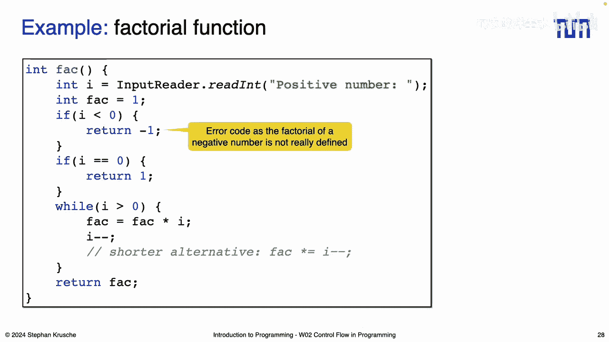
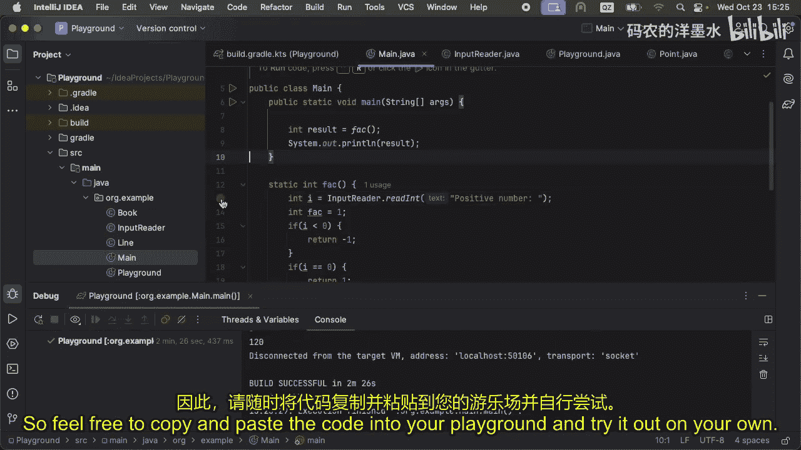
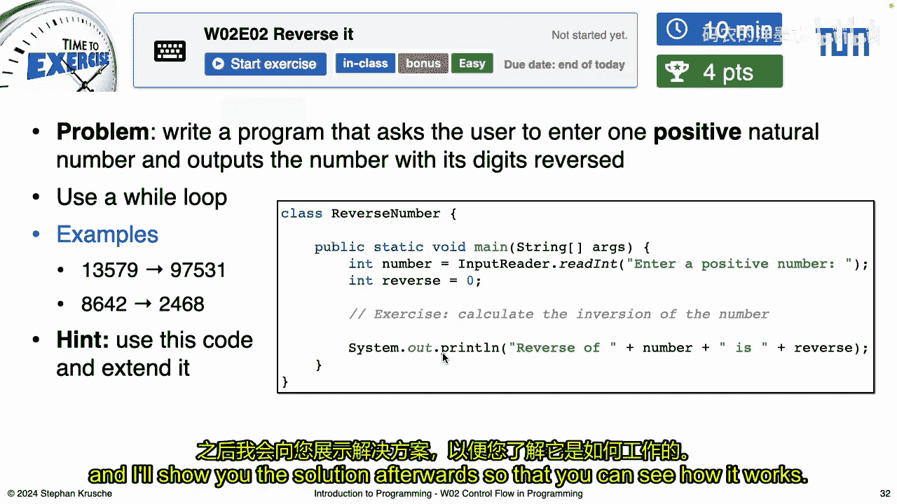
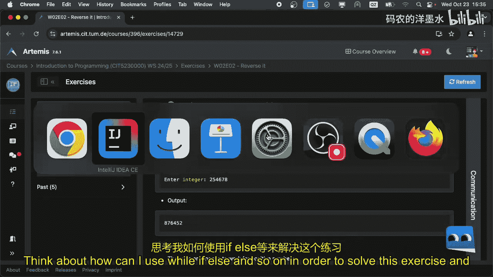
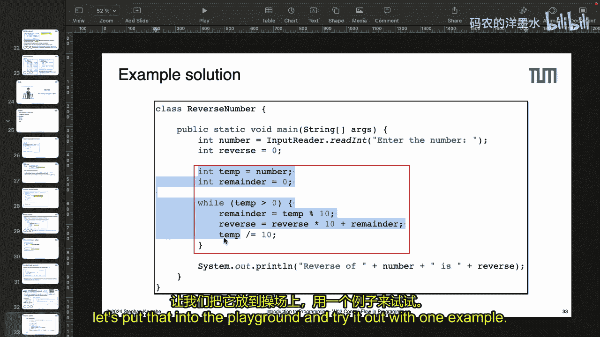
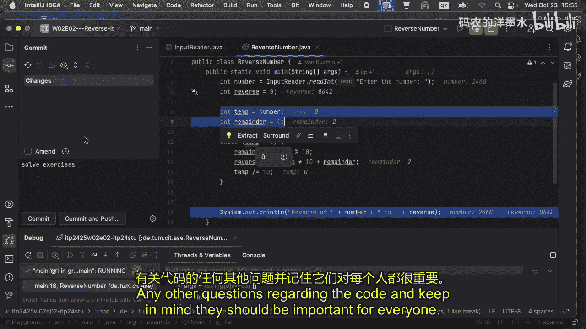
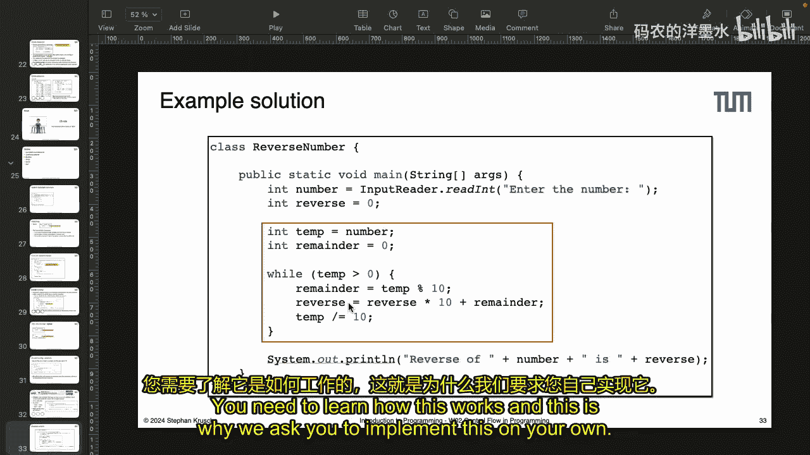
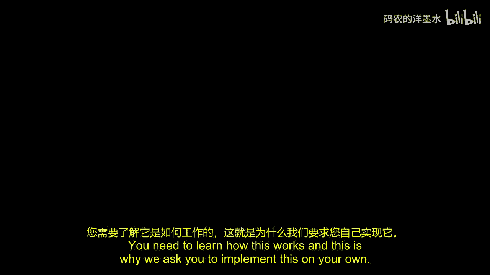

# 【全集】慕尼黑工业大学 计算机编程：从入门到实战 中英字幕 p11 Lecture 11 - 循环part1 -BV1WFrTBZExY_p11-

In our next unit we'll talk about iterationer and we have a first starting example here。

 iteration basically means you repeatedly execute a statement or an expressioner multiple times normally until a conditioner becomes false and this is what we do here we read two numbers X and y of our lovely input reader and then while a condition is。

😊，Not false。 While it is true， we execute the code in the body of the while loop here。

 So while x is unequal to y。We execute the body of the while loop。

 and in the body we actually have an if statement and we say if x is smaller than y。

 we sub x from y and assign it again to y， otherwise we sub y from x and assign it to x。😊。

Who if you knows the algorithm that we show you here， it's a very famous algorithm。In general。

 it's a loopia， but this is a very specific algorithm。

 you can calculate the greatest common divor of two numbers using this。😊，So if I， for example。

 give you the number， let's say，9 and six。What is the greatest common device of 9 and 6。3， exactly。

 yeah and then we would basically do that until x and y is the same yeah and we would then for example。

 say9 minus6 is3。 and then we have9 and sorry6 and3 and then we would say6 minus minus3 is3 and then we have two times3 and three is the greatest common divisor。

 There are other ways to calculate this， but this is one of the ways to do that。😊。

So the general syntax of the while loop is that we have a conditioner， the condition is evaluated。

 if it evaluates to true， the body will be executed after the execution of the body。

 we basically go back to the beginning。😊，Yeah， so we don't have a。Sequential order anymore。

 We go back in our program and we evaluate the condition again。

As long as it is true and only if the condition evaluates to false。

 the program will jump after the body of the while loop。

And the body can consist of multipleable statements again and can even nest other loops or if else。

 statements inside。Here is another a more complex example we'd like to calculate the factorial function the factorial functioner takes always a multiplication yeah so you have a starting number let's say5 and then you calculate 5 times45 minus1 times3 times2 times1 and then you stop this is the factorial number in math and a while loop can be used in order to calculate it what do we do here Well we first get a positive number from the user。

😊，Then we have a temporary variable or a local variable that is also in our result。

 and we initialize it with one。If for some reason the user doesn't end a positive number。

 we do some  error handling， we return minus-1， that's our  error code if because the factorial function for negative numbers is not really defined。

😊，If I equals0， we return 1， that's a definition in Mafia， that factor of 0 is 1。😊。

And this is really justarrow handling， because if the user does a real positive number。

 then we jump over this and no quote， no statement is executed here。

And then we have our while loop and we say while I is smaller than0。

 we execute the body so you see this also can be translated into natural language and that's the intention of programming language that you can understand it based on natural language while I is larger than0。

 we say the variable FA equals FA times I I is our index that we used here in the beginning and then we decrease i by1。

 so I minus minus is the same as I equals I minus1。😊，And we'll do that until I is not larger than 0。

 until I is 0。And then we return the result。

Let， let's copy and paste this into our playground to better understand what's going on here so we can simply copy and paste this here。

And then invoke it in our main function。And in order to do that， I'll just declare as static。And。

Then we can also capture the value。 Yeah， for example， end re equals and then。

Printted to the console。In order to verify what's going on and now let's debug this again debugging very important skill for you to understand and you see the program immediately jumps into this。

 we can jump over this and provide a value on the console you make sure that you jump between those two steps threats and variables where you can do the inspection and the console and now let's assume we want to do it with five。

And then you see we'll jump into the next line， we go over all the arrow handling。

 and now it's the first time that the condition in the while loop is evaluated and I is5 and5 is larger than0 so this evaluates to true Yeah you also see it as a little preview here。

 this is very nice from the intelligent from the IDE to help us here。

And then we can step over this line。 and we see we go into the wild body now。

This variable was initialized with one， and now we multiply it with5。 so the result will be5。

And I is decremented， we sub one from it， so I will become four。

 then our loop is over and you see it immediately chas to the beginning of the loop。

 This is the main idea of iteration or repeated executioner and then we have I equals4。😊。

Then we multiply5 the current value of FAC with4， the current value of I and we end up with 20 and I gets again decremented and has a new value 3 so we do that again  three times 20 is 60 and then I is 2 and 60 times 2 is 120 and then I is 1 and now we multiply 120 with1 so this is actually a redundant step we could actually leaf that out and an optimization but we'll still do it and then I becomes0 and now it's the。

Final step。 We have the first time that our condition is false。 So we'll jump over it。

 And Inliche indicates that by graying out all the codes。 So in the next step。

 we will jump over it and return our result。 and then we basically jump back into the main function and can print it to the console。

😊，And that's basically how the while loop workss。 given this example。

 So feel free to copy and paste the code into your playground and try it out on your own。

Any questions regarding this example， great。Now we've seen in the switch statement that we can end a switch statement or that we sometimes have to end a switch statement with break and brake is also available in loops。

 Well， it's basically something that you can use in order to exit a loop immediately。

And this sometimes helps to improve the code because sometimes you have additional conditions for which you would like to break the loop and you don't want to cover them all in the initial evaluation。

😊，And sometimes it's also just easier to understand this。

 we have an example here where break would cause the innermost loop yeah we can na them as I said before。

 but it would cause the innermost loop to be exit exited immediately and we do that here we basically get an integer from the user we read an in。

😊，And we read until the user types in0 and what do we do if the values well we create a sum so the user can type in a lot of different numbers and we sum them up until the user stops the calculation by inserting0 and then our if statement condition is true and this would then break the innermost loop in this case。

 the while loop that we have here。😊，And then we can do some post processing。

And this is just another step to make sure that your loop is always exiting at some point because one common error with loops is that you do not have exit conditions。

😊，And if you don't have an exit conditioner， the root will run endlessly。

 and of course this can be a problem， especially because your computer does calculate those statements very quickly and can sometimes do millions of statements in one second and this then also means that millions of statements are executed here per second when you never exit your loop and this can then。

😊，Lead to issues in terms of the program does not respond anymore。

 or it runs at 100% CPU level and drains your battery and so on。

Keep in mind that you should not use breakak too often because otherwise the code becomes a bit unclear and a bit difficult to understand。

 so use it sparsingly and selectively when it makes sense and when it really makes the code easier to understand。

In addition to the normal while loop， we also have a slight variation， the so-called a do while loop。

 to be honest， I never use it and I kind of don't like it because it looks a bit cumbersome but you might see certain code also in exercises where this is used the only change is that the while condition is at the end of the loop。

And that the loop is executed at least once。 The traditional Y loop might not be executed at all if the condition is wrong。

But the do while loop is executed at least once and only at the end of the loop the condition is evaluated so in some sense it can there can be cases where it helps you but most of the times you don't really need it here's an example it's basically the same example that we did before and now we don't say while true we say while I is not0 but we first have to read I from the console so here the do while makes sense to do something first and then check the condition。

😊，Any questions regarding do while loops？Great， then we'd like you to do a little exercise with this on Artemis。

 so please open Artemis and start the exercise W2E2 reverse it。

 we kindly ask you to write a program that asks the user to enter one positive that's important positive natural number and using a Y loop。

 you should。😊，Reverse the number。Reverse the diits。 So if the user types in one to3。

 you should print three to one。Or if the user types in 13579， you should output 97531。8ight，6。

42 should be converted into24，6，8。We also give you some starting code in this little exercise。

 So if you start the exercise and clone the repository， I'll do it with you together in a minute。

 then you will see a class reverse number and here you need to implement。This little algorithm。

 And we kindly ask you to。Don't use any strings here。 We don't want you to reverse strings。

 We really want you to。Use integers， that's why we store a number and the reverse already with0。

 and then you should calculate it here。And we'll do it with a while loop and I'll show you the solution afterwards so that you can see how it works。

 but now let's start the exercise and you get around 10 minutes to work on this we have a couple of tutors around here they can help you if you have issues。

 so let me open Artemis。😊。

And。Go into the course and we see it's already available， it's called W2E2 reverse it。

 we'll start the exercise。And then you can click on this little code button here。

 and what I typically do is I copy the URL。😊，And then I go to Intelliche and I say file new project from version control。

Then I paste the URL， so copy and paste is a very important skill for computer science students or for management students with a computer science degree。

Yeah， so copy and paste it in here and then you say clone。

 I'll do that again just so that you see it， I'll start the exercise on Artemis。😊。

Then I click on this code button here。 and we have this little pop up。 I say， copy URL。

And then in Intelliche， even if I already have something open， I can say file new。

Project from version control on Windows， it might look slightly different， but you will find it。

 Then I paste the URL。And I can choose my own directory， whatever I want。

 I suggest you have an ITP projects folder where you store this， and then you click on clone。

I trust this location。And I would like to open this in a new window。Here we go。

 and after cloning the repository， the project will be imported。

You might need to make sure that all the settings are correct。

And then after a few moments you can open the project and there's again this little input reader that you have seen before。

 so this basically the same implementationer， and then we have the class reverse number and here you need to do all the hard work and I'll give you one more hint before we start this exercise。

 this is also written in a problem statement on Artemis。😊。

And this hint basically means that you need to use the modular operator。

So if you don't know what a module operator is， look it up yeah you can use all the resources IIS is also here to help you yeah so you need to use the module operator。

 module operator and you need to use a while loop so work on this try it out。

 think about how can I use while if else and so on in order to solve this exercise and I'll show you a solution in a couple of minutes。

😊。

Okay， so the time is up， please stop working on it。 if you want。

 you can still submit the code and I'll show you a。

One example solution how to solve this now and if you don't have any clue how to solve this this is a bit tricky yeah not in terms of using a Y loop but in terms of coming up with the actual concept in order to reverse the number so here is an example solutioner we will add this to the slide deck afterwards so that you can also see it and what you can see here is that we only do this with integers and a Y loop I'll explain the solution and then you can ask your question okay so what do we do well we have a temp variable to store the number so that we don't lose it so that we don't need to change it。

And then we have another local variable called remainderda， which is quite important here。

And then you will see that we have basically two operations that are important here。

 we have the modular Opera。And we have the division Opera。And while the second one here looks a bit。

😊，Difficult， it basically says1 equals temp divided by 10。

And the first one says the reminder equals the temporary， so the initial number， mod 10。😊。

And then what we do is that。We used the remainder of the modular operation。

 so let's assume we have 1，23， then the first remainder would be 3， yeah 1，2，3。

 modular 10 would be 3 and we used this remainder。And start creating the reverse number with it。

Because we say reverse times 10， this doesn't do anything initially。

0 times 10 is 0 plus the remainder3， so now in the reverse we start with three。

 which was at the end of the initial number。Now we say temp  one to 3 divided by 10 equals temp。

 and this interte division means we basically remove the right most diit。So 1，2。

3 divided by 10 is one，2。Inte a division。So temp is 12。😊。

Reverse is3 now we go back to the beginning of the loop loop temp1 is 12 is again larger than 0 so we do it again now we again take the right most diit using the remainder and the modular operation the modular operation always takes the right most element and now reverse is 33 times 10 is 30 plus the remainder2 so you see we basically put the。

Remain there to the right of the number and fill up the number from the right。

And we'll do that again， 1 12 divided by 10 is becoming one。Then the remainder is one。

 will add up to the right， and we have three two， one。

That's the basic idea of this algorithm I know coming up with the division and the modular operation is not that easy。

 this was a challenge now but you have to code here let's put that into the playground and try it out with one example so I basically copy the code in this red rectangle and replace it here and then we can try it out I'll set the。

😊。

Break point into the， while。Into the conditioner of the while loop so that we'll see what's going on。

And then I'll start debugging the program。And。We have to enter the number Yeah， so for example， 2，4。

6，8。And now let's see what's happening。 So again， let's go through it。2，4， six，8 is larger than zero。

 so we go into our loop， we calculate a remainder that's the number on the right side， which is8。

So remainder should be eight， and we can also see it here。Then we basically。

Start our reverse number with the rightmost element putting it to the leftmost element here。So。

Reverse is 8， which is the beginning of our reverse number， and then we divide10。

 which is still our initial number by 10。 so we cut off the rightmost number。And here we are。

Jump back to the beginning of the loop。 Now we have 246， which is again， larger than0。

 We take the rightmost element。And put it to the right side because then it's at the end on the left side of our reverse number。

 and now we have 86 and we divide it by 10 and we have 24 and you see reverse and 10。

 if we would concatennate them。They would。All the digits that we have here are still part of our number。

 let's phrase it like that。And we'll do it again remainder six。

 we put that six into the temp on the right side， yes。

 so you see it's 24 and now the six by multiplying it with1，😊，Adding six。

 we add it at the right side of it。Sorry the sorry4， I was confused， sorry four on the reverse。

 we add four on the right side of reverse， and then we cut off the four on the temp。

 everything that we cut off all the numbers that we cut on the right side of the temp。

 we add to the reverse number。😊，we'll do it one more time and now temp is becoming zero and we have our reverse number。

 so the reverse number of 2468 is 8642 notice this only works for positive numbers。

And it doesn't take leading zeros into account because leading zeros are not parsed when you convert a string into an int。

 and of course， if you take two large numbers， it wouldn't work， you use intes here。

 they have a specific maximum， if you need large numbers。

 you can also change to a long and the algorithm would work similar。Now。

 if you have inserted this or a similar solution into your code， you can commit the changes。

Prov a meaningful。Commit message， make sure to select all the changes that you did。

And then you can commit them。Need to provide an email address， so let me just use ITP tombDE。

And now I have committed the changes， and I also need to push them。

And I see that there's a little up arrow here， so I can click here and say push。And。I have。

One committed I'd like to push， I'll do that now。Push was successful and now if I go back to Artemis。

 I see building and testing like you have used to it from the tutorial group and homework exercises and after 20 seconds roughly you will see feedback here。

 if you don't get 100%， it means that still something is wrong， double check the feedback。

 talk to one of the tutors or to IIS if you don't understand it。

 and now we have time for a few questions， there was a question down here， is it resolved already。😊。

Someone was raising their hands， okay then。I wouldSo the question is someone has a slightly different solution yeah。

 for example temp is unequals0， there are certain variations that are definitely correct。

 it's always better to initialize variables if possible outside of the loop。

 the compiler might optimize this anyway， but there are definitely different solution possible。

 this is just an example solution and not a sample， it's not Muta Luung in German。

 which sounds like this is the only solution that is possible， it's really an example solution。😊。

Other things are possible as long as you fulfill the feedback， get 10%， it's fine。😊。

Not a question over there。The question is what does amend here in the commit message mean， well。

 sometimes you commit changes but you forget a file， and as long as you have a local commit。

 you can still amend new changes to this local commit。😊。

But the thing is if the commit was already pushed to Artemis and you do amend。

 you change the local history and then you add up with conflicts， so don't use it for now。

 except you're really familiar of what you do， just ignore it。

 because it can really lead to issues that are very difficult to resolve。

Any other questions regarding the code and keep in mind？😡。

They should be important for everyone if you ask them here。

Yeah so the question is can we also store it as a string and simply reverse the string theoretically yes。

 but the problem statement was asked in a specific way to not use strings。

 so if we ask you to not use strings you should not do it in an exercise we wanted you to use the while loopbe and modular and division operation to just repeat those concepts right so in this particular case I would say no in general yeah if you have to solve this issue。

😊，Whatsoever， do it with a string operation。 fine。 Yeah I don't mind。

 Maybe the string operation is even moreperant。 I don't know。 depends on the implementation。

 but here it was really used to vi loop and the。Ws if you program in a large project and you need to reverse things。

 it might actually be easier to find a framework to do that for you right。

 you don't implement everything on your own， but you're a beginners。

 you need to learn how this works and this is why we ask you to implement this on your own。

