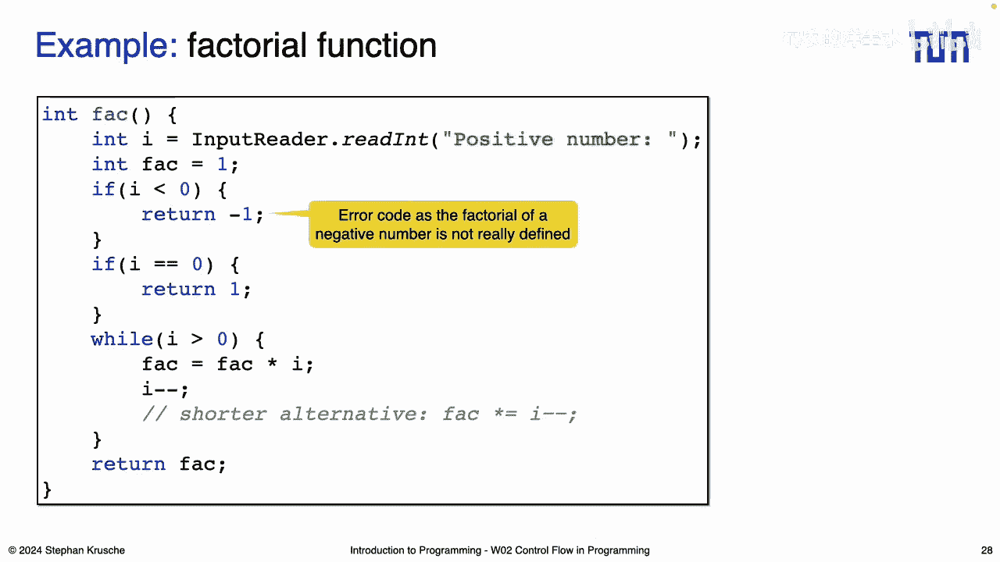
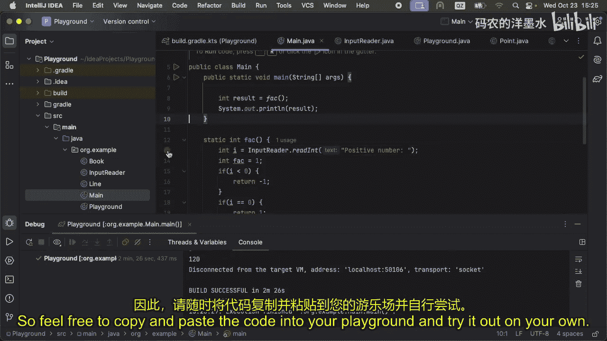
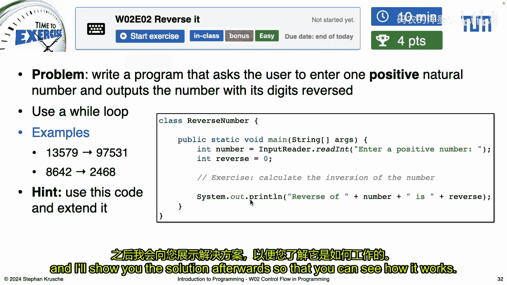
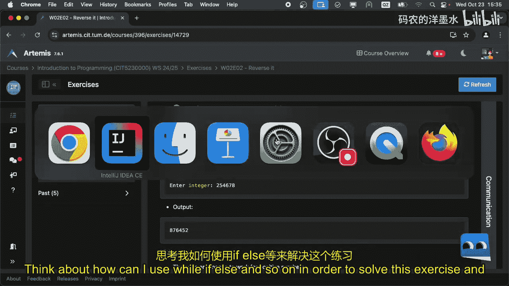
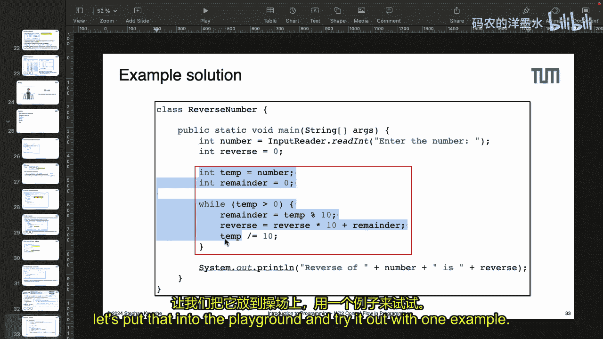
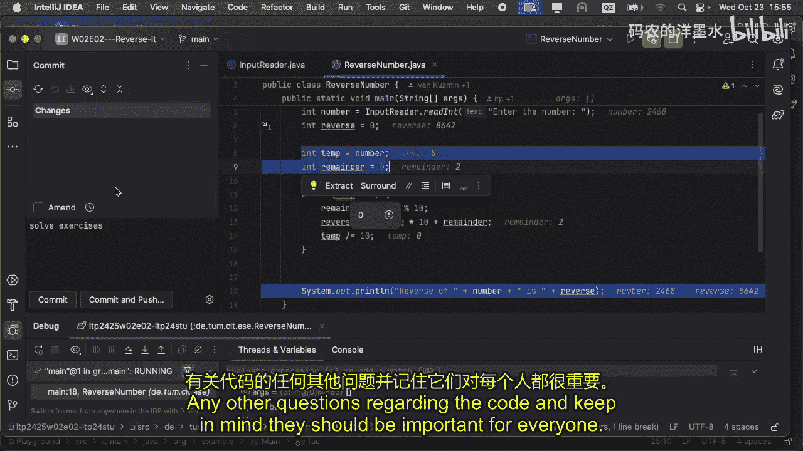
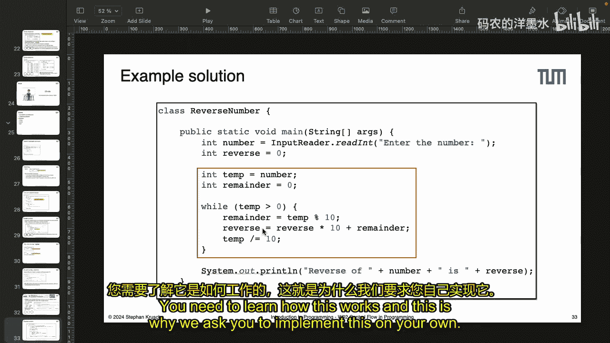
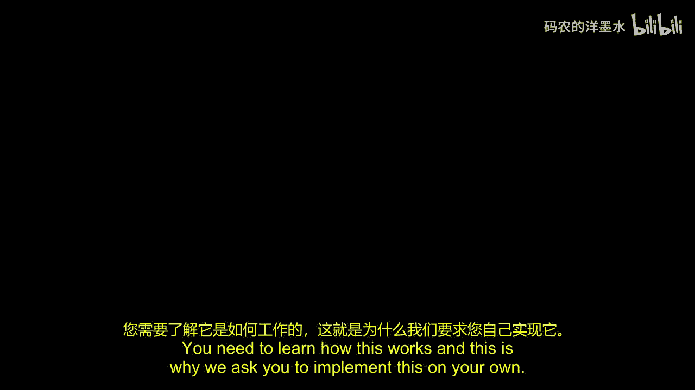

# 慕尼黑工业大学 计算机编程：从入门到实战：11：循环（第一部分）


在本节课中，我们将要学习编程中的一个核心概念——循环。循环允许我们重复执行一段代码，直到某个条件不再满足。我们将从 `while` 循环开始，学习其语法、工作原理，并通过实际例子来加深理解。

## 循环简介

循环，或称迭代，意味着重复执行一个语句或表达式多次，通常直到某个条件变为假为止。

我们从一个简单的例子开始。该程序读取两个数字 `x` 和 `y`，然后执行一个 `while` 循环。

```java
while (x != y) {
    if (x < y) {
        y = y - x;
    } else {
        x = x - y;
    }
}
```

只要 `x` 不等于 `y`，循环体中的代码就会被执行。在循环体内，有一个 `if` 语句：如果 `x` 小于 `y`，则执行 `y = y - x`；否则执行 `x = x - y`。



这个算法实际上是一个著名的算法，用于计算两个数字的最大公约数。例如，对于数字 9 和 6，算法会执行 `9 - 6 = 3`，然后 `6 - 3 = 3`，最终得到最大公约数 3。

## while 循环的语法

`while` 循环的一般语法如下：

```java
while (condition) {
    // 循环体：要重复执行的语句
}
```

程序首先评估条件。如果条件评估为 `true`，则执行循环体中的代码。执行完循环体后，程序会跳回到循环的开头，再次评估条件。只要条件为 `true`，这个过程就会一直重复。只有当条件评估为 `false` 时，程序才会跳出循环，继续执行循环体之后的代码。

循环体可以包含多个语句，甚至可以嵌套其他循环或 `if-else` 语句。



## 计算阶乘的示例

上一节我们介绍了 `while` 循环的基本语法，本节中我们来看看一个更复杂的例子：使用 `while` 循环计算一个数的阶乘。

阶乘函数在数学中定义为：`n! = n * (n-1) * (n-2) * ... * 1`，并且规定 `0! = 1`。

以下是使用 `while` 循环计算阶乘的代码示例：

```java
public static int factorial(int n) {
    if (n < 0) {
        return -1; // 错误处理：负数没有阶乘定义
    }
    if (n == 0) {
        return 1; // 根据定义，0的阶乘是1
    }
    int result = 1;
    int i = n;
    while (i > 0) {
        result = result * i;
        i = i - 1; // 等同于 i--;
    }
    return result;
}
```

程序首先进行错误处理：如果输入是负数，则返回 -1 作为错误码。如果输入是 0，则直接返回 1。对于正整数，程序初始化 `result` 为 1，并使用变量 `i` 作为计数器。只要 `i` 大于 0，循环就会将 `result` 乘以当前的 `i`，然后将 `i` 减 1。当 `i` 变为 0 时，循环结束，返回最终的 `result`。

我们可以通过调试来逐步观察这个循环的执行过程。例如，计算 `factorial(5)`，循环会依次执行：`1*5=5`, `5*4=20`, `20*3=60`, `60*2=120`, `120*1=120`。

## 使用 break 语句

在 `switch` 语句中，我们使用 `break` 来结束一个分支。`break` 语句同样可以用于循环中，其作用是立即退出当前所在的**最内层**循环。



有时，使用 `break` 可以使代码更清晰，特别是当退出循环的条件比较复杂，不适合全部写在循环的初始条件中时。

以下是一个使用 `break` 的示例：程序持续读取用户输入的整数并求和，直到用户输入 0 为止。

```java
int sum = 0;
while (true) {
    int value = InputReader.readInt(“Enter a number (0 to stop): “);
    if (value == 0) {
        break; // 当用户输入0时，立即退出while循环
    }
    sum = sum + value;
}
System.out.println(“The sum is: “ + sum);
```

在这个例子中，循环条件被设置为 `true`，这意味着理论上它是一个无限循环。然而，在循环体内，我们检查用户输入的值。如果值为 0，则执行 `break` 语句，立即跳出 `while` 循环，然后执行循环后的打印语句。

需要注意的是，应谨慎使用 `break`，过度使用可能会使代码的逻辑变得难以理解。同时，确保循环最终有退出条件至关重要，否则会导致程序陷入无限循环，耗尽CPU资源。



## do-while 循环

除了标准的 `while` 循环，还有一种变体叫做 `do-while` 循环。它与 `while` 循环的主要区别在于，`do-while` 循环**至少会执行一次**循环体，然后再检查循环条件。

`do-while` 循环的语法如下：

```java
do {
    // 循环体
} while (condition);
```

在 `do-while` 循环中，程序首先执行一次循环体中的代码，然后评估条件。如果条件为 `true`，则跳回开头再次执行循环体；如果为 `false`，则退出循环。

以下是一个使用 `do-while` 循环的示例，其功能与上一节使用 `break` 的求和示例类似：



```java
int sum = 0;
int value;
do {
    value = InputReader.readInt(“Enter a number (0 to stop): “);
    sum = sum + value;
} while (value != 0);
System.out.println(“The sum is: “ + sum);
```

在这个例子中，即使用户第一次就输入 0，循环体也会先执行一次（将 0 加入 `sum`），然后检查条件 `value != 0` 发现为 `false`，循环结束。`do-while` 循环适用于那些需要先执行一次操作，再根据结果决定是否继续的场景。

## 实践练习：数字反转

现在，我们将应用所学的 `while` 循环知识来解决一个实际问题。请完成以下练习：编写一个程序，要求用户输入一个**正整数**，然后使用 `while` 循环将这个数字的各位数字反转后输出。

具体要求：
*   输入：123 -> 输出：321
*   输入：13579 -> 输出：97531
*   输入：2468 -> 输出：8642

**重要提示**：请不要使用字符串操作来完成此任务。我们希望你练习使用整数运算和循环。关键思路是使用 **取模运算符 (`%`)** 和 **整数除法 (`/`)**。

以下是一种可能的解决方案：

```java
public static int reverseNumber(int number) {
    int temp = number;
    int reversed = 0;
    while (temp > 0) {
        int remainder = temp % 10; // 获取最后一位数字
        reversed = reversed * 10 + remainder; // 将最后一位数字“附加”到反转数字的右侧
        temp = temp / 10; // 移除最后一位数字
    }
    return reversed;
}
```

**算法解释**：
1.  `temp % 10` 可以得到 `temp` 的个位数（即最后一位数字）。
2.  `reversed * 10 + remainder` 的作用是将新的数字（`remainder`）放到已反转数字的末尾。例如，已反转数字是 32，新数字是 1，则 `32 * 10 + 1 = 321`。
3.  `temp / 10` 进行整数除法，会去掉 `temp` 的个位数。例如，`123 / 10 = 12`。
4.  循环持续进行，直到 `temp` 变为 0。

你可以将这段代码复制到编程环境中进行调试，输入如 2468，观察每一步中 `temp`、`remainder` 和 `reversed` 变量的变化，以彻底理解其工作原理。



## 总结

本节课中我们一起学习了循环结构的第一部分，重点是 `while` 循环。
*   我们了解了循环的基本概念：重复执行代码直到条件不满足。
*   我们掌握了 `while` 循环的标准语法和执行流程。
*   我们通过计算最大公约数和阶乘的例子，实践了 `while` 循环的应用。
*   我们学习了使用 `break` 语句来提前退出循环。
*   我们简要介绍了 `do-while` 循环及其适用场景。
*   最后，我们通过“数字反转”练习，综合运用了 `while` 循环、取模和整数除法来解决实际问题。





理解循环是编程中的关键一步，请务必通过练习来巩固这些概念。