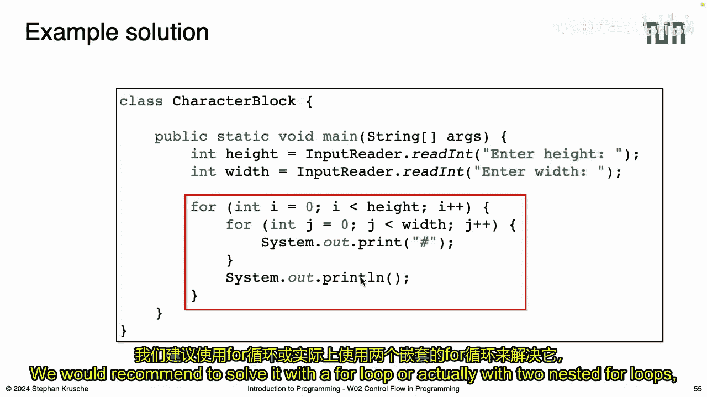

# 【全集】慕尼黑工业大学 计算机编程：从入门到实战 中英字幕 p12 Lecture 12 - 数组 -BV1WFrTBZExY_p12-

Great， we'll finished the first。Section on iterations and we'll continue with the next unit about arrays。

 and you' will see that arrays are also tightly related to iterationer。😊，Well， why do we need arrays？

😡，We need them because often we would like to store many values of the same type in a data structure so you do not just have one integer or one float or one double。

 you have multiples of those and you might sometimes not even know how many you have and the ideas tend to store them consecutively in a so-called array and array has multiple values you need to define how many of them you would like to use when you create the array and then you have so-called。

Ind see and each element sits at one specific index and nowadays already something that is a bit tricky to understand computer scientists start counting at zero not at one so the first element is stored in the index0 the second element is stored in the index1 this is a bit counterintuitive for people who come to this domain fresh and have no experience but this is how it is you have to deal with it。

 it's a little bit like in Sherman buildings yeah the first floor is called ittaash or zero and then basically the second floor is the number one so maybe this helps you as an analogy you people don't understand this yeah and if you go to the US the normal ittaash yeah here is floor number one。

😊，So there's also some confusion here and the same confusion happens when it comes to arrays and indices。

 so make sure to understand the first element is always at index0 and the last element is at the length of the array minus1 very very important what is the array length here who can tell me six thearrow length is6 we have six elements one2。

3，4， five， six， six elements and the last index is。😊，leength minus-1。

6 minus1 is 5 so whenever you like to access an element in an array。

 make sure that you have this minus1 when you use the length。

 otherwise you end up in a so-called index out of bound exceptional and your program might terminate。

It's also important to understand that arrays can be declared like you see it here。

 you always specify the type， then you have those rectangular braces and then the name。

There's an alternative notation which says type and then name and then rectangular braces。

 but we typically use the one where we have the rectangular braces next to the type because that's much easier to understand。

 notice that you used a new keyboard。And this should already tell you that we have a reference type here。

 and this means if we copy the array or if we if we think we copy the array with this equals operator。

 we actually don't copy the array， we just copy the reference， it's like with object types。

 the array is not a simple type， even if it's an end array， it's not a simple type。

 so instead of copying all the values， we create another reference。😊。

And we still have unique values in the memory area this reference points to。Again。

 numbered consecutively starting with index0， so the I element is accessed with name dot name。😊。

Rectangular race I， the length can be accessed with name dot length。 but of course。

 only if the area is initialized and then we have。The index is0 until length minus1 and if you are outside。

 if you have a negative index， you get an array index out of bound exception and if you have an index that is larger then length minus-1。

 you also get array index out of bound exception and we'll cover exceptions in more detail later on just remember an exception is an error and if the error is so severe then your program will crash and you can't continue anymore。

😊，Here's another example where we can use this in our points world。

 remember we had this class point last workshop and a polygon consists of multiple points。

 however it's not like a rectangular or a triangle that we know the exact number of points we don't know how many points we have a polygon can have five points as you see here but it can also have six。

78 or a million points this is not clear this is arbitrary and this is a very。

 very good use case to use an array so we have a point array so you see we can also use。😊。

Class types， complex data types for arrays， not only basic types such as integer。

And we simply do this as with normal attributes。 Yeah， we have this。

Constructor here that has one input parameter and a with points。 and we pass it to our。

Constructor Now， how do we create this。 Well， we say our points array equals new point。

 and then we specify the length。 So we specify that we would like to be able to create five elements。

 And when you do that， when you create a new array， you always have to specify the length。

 it's not possible to create an basic array data type in Javava without specifying the length。

 This is not possible because Javava needs to know how much memory it needs to reserve。

 There are other data structures where it looks like this is not defined。

 but they have some internal mechanisms in order to increase arrays or decrease the array length at some point in question。

😊，Good question， can you change the error length after you have created it， no， this is not possible。

 but you can create a new array with a larger or smaller length and then copy all the values to the new one。

Now we create a couple of points with our X Y constructor and store them with the index in our array。

 this is the notation how to do that， so if we would like to store it at index0 we do it with01，23。

4 remember points5 is not possible because that would be outside of our。😊，Aa length。

And then we can simply pass those points into our polygon。 There's also another way to do that。

 We can first create all those points with local variables， P1， P2， P3， P4， P5。

 and then assign them to an area without specifying the length。😊。

But by specifying all the content already in curly braces。

 so that's just a second way of creating an area with the new operator instead of passing the length。

 we pass all the elements and by doing that Javava can automatically infer what the length is because if we pass five points comma separated。

 length is five， if we pass three points comma separated， length is three and so on。😊。

We can use Y loops in order to fill arrays that's already a good connectioner and when we declare an array like here we do not specify the length yet。

 we specify the length based on the user input。And then we could fill it with a while loop。

 so while I is smaller than n， very important here， we add the element that is inputted by the user。

 the next number into the index at this particular position。😊。

And then we say i equals i plus one in order to make sure to go to the next index。

And this is a very recurring pattern that we have here， it's called the iteration pattern。

 it's a typical form of iteration over arrays， we initialize the so-cal run index。

 which is typically appbbreviated with I。😊，Then we have a while loop with an entry condition for the body。

 and then we modify the run index at the end of the body。 This is a very common pattern。

 So we have it again here， in order to。Copy an array and sorry not in order to copy to determine the minimum of an array。

What do we do， we basically iterate through all the elements。

And if the element is small that in the current minimum， we store it as a result， otherwise。

 we continue。And this is a very typical pattern， so we initialize our run index。

 we have it in the condition of the via loop， and we modify it at the end of the loop。😊。

And by doing that， we really go step by step， right， So how does it work， We initialize I with one。😊。

And the result is actually the first element at index 0。

 This is our current minimum that we have now we。😊，Iitialize i by one。

 and then we check if the element at index 14 is smaller than the result， this is not the case。

 so we skip the if statement block， we increase i by1， i is 2。😊，Now， -1 is the next element。

-1 is smaller than1。 So -1 is becoming our， is our new mini current minimum。😊。

And we can go to the next and then five is not smaller than -1 and three is also not smaller than -1。

 and if the index is5 it's。😊，Not true anymore。 It's false。 Yeah。

 then5 is not smaller than the array length， which is 5。 And then we skip the loop， and we go to the。

Remaining。Statements。Okay。So this is a small algorithm in order to determine the minimum with a vi loop question to you。

 why do we start with one as the initial value and not with zero in this particular case？😊。

if you can guess this。That's the correct answer we basically would like to reduce redundancy or increase the performance because we already have to element it zero and we don't need to compare it with itself。

 that would be not giving us new information this is why we start with one typically if you iterate through an array though you'll start with the index0 doesn't matter。

😊，So the question is what is if the first element is not one。

 but I don't know minus-5 or something like this does matter。

 We take the first one as a minimum and then if we find a smaller value， this is our minimum。

 that's basically how we do it。And we have to start with an initial minimum and we don't know if it could also be already the result。

 we don't know it yet， it could be the maximum， it could be the minimum or something in between。

 we don't know it， so we take it as a temporary minimum and then we go through all the numbers and if we find a smaller one we use this one。

And with this， we we have a guarantee that we can get the minimum of the array。Great。

 now because this iteration pattern is so common， people thought let's invent another loop just to confuse you and make it easier for the more experienced developers and they call it a full loop。

 so this is the second。😊，Exl second loop that we learned for today， the for loop works quite similar。

 but has this built in iteration pattern and a three point rule or three statement rule in its definition。

 so we always initialize。😊，A run index in the for loop。

We always compare the run index with the length of the array if we iterate through an area or with the length of something else。

And then we modified a value。 So instead of having it before the loop。

The condition and at the end of the loop， we write all of this into the beginning and define this upfront。

 and then we don't have to deal with it later on。😊，However， still i+ plus。

The increment is executed at the end of the loop only because we write it in the beginning doesn't mean it's done in the beginning of the loop。

 Yeah， it's always done at the end。 The initialization is done before the loop。Works， yeah。

 so this is only done once， the comparison here， the condition is done always in the beginning。

 and the modification is always done in the end。😊，So we write initialization and modification into the declaration of the for loopop。

😊，So the question is how does the program know which parts need to be initialized first and which afterwards。

 well， that's by definition， so everything that comes before the first thing we call on。

Is initialized before the loop。And then， the conditioner。

Is evaluated at the beginning of the loop and the modification is executed or the statement of the modification is done。

 you change the state at the end of the loop。 this is done by the definition。

 So the semantics of the full loop are we initialize something semicco。

 we have a condition semicco we modify something and then we have to statements。

 and this is as powerful as a y loop。 So you can choose which one you like more。

 if you have a preference to the y loop do it with the y loop。

 if you have a preference for the follow loop do it with the for loop。

 but in any case you need to learn both because both of them are used in practice and this specific semantics here corresponds to initialization before condition also as in the beginning then the statements and then the modification。

😊，Notice that we often write i plus plus as a shortcut。

 or it can also be i minus minus because you can also start from the right of the array and go downwards in terms of indices。

 and I++ is equivalent to I equals i plus 1。😊，If you iterate through arrays。

 we highly recommend to use four loops or later on even modern for each loops because they are typically easier to understand。

😊，Because all the things are defined upfront and you see them immediately and you don't have to search where exactly the modification takes place and you also can't get it wrong if someone accidentally adds another statement after the modificationer and produces a wrong value in the result。

 this can't really happen in the for loop， so the for loop guarantees that the modification is done at the end of the loop。

 while in the while loop you have to guarantee this on your own。😊。

Now if we compare all the three loops with each other that we learned today， we have the four loop。

 the Y loop and the do Y loop and the syntax， and we also show you the syntax for the infinite loop which is something that you should prevent because infinite loops are normally in the normal program behavior are really bad there are cases where we need infinite loops but normally this is not the case and this is the main aspect what we learned about loops today。

 so make sure that you have a look at slide 47 in case something is unclear。😊。

Now those increment and decreement operations are a little bit tricky。

 I would recommend to use them sparsingly and only use them if you fully understand them。

 what you have to understand is that there's a difference between pre and post a pre- increment and a post sorry a pre increment and a predcrment do the increment or decrement before the value of the expression is determined while the post do it afterwards and this can really be very confusing so in this particular case here you assign seven。

😊，To x， to the index x。 and then you increment x。So if x is currently0。

7 is at the first position of the array and then x becomes the value1 afterwards while doing it as a prefix。

 it means that first x equals x plus one as executed and then7 is assigned to index1 in this particular example I recommend to not use the prefix at all because it's super confusing and I also recommend to only use the post increment if it's completely clear。

 but avoid doing it like here， so this in my opinion， this is really bad code。

 you should not do that because people get confused people don't remember this by heart because they don't use it very often I would always prefer writing two statements here but I know they are also hardcore。

😊，Programs and computer sciences in particular those who work with very low level code in C or even on the operating system level and they love to make it very difficult to understand。

 but in my opinion code would be easy to understand also for people who are not as experienced as I am or who are beginners like you。

 so I would never write a statement like this， it's just here sort of in case you see it you understand how it works。

😊，Also make sure that you understand the difference between assignment。

 one equal operator and a condition two equals operators， and there's a very tricky。

 the good thing is the compiler warrants you if you do that， but this statement here。

 even if we assign x to false， will always evaluate to true because it first assigns x to true。😊。

And then it uses the value of x for the if statement。😊，And after the assignment exites through。

 so it will always be executed。And this is。Something that beginners sometimes struggle with。

 make sure that you never do an assignment within and if condition， this is also bad practice。

 always do assignments up front。And within the conditioner。

 only use double equals operators instead of one single equals operators。

 And with this rule of thumb， you can avoid。s nasty issues that are really。

 really hard to find if you em this in a code， I believe that even experienced developers will have a hard time identifying this as an issue because you really easily overlook it。

😊，Here's another example of filling an array with the for loop， we've done that with the Y loop。

 so what we would like to do is in this function here。

 we read an array based on the numbers that are specified by the end user。

And we determine how many elements we would like to read into the array。

 so we create the array and initialize it with the new operator based on the given number。

 for example five。😊，And then we have this very typical iteration pattern。

 in I equals0 I smaller number or I smaller than result length。

 those would be identical i plus plus and then we sayre at position I equals input reader read end and if you copy and paste this into your playground and run it。

 you will see that you can for example five times 10 times whatever number you specify you can read in values and you do not get an array out of boundce exceptional。

😊，If you exactly define it like that， if you change it， if you say I smaller equals number。

 or if you start differently here， you might end up with error index out of bond exception。

 so make sure that you understand this very typical pattern here。

Some additional help statements in case yout don't really understand the code。

 we can also copy arrays。 There's actually a copy function that you can use if you don't want to do this on your own。

 but you can also do it so if we give you a float array as an input here we can create a copy remember the copy is empty in the beginning and then we iterate through it and we assign the。

Element at index I of the original array to the。Element of the index I of the copy。

And we do that for all the elements。 So if we have 1000 elements。

 this loop will be executed 1000 times， and then we have a full copy of the array。😊，So again。

 an array uses reference semantics， you can't simply assign it to a copy。

 then you only copy the reference if you want to copy the content you have to do it with a loop and you can either use the for or the while loop。

So here's an example how to use this， we can create a copy， but we can also create an alias。

 and now if we change the copy the original。😊，Value is not changed。While if we change the alias。

 the original value is changed and this is the big difference here。

 if you create a copy and change value， the original array is not affected。

 if you create an alias and you changed values， the original array is affected and therefore this one outputs one point。

 oh even though I have changed the alias array and not directly the original array。😊。

We can also have character arrays where we have multiple characters after each other and this is basically what a string is。

 notice that a string simply has some character array as its internal representation and a string is always immutable so if you assign a new value to a string Javava in fact creates a new string internally for you you just don't need to use the new operator here which makes it easier。

😊，There are certain convenience methods so you can for example， get the length of a string。

 you can get the character at a certain index using the same idea as in the for loop just with a different or with an array just with the different notation here and you can also check if an string contains certain characters and you can also get the index of the first index of certain characters more about that in the documentation it's just to make you aware that a string is nothing else than character array before we do the next exercise I'd suggest we do a break now so that you can refresh a little bit as we said we do it a bit shorter at this time so we'll start again at440 and then we'll directly do exercise W2 e3 character block。

😊，So enjoy the break and see you in 20 minutes。I'll show you the example solution that consists of。

Four actual lines of code。We have two nested for loops and out of four loop based on the height。

And the index I and an inner for loop based on the width and the index chain。

And we use system out print。😊，Our。Character。Without the LN， because we don't want to have a new line。

 LN stands for new line。In the inner for loop。And when the inner for loop is done。

 when we have printed characters。As often as we would like them in the width。

 we actually print one line and we do it again， and with that we can produce as many lines as we have specified in the height。

😊，Any questions regarding this example solution， anything that is unclear？

We would recommend to solve it with a for loop， or actually with two nested for loops。

 but of course you can also use Y loops。

