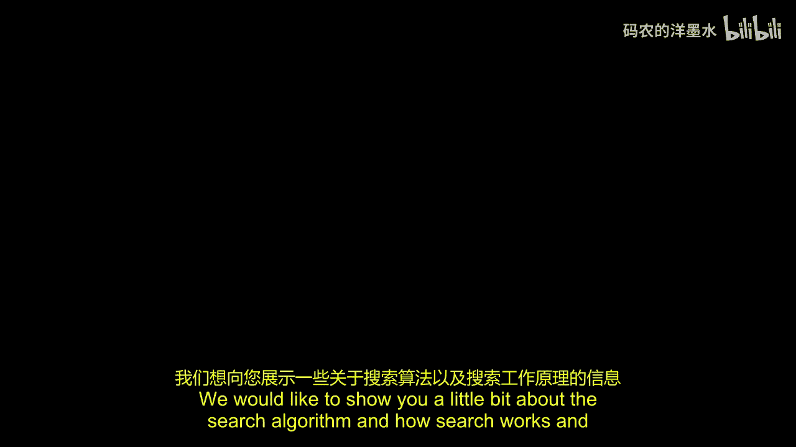
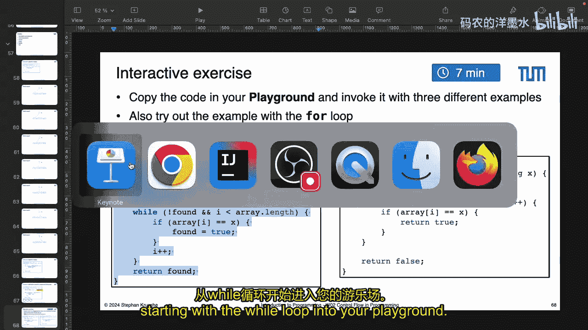
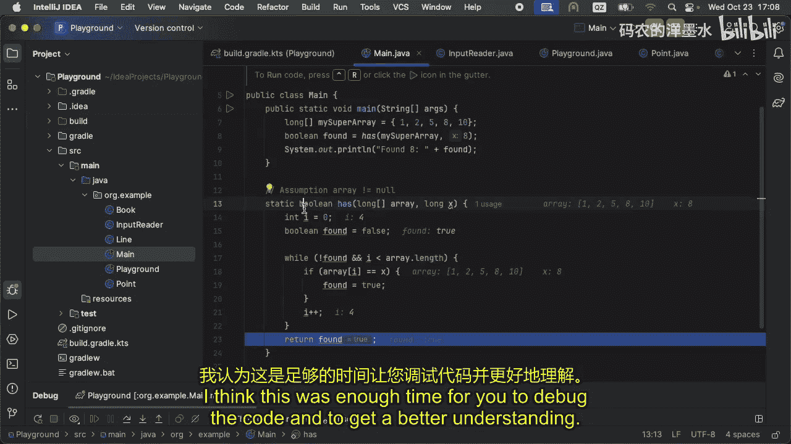
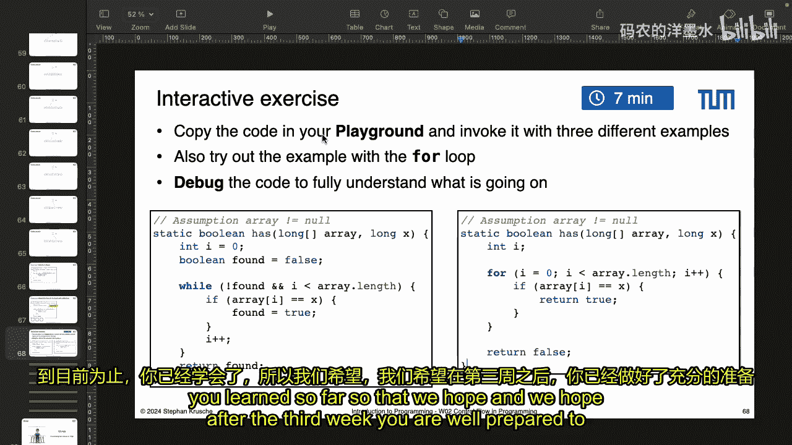
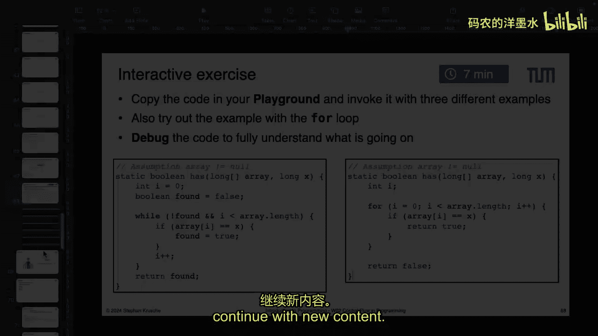

# 【全集】慕尼黑工业大学 计算机编程：从入门到实战 中英字幕 p13 Lecture 13 - 搜索 -BV1WFrTBZExY_p13-

We would like to show you a little bit about the search algorithm and how search works。

 and we'll see this really as an example so that you can practice more cases with while four loops and if else statements。

 this is why we show you simple algorithms now， because they are based on those conditional selections and iterations and are really good in order to better understand them。

😊。

And here we have a little example， very simple example， how to search in arrays。😊。

How would we do that， Well， we can have a method， actually a static method or function called has where we would like to see if the array。

The long array array has the element X inside， that's why we call it has。And how do we do that Well。

 we iterate through the whole array based on the for loop that we just learned。And then if。

The array at the current index， at the current positioner equals the value that we are searching for。

 we return true， which immediately breaks and exits the loop as well。😊。

And if we can't find it after going through the whole array， we return falses。That's a very。

 very simple way how to search elements in an array。

 create any questions regarding this little example， again， a loop for iteration。

 we iterate through an array and an if。😊，Statement with a conditioner to check if we can find the element or not。

Great， we can visualize how this works in the slides。

 so if we have the element7 and we would like to search for it。

 we compare it with the first element of the array at index0， it's not the same。

 so we navigate to the next one， not the same， navigate to the next one。

 and so on and so on and so on。😊，Until we find it and then the algorithm is done。

 we don't search for more elements， it can appear twice。

 theres no guarantee that the element only appears once， but it doesn't matter for us。

 we just want to know if the array has this element or not。Now。

 is this a very good algorithm in terms of performance？Or can you come up with a better algorithm。

 what do you think？Who thinks this is the best algorithm in terms of performance that we can do。

 raise your hands？😊，Who thinks we can come up with something better？Okay a few of you。

 it's not that easy if you work on unordered arrays and sometimes the order can't really be changed。

 then it's the fastest thing that you can do if you have an unordered array。

 you have to potentially look up every element in order to find something or not。😊。

But if you search very often， this is very， very imperformant and very slow。

 if you search very often it's good to have a sortded version of the array。

 either you sort the array itself once this takes longer than the normal search。

 but then the search afterwards is faster， or if you can't search the original array because you still need to have a specific order of those elements and this has a specific meaning。

 then you can actually create a so-called。Second version of the area where the elements are sorted。

 and then searching can be implemented much， much， much faster。

And big search companies such as Google， they invest a lot of time on how to make search as fast as possible because that's their main business and if they can search 10% faster than the others。

 they save 10% compute， they save 10% of your time as an end user if you search something。

 and so for them it's really really important to look into those algorithms。Now。

We can also use a for loop。But implement it slightly different。And。

We see that we basically access the array two times here we first check for the array length as a condition and then we check again if the index is the same and some people would consider having two conditions here is not good and we can do an alternative search with a while loop where we put both。

Elements into the same。Condition here basically and how do we whether we have an additional condition as part of the loop in order to make sure that the loop ends early if we find the element。

And this is just an alternative way， we have index I equals0 again。

 we have a temporary variable Boolean found which is false。

 initially we didn't find anything and while found is not true and I is smaller than the area length。

 we check for this and set found to true。And then。Increase the index if we didn't find an element。

 find found is still false， so we continue if we go to this particular statement。

 we do another increment， a last one and then we exit the loop as well。Okay， so the question is。

 let's go back to this slide， what happens if an array has two identical elements， nothing happens？😊。

That's intended use of an array， an array can have always you can have an array that always has the same number if you have an array that has 1 million times zero。

 that's perfectly fine。😊，And an array is not supposed to have any assumption on the order of the elements。

 on the uniqueness of the elements， the only assumption that we have is that we have a specific length and that we can access the elements and overwrite the elements at any time。

O。So second version of the algorithm， not found is the same as found equals equals false for the ones who have never seen that。

 that's an abbreviation。And we'll like to do an interactive exercise with you now and for that I'll upload the slides as well。

 so we ask you to copy the two different versions of the search algorithm into your playground and then to try them out in your playground on your own to do a little bit of debugging to understand what's going on and to better understand what you do and we can do this together so before I start let me upload the slides very quickly。

😊，We basically missed this part of the slides。😔，Okay。

 slides should be updated now if you reload the page。

 you can find them and then please copy and paste the code first starting with the while loop into your playground。

I'll just put them into。Not into the character block exercise here into this one。

 Just get rid of all the other code for now。And。Then， we have it。

And in order to play a little bit with it， we first， of course， need to create an array。So we could。

 for example， say long。My super array。E quilts。 And then。We add a few values。So we say one， two。

 five， eight， and 10。Here we go。And then we would like to check if the。Aray includes or has。

The value 8， for example， now we do it like that， and then we can do system out print line。

If it was found。Or not。Like this。And if we put a breakpoint in here。We can start the application。

 debug it， and see what's going on here， so we， for example have our array 1，25810。And we have x。

 which is 8。And now， if we jump over it， we'll see。We go first time into our。W loop。Then we check is。

The element index0， which is1， is it the same as eight double equals operator。

 are very important here？It's not the case， so we increase it by one。Do it again。

 Now we compare two with8， not a case。Now we compare five of eight， not the case。

Now we compare eight。With 8， you know， so index at。Our array at index 3 has the value8 here。

 we compare it， and then we go into found eags true， we do one last time of incrementing it。

 but then we don't go again through the loop。So try this out on your own with a little example and also。

😊，Replace the method with the second version of the for loop。And do the same。 Also try it out。

How it works， this is really an important skill for you for every given program。

 you need to be able to understand it and boy if you don't understand it through reading。

 you can use the debugger， this is a really essential skill， I cannot emphasize this often enough。😊。

The debugger is really your friend in order to inspect what's going on。

 and I also sometimes struggle to understand code， you're not alone with that。

And I then also use the debugger， so this is really。

 really important every programme I uses the debugger in order to better understand it so please try it out on your own。

 copy and paste the code and make yourself familiar。We give you five more minutes to do this。

 and then we'll continue with the lecture。Okay， I think this was enough time for you to debug the code and to get a better understanding。

 are there any open questions， anything that is unclear regarding those two ways of searching in arrays？

Maybe a bit of feedback， who of you has a good feeling that you understand those methods？

Who you still struggles a lot？Who does not know whether you struggle or not？Okay， so if you struggle。

 take your time afterwards， we will have a full week now where you can practice while for if else and so on。

 and where you can also use the debugger if you don't understand something we have great support by tutors and by IIS as well。

 so take the chance and practice this， this is really important that you practice practice practice and the good news is next week we will not add any new content in the workshop but instead we will have a repetition week where we again go into in-dth about the concepts that you learned so far so that we hope and we hope after the third week you're well prepared to continue with new content。

