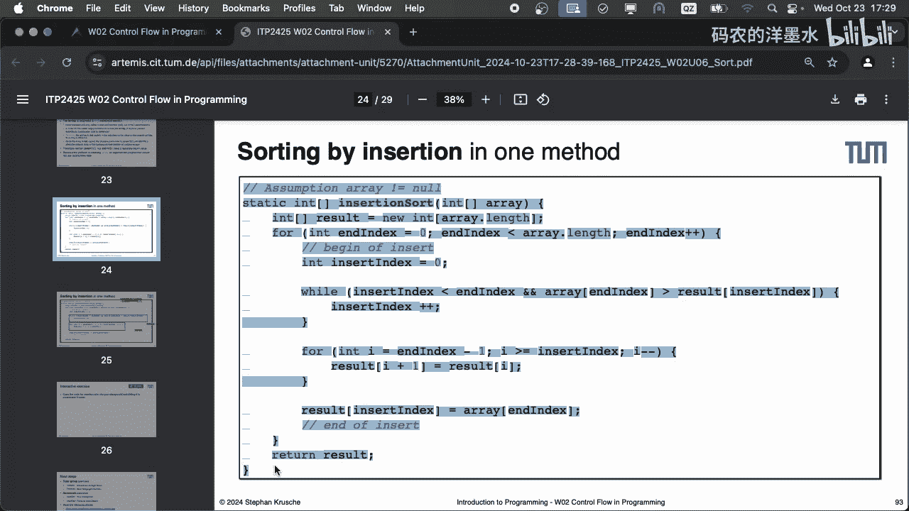
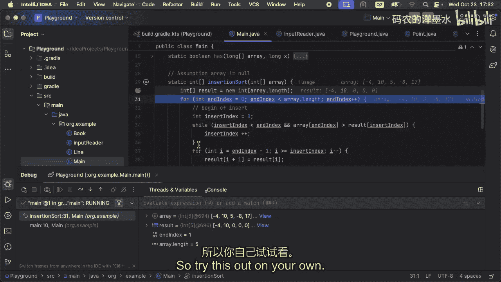
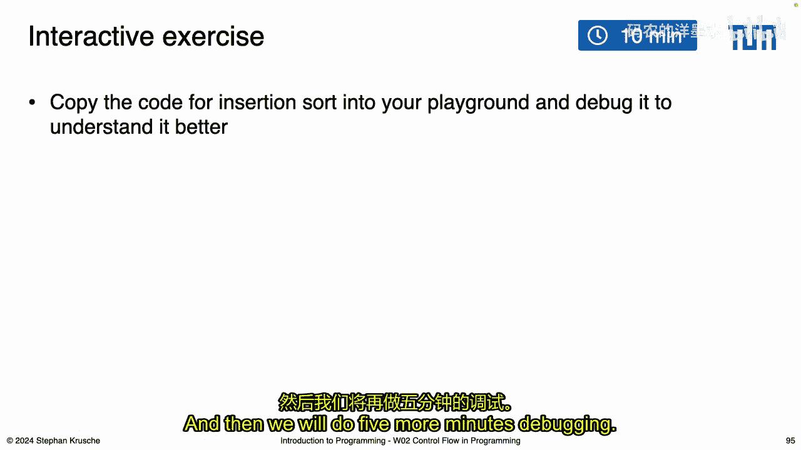
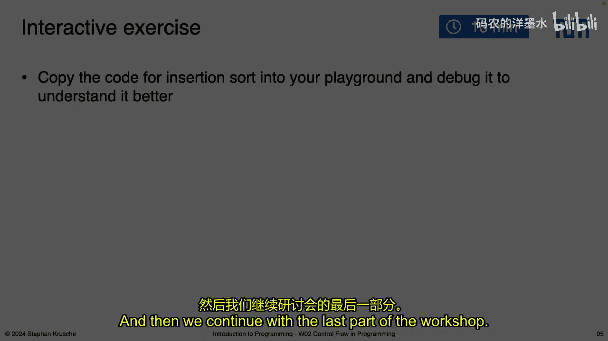
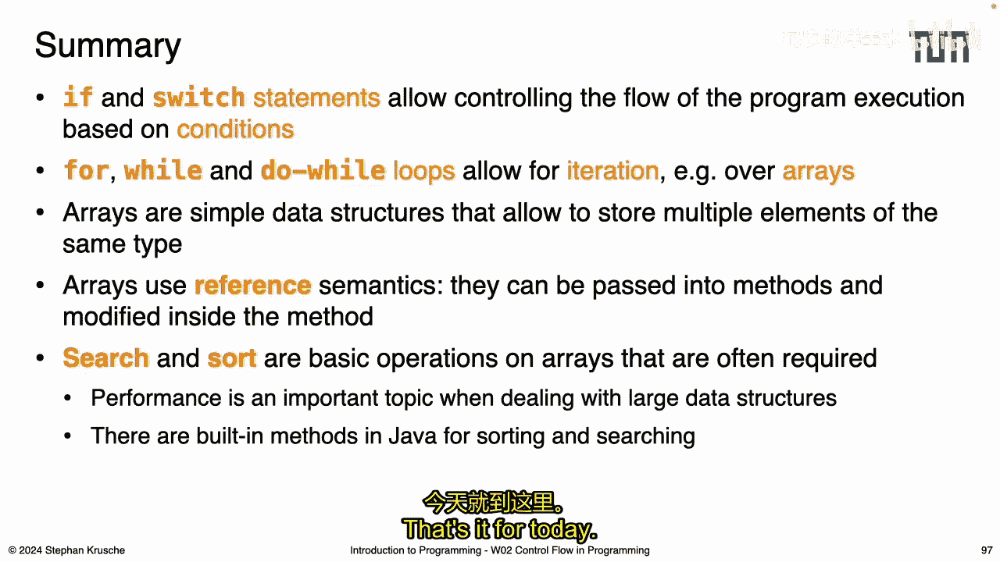
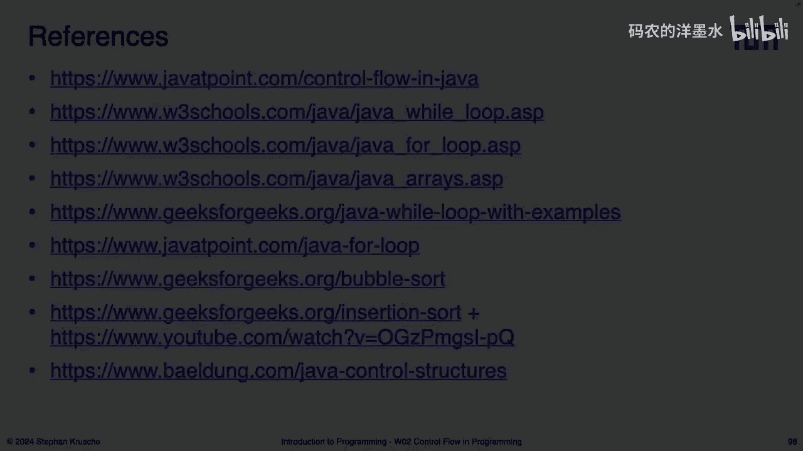

# 【全集】慕尼黑工业大学 计算机编程：从入门到实战 中英字幕 p14 Lecture 14 - 排序 -BV1WFrTBZExY_p14-

So our last unit for today is about sorting and again it's not that you get perfectly familiar with all sorting algorithms。

 there are a lot of different sorting algorithms， yeah the slides are not uploaded I know。😊。

Thanks you get them， there are lots of different sorting algorithms。😊。

And there's also a lot of performance optimization and there are even full courses where you learn which sorting algorithm is the best and which one is the worst and so on。

 and this is not the idea today we would like to show you one， very simple algorithm。

 it's called insertion sort， there are others as well。

 but we would like to show you one and again it's for you to practice how if else statements while and four loops work。

 that's the main idea。So let's have a quick look， sorting basically means that we have a sequence of elements。

 in this case now intes， theyre typically un sorted in the beginning。

 and our main goal is to sort them。😊，And in this particular example we would like to sort them in ascending order。

 so from the lowest to the highest number， you could also sort them in descending order from the highest to the lowest number that's a reverse sorting so to speak。

 but here we focus on an ascending order and a very simple idea could be to store the sequence in an array we just learned how to use arrays。

 then create another array and then go through the array step by step and then insert each element into the second array at the right position at the right index。

Sounds a bit tricky， this is called sorting by insertion or insertion sort。

 I'll show you how this works so we start with this array here， 17，3 minus2 and so on， 425。😊。

This is our original array now we create a new array and we'll inspect the first element 17。

 we take 17 and insert it into the second array at the right position。😊，Right now。

 the second area is empty， so we just insert it at the first position。

Now we look at the second element three， three should now be inserted into the second area at the right position。

😊，Or at the correct positioner and this is on the left side of 17。

 so we now we need to shift 171 to the right。😊，So that we can insert three。And this is what we do。

 we shift 17 and we insert three。Now minus2。Minus2 is again smaller than 3。

 so we have to insert it at left side of three and not at the middle or at the right side of 17。😊。

And we do that by shifting3 and 171。😊，Each to the right。And then we can insert minus2 at the index 0。

Now with 9， it gets a bit more tricky，9 is not smaller than minus2， it's not smaller than3。

 but it's smaller than 17。😊，So we can insert it at index 2。 indexdex 2 is already occupied。

 so we need to shift 171 to element to the right， and then we can insert it。Same with0。

0 would end up in the。Index1， the second position of the array。One would now end up in the index。

 two or the third position in the array。Seven would end up here。

42 is a good case now this is the largest element of the array for now。

 so we don't need to shift anything in this example。

 we can just insert it and5 is again somewhere in the middle， so we have to shift a few elements。

 those four elements to the right， and then we have enough space to insert five。😊。

And then we're done。That's basically the idea。 Yeah。

 I visually explained you now how the algorithm works。😊，And。In the next slides。

 I'll show you the corresponding code。For now I help you with this， but in the future。

 we assume if we explain something like this to you visually。😊。

Or verbally with a descriptioner that you are also able to come up with thecoia。

 this might sound hard， but at the end of the course you will be able to do that。😊。

And there's already one question here。I get you， that's a very good question so the question was in one of those examples here。

 yeah， let's take this example， do we move 9 and 70 at the same time？😊，Wants to the right。

 or do we do it sequentially and potentially for our question if we do it sequentially。

 which one would we do first？Yeah， that's a very good question， thank you for that。 Well。

 I told you that for now we assume that a program is completely sequential。😊。

There are not two operations that can be executed at the same time。 This is not possible。 Later on。

 you will learn that。There's a whole area of concurrent programming and some operations could be done on parallel。

 but here we don't do it， here we do it completely sequential because we don't have the skills yet。

 and if we do it completely sequential you can basically answer the followout question on your own。

 which of those numbers do we need to shift first？The most right one。

 17 because if we would not do that， nine would end up here and we would overwride 17 and we would lose the information what the number is and we can't do it anymore so first we shift 17 to the right。

 then we shift nine to the right， this is visualized in one step here。😊，And then we can enter 7。

Great question。Good， let's implement that now， so this is a bit more tricky to implement。

 we have multiple steps and you see that we have our general sort function here。

 our sort function takes an in array。😊，And returns another int array。

 that's for the syntax or the logistics here， we get an int array， we sort it。

 and then we output an int array。Now what we do here then is we create a second array based on the length of the original one。

😊，We call it result。That's a completely new array empty in that sense。

 that we have default values that we don't really mind。And then we do what we just described。

 we go through each and every element of the original array based on the index I。😊。

Now here we get this and we insert it into our re array at the right position。😊。

And this is done in the insert function。So now we do what we always do as computer scientists。

 we have a large problem and we divide it into smaller pieces and a small problem or sometimes also called subpro is now how do we insert。

 so that's the next step。😊，And this is done in the next slide。Here is our insert method。

Insert works like that， again， think about the visualization on the slide。😊，We take the element。

Locate at which position of the new array。Which we call error here as well， this is our result。

 but we call it error， at which position we have to insert it， so we locate the insert index。😊。

And then we shift all the elements of our new array from this insert index to a end index。😊。

To the right， we do this， we call this shift。And then we can add the element at the insert index。😊。

So again， divide and conquer we insert by first locating and then shifting。

 so now we have new sub problemsm， we need to find the insertion point using the method locate。😊。

And we need to implement moving elements to the right in the shift method。

Let's have a look how this works。Some additional annotations， so here's again。😊。

Here's locate and shift and I added again an explanation based on the example that we have here and we are in the moment and you know our method has to work all the time for all the different cases where it is in work but for this particular slide I have the case where we want to insert five we want to insert five the end index that is specified here is eight if you go back if you look up the slides afterwards you see that's the current index in the initial method in our initial for loop。

😊，So the end index is eight and we'll start with the index。😊，Insert index 0。

 because potentially it could be the case that 5 is inserted if we don't know。

So what do we do we check is。😊，5。Our element。Larger than minus2 the array at the insert index， yes。

 this is the case， so we simply increase the insert index。😊，Is5 larger than zero， yes？

Is it larger than one， yes， is it larger than three， yes？Now it's the interesting point。

 it's not larger than seven anymore。So the right conditioner becomes false。

The left condition is still true yeah we are at index4 which is smaller than the end index so we are not yet at the end of the loop just make sure that we don't go over the end of the loop because then we would have potential index out of bound exceptions。

 so this is still true but this is false and now we use the end operator if something is true and the other thing is false the end operator will evaluate to false the end operator always is only true if all the intermediate evaluations are true if one element is false and will also evaluate to false。

😊，So we will not increase it anymore。 We found it actually， we found the insert index。

 and we can return it。😊，So locate is relatively simple if you just look at the implementation and the explanation。

 so our insert index for this particular example is four。😊，Now， next step。

 we use this insert index and the original end index in order to shift。😊，So we have our new array。

 the copy， or not they copy the result array， and now we need to shift elements。

 so let's do that now， this is the state before the shift operation。😊。

And we'll start with the rightmost element as we had in the previous question。

 we move 42 to the right， how do we do that in code。

 well this time we don't start from the left and iterate through the array。

 no we'll start from the right and iterate from right to left within the array so we'll start with the end index minus1。

😊，We do that because the end index might be the same as the length。So we have to say minus1。

 and we will do that until I， our running index our iteration index is larger or equal than the insert index because remember we need to move 7。

 9， 17 and 42， well start with 42。😊，And index minus1，7 and we shift 42。

 we then shift 17 then 9 and then 7 that's the idea and this is how you now see an example of a photo where you go from the right to the left but not potentially the whole array。

 some middle area of the array depending on the conditions。And how would do we shift Well。

 shift is simply assigning the value we have 42 to the next index and in that sense。

 the animation is a little bit wrong because。😊，The index element here is not。Going away。

 it simply has the same value， but this is tricky to animate for you and makes might confuse you。

 That's why I animated it like that， yeah but。If I move 42 to the right。

 I'll basically just insert the value here， copy the value into it， and it stays the same here。

 and then I move 17， yeah so 17 would stay here， now we have it here as well， then I move nine。

 then I move seven， seven is still here， but I'm done with the shifting because now I can go back to the previous function and insert five our element into this position because I have enough space。

😊，And this is what I would do now。A few additional statements that I also mentioned during the explanation。

Notice that the second argument of the operator and locate is this one here is only evaluated if the first one is true。

 this is an optimization in programming language is because if the compiler。

The compiler always evaluates from left to right if there are no additional braces。

And if this is already false， we don't need to evaluate the other one。

 it can never become true again， and this is called short evaluation。😊。

And this is sometimes very important that you first do this one and only if it's true you do the second one。

 because theoretically there could be an error index out of bound exception in the second one if the first one is false。

😊，And the second thing is that we run downwards here or from right to left in our visualization。

 so this is a good example and also a question to you， maybe you already know it。

 why does the for loop run downwards？😊，This is basically the question that we answered， right。

 it has to run downwards because otherwise you would override values and they would be lost okay？😊。

Now， sounds all a little bit difficult， but this is now our first algorithm where we really put a couple of pieces together。

😊，And there are some additional explanations in the slides for you to read after I have uploaded them。

 here is the whole algorithm now in one method。😊，YeahIt's questionable if we put everything in one method。

 and then it's easier to understand， or if it's easier to understand if we extract a couple of other methods。

😊，Probably for you as a beginner， it's easier if everything is in one method because then you don't have to switch your mind when doing method calls。

 which can be quite difficult， but of course a developer at some point an expert developer would split them into smaller methods because first of all smaller methods can be reused in different ways and secondly。

 smaller code is also easier to test if you have mistakes。😊。

But what we do now here in slide 3 93 or 94， we basically mark the previous places。

 so the whole function is now called inserting insertion sort。😊。

You see the creating of the new array here， you also see the initial for loop that we discovered and locateade is this part here。

 locateade is just a while loop， and instead of passing elements over in a method call we directly used them here。

😊，This part is the shift method， just insert it at the right place。

 and this part is the insertion that was always at the outer part。😊。

So this is insertion sort notice that insertion sort has a quadratic average complexity and is compared to other sorting algorithms a relatively slow one this means in the worst case you have a lot of operations that are not necessary。

😊，Fastest sorting operations that we know so far are Quicksort and merch sort and there are a few others that are very。

 very fast but QuickSo is supposed to be the fastest one。

 but it's very complex to understand nothing that I can teach you in this course。

 you have to go to other courses or to the internet in order to learn it。Great， so again。

 we'd like to do an interactive exercise， please copy and paste the code after I have uploaded it into your playground to better understand it。

 so let me quickly upload the slides。😊，And then。You can have a look and try it out to better understand it and we'll have a bit more time for you to ask questions。

This page here， slide 93。We copy everything。

And go into the playground。And paste it here。 I hope it works for you as well， without any。

Weird character errors。 And then we can use that。 So let me collapse the search function。

And we could basically create another array here。 so let's call this unsorted array。And I don't know。

 we do a few random numbers， minus4，10。Plus5， minus-8，17。And now we basically invoke this by。

And it has does。 It has to be an in array， sorry， not a long array。

And we basically invoke this now and say our sorted array。Equals insertion sort。

 and we pass the unsorted array。And then we can print that。

 notice that printing arrays doesn't really work。😊，But we as a little trick in order to do that。

And this is。I think it's called Ars。😔，To string。And then it will be printed very well。

 And if I invoke this without debugging， I can already check。

What's going on here and see that the array was sorted correctly， minus-8， minus-4，5， 10，17。

It's very easy to get sorting algorithms wrong， so it's always good to test this with a couple of examples。

😊，And in the second step， you can now set break points and really go through it with your own example so again。

 start this in the debug mode and look through it to better understand it with the help of the threats and variables here。

You can for example then jump into it and then you see what is end index， what is array at end index。

 what is the array length， what is the insertion index。

 how do those values change and which parts of the loops are actually executed so what you notice is for the very first insertion no loop is executed。

 because the first element can directly be inserted。

 there is no need to search the right positioner for the first element it's completely clear。

But if we go again， we will see that the Y loop is executed in this example once。

 the for loop does not need to be executed in this particular example because 10 is larger than minus4 and the insert index is 1。

😊，And we can directly insert it。 So try this out on your own。 You have a few minutes。

To do this again， it's really important to understand how those concepts， Y loops， for loops。

 if L statements work and this is another good example to try it out if you have any issues raise your hands。

 our tutors are happy to go around and assist you also if you have。

Issues understanding it， you can ask them more about this if you don't want to do this in class here。

And then we'll do five more minutes debugging， and then we continue with the last part of the workshop。

Okay， I see that many people are。Watching。Instagram and TikTok videos on their smartphone。

 so I assume that you are done with practicing， there's one person with a question I think you need a tuor right？

So maybe you can help her。Are there any other questions regarding the method。

 anything that you don't understand and that you absolutely want to know right now？Otherwise。

 feel free to。Review it again afterwards to discuss it in your tutor group with your friends and make sure that you understand this in the next couple of days。

Okay， I don't see any questions， then we can continue。

What are the next steps well we again have two tutorial group exercises。

 the first one is called showdown at high noon and the second one is about seal telegraph decoders and two homework exercises。

 the transporter and panic at seal saloon so you see we always try to give them interesting names and themes and we hope you have some fun with those we also highly recommend you to read some online articles about arrays。

 while loops and for loops again I can only cover certain aspects here。

 all the details are online in the documentation we'll try to do more examples more practicing next week in the workshop where we do repeat the core concepts but we really ask you to be familiar with all the semantics and to make sure that you study this on your own。

A quick summary before we finish， so please pay attention to one more minute。😡。

And then we are almost in time。We talked about。Control flow in programming today， in particular。

 about conditioner selection， where we can。Configure how the program flows throughout the code in different branches based on conditions。

 and we have two important aspects in order to do that。

 we have if else statements and we have switch statements。

We also talked about repeatedly executing code。😡，In the so-called iteration。By using four loops。

 while loops， and a slight variation， the so-cal do while loops and we looked into a data structure that is really。

 really， really meant for loops， which is an array。You saw a couple of examples how。

Those loops and arrays can be used， in particular， two very important algorithms in computer science without those algorithms。

 nothing would work。And this is search and sort。😡，Those are basic operations that are often required。

Performance is typically an issue when dealing with those data structures in particular if you have large data structures。

 notice the good thing is they are built in methods for that。

 you don't have to be the perfect program in terms of search and sort。

 but now we assume that you understand basic algorithms like that， just for you to practice。😊。

Remember that arrays use reference semantics so they can be passed into methods and you can still manipulate them。

And if you just copy the reference， you get an alias， if you want to copy the whole area。

 you need to copy it element by element。This is very important。So Con flow and programming。

 your first encounter， practice， practice， practice until next week， then we do even more practice。

 that's it for today， have a nice rest of the week and see you soon。

