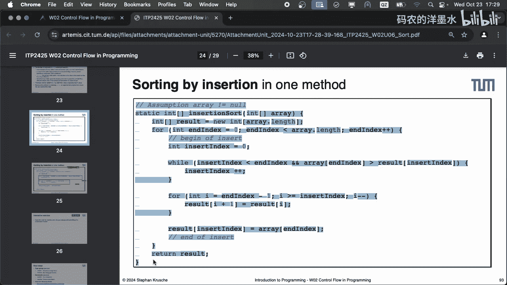
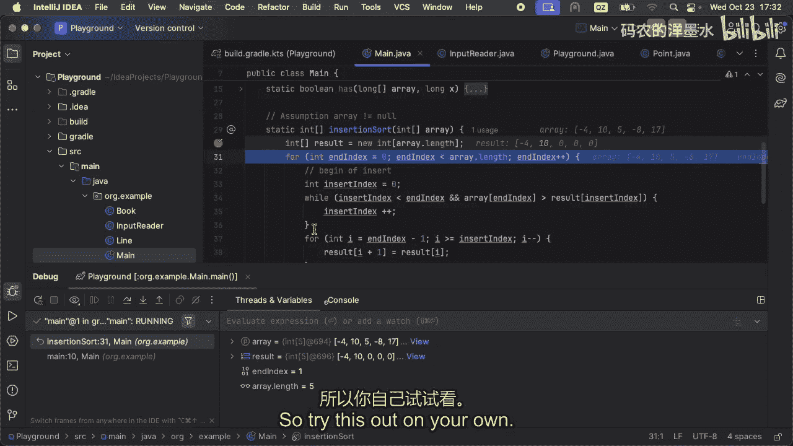
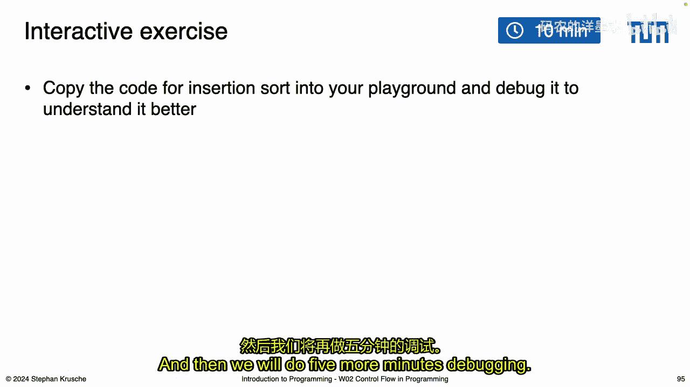
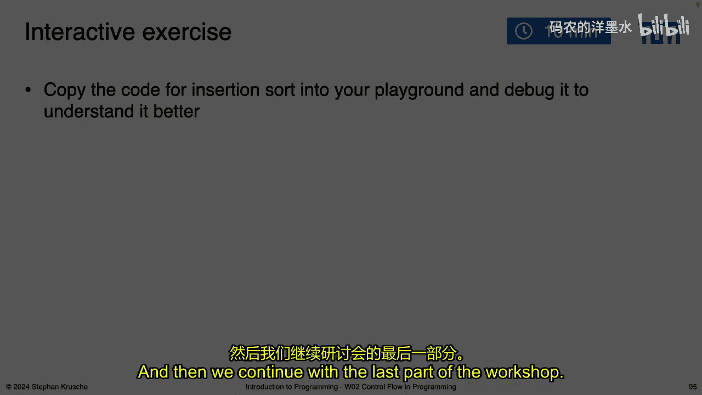
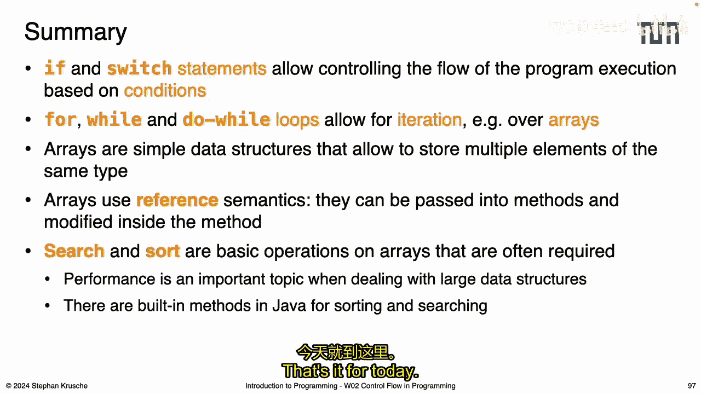
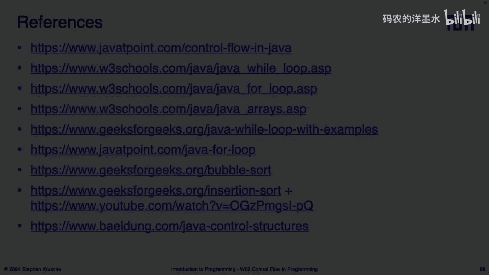

# 计算机编程：14：排序算法入门


在本节课中，我们将要学习排序算法。排序是计算机科学中的一项基础操作，其目标是将一个无序的元素序列（例如整数数组）按照特定顺序（如升序或降序）重新排列。本节课我们将重点介绍一种简单直观的排序算法——**插入排序**。通过学习其实现，你将巩固对 `if-else` 语句、`while` 和 `for` 循环的理解。

## 排序的基本概念

排序意味着我们有一个元素序列，初始时通常是乱序的，我们的主要目标是将其排序。在本例中，我们希望按**升序**（从最小到最大）排列。你也可以进行降序排序，但本节课我们专注于升序。

一个简单的思路是：将序列存储在一个数组中，然后创建第二个数组。接着，我们遍历原始数组，将每个元素插入到第二个数组的**正确位置**上。这种方法被称为**插入排序**。

## 插入排序算法详解

上一节我们介绍了排序的基本概念，本节中我们来看看插入排序的具体步骤。

以下是插入排序的工作原理：
1.  我们从一个原始数组开始，例如 `[17, 3, -2, 9, 0, 1, 7, 42, 5]`。
2.  创建一个新的空数组（结果数组）。
3.  遍历原始数组中的每一个元素：
    *   将当前元素插入到结果数组的**正确位置**。
    *   为了给新元素腾出空间，可能需要将结果数组中一些已有的元素向右移动。

让我们通过一个例子来可视化这个过程。假设我们要将元素 `5` 插入到结果数组 `[-2, 0, 1, 3, 7, 9, 17, 42]` 中。
*   首先，我们需要找到 `5` 应该插入的位置。通过比较，我们发现它应该位于 `3` 之后、`7` 之前，即索引 `4` 的位置。
*   然后，我们需要将索引 `4` 及之后的所有元素（`7, 9, 17, 42`）都向右移动一位。
*   **关键点**：移动必须从最右边的元素（`42`）开始，依次向左进行。如果从左开始移动，会覆盖掉尚未移动的元素值，导致数据丢失。
*   移动完成后，我们就可以在索引 `4` 的位置插入元素 `5`。

## 插入排序的代码实现

理解了算法步骤后，现在我们来探讨如何用代码实现它。我们将采用“分而治之”的策略，将大问题分解为几个小函数。

首先，我们有一个主排序函数。它接收一个无序的整数数组，并返回一个新的已排序的数组。

```java
public static int[] insertionSort(int[] array) {
    // 创建一个与原始数组等长的新数组
    int[] result = new int[array.length];
    // 遍历原始数组中的每个元素
    for (int i = 0; i < array.length; i++) {
        // 将当前元素 array[i] 插入到结果数组 result 的正确位置
        // 当前结果数组中已有 i 个元素（索引 0 到 i-1）
        insert(result, array[i], i);
    }
    return result;
}
```

主函数的核心是 `insert` 方法，它负责执行单次插入操作。

`insert` 方法需要完成三个步骤：
1.  **定位**：找到新元素 `element` 在结果数组 `arr` 中应该插入的位置（索引）。
2.  **移位**：从该位置开始，将 `arr` 中已有的元素向右移动一位，以腾出空间。
3.  **插入**：将新元素放入腾出的位置。

以下是 `insert` 方法的框架：

```java
private static void insert(int[] arr, int element, int endIndex) {
    // 1. 定位插入位置
    int insertIndex = locate(arr, element, endIndex);
    // 2. 移位
    shift(arr, insertIndex, endIndex);
    // 3. 插入
    arr[insertIndex] = element;
}
```

### 实现 `locate` 方法

`locate` 方法的任务是找到正确的插入索引。它从数组开头开始，将新元素与当前位置的元素比较，直到找到第一个比新元素大的元素，或者到达当前数组的末尾。

```java
private static int locate(int[] arr, int element, int endIndex) {
    int insertIndex = 0;
    // 注意循环条件：insertIndex < endIndex 防止数组越界
    // 并且使用“短路与”操作符：仅当第一个条件为真时，才计算第二个条件
    while (insertIndex < endIndex && element > arr[insertIndex]) {
        insertIndex++;
    }
    return insertIndex;
}
```

**代码解释**：
*   `while (insertIndex < endIndex && element > arr[insertIndex])`：只要还没到数组末尾**并且**新元素大于当前位置的元素，就将插入索引加一。
*   **短路求值**：如果 `insertIndex < endIndex` 为假，则不会计算 `element > arr[insertIndex]`，这避免了潜在的数组越界错误。

### 实现 `shift` 方法

`shift` 方法负责将元素从 `insertIndex` 到 `endIndex-1` 的位置向右移动一位。**必须从右向左**进行移动。



```java
private static void shift(int[] arr, int insertIndex, int endIndex) {
    // 从右向左遍历，从 endIndex-1 开始，到 insertIndex 结束
    for (int i = endIndex - 1; i >= insertIndex; i--) {
        arr[i + 1] = arr[i]; // 将当前元素的值赋给右边一位
    }
}
```

**为什么必须从右向左？**
如果从左向右移动，例如先将 `arr[insertIndex]` 的值赋给 `arr[insertIndex+1]`，那么 `arr[insertIndex]` 的原始值就丢失了，后续无法正确移动其他元素。

## 整合与测试

现在，我们可以将所有部分整合起来，也可以将逻辑写在一个完整的函数里以便初学者理解。以下是整合后的 `insertionSort` 函数：



```java
public static int[] insertionSort(int[] array) {
    int[] result = new int[array.length];
    for (int i = 0; i < array.length; i++) {
        int element = array[i];
        // 定位 (对应 locate 函数)
        int insertIndex = 0;
        while (insertIndex < i && element > result[insertIndex]) {
            insertIndex++;
        }
        // 移位 (对应 shift 函数)
        for (int j = i - 1; j >= insertIndex; j--) {
            result[j + 1] = result[j];
        }
        // 插入
        result[insertIndex] = element;
    }
    return result;
}
```





你可以使用以下代码进行测试：

```java
public static void main(String[] args) {
    int[] unsortedArray = {-4, 10, 5, -8, 17};
    int[] sortedArray = insertionSort(unsortedArray);
    // 打印排序后的数组
    System.out.println(Arrays.toString(sortedArray)); // 输出: [-8, -4, 5, 10, 17]
}
```

**关于算法性能**：插入排序的平均时间复杂度是 **O(n²)**，这意味着对于大规模数据，它的效率相对较低。更快的排序算法如**快速排序**和**归并排序**，但它们更为复杂，将在后续课程中学习。

## 课程总结

本节课中我们一起学习了排序算法，特别是**插入排序**。
*   我们首先理解了排序的目标：将无序序列按特定顺序排列。
*   然后，我们详细拆解了插入排序的步骤：**定位**、**移位**、**插入**。
*   接着，我们使用 `for` 循环、`while` 循环和 `if` 条件判断的逻辑，逐步实现了该算法。
*   我们强调了实现中的关键点，如**从右向左移位**和**短路求值**的重要性。
*   最后，我们整合代码并进行了测试。





通过实现插入排序，你不仅学习了一个基础算法，更重要的是练习并巩固了程序控制流（条件与循环）和数组操作的核心编程技能。请务必通过练习和调试来加深理解。