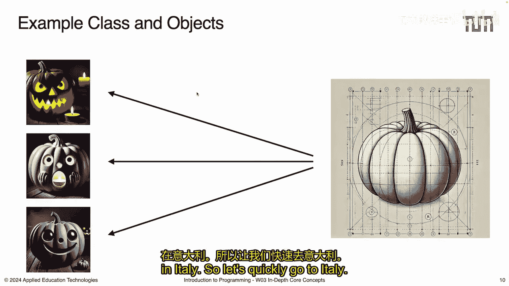
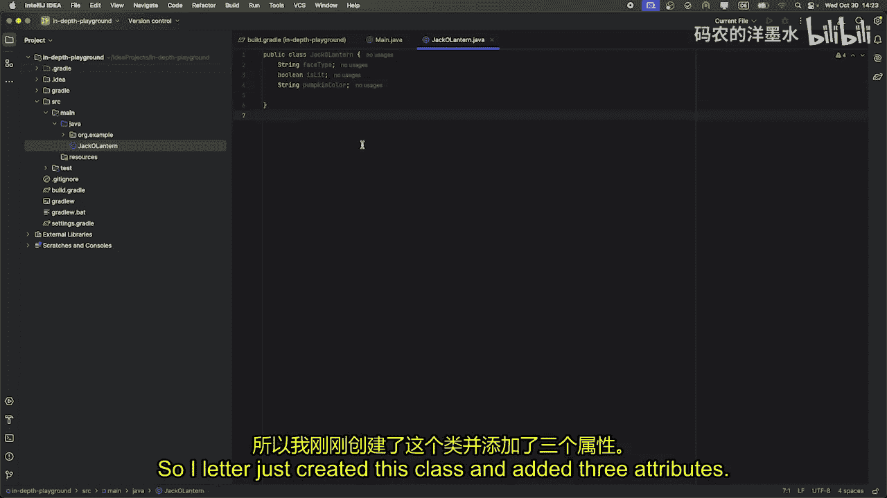
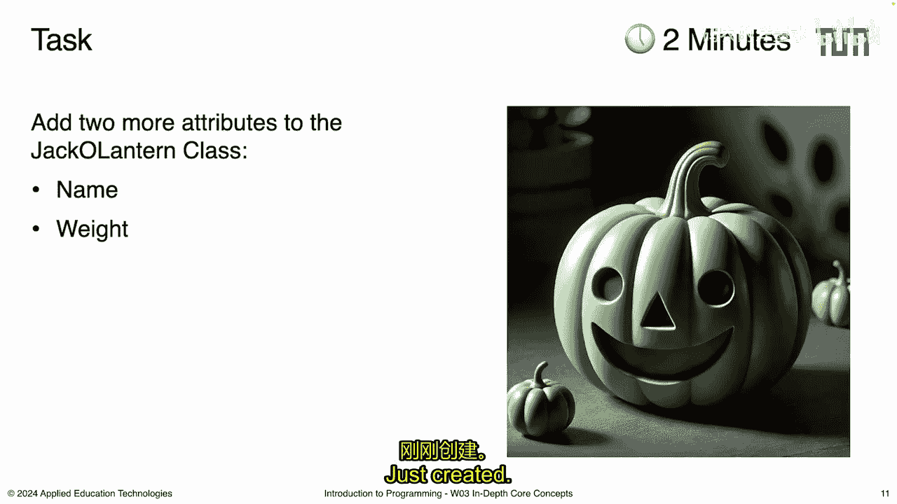
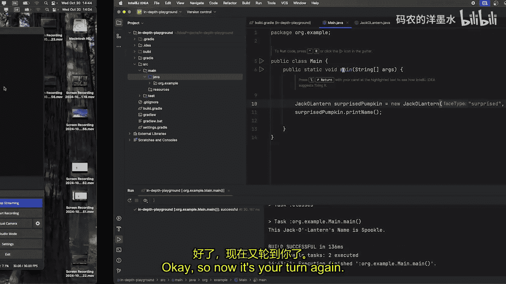
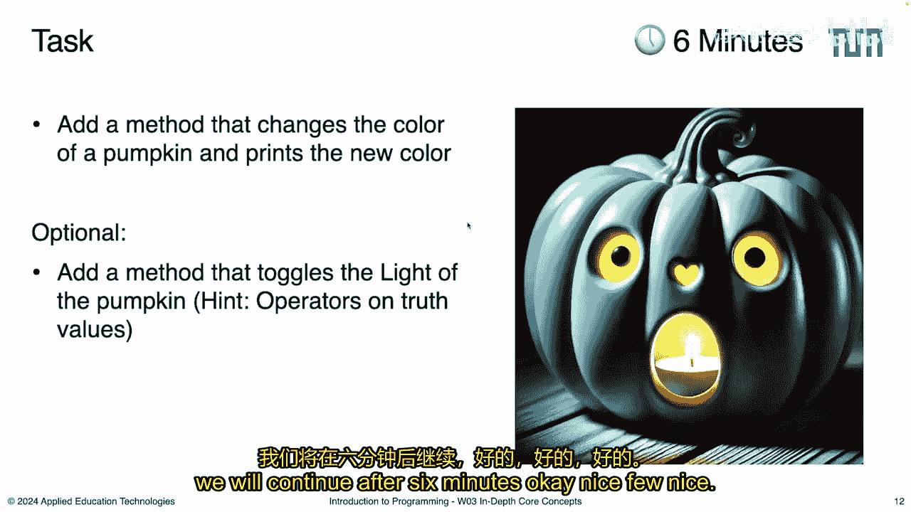
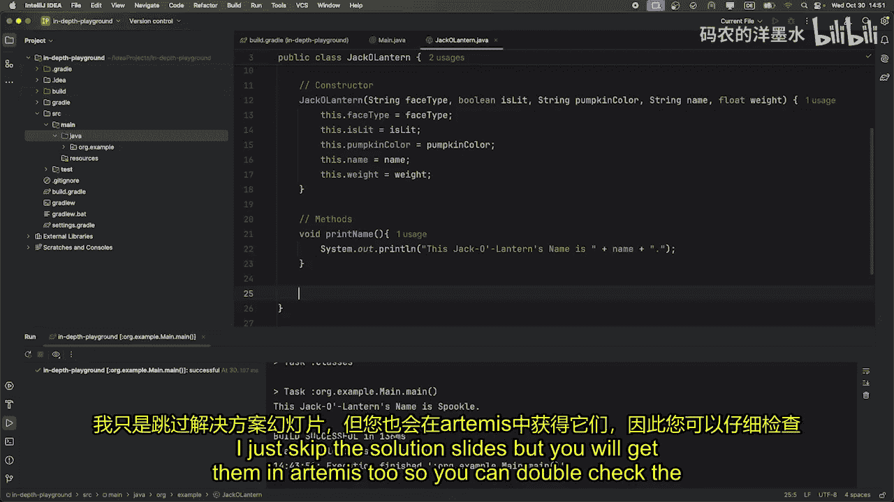
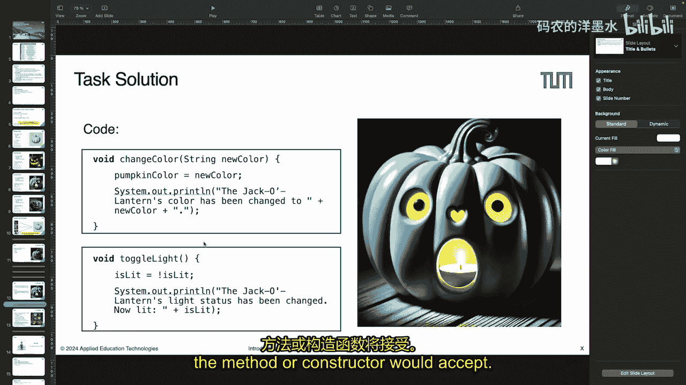
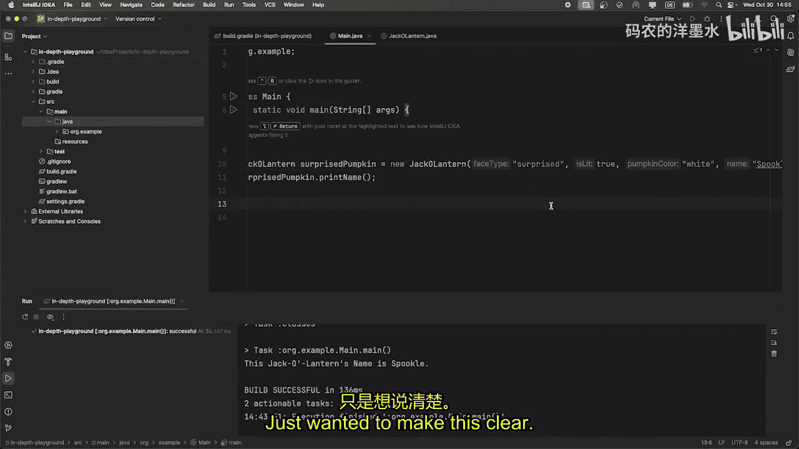
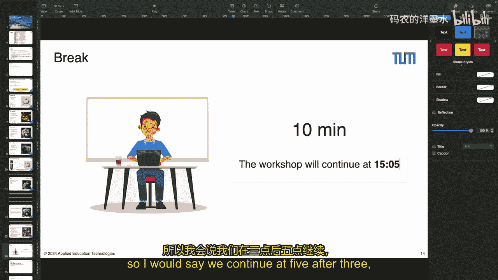

# 【全集】慕尼黑工业大学 计算机编程：从入门到实战 中英字幕 p15 Lecture 15 - 类 -BV1WFrTBZExY_p15-

So like Microsoftt， we are doing in depth core concept workshop。

And I will start with the first session。And before we dive into it。

 just our in depth core concept workshop is。So we want to deepen your knowledge in the first two or from the first two workshops。

 so the introduction and also the control flow last session。And to do this。

I want to show you the context of this workshop from today and we want to implement a single class and instantiate a respective object。

We also want to implement the connection of multiple classes with each other inside a race。

And last but not least， we have two sessions and in one session we will implement our conditioners and in the other we will implement some loops for controlling the program flow。

This should be all something you heard of the last two weeks。 but like I said。

 we are here to deepen the knowledge。For all those concepts。Here you can see the learning goals。

 so at the end or after this in that workshop， you should be able to implement a class with multiple value and type attributes and also respective methods。

You should be able to implement a class with multiple reference types。

 attributes and respective methods， also implement an array of reference types。

You should be able to implement Boolean。Regardless of values， attributes and methods， if statements。

 switch statements and theinerary operators。Last but not least。

 we will also take a look on while and two while。 and for each loops。

 and you should be able to implement those loops。Okay， so let's get started。

 I just said I will take care of the first session and the first session is about single classes so we will or dive into。

Let's do a short recap。 So the question is what is a class and what is an object。

 Im super sure you heard this question a lot in this course。

 but I just have the same question again for you so。What is a class， A class is a template。

 And I'm also super sure you heard this a lot。 or someone said a class is a blueprint。

 but that's what a class is。 A class is a template。

And we can also say that a class defines the form of an object。 So again。

 it's kind of a blueprint for an object。We can also say this the other way around。

That an object is a specific instant of a class。So I have this nice pop up。Would I would also。

 so I like you that you remember this， a class defines the template。

And an objects or objects in general are specific instances of this template。But。That's awesome text。

 I brought you some examples。 So because I think it's a lot more easier with some kind of examples。

You can take a look at the picture and just see many， many pumpkins。

Most likely because Halloween is tomorrow。And this is why we choose some nice pumpkins or t lanterns。

So you can see really a lot of different pumpkins。 And I hope you agree that they are all pumpkins。

But they look a bit different， but all pumpkins have some nice faces。They have some different colors。

 and sometimes the candle is on and sometimes not。So what I try to say is that we could have a class called check or Lntern。

And then we have some attributes like the face type。 So every pumpkin on this。

Picture has some kind of face time。 It's different。 So it's sometimes more scary。

 Sometimes they look happy and so on。 But all of them have Facetimes。Then we have。

 or we could have some attribute called like is lid。 So is the candle lid or not Do the pumping have。

Yeah， is it on or not， so to say？And for a third attribute， I choose to pumpkin color。 So again。

 you can see there are some pumpkins that are green， some are purple， black or orange。And this is。

 this is our template。 So we use this template， and we can。Have many， many different pumpkins。

 They all sometimes of checkze or lanterns， but they look different。So I want to take a closer look。

On these objects， we had the class， which was our template。

 and now we have a specific object like this guy。I hope you agree that this one looks kind of scary。

 so I would say the face type is scary。And， of course。I would say it is lit， yes。

And the pumpkin color is normal。 So it's an orange one。

 So this is a specific object that we created from our class。Again， the class was the template。

 And now we have the specific objects with specific。Things like the face type is a scary one。

We could also have another one。Just nice guy。And I think it's not a scary face， it's more。

 I would say， surprised one or shocked。😔，And I would also say yes， again。

 the color of the candle is on。And the pumpkin color for this one is definitely not orange。

 but it is white。Again， a a thesretic example， just to be sure。😊，And not object。

This one is super yellow， and I don't think we will find this one in a supermarket。

But this one has another face type。 The face type is happy。

And this time it is not lit and also the color， like I said， is purple。So you see we have our class。

 which was the template。For a general check or lantern， regardless of the face type。

 and the color and so on， and now you have seen three different objects， scary one。

 the surprising one。And last but not least the purple one。

But I'm not here to show you only some presentation slides I want to。To do some exercises with you。

 and that's why I want to create dis with you in intelligentche。So。Let's quickly go to Inlych。

Here we go。Okay， so that's the part where you have to open your MacBooks and laptops and so on and do some programming quickly。

First of all， I will create a new project。And I will call this project in the。Pground。Okay。

 here we go。Okay， I hope this is fine for everyone。Now。

 as you learned in one of the previous lectures， we want to have a class。In a new file。

 so every class that we want to add should be added in a separate file。

You have to do the right click on the right folder。😊，Now you can add a Java class。

 and then we call this one check go lantern。Okay。Here we go。So we had some， some different types。

 I said， or I talked a lot about the taste type。So I talked about the s and I talked about the pumpkin color。

So。My enche is super red。Does anyone have an idea what I totally missed here？😔，Yes。Okay。

 so we would go for a string for the first one。And islet was a bullion right。And the last one again。

 string sounds reasonable for me。Do you all agree？Nice。

 so I just created this class and added three attributes。

Now this is again， your time， and let's quickly go here。Maybe not。是的。

Now I want you to quickly add two other attributes to this class。Just create。

I give you two minutes， then we will continue。Okay， everyone， quick question。 Can you read the text。

 Is it not big enough or do you have any problems， and can you see it， We turn off the lights。Nice。

 okay。We had or you should add the name。Which type did you choose for a name？Nice。

Now the interesting one， oops。We should also， you should also add the weight。

Which type did you choose and why yes？Okay， just a quick。Our student in the front choose double。

 Does anyone else choose some different type。 It' also an idea。 Does any of you choose integer。Why。

Why is inte？A good idea， but maybe not the perfect solution。 Any ideas。Exactly。

 so the answer was that intership would round the number。 And I would say for a pumpkin。

 it's bit important if you wait。1 kilo or 2 or 3。 So I think we are definitely need。The dot。

 so the thatsimal。 So you could go for float。 It should be enough。 We could also go for double。

I just。Want to choose a float， because I。I wantant to show you this one。Okay。

 now we have some nice attributes for our class， but I also want to introduce a method。

 so I think it would be really nice if our pumpkin could print his name or her name。

So let's introduce a nice function that。Called like。

Like after this was the function would like to do， so I would call it print name because the function should print the name。

What I do before is I will add。To slashes。 And right here， something like methods。

So there two slashes。This are used as a comment。 So the things that I will write in the same line。

Will not be。When you run your file， this will not be taken into account so you could structure your code a bit with comments and on yes。

Nice， we need to go inside the class。 It's super true。Nevertheless， I also add my comment。

 and then I want to have my print name function。We need be the brackets。

 and we all also need the curly brackets， so the opening curly brackets is the start of your function。

Or your method。 And the。Closing curly bracket is the end of your method。

 So the logic will be in between those two brackets。Okay， so I think you all know this。

I hope you know all these function， the system out print line because every new project kind of starts with the system of printline hello Earth。

So， and then I said， I would like to have the pumpkin to print his name。

 So that's why I write something like。This chi of lantern。Name is。ok。What do I do now。

 I could simply write this check on names L Bob。 But what was what would be the problem if I did this。

Yeah， exactly， so the answer was that this is not a good idea because then we would have every object or every object would have the name Bob because we decided to use bob here。

 but hopefully not every check or lantern will be called Bob。So what could I do。

 What could I do instead of writing golf Any ideas。I like you guys。

 but anyone else has some ideas exactly。😊，We all， we simply type plus name。

 and then you can see the name turn to purple。 We can also say it here。

 So now we have a usage of the the。Attribute name and tellliche Husons。It's awesome sorting。

 I just add。Dot， so it is a sentence。哦配。Again， here's something red and intelligent， I think it's。

Super small on it 100% sure if you can read it， but Etelche says envelopelo method declaration return type required。

Any ideas what this means？Yeah， kind of right。 Do we need to have the public void， so。

It's kind of correct。 But Li Chey just mentioned that the return type is required。

 What what would you add。Yeah， I， I think I heard it here。 We only have to add void for now。

 So public and private is definitely important。 But for the first session。

 we will skip this and we will take care of this later， but we need to add void。

Why does the type that you use when the methods return anything， I think now we have a nice class。

 We have some attributes， and we have our first method。So let's go to the mainto Chava。

And I remove all this。Things， because I think we don't need them。说不。So， it's good。O。1。should be fine。

Let's see。Okay。What， yes， the question was， do I always need a access modifier like public or private and so on。

 And if I don't add。Access modifier， like I did， so I did not add a access modifier there as a default one and the default one is public。

Okay， so let's try to iniate object。And what is the key to instantiate an object。Yes， I read it。

 thekiword is new it， so I would try to check O lantern and I want to call my object。Surprise。

Timeumper。And then I say new， that's the magic key。 And then I have to check how。Lantern。Okay and。

With this。And this。Okay。If we would， whos。H。I think I would render it to okay。When we would。

Call our method。 We could do this like this。就是行。New。So。When we now run our project。

 what would happen。😀Yeah。😊，Nice， because it is super， everything is red。😊，I need to。过了去。This one。哼。

关成。哈好。😊，Okay， now we fixed it。Again， but what would happen if I now run my project and we don't have any errors。

What would happen？Yes。Nice。I can click here and hopefully you can see it here。

We have this Cll lantern's name is Nll。Why。Yes。Exactly。

 so the answer was we have no constructor just to show you， we could also do something like this。

Crice， pumpkin， doch。Ne is。Let's call him Spookle。 We could also do something like this and run our project and then it would be fine。

 but we already heard the better answer， we have to introduce a constructor。So again， it's your turn。

 try to introduce a constructor for our class check or lantern， and I will continue in a few minutes。

Then let's continue。Okay。Back in Intellich， we can see Intellich says that I have one related problem。

And I can simply click on this related problem and then In will jump right into the file and set my cursor where the problem is。

I can hover over it and then I can see expected five arguments， but found zero。

Because I edit the constructor。And I said that we want to haveops， sorry。These 5。

Attributes that we defined in our class， I put them here。And that's why。Now。

 we have to introduce them in our main function or not especially in our main function。

 But when we want to instantiate the object， we have to。Give our。Yeah， we have to introduce some。

Attributes。So that's why let's add some things like the face type。

 I would go for the surprise one because I love this guy the most。So price。

 but I'm not able to write it correctly， so。Firstt。Okay， and then I will say that it's true。

 because I want。He glows and then I have the pumpkin color， I say white。And we also edit the name。

 I still go with spookle。And。I honestly have absolutely no idea what a pumpkin in。Let's go with 1。7。

 Okay， again， here's something red。Because I wrote 1。

7 and Intelliche says that the required type is float because in my class I said that I want to have a float value for my weight。

But Intelliche also says that I provided a double。What can I do， yes？Exactly， I need to add the end。

Okay。No。只。Then make sure that we have a floating value to differentiate between a double and a floating value。

Float value， sorry， not floating。Okay so。Now， I clicked on run。And again， I have null。

I think I did not show you my constructor before， but I will show you now。

 Do you have any idea why I have null and not the name of my， of my pumpkin。Yes。Exactly。

The answer was。The answer was， maybe you should add this。 but， yes， definitely， I have to add this。

Do you all know why I have to add this。Any ideas？Exactly。With the key word this。

 we're referring to the object itself。 And this is what we want， because we want to。Address。

The attribute of the object we want to create。 and this is why we have to add this oops。

 I removed the end。So when let we go back to your？File， and I run again。 Then now we have the nice。

Name of Spooker。 So this is C O lantern's name is Spookle。Okay， so now it's your turn again。

是。And your task would be to add a second method that changes the color of a pumpkin and prints the new color。

Focus on the first task。 So on the first method， if some of you are fast。They can do the second one。

 You add a method that toggles the light off。The pumpkin。 But start with the first one。

 Take your time， and we will continue after six minutes。Okay， nice a few。 nice。 Okay。

 then let's quickly jump back to。

And tell you cheap。So I will quickly show you the solution。 You will also get some slides。

 or you will get。These lights， I just skipped the solution slides。

 but you will get them in Artemis too so you can double check there。

To be honest。I think I will simply。嗯。Show you the answers here。So this would be the code。

 the solution for the two methods。😔，And。This。The interesting thing is that you have to。

Add the parameters for the change color method。Because you want to change the color and you have to tell our program to which color。

 So you have to introduce。Or you have to add the parameters in the brackets of the method。

And then you will change。The color， so the pumpkin color to our new color。

 and then you can simply use again， the system or print line command。What function him？

To print something like the tel lantern's color has been changed to and thenprint a new color。

You would also be able to print the pumpkin color since you changed it before。For the other method。

 it's the talkggle light。And， of course， you could do。Something similar and or introduce a method。

That。Sets is LED to true or false。 And you can pass。Argument， too。

 But what we wanted to do is to toggle the light with one single function。 I always say function。

 but I mean， an method。And this is why you have to is。And then you can set the islit to the nu islit。

 so this is what we do with the exclamation mark here。So when is lid was true before。Then we say is。

Is。Not true， which is false。 So we toggled it。It's the same when Ilet was false before。

Then we set it to is nu false。 And this is again true。

 So that's a idea to to Boolean variables very easily。 And then again， it's the system。

Out print line， and then you can say something like the checkll lantern light status has been changed and now it is changed is lit。

Okay， any questions so far？Nice， I like this。Okay。Maybe one thing I just wanted want to add before we go to the break。

 two things， to be honest。Because sometimes I also mix things up between parameters and arguments。

 So I want to。To make this clear at this point。 So we have the words parameters and arguments。

And parameters are the variables in a method or also in the construct。

That the method or constructor would accept。 So when I go quickly back to my intelligent。

The things here。😔，They are called parameters。And when I go to my main function。The things here。😔。

I parish to my constructor or to some methods。 These things are called arguments。

 So a lot of time these two birds get mixed up。 just wanted to make this clear because sometimes。

Yeah， it's confusing and I also mix them up。

Just wanted to make this clear。And the other thing I also have。And other big task。

But I would skip this because of time reasons。 But if you want to do all the things we did in this lecture。

Now， you could do this at home。 It's kind of the same progress。

 and you can train to create a class to add attributes， to create a method。

To instantiate an object and so on。I will upload the slides， and if you want。

 you could do this and practice this again。So。That's it。 And I just looked at my watch。

 We are five minutes late， so I would say we continue it。F of three。 Thank you。

