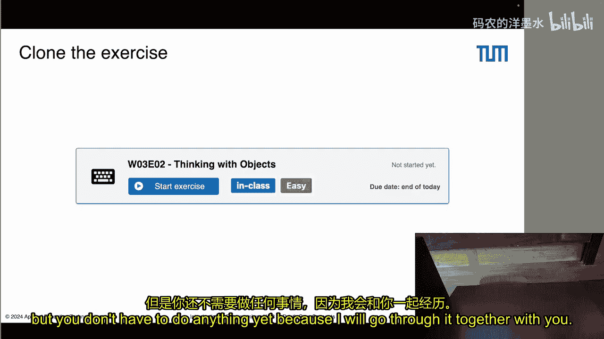
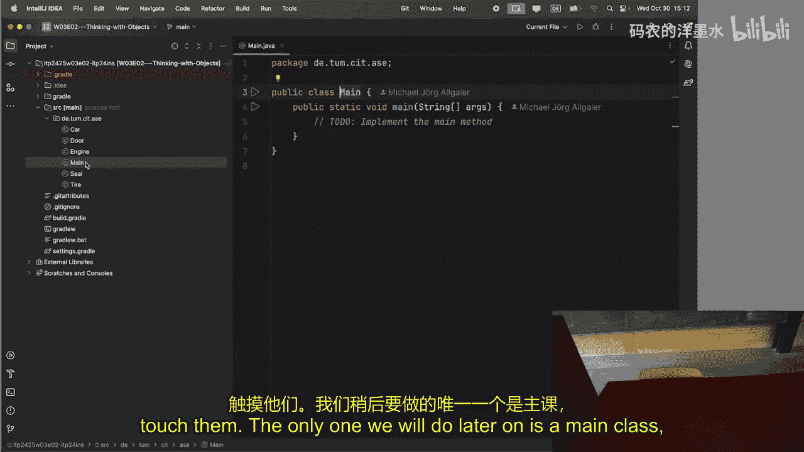
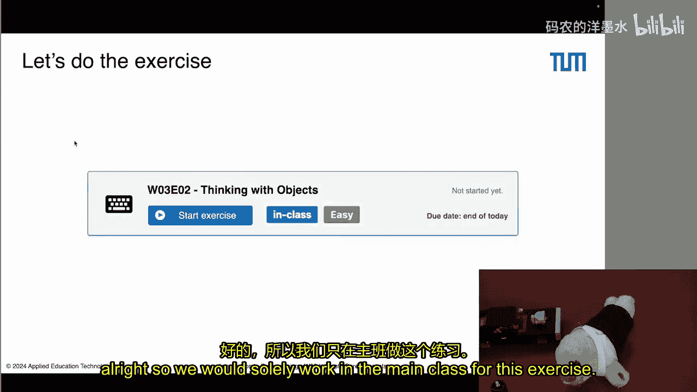
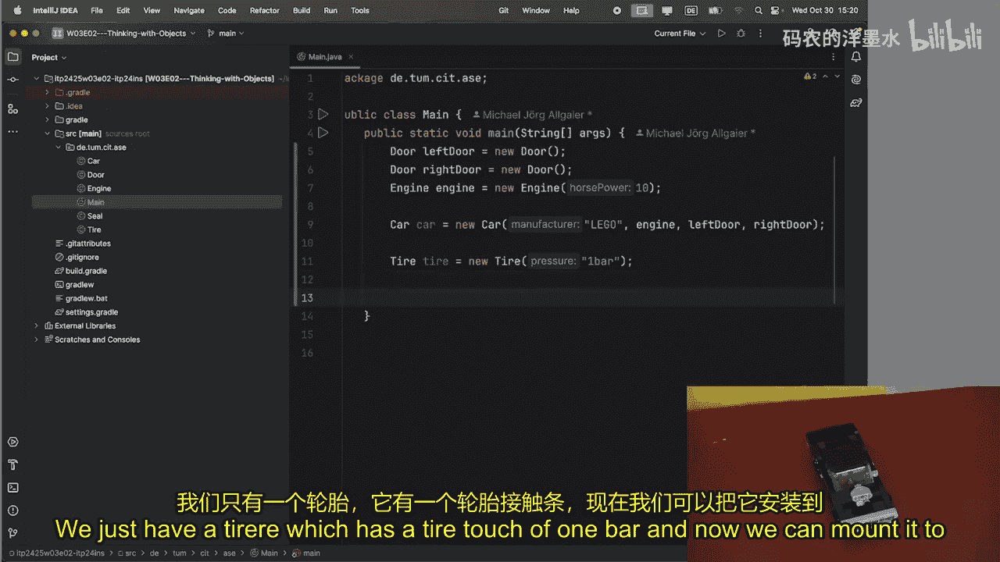
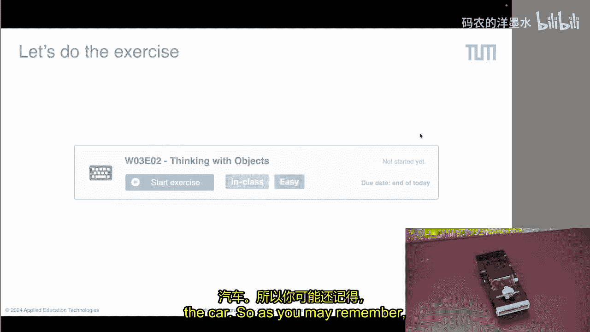
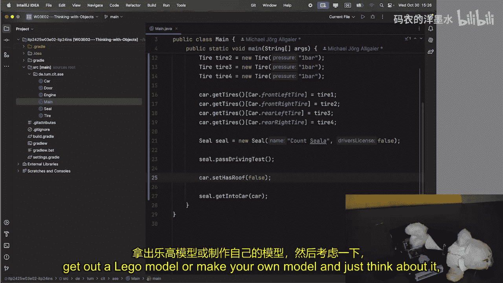
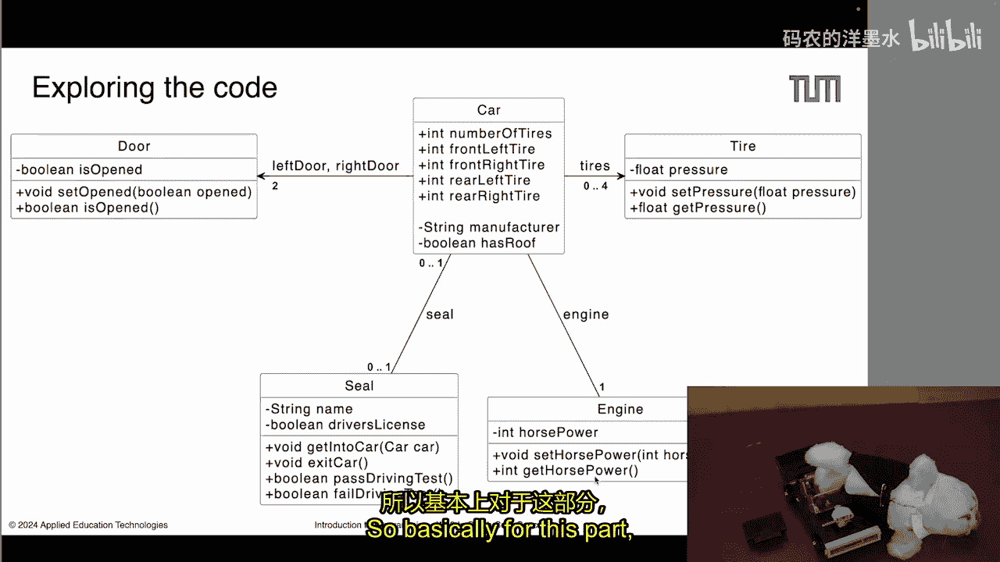
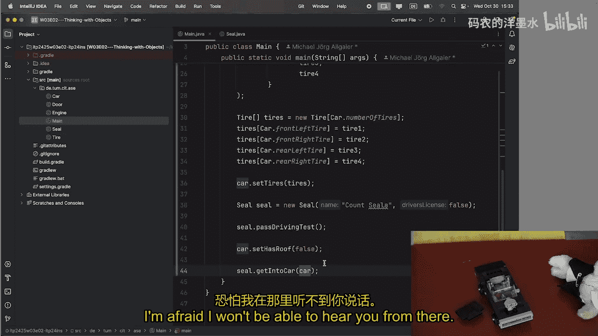
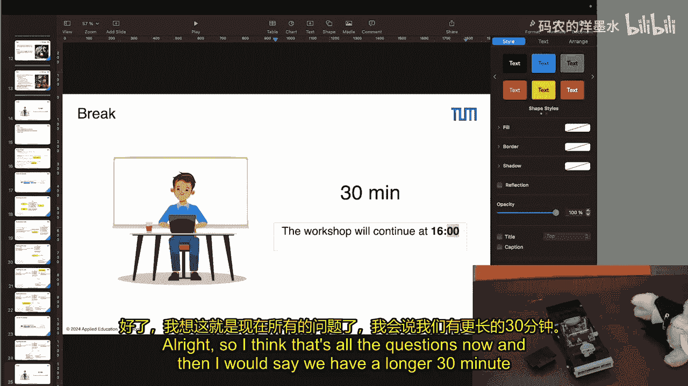

# 【全集】慕尼黑工业大学 计算机编程：从入门到实战 中英字幕 p16 Lecture 16 - 多个类与数组 -BV1WFrTBZExY_p16-

After Ramona has now showed you how to use single classes。I will now take over the second part， and。

Tell you about how to use multiple classes。Together with a race and to really think of objects as objects in the real world。

So first of all， I will do a small repetition on arrays。

So there are three important parts about a race。First of all， that's a declaration。

Then there's the initialization。And then that's how to use them。So to dec， you have this。

It is pretty much the same as you would do it for any other type， you have a visibility。

 which you can also leave out if you're inside of methods， for example。

And then you have the type and then the name， However， a， after the type， you have。Two braces。

To brackets。So you're right to type， open bracket， close bracket， nothing in between。

So as an example， you would write private seal， brackets， seals， and this would create。

An array of seals that is also called seals。And it is private。So it can only be accessed inside of。

The class。Now， the second part is after you finishedized it， it's still empty and contains nothing。

It's just an empty variable。Then， to initialize it。

You have to do like with objects new then the type of the array， then inside of the brackets。

 you write the size of the array。So as an example， you will do new seal。

Opening bracket 10 clothing bracket， which would create a seal array of size 10。

And something important to note here， arrays have a fixed size。 So if you specify here。

 this array is a size of 10， you can only put a maximum of 10 elements into it， but not 11。

And also with this， the contents of the array at the beginning are empty。 So now。

There's also a second way to the initialize arrays where you do not specifically state the size。

 but instead， you already populate it from the beginning with some values。

So the syntax for this is you no longer have the sides inside a brackets。

 but after award you have curly braces and there you have a comma separated list of objects you want to put into the array。

As an example， if you want to have a string array， you could put the string hello。

And then this string whirl into it。 and this array would then have the size， too。Good。

 now how do you actually use the values in the arrays for this。

 you have to use the name of the variable the array is stored in。So， for example， seals or texts。

And then you have to， again， use brackets and put the index of the element you want to access in there。

So， and then to assign something to that slot in the array。

 you just have to do equals and that the value。 So you can again see examples here。

 So to get the first seal out of an array， you use seals， brackets。0， and that is because for arrays。

 we start counting at0， not at one as at one， like us normal Newman do， but we start counting at 0。

 So that means for a array of size 10， you have the index 0， all the way through 9。

 if you try to access a 1 index， that doesn't work。

Because that would try to access the 11th element in the array， which。

It doesn't exist because the array only has 10 entries。And then the same is for assigning it。Alright。

 so far so good。 Now let's get into the exercise part where I have prepared an exercise on Artemis for you。

 which I want you all to clone right now， but you don't have to do anything yet because I will go through it together with you。

Alright， so you have to go to Artemis the course， go to W O，3， E O2， then start the exercise。

And then， copy the URL。Go into Italy Jane。Then。Get from VcS。Paste URL here。And then you can clone it。

Alright， and I'm gonna to give you all one or two minutes to get this done。

I guess and I can continue so if you look into the repository you just cloned。

 you can see we have already provided you with a bunch of different classes and you don't even have to touch them。

 the only one we will do later on is the main class。

 but before we do that I will first walk you through our class hierarchy。

So the first and most important class is that of a car。So in our case， a car has。

5 static public attributes。Which is， first of all， the number of tires a car can have。And then， also。

The indexes for each of the tires。 So I've brought a little Le here。To visualize this。

 so this car has。Space for four tires we have so the number of tires is four and we have a front left。

 front right， rear left and rear light， rear right tire。

And those will be used later on to just simply ease how we。Put tires onto the car in the coat。

All right， then we also have two private non static。Attributes。

 the first is a manufacturer of the car。 So in our case， we have a Lego car here。 And also。

 if the car has a roof because for this car， the roof is actually detachable。Allright。Perfect。Now。

 let's continue。Iic can。So。This car has also two doors， a left door， and a right door。And this car。

Does not allow us to detach these doors。 So it always has two doors。

And a door can be opened and closed。And yeah， that's all there is about the door， cars to doors。

 always， nevertheless。Good， then the next thing that a car has。

 which is very prominent with this car， is the engine。You can see it here at the front。

 and it is also fixed into the car。 And that means the car always has one engine， not more， not less。

All right。And lastly， we also have tires。 Now for tires， as you can see。

 this car does not have any  tires currently mounted to it。 That is because they are dismountable。

 so the a car can have anywhere from 0 to 4 tires。And。

It is really up to you how many car ties a car has in the end。Good。Now we have some here。

 and we will use them also later。So the last thing that you can find is a seal class。And we。

 I've also brought you here， which I will also use for the practical demonstration purposes later。So。

For this， so for a seal and a car， we have something fairly unique。

 which is a bidirectional relationship。 So you can see for all others。

 they are going into one direction。 So a car has doors。 a car has an engine， a car has tires。

 However， a car can have a passenger or a driver， but the seal who is a driver also owns the car。

 So we have this。😊，The relationship that goes into both directions。

 So we have multiplicities on both sides here and。Since they are independent of one another。

 a seal does not have to have a car and a car does not have to have a seal in it。Good。

 and a seal can obviously also get into the car and exit a car and also pass or fail a driving license test。

Perfect。😊，Now， I hope the class hierarchy is clear now。And。Then。We would now start with the exercise。

Allright。

So I would。We will solely work in the main class for this exercise。

 so you should ideally all admit so you can follow along with me。So。Obviously。

 of all the three things we have here， tires， a car， and a seal。😊。

I think we can all agree that this is the most important thing to have a car before we。

Have a tire because without a car。We have can't。 We can't really do anything with a tire。

 So for this， let's create a car in Java。So first of all， I declare the variable。

 which is of type car， and then I create a new car。And here we have now a little bit of a problem。

 So a car has to have certain attributes when we created in the constructor。

So the first thing is pretty simple， as we can see here。

 Inche is very helpful and tells us what we need。 So the first thing is the manufacturer name。

 which is Lego。The other three are an engine， a door， and another door。

So because as I already told you， our car cannot live without those three things。

 so we have to create them before we create a car。So， let's do this。So for this。

 the procedure is pretty much exact same， so we have a door。Here。

 so this is the left door that I'm going to create now。And it's just a new door。

And the exact thing is also for the right door。Perfect。Now。

 it's the last part we need to create a k engine。 So again， it's the exact same procedure。

 We declare variable and initialize it and。A car also has a horsepower value， in this case。

This car has 10 horsepower because it's very small and it's made of Lego bricks。Good。

 now we have to put them into the constructor。 and now in what order are we propose to put them into。

 So there are two tricks that we can use here。 The first one is we can just look it up here。

 or interj also allows you to reduce a shortcut， which differs from laptop to laptop。So for Mac OOS。

 it is command and P for Windows and Linux， it's different As on alomists someone will know。

And then itj will show you as a pop up here， what you need to put in there。

 So first we need the engine， then we need the left door， and then lastly we need the right door。

Perfect， now we have。This car， so what we have in the Java code now is exactly what we have here We have the Lego car is two doors and an engine。

So。This is not some abstract thing we have in Java， but really， we have created an object。

 and this object perfectly represents what we have here in real life。到。The thing is。

Now we have a car， but。As this car cannot drive currently。

 So there's no point in the seal getting into it。Because， well， it doesn't have any tires。

 so for that we need to create tires。So the first step for that， let's create a tile。

 and it's the exact same thing。We just like as we did before。 So I'm not going to explain it again。

We just have a tie， which has a tie up to drop of one bar。And now we can mount it to the car。

So， as you may remember。A car。Has。

An array of tiles。 So we have to put it into the array somewhere。 So in this case。

 I to edit this tile。I want to mount it now to the front left position right here。

So in order to do that， I have to。Get the array of tires。

And then I want to put it into some specific slot。And this slot should contain the tire。

So which slot in the array is now the front left slot。 It， I don't know。

 You don't have to know it doesn't matter。 What matters is we have provided you a static attribute for that。

 which just you can do car do front of tire。 And then it's in the right position in the array。

You don't have to worry about where the rate actually is as long as you know， cut up front the tire。

Front right， that's actually wrong。 I want the front left tie。And now， what we've done。

We have planted， we cl out。就是卡。And have established the relationship between a tirere and a car。

Perfect。Now， ideally， we want to do this for all of the four tires that the car can have。

 So for this。The naive approach might be， we just copy this four times。

 switch out the position of the tire， so。Like this。And Java says this is fine， you could run it。

 it will compile。And it looks good， maybe， but it doesn't make any sense from a。

Reality point of view。 So what we have done is we have taken the exact entire。

 which we have hurrying mounted to the front left slot and mounted into the other three slots on the car。

 However， a tirere is not a quantum object。 It cannot be in four positions at once。So。

While it works in code， it doesn't make sense， and that is really one of the things here。

 just because Java allows you to do something doesn't mean it makes pen。

So what we should do instead is。We should create three u tires。

And then mount these three new tires to the remaining three slots。

So instead of just creating one tie here， we have to create。4 tires。 So tie 1， third2， tire 3 and 4。

And then we can mount them all to the respective slots here。And。

This is now also the reality I will mount here。And。那我给来。A fully functioning car。

The only thing that is missing， which we already have here in the real world， is our seal。So。

 in code。It doesn't know anything about a seal yet， so we have to fix that。So for that。

 it is the same procedure again， we just declare it， and then we initialize it。So。

This seal is named countla。And currently， does not own a driver's license yet。We have to fix that。

 Otherwise， we can't drive a car。 So for that， we simply use the class that。

 the message that we provided you and。This counselor takes a driver's test and passes it。

 so now he can drive the car legally。And now for that， he wants to get into the caral。So we say seal。

 get it a car。 And then when we pass a car， which in Java， again， just fine， we could end it here。

 However in the real world， we have a side problem。He doesn't fit into a current lead。 However。

 there's a trick we can do。ch the roof， and then you will fit into it at least somewhat。Yeah。

 so in order to do this in code， we have to really do car dot set through to fault。And now。

 this car has no a roof anymore。So。This would be it for the exercise now， basically。

 So I really hope that I could show you really the relationships of objects in Java and objects in real life because it is very。

 very helpful when you write Java code and write objects， attributes and。😊。

Methods that you really think about。How would that work in the real world。So， if you haven't。Object。

That is related to another object。 Does this relationship make sense？For example。

 it wouldn't make much sense to say the engine has a car。 The car has an engine。

 So also for the direction of the relationships， this is really important to just think about it。

 maybe even just。Draw it on a piece of paper or if you have it like me here。

 get out a Lego model or make your own model and just think about it， how it makes sense。

Perfect。😊，So。I'm。Pretty early actually， so are there any questions about this？

So basically， for this part， I have to write it four times because。Well。

 we have to mount four wheels to the car， so we have four slots and for each slot we have to individually mount the tire here。

And for the first part here。So I will repeat that。 So if we would just have。

One of these tires here and mounted to all the four different slots。That works in Java。

 but not in reality， because。When we create one of these taac here。

 So we have a variable and we create a new tare， what we do is。😊，In real life， we have this one tie。

 but only this one tie。And。In reality， we can only mount it to a single slot。

So it cannot be mounted to multiple slot for that we need multiple actual tires in real life and since one object in Java is one object in real life。

 that also means we need four objects in Java。Did cleared up a bit perfect。We can actually do both。

 So the thing is， eras our objects themselves， so。😊。

An alternative to this would be that we can indeed do set tires。

 and this would then require the entire array of tires。 So in order to do that。

 we would have to create a new array。 So as I've shown you before and then here。We have to。

 we can already then specify all the tires。 So here we do tire 1， tire 2。Tre 3 and tie。4。This。

 however， has a slight disadvantage that you don't really know in which Fl is Ti mounted now。

So an alternative could also be you create。The array separately。 So you do。Declare variable tire。

 Then you create a new。I read it， and you could either write for here。

 but the better solution is to use。The static attribute we've provided。

Because this way it is very easy to change how many tires we have， and then in this array。

 we could do effectively the same what we have done here above， so I am just gonna。

Copy that over here。And let me fix。This gotier。Allright。And then lastly。

 we could do car dot set tires， and then our array。So basically。

 these are three all valid approaches。 and I just。choseose this one。

 because then when we create a car， we already have a slots for the。Ty us and。In Java。

 it really it doesn't make a difference。 in reality。 it really makes a little more sense to say， hey。

 we have these slots that were already created and we just use them。Yeah。Okay， so for that。

 it is helpful to look into the method now and see what exactly it does。

So it sets the driver's license attribute to true。 So now the question is。

 is driver's license static， So the same for all objects of one class。 or is it。

Specific to that one object。 So for that， we also have to。Look at up here again。

 and we see it is not static， so it is specific to each seal。 So if we set it to true。

It is only true for this one seal。 And that also means now that。If we say fast driving test。

Then it only count for this one specific seal。好。So， this one。Okay。

 so a seal has the method to get into a car because。Well， in reality， again， a seal。Or a human。

It's an actor and gets into the car。 The car cannot be like。YouYou could also in Java do。

Except passenger or something or set driver or whatever。 And again， this would make sense in Java。

 but。Does it make all that much sense in。The real real world。

 because that would kind of mean that the car is the actor in this case。So that is， first of all。

 why we have some message in the seal and then。The seal has to know which car it gets into。

So for that， we have to actually give it the car that we have created previously。

And then the ceiling knows up， I get into this car， and。Yeah， it。That's everything。

There's a question right in the back。 I'm afraid I won't be able to hear you from Mike there。

 The question is。

In CAAR， we have these non static attributes and we have the static attributes here。

If there's a way to differentiate them。And sadly， in this diagram， there isn't。

Usually there's a notation for that， however we don't really use it in this course。

So the only real way to know this here is if。When I've told you。

 it is in the slide or for exercises when it's written in the problem statement。

I know this is not ideal。Sadly， that's what we're dealing with currently。Allright。 So I think。

That's all the questions now。 And then I would say， we have。A longer 30 minute break， which。

Goes until 16 or 5。

