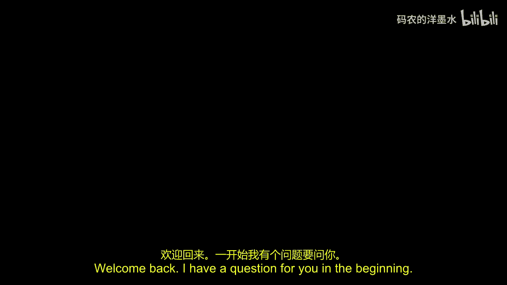
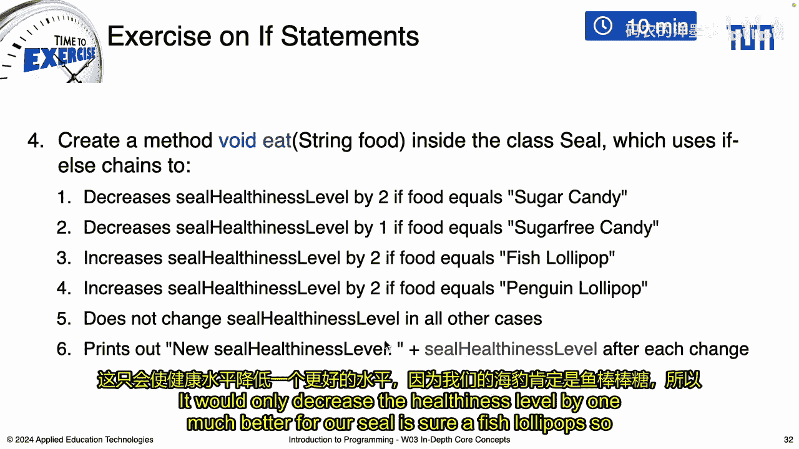
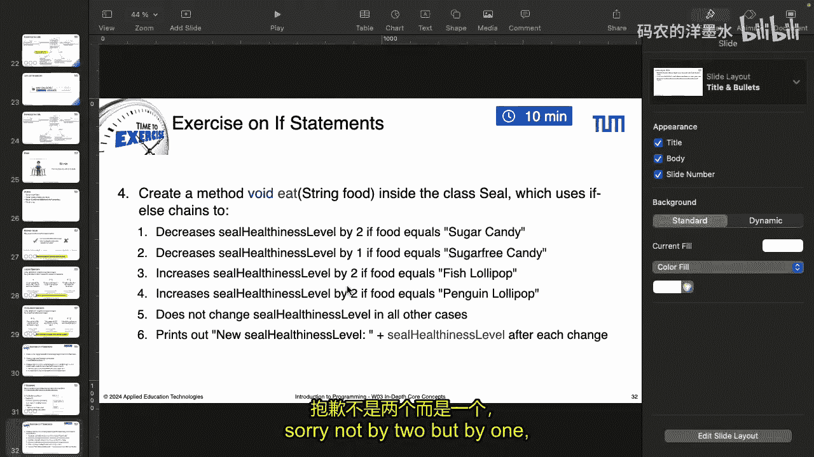
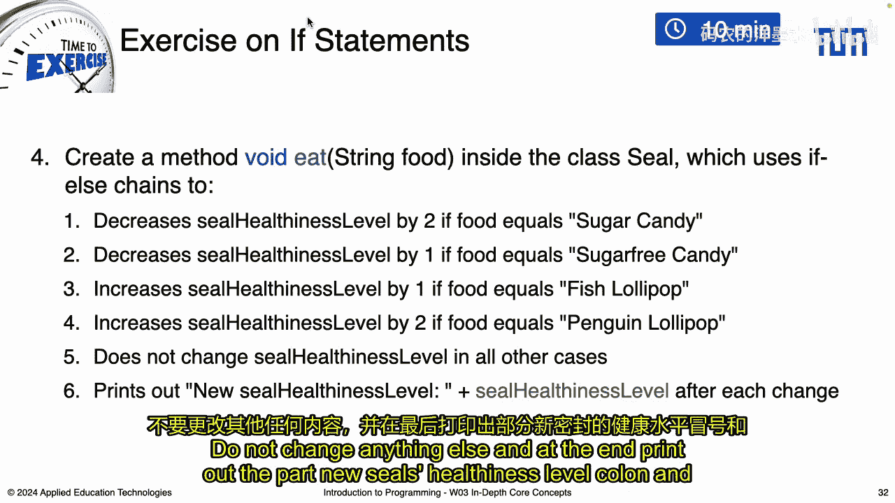
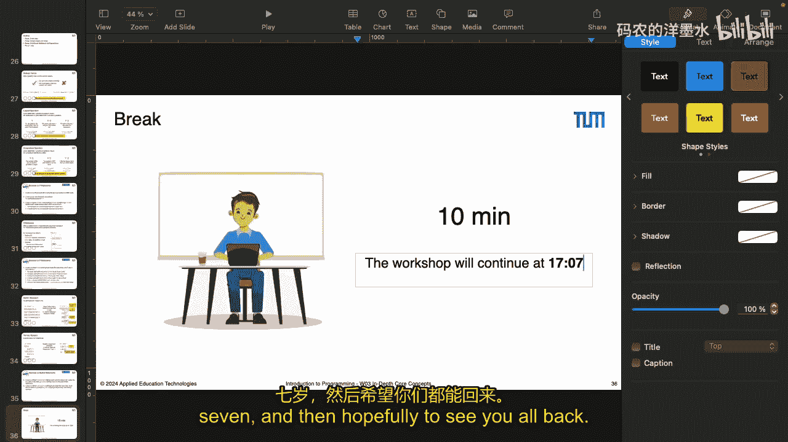

# 【全集】慕尼黑工业大学 计算机编程：从入门到实战 中英字幕 p17 Lecture 17 - 条件语句与表达式 -BV1WFrTBZExY_p17-

Wecome back。

I have a question for you in the beginning。What was the last？Time today， you made a decision。

Pro one of your decisions today made was， could I go to the lecture door？😊，哦，对我来水。

Here we have an either question。Let's tell me to the basic question I know。Lecture of today。

There are just two answer options here。Either a goal or not。Yes or no。 Similarlyly。

 will I participate in the two test sessions next week， I hope your answer is yes here。

 but the answer could either be yes or no。So just to answer options here。

Similar concept we have with Boolean values in Ja。Boollion values can only have one out of two options。

 They can either be true， which is our equivalent here to。 yes or false。

 which is our equivalent to know。These boolean values， from a really important basis。

To state a decision。By our program。As you can imagine。This only works for really easy。

There are way more difficult or at least a bit more difficult questions。

Where you need what is called a logical operator。For example。

 you want to state that if you go to the lecture hall， you will not watch the live stream。

 It doesn't make sense to go here in the lecture hall and watch the live stream here。

 So if you go to the lecture hall， you will not watch the live stream For this。

 we need a not operator。In Java， this is an exclamation mark。

 So if we put an exclamation mark in front of our decision lecture hall。

 then we can assign this to a Boolean value live stream。 So when lecture hall is true。

 live stream is false and vice versa。😊，Then you might think I only want to go to the lecture hall if it is sunny and warm。

For this， we need an and operator。So we only go to the lecture hall if it is sunny and warm at the same time。

 if it's sunny， but not warm， we don't go。 And if it's warm but not sunny， we also won't go。

 and we especially won't go if both are fault。An end operator in Java is done with two so called ampers signs。

 Or you can know it as an end sign。 So two ans。Be careful。 not use one， always two and signs。

And on the left and on the right， a Boolean value results in another Boolean value。

 so you can assign sunny and end warm to lecture。Third example。What happens if you say？

If it rains or storms， I will watch the live stream。 So I will watch the live stream， if it rains。

 but not storms， if it storms， but not rains， or if it's storming but raining and raining at the same time。

 But I will not watch the live stream if it need a rains of storms and I go to the lecture hall For this。

 we need the end operator。😊，This is in Java 2 so called pipe symbols。 So this vertical。

These vertical characters here。 And if you apply to this operator on the left and on the right。

 a boolean value， it results in a boolean value。So live stream is rain or storm。 below here。

 you see the Java notation。 More up， you see what you might have seen in one of your math lectures。

 These are the mathematical operators， but in Java， we cannot use them。

 so we have to use these alternatives。This， this is the basis to decide simple questions where we need to combine some form of statements。

Next type of operators。Are the socalled comparison operators。

Sometimes you have to compare the state of two either values。Or object in the form of references。

So let's think about the first question。 The is the content of this and the second workshop equal。

This year， in the sense of what were currently doing。So we want to know if。

And now we have to differentiate whether we have a value type。 So， for example。

 a boolean or a inch or a float。Where we need to use the double equal science。

Or if we have a reference type。 if we have two objects。

 we cannot compare two objects with the double equal sign here。

 because then we would compare what is so called a pointer。 Basically the reference to the object。

 If the reference are the same。 So instead for reference types， we need to use the equals method。

 So we say， for example， here， this equals and then as parameter second。 So in this case。

 we get the result， whether this and the second workshop is content y equal。

Is the content of this lecture and P D P the same， Well， obviously not。

 So we want to see if it's unequal for this， for value types， we use。Exlamation mark equals。

And for reference types， we use basically the equal sation with a not operator in front。

If we want to not compare equality。But more sizewise， if something is larger， larger。

 equal or smaller， smaller equal。We can simply use。

The annotation that you know from elementary school in math。 So the larger sign。

 smaller sign and larger and smaller equals， we really put a larger sign and an equal sign next to each other。

How we do this for reference types is a very different question。

 And you will get the answer much later in workshop 8。Just a note here。

Always keep in mind when you want to compare equality to equal sine。

 One equal sign is the assignment operator。2 equal sign is the comparison operator。

These are the basis to decide。 I would say a bit more difficult question。 Okay。

 I would say we have now a solid base。 And let's start with our first exercise。

Exercise on if statement。 So I will give you now five minutes。 Please。

 You don't have to create a new playground。 Just reuse the one from Armona。😊。

And go into the main class。 see if it still has a main class and please empty that main class。

 Then create a new class called sealal， with a single attribute。

 which is an integer attribute C Healthiness level and directly assign it to the value 5。

 and then create a method。😊，A boolean， a method which with Boolean return type。

 which is called seals healthy， which has two parameters。

2 Boolean parameters moved enough and slept enough inside the sequel class。

 And this method should return。True， if moved enough is true and seal healthiness level is larger than 0 or slept enough is true。

 and seal healthiness level is larger than 0。 So these three steps，5 minutes。

 If you look on your left and right， you see a friendly two theirs on the rows。 So please ask them。

 if you have any questions。 and I give you five minutes from now。😊，Okay。

 let me show you how I would do it。So as you can see here。

 we have our main class with our empty main method。 So the first。Part is already done。

 Let's go point2， create a new seal class。 So for this， we go in our package here。

 right click new Java class。And we have to create a new class called seal。You'll enter。

Now we have our seal class， our public seal class in our package or G example。Fine。

And we have to create this with one attribute。 So attributes are usually right directly under the。

Class definition inside our scope brackets here。 So we have。And。So。Seeね。Have equals5， okay。

And as this is an attribute。You probably know this from at least the twotor sessions and also from the workshops。

 we should make it。Pt。So that it cannot be accessed from outside。

 One small correction from what Ramona said before， she said that if we would not put a。嗯。

An access bodyifier here in front。 It's actually not directly public。

 What it is is actually a state called package private。 So everything inside our package here。

 which is already an example， can access this， but everything outside cannot。

 So as long as you work in this package， it's basically public。But if you work outside。

 you will notice the difference。 while if you put it public。

 then it can also be reached from outside of the page。Okay， next point。We should create a method。不烟。

Fals。Halthy。为。Two parameters。B and。Moose。Moved enough， and。Bulian。来不。Slepped enough， okay。

As we have learned。As this is a method， we put it public。Good。

 now we see it's right here because we're missing a return statement。

 So we have to fulfill the second type。 We have to return something。Okay。

 and now remember what I told you before。 We have the first thing we should check if。Move enough。

Equals true。And。See the healthiness level。Is larger than 0。First step， the alternative。

 which we stayed with an ore。Yes。Slept enough。Equals true。And。

Sed's healthiness level is larger than0。And now we have a working method。Nothing red here。

 everything's inside。 but there are some yellow remarks here。Let's address the first one。

 We say here， return， move enough equals2， but moved enough itself is already a boolean operator。

 which we can or basically results in a boolean value。

 which we can directly use with our end operator。 So we actually don't need the equals true here。

 can just delete it。 similar here。Can we remove this as well。Okay， we already made it a bit smaller。

Remember what you learned at the beginning of。Middle school or high school。

 depending on your school system， what you learned about a law called distributive law。

Which allows us to actually put brackets now inside this and pull stuff out of a certain part of this equation。

 I would say。 So what we can do here。Is。Take this here。Out of it， together with the or。

Delete this last part here。And put it in set here。This now looks really confusing for you。

 But let's take it logically。 We said a seal is healthy here。

 if its moved enough and it's a healthiness level is larger than 0 or if it's slept enough and the healthiness level is larger than 0。

 So in any case， we need that the healthiness level is larger than 0。

 But so the only two difference between these two cases is that it either the seal moved enough or it's slept enough。

 So this is why we can reformulate this one， And this looks good。 So。😊。

Let's have a try here in our main method。 Let's create。诶 see啊。C0 equals new seal。Got any parameters。

And let's say seal dot sets healthy。 And let's say， for example。This seal moved enough。

 and it slept enough。Now， we want to have a this as a result。 So let's take it as a booleion。

Equals so that we know what is the outcome。And， let's print this。System out。T嗯。With not。

And let's execute this one。And we have true。 So if the seal moved enough and slept enough and the healthiness level didn't change because we still have it to 5。

We fulfill the equation， and we get two back。 We only get faults back if we put both and falses。

Because remember， we have this all connection between move enough and slept enough。

And if we execute that， we get faults。So everything has expected。 Any questions about that part。No。

 great， then let's continue。嗯。So as you came today to the lecture hall。有有个 in嚟做。Based on this inity。

 you go to the next home the knot。You have to do some sets differently in your daily life basically most because you probably have empty you on。

So。要说。If got outside of the house inside view， I' a few bun inside here。If you would watch live。

 the sets would be pretty different。How do we now reflect this in Java， How can we tell Java， Okay。

 if my bulloleing here is true， do that else， do the other thing For this。

 we have a wonderful feature called the if statement。

 if statements allow selective program execution and an if statement looks like this。

 let's dissect it。First thing that you can always。Find out that there is an if statement in your program code is simply by the keyword。

 if， So if there is this keyword， if somewhere， we have an if statement。Afterwards。

 in round brackets， we have the so called condition inside there。

 we need to have a Boolean expression of something that evaluates to a Boolean value。😊。

And if this boolean value is true， then everything which is inside the body。

 So inside these cur brackets is executed。 If it's false， then this part is not executed。This。

 these are the mandatory parts of an if statement。 There are some optional ones。 We can say， okay。

What should we do if that is not the case， but something else happens？For this。

 we have the else if statement， so。If we have at the beginning， we check if some。

 some situation happens， then we say， okay， if the separation does not happen。

 but another situation happens， we use else if， and then we can stay in new condition and have a new body for those parts of the code。

 which are executed if。The first one is false， but the second one is true。

And we have a so called else case。 This contains everything that is executed。

And all of the condition。and the else condition are all false。Keep in mind， you can in。

 an if else look like this year， you can only have one if。One else？But multiple different else， if。

 So I could say if something， then， else， if something， then else， if， then， else， if， then， else。

 if then， and at the end， else。Time for an exercise again。So we now have our seals class。

 and we want to add an if else， chain here。So our method。

Should con which is basically a white method。 So it doesn't return anything here。

 but it has a peri food。And what our method should do is decrease the healthiness level by 2。

 If food equals sugar candy， because sugar candy is bad for our seal。 A bit better。

 It's sugar free candy。 It would only decrease。The healthiness level by one。

 much better for our seal is sure Off lollipop。 So this would actually increase it。 Sorry， not by2。

 but by one。

So this should be one here。And the very best is for sure a penguin lollipop because seeds love penguins。

 So this gives us a solid plus two in our healthiness level。

If any other string is import here as for the parameter food， do not change anything else。

 And at the end， print out the part， new seals healthiness level， colon。

 And then there is something which is important here is a small space， leave a small space。

 And then plus current seal healthiness level after every change。

 I will give you 10 minutes for that。

And after 10 minutes， I show you how I would do it。Have a look how I would do it。First。

 basically the。The question was， like， how to create this。Right。It。Method with a parameter me。Sring。

Food。Okay， so we basically start with if。Because we have to now decide what we want to do if something happens。

 Well， first thing that we want to say if。And then。Foo dot。Equals。这个嗯。Sugar candy。And if， so if。

Food equal sugar candy。 We say we want to have sealed healthiness level。Decreased by 2。

 I hope you all know this。Way of changing a value。 Min is equal is the same thing， Basically。

 as if I would write seals Healthiness level equals C healthiness level -2。

 So these two are the same just to save a bit of space。 I use-2， then。Else。

 what do we do if food is not sugar candy。Well， if。We have this time。修改。3e。Candy。And it's not this。

 but we have to do here as well， food equals。Then we want to decrease it by。One。

 so let's just copy paste stuff one。Then we can basically just copy these things two times and just change here from sugar free can eat too。

Fish lollip puffuff。Here。And to penguin lollipop。And this is then not a decrease， but an increase。

And now we say in any other case， so if food is neither sugar candy nor sugar free candy nor fish lollipop nor penguin lollipop。

Then。We basically don't do anything。And now we have another warning。 L statement has empty bodies。

 So In tells us， hey， do we really need this L statement。Actually， not。So we can remove it。

And we also have here yellow， and this is actually a hint to what we will see afterwards。

So the new thing that last thing we need to do。Is this him。Out。Priendallan。To have new。You。

I basically can just copy this。So because。Now we defined like how we are changing the seal health level。

 but we want to print it out。 so we have exactly what we had on the slide。

 new seal healthiness level。Is。The Se Healthiness level。Okay， stating that taming works is good。

 but let's try it out。We still have here our seal。We know that this is not healthy。

But let's see when we say seal that eat。And。Let's just do。S get handy？

And keep in mind that we initialized seal healthiness level the5。

 So what would we expect at the moment， please always think before you try something out think。

 what is the expected thing that will happen， Well。

 we expect the system to print out new seal healthiness level。

 and we expect the system to decrease from5。2，3， because 5-2 is 3。

 So we expect new seal Healthiness level is 3。Well， let's try this out。And if we run it。

 new seal Healthiness level is 3。 So feel free afterwards in a break to maybe play a bit more with it。

 But due to time reasons， I would now。Want to continue。 And actually。

 an important hint that we see when we have this here， we have this， if else， chain。

 And I think you have to admit this thing is horribly ugly because we have a lot of sella steps here。

And when we go here on if it already already says， if statement can replaced by a switch statement。

Those who were not in the last workshop will ask。What is a switch statement？对。

One possible alternative define this statement。And it looks like this。It just has some requirements。

 The requirements are that while in an if condition， we can state almost anything。

 switch conditions mark more like comparisons。 So we compare a certain state with another state。

 So switch statement is a mix between if statement and a comparison。😊，And it makes these long。

 if else change much easier to read。So what do we have here。We have a new keyword now。

 which is switch。 So whenever you see the word switch。

 you know that we have a switch statement in front of us。😊，And we have one conditional variable。

 which is compared to other states。 And these states are stated here in cases。 So we have case 1。

 case 2， case 3， case 4， and so on。 So we compare here， for example， a grade。

With whether what should we do if the greatest is one， What should we do if the grade is 2，3，4。

 and so on。And then， we execute。What is basically below the case。

 And now you see the notation here is pretty different before we hatch these cur brackets。

 But now we have case。The comparison， compared。They a compared value and a column。

 And then we afterwards can put the statement。 But the last statement in most cases need to be a break statement。

We can also have these else， if now， as other cases。 As I said， now。

 we have need to have like as last statement break statement。

 What happens if we don't have to And what happens， for example， Also。

 if we don't have all other commands， then we have a so-called false through。

 So that means that case 3 will go on with commands。 But then continues with the next case。

 regardless of what the other case is， it will continue until we reach a break statement。

 So a switch statement will basically go through the case list， identify the case that is fitting。

 And then。Execute every single step under it until it reaches the first break statement。

 So please don't forget the break statements。And else here is also a bit different。

 It's called default。 So default is basically what we execute If we do not find any fitting case here。

That's one possible ti of replacing if statement。 Another nice possibility。

 which I think wasn't that much on the focus in the last workshop。

 is what we call a tenerery operator， tener operators。Are a bit hard to understand。

 but if you understand them， they are really nice shortcuts。Tinery operators look like this。

When do we use it， ainerary operator is a bit like in a way that we can use it with our instinct。

 but it just does one thing。 And that's assigning a certain value。To a variable。

 then we can so basically we can have long conditions here。

 but the only body step of each if statement should be assignment to the same variable。Like here。

 for example， where we say， if something happens， we assign grade to1， if something else happens。

 we assign grade to 2， else， we assign grade to 3。For this。

 we can use the tinerary operator shortcut， which has the keywords， question mark and columns。

 So whenever you see a combination of question mark and colon somewhere。

 you know that the tinerary operator is in use here。

Tillery operators are also pretty confusing because the order is a bit switched compared to our if statement。

 So as you see here， we start with the condition。 We start， okay。

 this is the condition that we evaluate。😊，And then the question mark says， if this happens。

 then assign sign， for example， here， the value  one。 So we have here dot， dot， dot。

Whenever this dot do， dot evaluateates to true， we assign grade to one。Else。

We check another condition and if that's true， we assign， sorry。We assign。Do grade2。

 And if nothing else holds， we assign the grade to 3。So this is our tinerary operator alternative。

Okay， time wise， I will now directly go to go with you through how I will do it。

 but the question is now， actually we don't need the slide because we can see it here actually。

 we want to have the same method here eat just now with different names eat switch and eat tenerary and instead of this long if L statement we want to use on one case a switch statement on one itinerary operator。

 So let's do that。So what we're doing here is we say now。喂。He。W eat switch。

It has exactly the same parameters。And it starts now， actually not with if， but with。Switch。

And into switch， we put food。Please note here that the switch statement here is quite intelligent。

 So it automatically finds out if we have a reference type or a。Value type。

 And if we have the reference type string here， it automatically applies that equals。

So we have switchhoot。First case is sugar candy。Okay， Chaveette candy here。

And we basically just do this。So we decreased the healthiness level by two。

And then we don't forget to make a break at the end。Now we can take the whole thing and copy it。

Four times。And then copy the other things here as well。 So first case， we had sugar candy。

 Now we have sugar free candy。 We said it's a bit healthier。

 So we just decrease the health level by one。Then we have the fishity problem。Which has。Plus1。

 And we have the penguin lollipop， which actually should be here， a plus 2。So。Penguin lollipop。

 we take it。 We copy it。Okay， penguin lollipop， and that's。Plus  two。Okay。And then。L else。

But we default and we don't change anything we just say break。And the rest。

 we can also copy from above here。And added at the end。Okay， that might have been a bit quick。

 let's go through it。 so what we actually check here is what is the value of food。

 If the value of food is sugar cany， then we decrease seal healthiness level by two do a break。

If we have sugar free candy， we decrease it by one。 Do a break。 If we have a fish lollipop。

 we increase it by one。 If we have a penguin lollipop， we increase it by 2。

 And every time after we finish with our commands in the。In the respective case。

 we do a break statement so that we do not continue。 If I would remove that here。

What would happen if we removed it here？ Well， if we do fish lollipop。

 we would increase the healthiness level by one， but then we would continue with the next case。

 and we would additionally increase it by 2。Now you say Marcus okay you state， well。

 let's try it out。You go on the main method and we've seen the same yields eat switch。

And we say that we eat fish lollipop。And what would we， what would we expect now， Well。

 we expect to have a current health level of5。Plus  one， plus2。

 because we forgot the brake statement， plus 3。 So 5，6，7，8。

 we would expect to say new seal healthiness level is 8。Let's try it out。

We run it and we have what we expected。So therefore， please do not forget the brake statement。

 and if we put。Break statement， Beck。We just have six now because we ignore this plus two here because it's after the break。

And if we do that， we have new level 6。Okay， let's quickly continue with the last part， which is。那。

Wite。8at。Tinary。Which also has again string food。Okay， so we created again， a method。

And what we want to do now is directly assign to seal Healthiness level。嗯。But basically class equals。

 we want to change it。Depenending on what our food is。 So if we， for example。

 say here we had the case that food equals sugar candy decreased it by2。Soles。If we have food equals。

We do minus-2。Else。And then we say， if。We have food equals， sugar free candy。为。Do。-1。Else。We have。

Fish lollipop。That was a。Last one。We want to have。Penguin lollipop， that's a plus two。

And in any other case， we said we don't want to change anything。

 So we actually add to seal healthiness level a 0。 And then we shouldn't forget to put a semi colonlon at the end because it's a statement。

 It's not an expression。 It's a statement。It's an expression of a statement in this way。

 So itinerary， let's try it out。切。What do we expect， Well。

 we take this time of penguin lollipop and we start with 5。 So we would expect now a new level 7。

And that's actually， a yeah， one thing that I surely forgot is to add the system up printer on。

What we do afterwards。So that we actually print our result and now。We have。Have a look， we have the。

Fish penguin， which doesn't make sense。 It should be penguin lollipop。

 but you receive fish penguin is something that we don't cover。 So the level stays with 5。

 If we to the penguin lollipop and we execute it， we get 7。 So what we expected。

Any questions about the if。The switch statement or theinerary operator， Any questions。Yes。

Tenerary operator。Do you have any concrete question about it？The what？the code for the Se class。

 which is。This year。O， the question is， why do I only have it in front of here and not in each line。

 Well， this here is a combined expression。 so basically this says we change seal healthiness level by if we have sugar candy。

 we decrease it by 2， so we add minus2 to it， and this here is the else case。And the else case。

 then again， asks like。Is food equals to candy， If yes， we decrease it by one because we add -1。Else。

If else， if so on。Does it answer your question， Okay， Any other question？No。

 I don't see any question here， okay？Yops， then。We do another 10 minute break。

 so we will continue at。16。At 177。And then hopefully， to see you all back。

