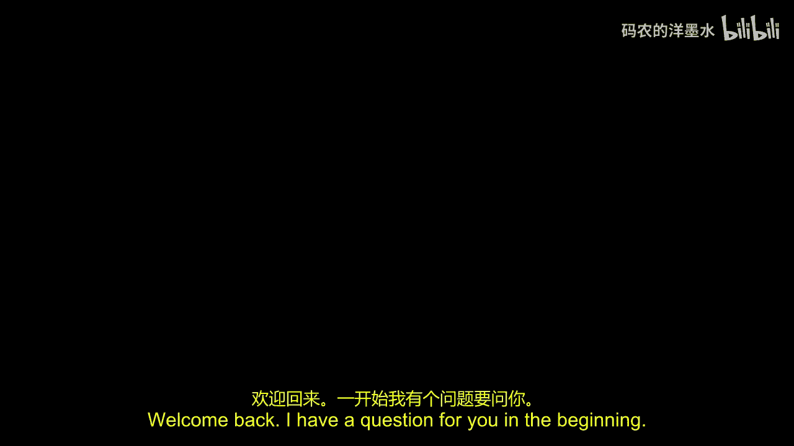
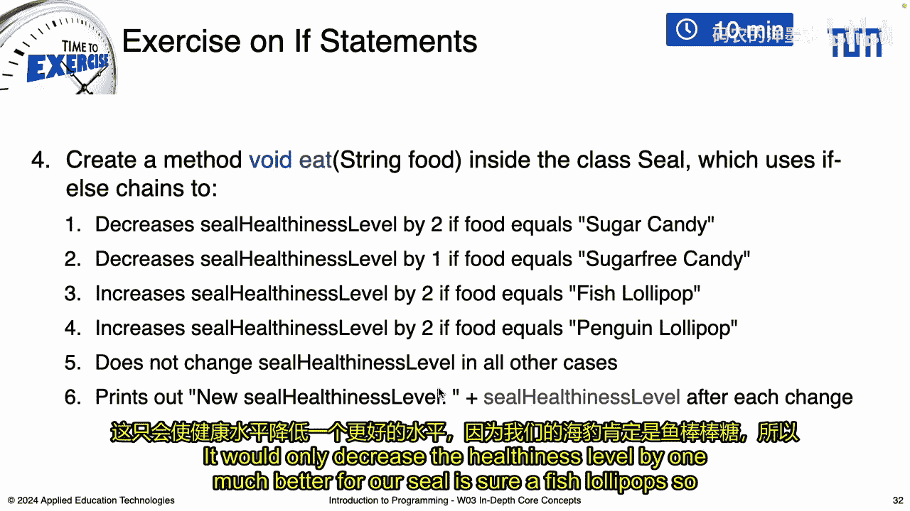
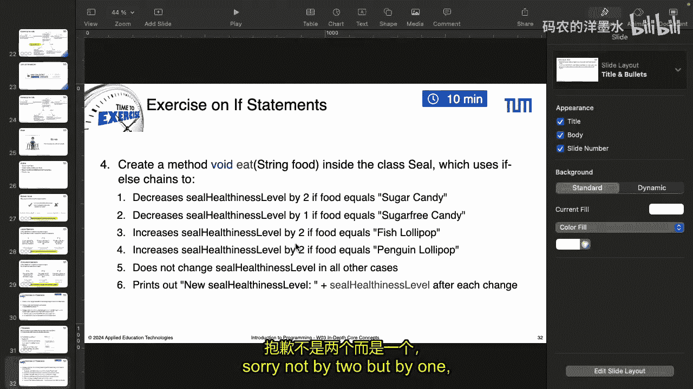
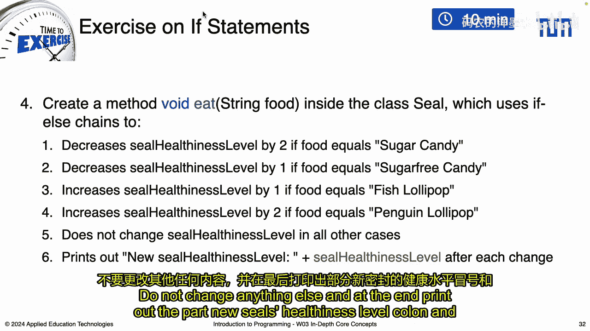
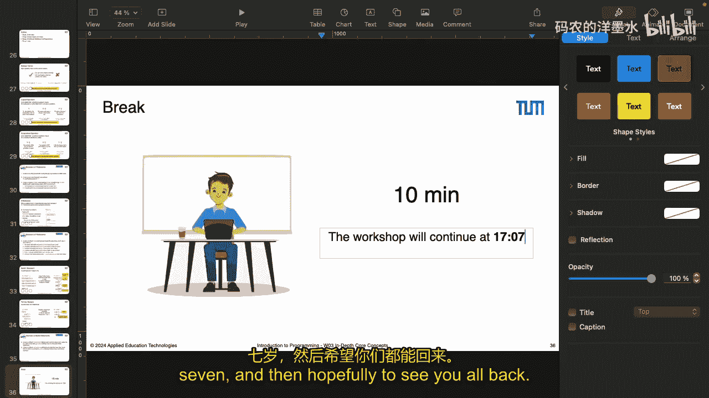

# 计算机编程：从入门到实战：17：条件语句与表达式



在本节课中，我们将要学习Java中用于程序决策的核心工具：布尔值、逻辑运算符、比较运算符以及条件语句。我们将通过一个关于海豹健康的例子，逐步学习如何使用`if`、`switch`和三元运算符来控制程序的执行流程。

---

## 布尔值与逻辑运算符

上一节我们介绍了程序的基本结构，本节中我们来看看程序如何做出决策。就像你今天决定是否来上课一样，程序也需要根据条件做出选择。

在Java中，最基本的决策基础是**布尔值**。布尔值只有两种可能：`true`（真）或 `false`（假）。这类似于回答“是”或“否”。

然而，现实中的问题往往更复杂，需要组合多个条件。这时我们就需要**逻辑运算符**。

以下是三种基本的逻辑运算符：

1.  **NOT（非）运算符**：用于取反一个布尔值。
    *   **Java表示**：`!`
    *   **示例**：如果不去教室（`!goToLectureHall`），就看直播。

2.  **AND（与）运算符**：要求两边的条件**同时**为真，结果才为真。
    *   **Java表示**：`&&`
    *   **示例**：只有天气晴朗**并且**温暖（`sunny && warm`），才去教室。

3.  **OR（或）运算符**：要求两边的条件**至少有一个**为真，结果就为真。
    *   **Java表示**：`||`
    *   **示例**：如果下雨**或者**刮风（`rain || storm`），就看直播。

> **注意**：在数学中你可能见过 `¬`, `∧`, `∨` 等符号，但在Java中我们使用 `!`, `&&`, `||`。

---

## 比较运算符

除了组合布尔条件，程序还经常需要比较两个值的大小或是否相等。这时需要使用**比较运算符**。

以下是常用的比较运算符：

*   **等于**：
    *   对于基本数据类型（如`int`, `boolean`），使用 `==`。
    *   对于对象（引用类型），使用 `.equals()` 方法。
*   **不等于**：
    *   对于基本数据类型，使用 `!=`。
    *   对于对象，通常使用 `! .equals()`。
*   **大于**：`>`
*   **小于**：`<`
*   **大于等于**：`>=`
*   **小于等于**：`<=`

> **重要提示**：一个等号 `=` 是赋值运算符，用于给变量赋值。两个等号 `==` 才是比较运算符，用于判断是否相等，切勿混淆。

---

## 练习：创建海豹类与健康判断方法

现在，让我们运用布尔值和运算符进行第一个练习。我们将创建一个 `Seal`（海豹）类，并为其添加一个判断健康状态的方法。

**任务要求**：
1.  创建一个名为 `Seal` 的类，它有一个整数属性 `sealHealthinessLevel`，初始值设为 `5`。
2.  在该类中创建一个返回布尔值的方法 `isSealHealthy`。
3.  该方法接受两个布尔参数：`movedEnough`（运动充足）和 `sleptEnough`（睡眠充足）。
4.  方法应返回 `true`，当：(`movedEnough` 为真 **且** `sealHealthinessLevel > 0`) **或** (`sleptEnough` 为真 **且** `sealHealthinessLevel > 0`)。

根据分配律，我们可以优化这个逻辑：海豹健康的条件是 `sealHealthinessLevel > 0` **并且** (`movedEnough` 为真 **或** `sleptEnough` 为真)。

**代码实现**：
```java
public class Seal {
    private int sealHealthinessLevel = 5;

    public boolean isSealHealthy(boolean movedEnough, boolean sleptEnough) {
        return (sealHealthinessLevel > 0) && (movedEnough || sleptEnough);
    }
}
```
在 `main` 方法中测试：
```java
Seal mySeal = new Seal();
boolean healthy = mySeal.isSealHealthy(true, true);
System.out.println("Is the seal healthy? " + healthy); // 输出：Is the seal healthy? true
```





---



## If-Else 条件语句

程序决策最直观的表达方式是 `if-else` 语句。它允许程序根据条件选择执行不同的代码块。

一个 `if-else` 语句链的结构如下：
*   `if (条件) { ... }`：如果条件为真，则执行此代码块。
*   `else if (其他条件) { ... }`：如果之前的 `if` 条件为假，但此条件为真，则执行此代码块。可以有多个 `else if`。
*   `else { ... }`：如果所有 `if` 和 `else if` 的条件都为假，则执行此代码块。

---

## 练习：为海豹添加进食方法

现在，让我们为 `Seal` 类添加一个 `eat` 方法，使用 `if-else` 链来根据食物类型改变海豹的健康值。

**任务要求**：
创建一个 `void eat(String food)` 方法，根据参数 `food` 的值改变 `sealHealthinessLevel`：
*   如果 `food` 是 `"sugar candy"`，健康值 `-2`。
*   如果 `food` 是 `"sugar free candy"`，健康值 `-1`。
*   如果 `food` 是 `"fish lollipop"`，健康值 `+1`。
*   如果 `food` 是 `"penguin lollipop"`，健康值 `+2`。
*   其他任何食物，健康值不变。
*   每次变化后，打印：`"new seal healthiness level: " + sealHealthinessLevel`。

**代码实现**：
```java
public void eat(String food) {
    if (food.equals("sugar candy")) {
        sealHealthinessLevel -= 2;
    } else if (food.equals("sugar free candy")) {
        sealHealthinessLevel -= 1;
    } else if (food.equals("fish lollipop")) {
        sealHealthinessLevel += 1;
    } else if (food.equals("penguin lollipop")) {
        sealHealthinessLevel += 2;
    }
    System.out.println("new seal healthiness level: " + sealHealthinessLevel);
}
```

---

## Switch 语句

当需要基于一个变量的多个确定值进行分支选择时，`if-else` 链会显得冗长。`switch` 语句提供了更清晰的结构。

**`switch` 语句结构**：
```java
switch (变量) {
    case 值1:
        // 执行语句...
        break; // 跳出 switch
    case 值2:
        // 执行语句...
        break;
    default: // 相当于 else
        // 执行语句...
        break;
}
```
> **关键点**：`break` 语句用于阻止代码继续执行下一个 `case`（这种现象称为“穿透”）。如果省略 `break`，程序会从匹配的 `case` 开始，一直执行到遇见 `break` 或 `switch` 结束。

让我们用 `switch` 重写 `eat` 方法：
```java
public void eatSwitch(String food) {
    switch (food) {
        case "sugar candy":
            sealHealthinessLevel -= 2;
            break;
        case "sugar free candy":
            sealHealthinessLevel -= 1;
            break;
        case "fish lollipop":
            sealHealthinessLevel += 1;
            break;
        case "penguin lollipop":
            sealHealthinessLevel += 2;
            break;
        default:
            // 什么也不做
            break;
    }
    System.out.println("new seal healthiness level: " + sealHealthinessLevel);
}
```

---

## 三元运算符

三元运算符 `? :` 是一种简洁的条件赋值表达式。它适用于根据条件为**同一个变量**赋予不同值的简单场景。

**语法**：
`变量 = (条件) ? 值1 : 值2;`
如果条件为真，变量被赋值为`值1`，否则被赋值为`值2`。

它可以嵌套来处理多个条件：
`变量 = (条件1) ? 值1 : (条件2) ? 值2 : 默认值;`

让我们用三元运算符实现 `eat` 逻辑。注意，这里的思想是计算本次进食带来的健康值变化量：
```java
public void eatTernary(String food) {
    int healthChange =
            (food.equals("sugar candy")) ? -2 :
            (food.equals("sugar free candy")) ? -1 :
            (food.equals("fish lollipop")) ? +1 :
            (food.equals("penguin lollipop")) ? +2 :
            0; // 默认变化为0
    sealHealthinessLevel += healthChange;
    System.out.println("new seal healthiness level: " + sealHealthinessLevel);
}
```

---

## 总结

本节课中我们一起学习了Java中实现程序决策的核心知识：
1.  **布尔值** (`true`/`false`) 是决策的基础。
2.  **逻辑运算符** (`!`, `&&`, `||`) 用于组合多个布尔条件。
3.  **比较运算符** (`==`, `!=`, `>`, `<`等) 用于比较值。
4.  **`if-else` 语句** 是最通用的条件执行结构。
5.  **`switch` 语句** 在基于单个变量的多个确定值进行选择时，代码更清晰。
6.  **三元运算符** (`? :`) 为简单的条件赋值提供了简洁的写法。



通过创建和扩展 `Seal` 类的练习，我们实践了如何运用这些概念来让程序根据不同的输入（如运动、睡眠、食物）做出相应的反应和状态改变。掌握这些条件控制结构是编写动态、智能程序的关键一步。