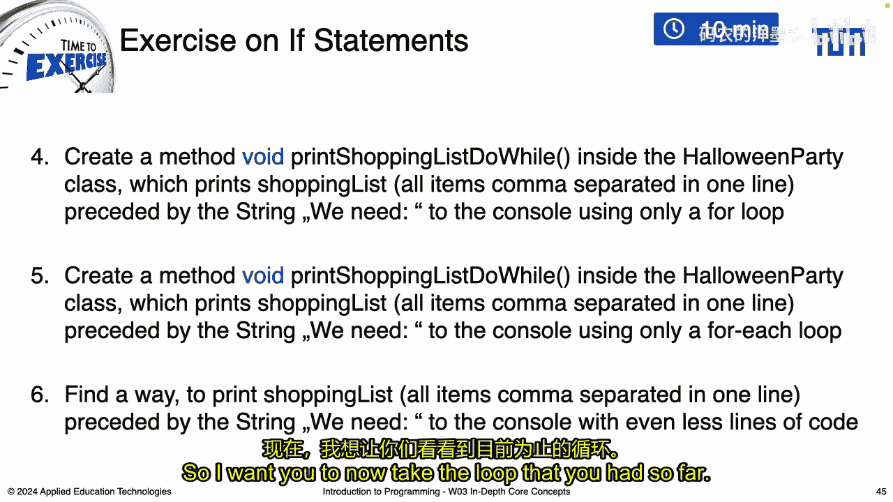
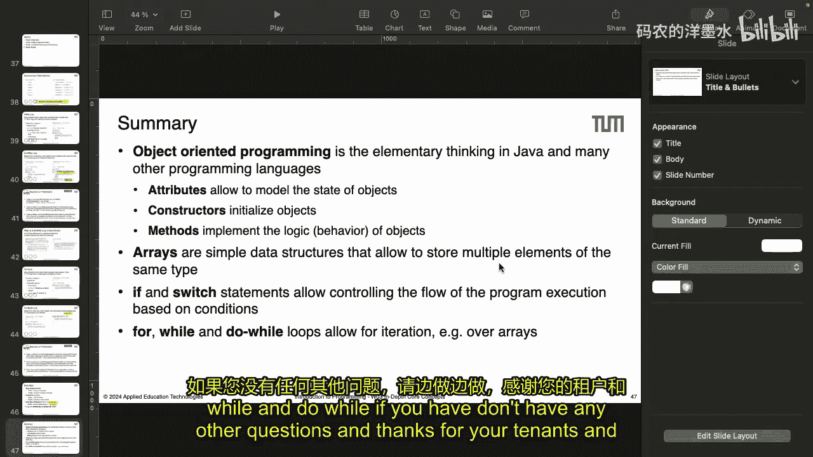

# 【全集】慕尼黑工业大学 计算机编程：从入门到实战 中英字幕 p18 Lecture 18 - 循环part2 -BV1WFrTBZExY_p18-

So。Let me let me ask you。嗯3。これ。For some people。我个。Yeah， for some people， the life。

Actually looks a bit like it works sleep。Eat， work， sleep。So I think this sounds familiar to you。

Have we modeled it so far with the stuff that we have， guys， can you come a bit down？Thank you。 Okay。

 So what we know so far doesn't help us here because we still have to state， eat， work， sleep。

 eat work sleep， we cannot。Have this continuously going， It just。Have to state。

 put every statement here。 single one， similarly to， as you saw how also today with Timor。The arrays。

 you can have really large arrays。 And then you have to access every single element every time。

 For example， here， when we assign students random grades。

 some students think we do this by just assigning them random grades， I can assure you， it's not。

 But in theory here， if we have five， if it's still okay。

 But imagine if we have 100 students and need 100 statements just to assign every student a great。

 This make our code look really， really ugly。😊，And this is where loop helps us。

 Lo can help against cultural repetition。 Cultural repetition is something that we want to avoid in computer science work。

 We want to have。The least amount of code working most efficiently。So。

Many programs have to execute some steps multiple times。

 and loops allow us to do this reetitive programming execution。 And we have four types of loop。

 Let me introduce you the first one and probably the one that you at the beginning used the most。

 which is the while loop。Let's consider a scenario where we have just a very simple alphabet， ABC。

 considering just of the letuce A， B and C。And we assign an interteject called L。

 I know this is bad variable naming， but I do it here for space efficiency。

L stores the length of our array， which is in this case，3， because we have the elements。

 And now keep in mind，0，1 and 2，3 elements inside here。And we have our wonderful vi loop。

What does a while loop actually consist of？ Well， first and foremost， the key word while。

 So if you look for code and you see somewhere written while， it's a while loop。

Then we have a condition。Condition says， as long as this thing is true。

 continue repetitively everything which is inside these curly brackets。

Which can be some form of body elements。 For example， here we print out。呃。Basically。

 the value of this area position。Now， if we wouldn't do the last here the increment of I。

 just imagine this wouldn't be here。 If we would run the while loop。

 it would go on and on and on and on。And actually will never really change this very value item。

So we would always print out the same thing。 And this would go infinitely。So， aside from。

This initialization。 So at first we have we need to have something how we can， for example。

 address an array， which is usually called an index。

And we need to update this index because else we would always stick at the same area position。

 And now it's really important that our condition。Actually gives us the option to exit this volume eventually。

 In this case， it happens when I reaches。😊，The size of L， because as we said。

 like we have three elements。0，1 and 2 at our lens is 3。 As soon as our index reaches our lens 3。

 we do not have an element that we can address。 So we should not continue the while loop else。

 We would get a socalled index out of bound exception more on that later。

 when you learn about exceptions。So， this update。Ne， we need this update to eventually exit the loop。

 but。Buddy， initialization and updates are technically optional。

 so you can have a via loop which doesn't have any of these。Just without an update。

 it would definitely be a so calledled infinite loop。 And it will。

 your program will only end when the power goes out the K PC C dies else， it would continuously run。

 Or if you forcefully cancel it。We have a very special form here of loops， which。😊。

Actually has some advantages in some cases。 And that's the so called do whilelu。

The Y loop can actually have a condition which allows it to never run every single time。

 So imagine if we start this loop， we have our condition and the condition right the first run of the loop is already true。

 Sorry， false。 then we will never execute the loop， because we only execute the loop。

 If the statement in the condition is evaluated to true。The two while loop， in contrast。

 runs the loop at least one time and checks the condition at the end。

Wil loop checks the condition at the beginning。2 while loop checks the condition at the end of the body。

So we now have an additional keyword do。The rare and the condition is also at the end。

 So we have do and while as our keywords。 So when we see do and while， we know it's a du whilelu。😊。

We have to condition the same one here as the beginning， and the rest is absolutely the same。Okay。

Then I would say it's time again for an exercise， I give you 10 minutes for this。

Create a new class Halloween party。 So our seals now started to have Halloween parties with a array shopping list。

 It's a string area containing the following string elements， decoration， food， drinks and costumes。

😊，And I want you to create two methods here。 The first method is print shopping list。

Which is inside the Halloween party class， and it prints all the elements of shopping lists separated by a comma into one line preceded by the string we need。

 So the goal would be at the end to have we need decoration， food， drinks and costumes。

 And please do this for print shopping list with a whilelo。 while you have a second method。

 print shopping list do while， which does exactly the same thing。 But now with a do while loop。

 And I said， I give you 10 minutes for this exercise。😊，Starting now。Okay，10 minutes are over。

 let's have a look at how I would do it。So let me5 the chest。Open the exercise on my side for moment。

To find it So we need to create a new class called Halloween Party。Halloween。而D。Okay。

 new class Halloween party。 We need an attribute。 as said。

 I always write my attributes directly under the class definition。 So we have。Sting。Shopping list。

That's a Gma thing， so shopping list equals。New。As you see here， by the way。

 with the new parameter with the new keyword here that we have actually working with reference types。

And then we directly initializing the area。 When we directly initializing the area。

 we don't have to state a length because it will automatically compute that out of how we initialize it。

 So we have。Decoration。We have food。We have drink。I forgot to。These things around here。And we have。

costumes。Everything necessary for good Halloween party， decoration， food， drinks and costumes。

First methods。What。Pm。Spping list。O。嗯。List。Okay。So， at first。

We want to create a string on which we basically put them all the elements of the array comma separated。

By the way， the shopping list should be as usually private and a method。Should be， as usual public。

 So we need now to have a place where we store every single string element in the shopping list and then come separate it。

So we have a stream。I tend to call them accumulator。

And the good thing is we can directly use this accumulator， because。

What we actually want to have is at the beginning， the stream we need。

So here have we start here with a string we need。Then。

We need to have an index over which we can address the elements in our array。 So we have an index。

And as we know that the first element in an array is always at place0， we initialize this index of0。

😊，Good， so far for the preparation。 now we go and try to create a wide loop。This bi loop should。

Check if index is already as large as shopping list do length。 with shopping list dot length。

 we get the actual length of the sub shopping list。This shopping list has four elements。

 So the size of the shopping list， the land flew before。

 And we check if our index already reached this number 4。Then。We used the accumulator。

And similar to how I did it before。We use here now the conong kate equals。 So basically。

 it's the same as accum equals accumulator plus something honest。And then， we have。Shopping list。

Index。Plus。Coma， because we said we want to comma separate everything。

 So after every shopping list element， we set a comma。Okay， and then we do system that do print N。

 and we print out the accumulator。This needs also as its statement， a semicollon。

Let's have a look if that makes sense， so。K delete Seal here。 And we have Halloween party。

 Halloween party equals。New Halloween party。And we say Halloweenparty。pre shoppingping list。

Let's have a look at what happens here。Runs through。And sustain process。For some reason。

 it takes a while。Why does it take a while？ Good question。 Why does it take a while now。

 Is there something I have forgot， yes。I never update the index。 You know。

 we say index is smaller than shopping list at lunch， but we never increment the index。

 So it will be always null in this while loop。Is running eternally。 This is what I described before。

 So actually， out of a mistake， I showed you now a good example of what you should not do。

 So what we need here is。Index。Plus， plus， the increment operator。And let's run this again。You see。

 much faster finished。But we have a problem here。 You know， we want to have， we need decoration。

 comma， food， comma drinks， comma customers， but we don't really want at the end a comma。

 Is there a way of how we can get around this， Yeah， actually， there is。

 Just think of what we learned before。We conditionally want to have this comma either happen or not。

 So we want to basically not have it。If。Inindex。Smaller than。Shopping list， that length。-1。

 So in the last instance， we don't want to have this。

 And this is one of the great places where we can use the tinry operator。😊。

So now it's a bit confusing because we have a plus here and a plus here and a question mark here。

 So we want to bind this whole sceneerary expression。 We want to bucket it inside by having。

Round brackets around it， and let's see。😊，Now we have a0 y because this shouldn't be0。

 this should be an empty string。And you see now the last comma is gone。Because in the case。

 when we are at the last element， we don't want to have a comma at the end。Great。

Next thing is we wanted to have the same thing with a do while。So let's copy the whole thing。

Let's name it。 shopping list to。While， I think that was what the exercise was demanding， yeah。

And now we want to， instead of w， we have do。And we just copy this out and have。While at the end。

Now you see something weird。Change due to while， we have something red here。

This is why a semi colon is missing。 So while the wild loop doesn need a semi colon at the end。

 do wild needs， Yes， there's a question。So the question is。

 can we actually avoid thisinary operator by actually running the loop until  -1。

And then just at the end， have an accumulator。That equals with shopping list。And then。

We basically don't need this。 We just need to have the semicolon at the end。And。Yet， it works， but。

Now， what is the index， Well， the index is basically constantly updating until it reaches shopping list -1。

 if we would do that。Let'Run it。Y， so that would also work。That's an alternative。 But I mean。

 I would rather have all of this inside the vi loop and veterinerary operator。

 but you can also do it like that。 It's up to personal taste。

 like some aspects of programming is just， do you like this more or that more。Okay。

 so this is now our dual while loop， and it basically does the same task。

 So it can be here equivalent just that it at first。Cicks。The elements and basically does。

The step and then checks the condition。 Yes， a question in front here。Okay， so the idea is basically。

 why why does this work here with this index， Let's think about it。 We start with0。

 We go through with 0。Increment here。 And then check。嗯。Basically， what is the case here？Yeah。

 the increment always before。 And this is why at the last time， then it's already one step over it。

And then we can directly have the index here。Any other questions？No， okay， let's quickly continue。So。

 oh， sorry。As an attribute。Yes， you can also have it as an attribute。

 The thing is just if you have it inside。Your method， it's only reachable inside the method。

 So you can have in another message method like this year。Index as well。

 You cannot have two indexes as attributes。 So this is something a bit later。

 you will learn the term scope。 And then you will see a scope in lifetime。

 Then you will see basically when I can reach a variable and when not。Okay。

 any other questions to the left， No， okay？So as you see。

 while dual files are pretty equivalentvalent， so why should I carry how while， I can't use file。😊。

Anyway。There is， our， I would say， a group of。Use cases where a do while loop is a bit advanced compared to a while loop and data often in the area of input output。

 So currently， you only know one version of inputting data into your program and outputting data of it aside from hard coding it in the main method。

 And that's the console。 Basically， you already learned how to read values from a console。

 You learned how to vi values to a console。And let's imagine the following scenario we have。

We actually want the user to input a password。 So we print out the request， input a password。

 Then we read the password。 Basically， this user can type in the password。

 And after they click on enter， the password is stored in our password。Variable here。

And then we check if the password equals password。 And while this is not the case， we again request。

The user to input the password。So we ask it initially to have the password and then we check。

If the password is correct and if it's not correct。

 we repeatedly ask the user to do another password until the user happens in the right password。

 problem as you see here， we ask the password before the vi loop and inside the vi loop。

 So we have code duplication actually here。With a du while loop。

 it's more practical because we know it it will any way execute at least once。

 so we can put everything input password and the password inside the Duvi loop because we actually check the equality at the end。

😊，So we save。Two lines。 So as you see here。We have the same two lines as on the left side。

 but the whole part on the top， we don't need。Now， there are some problems。 I mean。

 there are some problems where we don't know how many times we meet to run those quite we reach a certain destination。

And there are cases where we exactly know how long we need to run it。

 So there is a special case when we know， O， we have to run a certain amount of code n times。😊。

And for this， we have a specialized loop called a for loop。What does the for loop consist of？Well。

 at first， the keyword 4。 So if you see somewhere the key 4， you know， it's photo。And actually。

 the funny thing is that's what you everything you need for a for loop。 It sounds surprising。

 but this is everything which is a must have for a for loop。😊，Everything else is， again。

 technically optional。 So while in a while loop， it's not possible to just leave out the condition in a for loop。

 it is， but it's not recommendable because it basically， again， something which runs eternally。

 So you can have a for loop with nothing else， but it will never terminate。 It will just run forever。

What is technically。Optional， but still necessary is an initialization。 As you can remember。

 we saw at the beginning， we have this index。Now， the index is actually part of our for loop。

 and usually we use as index variable， the just the letter I。 So I。

 we will assign at the beginning to an integer0。 So I is now a variable integer variable with the initial value 0。

😊，And we have the condition。 So we check if I is smaller than out and we increment and we do everything like the initialization。

 the condition and the update in one line。😊，And the rest， the for loop basically does for us。

 so every time a fall loop is running through。It checks if the condition is already fulfilled。

 and if not， it run through the body and at the end of the body， it。Increments。

 basically this index variable。And the index variable will then increase until it is at at the condition。

 which eventually becomes false。 And then the for loop terminates。

There is now for some problems that very specific type of。😊，In a lot of cases。

And this only works with something which well learn a bit later， which is called a iterable object。

 But let me assure you so far that you already know one。 And that's an array。In many。

 many cases in computer science， we just need to run over an array。

 and we need to basically iterate over every single element。

 While a full loop technically in the update allows us to just look at every second element。

 It's a very common problem in computer science that you actually want to look at every element。

 And this is where for each loop comes into place。 trickyrick thing is it doesn't have its own keyword。

 So it shares the keyword with the for loop。But it's syntactically a bit different。

 So what we abolish here is， for example， the update step， because we exactly know the update step。

 The update step is just plus one every time。And so as we see here， fall is the same keyword。

The initialization now works a bit differently， we say。

We have basically an empty variable called letter。And at each iteration of that for loop。

Over the RA ABC here。😡，After basically， over every element。

This string letter will eventually take on every single element of this aerosol。At first。

 string letter will be equivalent the letter variable will be equivalent to the first element in the array in the next loop step to the second to the third until it reaches just the end。

 So we don't really need。A condition because the condition will be basically just iterable。

 reach end of iterable。 on in this case， reach the end of。The you of the array。

And we don't need an increment that because that's implicit。But the body is basically the same。

 So this is a very short version of a for loop very efficiently。

 but it only works if we treat every single element in an area。Time for the last exercise today。

So I want you to now take the look that you had so far。

It should also not be a do while， sorry for that， the first one should be shopping list for。

And the second one should be for each。So please implement the loop that you saw before this time with a four loop and with for each loop。

And I will actually， sorry for the restriction， but you have can actually copy a lot of stuff。

 Give you five minutes。 And after the five minutes， I explained to you。 By the way。

 please come up it down the noise here， because I think the rest still wants to。

Listen to it and after this I will shortly explain you how it works。

 and then we'll also try to quickly end the lecture on time So five minutes from now on Okay。

 everyone， for the very last time， let's see how I will do it。Please focus。

 and I will try to rush through it now in order to let you out a bit early， so。Basically。

What we have here。We can basically just copy the two lists here。So。

Let's just be lazy and copy those too。And one we call four and one we call four each。

So in the first one we want instead to use of the while loop， a for loop。

So let's replace while over before。We can copy this thing。Now， actually into this。

And we can copy this thing。Into this semicolon here。Okay， there was a bit quick， but now。

What we did was just before we had this。Index outside。

 defined outside of the while loop and then incremented inside of the body。And instead。

 we can just do all of this stuff here directly inside the follow。Now let's copy this thing。

Because there's even an easier way because we know shopping list is an area。 It's an itertable。

So we can just throw out this stuff。Throughout this stuff， we know shopping list is a string。

Let's call it item。Over shoppingping list。And then instead of shopping list。

 we can now directly work with the item。And。Actually， the problem is now， as we don't have an index。

 we cannot use this anymore。So we replace this， and。

Either we now leave the comma at the end or we do some trick。Which should。

Do not necessarily need to understand。 It's called substr， which has0 and。Accumulated that。Lth， -1。

Okay， so this basically just removes the comma at the end。And is there something I'm missing？😔。

Coseing brace。Okay， sorry。Boom， okay， let's try out these two variants。 So we had at the beginning。

 K up English。 Now we had。Print shopping list four。And we see this verse。

And we have print shopping lists too while。And we see that this works as well。

 Do you have any questions about that， yes。Which part of the class do you want to see？The full loop。

 so the fall loop was here。Do you have any specific question about that。Okay。

 I just wanted to make fun of this of it。Everyone took a photo of that。Okay。

 and then this is the for each loop。O。Any other questions about that。Okay。

 before we come to your homework， one very last thing。

 because I had at the very end of my presentation， this point。

 find a way to print shopping list with even less lines of code。 So we saw now how a loop works。

 But there is actually a trick for strings here。 if we have a string area。

Because we now want to have the。Sorry， that was a bit too quick。 we are here。

There is a trick of how to do it even faster with。Public void。Print shopping。

 I call now the method print shopping list function。Because for iterating over a string area。

Concatenating all their values with a comma， there is actually a separate function。Which is。

Stream do。Which is called string or join。Actually， we need to。Proceeded。

we need and we want to have it printed。So we add this around。 What string join is basically doing。

 It has two parameters。 It has the first one is called a delimiter。

 which means like I separate these string array elements with the following。Character。And then。

 I have my。Shopping list。 So this is a tricky alternative for the task。

And let's check if that works for us。That's print and shopping list function。And this works as well。

Any questions about that。一。You want to photograph this。Okay， then just。Now。

 I really want to rush to it。 So your next steps will be， you have two more tu group exercises。

 which are saving for Halloween and saving for Halloween reloaded。

 So more about what our beloved seals do during Halloween。 Gu， please come down a bit with the voice。

 I will also try to make it quick。😊，We have two homework exercises。

 Je O lantern and Halloween Caesar Cypher。 And for this time， very important。 For this time。

 we have one voluntarily challenge exercise。 This will give no bonus points because this is actually a hard exercise。

 It's not that much related to the content that we did today， but it's a very interesting exercise。

 And I think a lot of you will already be able to solve this with the knowledge that you have。

 you just might need to read a bit insight。 Just if you already struggle with this。😊。

Don't do this exercise because this is a hard challenge exercise。

 This is more for those of you who are really interested and want to push their boundaries further up。

Bonus points。Yeah， it's a hard exercise。Let me。And as last point， what did we learn today。

 we learned about object oriented programming， we learned what is a class and object attributes。

 construct and methods， we just not really learned it but we redid that， we have arrays。

 we learned what errorss are， and we repeated what if and switch statements are and the four loop types for while and do while。

If you have。Don't have any other questions。 And thanks for your tenant and see you next week。

