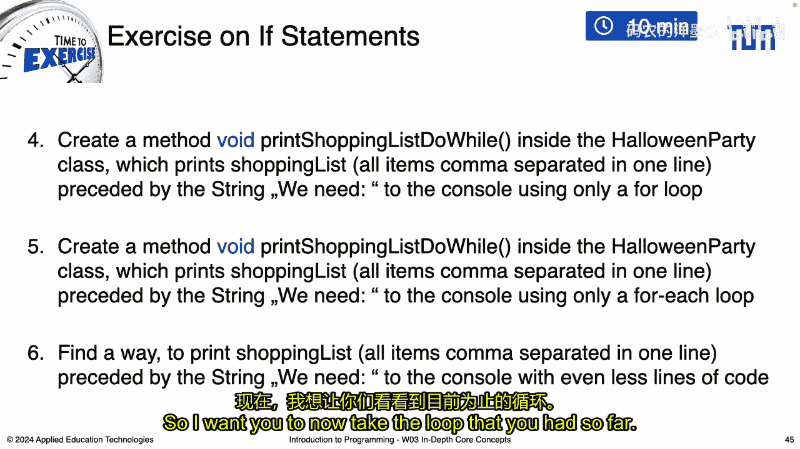
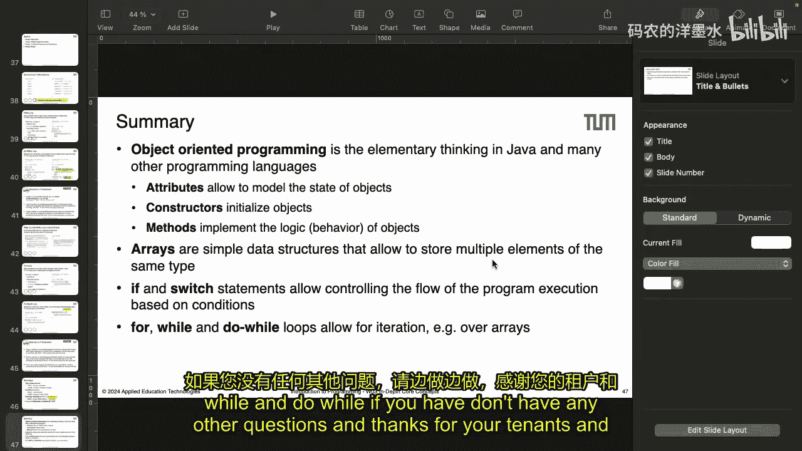

# 计算机编程：18：循环（第二部分）


在本节课中，我们将深入学习循环结构，特别是 `while` 循环、`do-while` 循环、`for` 循环和 `for-each` 循环。我们将探讨它们各自的语法、适用场景以及如何避免常见的编程错误，例如无限循环。

## 循环的必要性

上一节我们介绍了循环的基本概念。本节中我们来看看为什么循环在编程中不可或缺。

许多程序需要重复执行某些步骤。例如，模拟一个人的日常生活（工作、吃饭、睡觉）或者处理一个包含大量学生的数组（例如为每个学生随机分配成绩）。如果手动为数组中的每个元素编写语句，代码会变得冗长且难以维护。循环可以帮助我们避免这种代码重复，用最少的代码高效地完成任务。

以下是循环的主要类型：
*   `while` 循环
*   `do-while` 循环
*   `for` 循环
*   `for-each` 循环

## `while` 循环

首先，我们来学习最基础的 `while` 循环。它的核心思想是：**只要条件为真，就重复执行循环体中的代码**。

一个典型的 `while` 循环包含以下几个部分：
1.  **初始化**：在循环开始前，通常需要设置一个计数器或索引变量。
2.  **条件**：这是一个布尔表达式。只要其值为 `true`，循环就会继续。
3.  **循环体**：需要重复执行的代码块。
4.  **更新**：在循环体内，必须修改条件中涉及的变量，以确保循环最终能够结束。

让我们通过一个遍历数组的例子来理解：

```java
String[] alphabet = {"A", "B", "C"};
int i = 0; // 1. 初始化索引
while (i < alphabet.length) { // 2. 条件：索引小于数组长度
    System.out.println(alphabet[i]); // 3. 循环体：打印当前元素
    i++; // 4. 更新：索引加1
}
```

**核心概念**：`while` 循环的**条件**在每次迭代**开始前**检查。如果初始条件为 `false`，循环体可能一次都不会执行。

**重要警告**：如果忘记在循环体内更新条件变量（例如忘记 `i++`），条件将永远为真，导致**无限循环**。程序会一直运行直到被强制终止。

## `do-while` 循环

`do-while` 循环是 `while` 循环的一个变体。它与 `while` 循环的关键区别在于：**它至少会执行一次循环体，然后在每次迭代结束后检查条件**。

其语法结构如下：
```java
do {
    // 循环体
} while (条件);
```

这意味着，即使条件第一次就为 `false`，循环体也已经执行了一次。`do-while` 循环在需要至少执行一次操作的情况下非常有用，例如请求用户输入。

## 实践练习：万圣节购物清单

为了巩固对 `while` 和 `do-while` 循环的理解，我们来进行一个练习。

创建一个名为 `HalloweenParty` 的类，它有一个字符串数组属性 `shoppingList`，包含以下元素：`"decoration"`, `"food"`, `"drinks"`, `"costumes"`。

你需要实现两个方法：
1.  `printShoppingListWhile()`: 使用 `while` 循环，将所有购物清单元素打印在一行，格式为 `"We need decoration, food, drinks, costumes"`（注意末尾没有多余的逗号）。
2.  `printShoppingListDoWhile()`: 使用 `do-while` 循环完成相同的任务。

**提示**：可以使用一个字符串变量（通常称为“累加器”）来逐步拼接元素和逗号。为了避免最后一个元素后出现逗号，可以使用条件判断（例如三元运算符 `? :`）。

以下是 `printShoppingListWhile()` 方法的一种实现参考：

```java
public void printShoppingListWhile() {
    String accumulator = "We need ";
    int index = 0;
    while (index < shoppingList.length) {
        accumulator += shoppingList[index];
        // 如果不是最后一个元素，则添加逗号
        accumulator += (index < shoppingList.length - 1) ? ", " : "";
        index++;
    }
    System.out.println(accumulator);
}
```

`do-while` 版本的实现与之类似，但需注意循环结构和条件检查的位置。

## `for` 循环

当我们**明确知道需要循环的次数**时，`for` 循环是更简洁、更常用的选择。它将初始化、条件和更新集中在一行内。

`for` 循环的标准语法如下：
```java
for (初始化; 条件; 更新) {
    // 循环体
}
```

例如，用 `for` 循环重写上面的购物清单打印方法：
```java
public void printShoppingListFor() {
    String accumulator = "We need ";
    for (int i = 0; i < shoppingList.length; i++) {
        accumulator += shoppingList[i];
        accumulator += (i < shoppingList.length - 1) ? ", " : "";
    }
    System.out.println(accumulator);
}
```

**核心概念**：`for` 循环的**初始化**语句只执行一次。然后，每次迭代前检查**条件**，迭代后执行**更新**语句。

## `for-each` 循环（增强型 for 循环）



`for-each` 循环是遍历数组或集合中**每一个元素**的简化语法。它不需要索引变量，语法更清晰。

其语法结构为：
```java
for (元素类型 变量名 : 数组或集合) {
    // 使用‘变量名’访问当前元素
}
```

使用 `for-each` 循环打印购物清单：
```java
public void printShoppingListForEach() {
    String accumulator = "We need ";
    for (String item : shoppingList) {
        accumulator += item + ", ";
    }
    // 移除末尾多余的逗号和空格
    if (accumulator.length() > 0) {
        accumulator = accumulator.substring(0, accumulator.length() - 2);
    }
    System.out.println(accumulator);
}
```

**核心概念**：`for-each` 循环自动迭代**可迭代对象**（如数组）中的每个元素。它隐藏了索引细节，使代码更易读，但**无法直接获取当前元素的索引**。

## 更简洁的方法：`String.join()`

对于“用特定分隔符连接字符串数组所有元素”这个特定任务，Java 提供了更简单的内置方法。

```java
public void printShoppingListFunction() {
    String result = "We need " + String.join(", ", shoppingList);
    System.out.println(result);
}
```
`String.join(", ", shoppingList)` 方法会使用 `", "` 作为分隔符，将 `shoppingList` 数组中的所有字符串连接起来。

## 总结

本节课中我们一起学习了四种循环结构：
*   **`while` 循环**：在循环开始前检查条件，适合循环次数不确定的场景。
*   **`do-while` 循环**：先执行一次循环体，然后在循环结束后检查条件，适合至少需要执行一次的场景。
*   **`for` 循环**：将初始化、条件和更新集中管理，适合循环次数确定的场景。
*   **`for-each` 循环**：简化遍历数组或集合中每个元素的过程，代码更简洁。



理解并熟练运用这些循环是控制程序流程、处理重复任务的基础。请通过课后练习（如“万圣节雕刻南瓜灯”和“万圣节凯撒密码”）来巩固这些知识。