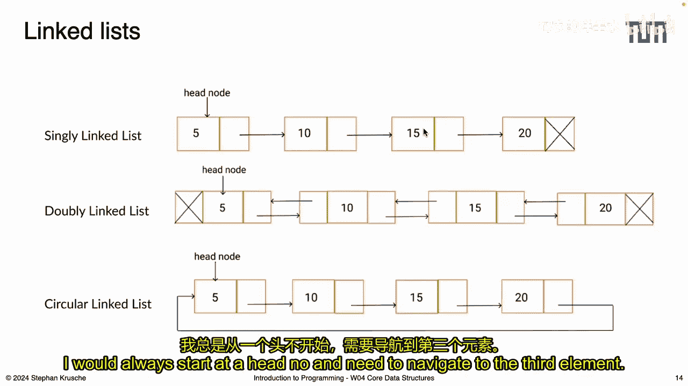

# 【全集】慕尼黑工业大学 计算机编程：从入门到实战 中英字幕 p19 Lecture 19 - 列表part1 -BV1WFrTBZExY_p19-

Welcome to today's workshop on core data structures in the course's introduction to programming。

We are in the fourth week of this course after introducing you to the basic concept of object oriented programming。

 control flow and a repetition week today will cover core data structures。

So we assume that you have a basic understanding of object oriented programming in particular how to define classes with attributes and methods and custom constructs。

 how to instantiate objects for those classes， how to invoke methods and so on。

 and you should also be able to use basic control structures in particular， if statements。

 switch statements for control flow and for and Y loops for iterating multiple times through the same code。

Today， we focus on data structures and data types in particular， We will cover the list data type。

 the stack data type and the Q data type。 Those are important types that you use throughout many applications and that are also very important for many different concepts in computer science。

 So at the end of this week， you should be able to explain how stacks and queuees work internally based on the letO and FiO principle。

 We will see what that means in a few minutes。You should also be able to explain the differences between the list data type and the array data type that we've already seen before。

And also distinguish between list and array based data types。

 So I'll show you an implementation of a stack based on the list and a stack based on an array。

 and you should understand the differences same for the queue。

We also cover the collection data types， the build in data types for Java， in particular list set。

 and I'll show you also that there are more of that。

 so you should be able to use them in very simple ways。

 we will cover more details on those in a future workshop。

And we'll also introduce you to a an enhanced version of the four loop， the so called for each loop。

 which allows you to iterate through those collection data types more quickly without the necessity to use indices and without the。

Likelihoods or risks to have index out of bound exceptions。Let's get started。

 abstracttract data types are important in computer science and programming because they allow us to specify operations that you can perform on those data types and they try to hide the internal complexity away from you so that you can focus on the actual work that you would like to achieve so we hide details such as the internal data structure or how those operations are implemented。

Interernally。 and this is called information hiding。

 David Parnas was the first person who coined and defined this term in more detail。

 And it's a very important concept of computer science because in large software systems。

 it's simply not possible that you understand every little detail in every little subsystem。

 and therefore， information hiding helps us to work with other code from other developers without understanding all the details behind it。

When it comes to data types， we typically would like to prevent illegal access to the data structure in particular。

 if the data type has certain properties or invaris that we would like to fulfill。

 we will see later on that in a stack you can only access the top element and no other element of the stack and in order to make sure that you don't illegally access certain things。

 we use internal implementations and hide them with the private keyboard so no one else can access those。

And this allows us to decouple sub problems for implementing something internally。

 debugging it and maintaining it in the future。 because when we maintain code。

 we don't really need to take care about who is using it if we focus on private internals。

Only if we change the public code in our class， the getters。

 the set or the public methods that are accessible to the outside world。

 then we need to make sure that everyone who is using this code gets notified about breaking changes or about a different behavior if we implement that。

Another big advantage of using abstract data types is that we can very quickly exchange ideas。

 exchange simple implementations and do rapid prototyping without worrying about the internal implementation。

 You can even for rapid prototyping， simply mock the internal implementation and just show someone else the API。

Application programming interface of a particular data type。

 and then discuss whether this makes sense。Or not。 And whether all the use cases can be fulfilled or not。

And we will cover four。Units today， again， like always， with three distinct abstract data types。

 you will see the API of those three data types。 and you will also see the implementation of them。

 at least of some of them。And then you have a very good background in using basic data types afterwards。

 So let's get started with our first unit on list。List is a very。

 very common data type that is used in many different ways and many different aspects。

And because of that Chava has built in list data types as part of the collection framework。

 The collection framework is a unified architecture that allows you to represent and manipulate multiple elements of the same type。

 so-called collections And it basically reduces your programming effort。

 because you don't like in information hiding。 You don't need to exactly know how the internals work。

 You just need to be able to understand how to use them。 And this is a big advantage。 Of course。

 we now teach you some of those internals as well， so that you have a basic understanding and that you could program such a data type on your own as well。

 But later on， when you program in a real project， like for example。

 the team project that you do in the second half of this course。

 you will notice that it's really most of the time enough to understand how to use a data type and not how。

What is internally implemented。And this can then increase the performance of operations on those collections because people well thought about how to implement those data types in a performant way in a reusable way and in a way that you can use it very efficient。

 and it also allows for a great interoperability of independent collections。

 Sometimes you are interested in a set。Data type that only has each element once without an order。

 Sometimes you are interested in a data type with a list where you have an order sequence where elements can appear multiple times。

 and a collection framework in Javava allows you to convert between those two concepts easily。

 So a list can easily be converted into a set and a set can also easily be converted into a list。

In fact， the most used data types in Javava and in general in programming are lists。Setets。

 queues and maps， and we will cover list in detail today。

 We also shortly mention set and what the differences。 We will also cover queue later on。

 map will be covered in a later session， because this is out of scope for today。

 The collections framework is very well documented on this link here。 the slide 7。

 So feel free to read more about this online。 There are also great resources that we mention at the end of this workshop。

😊，Let's get started。 Let's have a quick look at the list data type in this collection framework。 So。

 first of all， you need to import this data type based on the package Shava dot U dot list so that you can use it。

Secondly， it's a generic data type。And this is of big importance because you might want to use this with a string。

 with an integer， with a float or with any custom data type that you are interested in。

So list basically defines a generic data type that you specify whenever you use list。

 So this is not specified during the。Compilation time during the when the developer writes the list implementation。

 No， this is defined when you， as a developer， use this framework and define what kind of data types you' are interested in。

We don't cover generics in detail， I'll cover them quickly today so that you have a good understanding how to use them。

 more details will be covered later on。List is in fact， not a class。 It's a so-called interface。

 We will also not cover interfaces in detail today。 We'll tell you more about that later on。

 simply think of it as a specification。 So we specify how something should work。

 but we do not add implementation， but anything else can implement this interface and can follow this specification。

 and the list interface then represents an order sequence of objects。 So we have an index an order，1。

2，3，4，5。 And you know in computer science， we start counting at zero。

And elements can appear multiple times。How does this work with the list？ Well， we have a few methods。

Here in the UML class。That we can use， and we'll define them together and go through them together so we can add elements。

 We can remove all elements with a clear method。 We can check if a list contains an element。

 We can get an element at a specific index。 We can check if the list is empty。 We can remove。

One particular element at an index， or based on the element that we have at hand。

We can set an element to a specific index， and we can get the size of the whole list。

And the E that you see here， this generic type is then also used here。

 and basically is an appbbreviation of element here， and it can be anything。

 You can define it be a string， a point， a float or any class that you develop in your code question。

So the question is why does the ad method here returns a Boolean， Well。

 you would need to read the documentation to find out， I can tell you my understanding here。

 it can theoretically fail。And I think it tells you if the operation was successful or not。

So this is， this is what it does。 You will see the。

Definition here or the explanations for all those methods on slide 9。Yeah。

 so basically I told you already， but you can also read the text here and what is also quite nice。

 you can also read the text the explanation directly in the code。 So if you open your playground。

 if you use a list， if you click on one of those methods and navigate into it。

 you can read the Chava doc of this particular method。And again。

 we like you to understand this from the perspective that。We use Java here as an example。

 but a list data type is also available in every other programming layer。

And while in another programming language， it might not be called Ed， it might be called insert。

 or whatsoever， I don't care there's a similar mechanism to add elements to a list。

And every programming language is then slightly different， but allows you to add elements to a list。

 remove elements from a list and so on。 So take this as one example。

 but also try to generalize this concept in your head。

 So if you use another programming language with a list data type， you are well equipped as well。😊。

Here's an example how to use a list in your code。 So you see we import the whole package to make it easy。

 Now you can also just import Cha Ut list but we might use a list here as well。 First of all。

 L offers different implementations。 We can use an error list。 We can use a linked list。

 typically it's easy enough to use an error list， but this is something that you can also decide based on the specific case。

 we keep it simple here， we use a list， and you now see that on the left side。

 the type is slightly different and on the right side again。

 well explain you more details about that later on for now。

 just do it like you see it here in the example。 Yeah you could also write a list on the left side。

 but this has a few disadvantages that we will discover in a few minutes。Now。

 we have this list with the type string。 So now we say instead of having a generictype。

 we want to use it with string。 And this means we can only add strings to the list。

 We can't add integers。 We cannot add points。 We cannot add student。 if you have a student class。

 So we can only add strings。 And this is a big advantage because we can't accidentally add wrong data types into it So we prevent mistakes。

We add a few words into our list， and then we can access them by using the get method。

 So we get the third element here， which would be 5。 Yeah， remember again，0，1，2，3 for the index。

We can check if words contains the word sentence。 This is true because this is the second one here。

 Notice that we take the case into account and we take white spaces into account。

 So if you would write here upper case S sentence， it would be wrong， right， would be false。

We can also check the index of a specific word。 And in this case， it's 0。

Because that's the first element in the list。And now you can also see the first encounter of the so calledled enhanced for loop or for each loop。

 And the big advantage here is that you don't have to deal with indices。 Remember。

 traditional for loop we say 4 in I equals 0 I smaller than the length of something I plus plus。

And then we get the element at index I。Now， this is quite cumbersome and very repetitive。

 So we have the mechanism to also use it for each loop where we simply say string the type。

Then the single element， in this case， we call it bird colon， the list。 Yeah， in this case。

 it's called birds。 And then we simply say for each string ver in the list words， please。😊。

Invoke the block。Here once， and we can directly then use the element without dealing with any index。

And with that， we can print out all the words next to each other。

Any questions regarding this example。 Yeah， go ahead。Yeah， that's a very good question。

 So the question is， is a list similar to an array， And if yes。

 why do we need two different ways to deal with this。So， yes， they are similar。 We will also。

Introduce you to the differences。 Yeah when you follow a workshop until the end。

 you will see lots of differences。And the array is a very simple data type。

 It's not an object oriented data type。And it has a fixed size， for example， while in the list。

Just as a from a user point of view， I can add。Arbitrary any elements。Yeah if I。

 and I don't have to specify the length of the list， it's not necessary。 If I do I create an array。

 I have to do that。 So arrays are， in some sense， more low level。 Ls are more high level。

 On the other hand， arrays might be more performant than lists。And， in fact。

 the array list is implemented with an array internally， but you don't see that。 That's， again。

 information hiding。 And you don't care if they use an array internally or not。

 There's also this so called linked list。Which doesn't use an array internally。

 It uses a different mechanism， but it has the same operations。 You can still add elements。

 You can still access elements at a certain index。And you don't really care。 And in that sense。

 it's much more flexible， much easier to use if you don't have any performance constraints。

And in some sense， also less problematic in terms of errors， right， in an era。

 you can make simple mistakes。 Yeah， you add an element。

 even if it's already full or you access an element that does not even exist in a list。

At least with the methods that we use here。The chances are much lower to get it wrong。

 So I personally， when I program， I always use a list， I never use an array。

 but we have to teach you how array works as well， because sometimes you need to use them。Great。

 there's a second data type。 Yeah， okay， to ask one more question。So the question is。

 can we restrict the iterations for for each loop， Well。

 it's still a for loop so you could break potentially with an additional if statement。

And a conditioner。 But you don't get the index。 So you can't really do things based on the index here。

That's not possible。 And it's really meant for simple cases。

 If you need to index for whatever reasons， then you have to go to the traditional follow again。

But you see， it's much easier。 Yeah， if I just want to iterate over all elements in my list。

 I would always use it like that。Great， there's a second data type called set。

 The main difference is that set represents an unordered collection。

 So there's no guarantee about the order of the elements in it。

 Even if sometimes this looks like the order is guaranteed。

 you should never make any assumptions on the order。And additionally， each element must be unique。

 So if you add the same element twice to a set， the second operation will fail。

 and you only have it once in a set。And this is， again， a reason why they have a boolean here。

 You can still clear a set。 You can check if a set contains an element。 If it's empty。

 you can remove an element and you can get the size。 And what you notice here。

 everything that is related to an index。Is not available in a set because it's unordered and we can't really get the fifth element in the set。

 This is simply not possible。 You can convert a set into a list。

 and then you can get the fifth element。But then you can also directly use a list， right。

 because you have some kind of order。 In a set， there is no order。

So we have those six methods and their explanations on slide 12。And here's an example of a set。

 Again， we have different implementations。 We used a so-called hash set here in order to create a set of words。

 and you will notice that we try to add the word U and the word word R two times。

 but for the second operation， this would basically fail。 We don't look at the return values here。

 they would be false。 We ignore them， but you could take them into account。

 but if we print out the size of words， it's only four instead of six。

 even if we try to add six elements。And again， we can also use it for each loop for a set。

 not only for a list， and for a set， it makes even more sense because there is no index in a set。

 if you would like to access the elements based on a certain order。

 you would need to convert it to a list， but then again， even if you convert it to a list。

 you can't assume that the order is the same as you filled it up here and you also see that if I use it for each loop。

 the first thing that' printedity is sure even though we added R initially。Yeah。

 so there is no order guarantee， and it really depends on the internal implementation， which。

We should not take for granted。 Yeah， So even if you try out this code in your playground and it has the same order on another computer。

 it might not be the case。And this is mainly because of performance considerations internally in the implementation of thess set。

Any questions regarding the set。So in my opinion， you can always use a list if you're free to choose。

Except you are 100% sure that you don't need to know anything about the order。

 Then you can also use a set。 That's a rule of thumb for your later implementation。 Of course。

 if you also have performance characteristics， a set might be more performant than a list。 after all。

 There's one more question here。Yeah， so the question is。

 do the elements of a set need to always have the same data type。

 They need to follow the data type that you specify here。

We will see how you can do that with any data type。 There's the so-called class object。

 which basically represents anything。 So you could also say a set of objects。

 But then you also do not have any guarantee what you get out here。

 So you can't assume that this is a string or you can't assume that this is an integer based on the implementation that you like to follow。

So you have to be careful， and it's typically good to be very restrictive because you don't know who else will use this words collection at some point。

 And if this person assumes there are strings in it， but you have entered an integer。

 they might end up with compile errors or even runtime errors， which are even worse。

There are different lists as well。 So in computer science， we also have linked lists。

 and while I do not want to go into all the details here。

 because linked lists are a bit cumbersome to understand and not so easy to implement as well。

 especially for beginners， you should know that we have linked lists in a way that the head note links to the next element and the next element again。

 links to the next element until the next pointer is empty or now。

 this would be a singly linked list。Notice that we do not have an index here。

 so I can't directly access the element at position 3。

 I would always start at a head note and need to navigate to the third element。

 So this is just important for performance characterizations。

