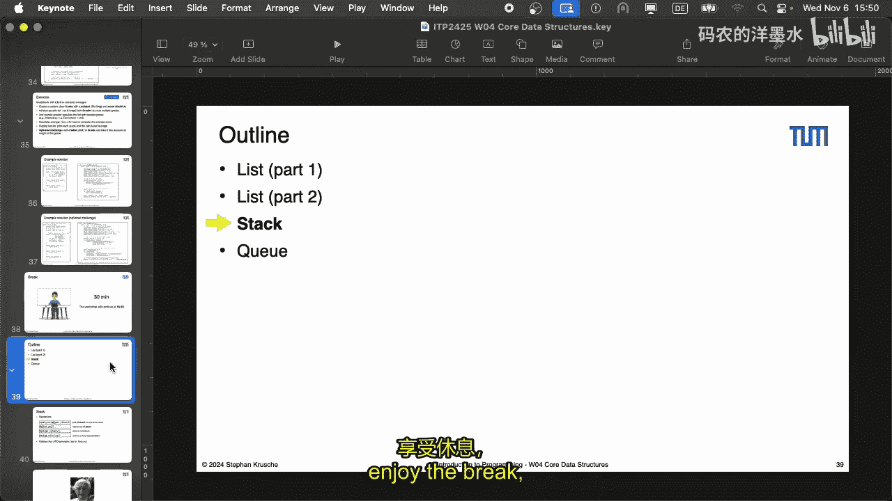

# 【全集】慕尼黑工业大学 计算机编程：从入门到实战 中英字幕 p20 Lecture 20 - 列表part2 -BV1WFrTBZExY_p20-

Let's continue in our second unit， we would like to look into more examples and more details with list data types。

So we basically expanded this from last year so that we have two sessions now because this is so important。

 we've already seen that the list interface represents an ordered sequence of objects。Now。

 I told you that you can use the list with integers， however。Those are unknown to you until now。

 because you've only learned primitive ins and with primitive ins and floats。

 you can't really use the list interface。 And this is what we'll talk about。 Before that。

 let's do a quick excursion was what this generic type actually means。

 A generic type as a placeholder for a class based data type。 No primitive type。

 So you can't use it with the int or the primitive float or the primitive Boolean。

And we will see how to circumvent this issue in a moment。 Genes allow us to be typea。

 It ensures that we consistently use the collections with only the types that we intend to do and prevents lots of mistakes during compile time that would otherwise only appear during runtime and。

They basically allow us to implement the list once and use it with any data type in the future。

And this was not always possible so in the first versions of Chava people had to implement a list for all their different data types。

 They had a string list， a fruits list， a student list， a point list， a float list。

 and so on and of course this is cumbersome we would like to reuse code and this is what generics allow us to do and they also then make the code cleaner and easier to understand if you go over the over the hurdles of understanding a generic data type。

Well， I told you for primitive data types， we can't use it。

 This is why in Javava we have so-called wrap classes。 for every primitive type。

 we have a wrap class。 So the lowercase sp has an uppercase sp Reper class， the short has a short。

 the int has an integer and so on Yeah So for eight primitive data types。

 we have eight wrapper classes。 why do we have both you might ask yourself now， well。

 primitive types are more efficient in terms of memory。 So if you use1 million times an integer。

As a wrap class， you need double the memory。 Then if you use 1 million times the primitive int。

And the reason is because an inte acts with。That is created with the new integer， like a class based。

 like any class based type， uses not only the value， but also a reference to the value。And remember。

 reference semantics have certain advantages， but also certain disadvantages。 Well。

 when it comes to inte to to wrap classes for primitive types。

 we can simply assign them to a primitive data type。

 and Javava does the conversion automatically for us， we don't really need to here。

 So even if x is an integer， we can directly assign to an int and all the conversion is done automatically。

On the other hand， we can also wrap an in value within an integer。

And then the constructor is called automatically， even without using this new integer syntax that you have seen in the previous slide。

 So this is also quite handy。And then it looks like that。Which of both should you use then？ Well。

 integers can。The class based integers are really good when it comes to collection data types。

 because otherwise， we can't use collection data types。 We cannot use them with primitive types。

 This is simply not possible。 So whenever you need to deal with a list。

 a set or any other collection data type in Java， you need to use those。Rea classes。

On the other hand， they need more space twice as or roughly twice as much as their primitive counterparts。

And this can be problematic。And in addition， you have to deal with one additional case。

Because they can be known。If you do not initialize them， they have the default value null。

 while primitive data types have a default value that allows you to always calculate something。

And in fact， when it comes to Boolean， a Boolean has two different values， right。

 a primitive Boolean， true and false。If you use the uppercase Booleion。

 you have a third value as well。 null， but is null false or is null true。 You have to decide now。

 and this can be quite cumbersome in many different places of your implementationer。

 So in addition to dealing with null and potential null pointer exceptions。

 you then also need to think about what does it mean if the value is null and it does not exist。

 How do I handle this case in the logic of my application。Additionally。

 Javava gives you a class that is called object。 Sounds a little bit counterintuitive。

 Why do we call a class object， Stean， you told us previously that a class and an object are different things。

 And you told us we should be able to differentiate it。 And you can't。 Well， it is like it is。

 Sorry for that。 the super class of all other classes is called object。

 will tell you later what a superclass actually is， this is an implicit superclass。

 so all classes are related to object， even if you don't specify that。

So right now you just need to know that that object exists and is a generic type that you can use with any class later on。

 and it provides you with a few useful methods， So you might have seen that if you create your own class like a point。

 for example， you always get this nice two string method that is even automatically invoked when you put it into system or print line。

 Well， this is because object。Provides such a method for you。

 And if you don't override your own to string method or provide your own two string method in your own class。

 then the one of object is used。There's also an equals operator that allows you to test whether two objects are identical or whether their references are equal。

Here's an example of how this is implemented in the super class object。

 but you can potentially change this in your own class。And with that。

 you have a few things that you can do with all the classes， even without implementing it。

 and those are also available for those Rapper classes。Now when it comes to collections， as we said。

 they can only contain classbased types so a set cannot contain primitive types。

 a list cannot contain primitive types， only class based types。

 but they can contain null value so it could be the case that you have a list and someone said words at null and then if you get the element at this position it's null this could be the case so you might need to deal with that at some point。

 of course you typically like to avoid that because that's not very nice。

 but if you want to be 100% sure you would need to check for null when retrieving elements from a set or a list。

Additionally， we have seen those concurrent modification exceptions in the previous exercise。

 so you can't really modify a collection while iterating over it。

 There are workarounds that we have seen。 We can use separate lists in order to。

Cover all the elements that we would like to remove or all the elements that we would like to keep and then do the operations based on that。

 or alternatively， And this is also something that you will use learn later on。

 you can use functional programming approaches such as streams to modify the collections。

 with streams you can implement so-called filters and those filters that automatically iterate over it and remove elements based on the condition that you are interested in。

 And this is much easier。 So a normal programmer would not use a for loop to remove certain elements。

 they probably would always use a stream and you will learn how to do that in a later workshop。

Notice also that some operations on collections are rather inefficient。 For example。

 if you add an element to the beginning of a list。All the other elements have to be moved to towards the end。

 right， And this can be quite expensive， depending on the internal implementation。

 So if you don't care at which position the element is always added at the end or reorder your code in order to be able to edit at the end。

 if you。At 1 million elements at the beginning of the list， This is very。

 very inefficient and leads to performance overhead that you can circle wet。

So keep that in mind that while collections are really great， especially for beginners。

 some considerations need to take place。Here's an example list with integers。 So again。

 no primitive type， but the wrapper class， we can simply say list integer numbers equals new array list and it's also quite nice that Chava does not need us to specify the type again on the right side。

 so by using type inferencefer， we can avoid specifying integer twice so in the second diamond here where we normally would specify the generic operator we can leave it out in most of the cases。

And then we can add a few elements like 0，1，1，2，3，5，8，1321。

 Who you know which number series we are using here。Yes。

 great answer Fibonacci serious and then again like in the previous examples we can get elements at an index。

 we can check if our list contains elements， we can check whether what the index of a specific element is and so on and we can also use automatic conversion from integers to ins and for example。

 use a for each loop un enhanced for loop。😊，In order to calculate the sum of all values within the numbers list and how do we do that。

 Well， here we simply print out the number that we are iterating on。

 and then we say sum equals sum plus number。And then at the end， we can print out the sum。

 And here you have an inte on the right side。On the left side， you have an int。

And Chava automatically converts that for you。 So you don't have to do any conversion。

 And this is quite nice。 However， this line could potentially lead to an nu pointer exception。

If you want to try this out， copy and paste the code into your playground， add null into it。

 which is possible。 And then here due to the automatic conversion from the integer to the end。

 you would experience an null point exception So always make sure that this does not happen in your code Any questions regarding this example。

Great， then I have another one with floats。 here。 We are dealing with temperatures。

 So we again create a list called temperatures based on the wrapa float。 of a case F here。

 Very important。 And we add a few temperatures。 And now we would like to calculate the average temperature。

 Yeah， maybe those are the temperatures every hour or every day And you would like to calculate the average in order to do some sustainability calculations and to find out what the average temperature is in Munich after some time。

😊，And how do we do that Well， we again sum up all the values， like in the previous example。

 automatic conversion from float wrapper to float primitive type。

 potentially leading to null pointer exceptions if you add null into your list。And then at the end。

 in order to calculate the average， we need to divide some by the size of the list。

And then we get the average temperature in Celsius。

Something around 20 degree would be the result here。 if you copy and paste this into your playground。

 you can try it out。Any questions regarding this example？Then I have another one for you。

 Remember that we defined a custom data type previously the so called class point with the coordinates X and Y。

 a constructor to initialize those and get us and set us。Do you remember that。

 Who remembers this class， Raise your hands。Okay， all the others have a loose brain。 No just kidding。

 Well， we can use this point class also。😊，In our list and use it with collections。

 we have an example here， we create a polygon。 And while this is a bit difficult to understand。

 I created a plot using CheP， by the way， for you in order to better understand that。

 So we create new points and directly add them to the polygon。 Pogon is a list。😊。

Based on error list implementationer。 And you see the polygon on the right side。

 And while we can also do some mathematical calculations Now， we can， for example。

 calculate the center of the polygon。Visualized with this little red X here。

And we do that again with an enhanced for loop by creating the sum of all the x values and the sum of all the y values。

And then dividing them by the polygon size， so we kind of calculate the average and the average then represents the center point of the polygon that we can print out to the console。

So very nice。 We create our custom data types like point or any data type that you have in mind。

 And immediately， we can use it with the collection data types。 We don't need to do anything。

 So this is quite convenient。😊，Any questions regarding this example here？Anything that is unclear？

Anything that you do not understand。Yeah， good ahead。Yeah。

 so the question is does the graph show in the terminal if you run the code know Yeah。

 I just wanted to visualize this and show you a visualization of this。

 you can actually give this code to chatCT and ask it to visualize to create this visualization and then it uses Python in the background in order to create a plot。

So if you don't wantna plot this by yourself， use AI for it。

 I did this as well because I was a bit lazy yesterday evening and didn't want to create a plot on my own。

 But this code just prints it to the console。 and， of course。

Thinking about a visualization while you see all the numbers on the console is a bit cumbersome。

 So I did this small convenience service for you。Great， if there are no more questions。

 we have another exercise。 This time， it's not an artemist。

 but we kindly ask you to do this on your computer in your playground。

 And the idea is now that we like to create a small grade book based on list to calculate your average grade。

 Maybe you've done that previously in Excelel， Now we try to do this in Javava。

 And we do that by creating a custom class grade， which actually should have two attributes。

 One is called subject， which is a string。 And the other one is called score， which is a double。

 And the score basically represents the grade。 So， for example， if you have past marketing。

 you can enter a 1。3 or the grade that you have gotten in there。 If you have past economics 1。

 you can also put your own grade or like here a 2。0 into it。

 So the score is basically representing the actual grade。 and the subject is the name of the。😊。

Of courseour。We kindly ask you to initialize the grade list using array list so that you can store multiple grades。

 you add a few sample grades， maybe the ones that you already have passed in your previous semesters。

 if you've not passed any exam yet， then feel free to use some random examples and then calculate the average by using a for loop and display the result to the console。

And while in this， print each grade from the enhanced for loop and afterwards the calculated average to make sure that everything works correctly。

 And if this is way too easy for you and you say She and I need more challenges well。

 we have one here at another attribute called credits into grade and take it into account for the weight of the grade because economics and marketing might not have the same amount of ECTS。

😊，And then the。Standard average would be wrong because at toM。

 you need to take the ECT S into account and the 12 ECTS course， such as introduction to programming。

 then counts much more than a6 ECTS course， which means that you should be more motivated get a 1。

0 in this course than in any other courses of the study program。So this is your exercise。

 You have around 10 to 15 minutes now， and then I'll show you an example solution。

 Ra your hands if you have questions。Time is up。Please stop working for now and listen again。

 I'll show you an example solutioner。 This is the example solution without the optional challenge。

 We have a class great。And two attributes， string subject and double score， I made them final。

 you don't have to do that， you can also do it differently if you want。

 and I basically assign values directly in the constructor and provide getters。

Users of the class can use them if necessary， Fi means we can only set the value once。

 and it can never change。Again， this is not essential for this example solution。Then I create a list。

With the type grade called grades as a new a list using type inferencefer here。

I add a few grades directly creating them like in the previous example with the new point。

 for example， marketing with a 1。3 economics 12。0 financial accounting and so on。

And after adding a few elements to our grades list， we can use。

An enhanced for loop to print all those values so this is one step to print each grade here again this is not really necessary。

 this is just for you to better understand if everything works if the getters are correct and so on。

And then the actual step is to calculate the average score。

 and I'll do that by initializing my sum again， in this case， a double with 0。0。

I sum up all the scores using the enhanced for loop again and the getter get score。

 Now I use the abbreviation here sum plus equals。 you can also just write sum equals sum plus。

 That's basically the same。 This is shorter and preferred by more experienced developers。

And then I create the average as the sum divided by the grade size。

And I'll print that to the console。Any questions regarding the example solution。

 anything that is unclear？So the question is， why do we use a second class grade calculator。

 Why can't we not put everything into the same class？ Well， you could do that。

 You could have a main function within the grade class， but typically， the code would be separated。

 the users of the grade class are not inside the grade class。

And it's also a good exercise to work with multiple classes in your project because this is what you have to do in the exercises as well。

 So it's technically not wrong， but it's typically the logic is implemented outside of the data class right So grade is simply a data holder and typically does not contain any additional logic in it。

Any other questions？Then I guess you're curious how we solve the optional challenge。

 We have to add a little bit more code。 So this could be an iteration of our our great book。

 Great book version 2。 How do we do Well， We add the credits field here。 So a third element， private。

Final in credits， we have to put that into our constructor and we provide G as well。And then， we can。

Add credits next to the construct here as well。 So 3，4，5，6， and 2 are added。

 They are potentially wrong。 So please use the correct credits。

 But I was not motivated enough to look that up in your study program。And then， we can also。

Change printing each grade with the credits by additionally showing the credits in here。

 using the plus concodination operator。You can also write system outline into one line。

 I just separated it because my slide is otherwise not large enough so you don't have to do new lines here。

 feel free to put that all into one line and then we have a small change in here because we need to take the weighted sum。

And the weighted sum is the。Great score multiplied with the great credits。

And then we also need to calculate the total credits。By adding all the credits in the grades。

 And then in the end， we can divide the weighted sum by the total credits。

And after your full Bchelor program， this would be 180。

 the total credits or potentially more if it doesn't fully get to 180 and after your master program。

 this is typically 120。And weighted sum could be something that is higher typically， right。

 So I don't know if you always get a two， A B and the。Courses。

 then you weighted sum for the baachelor could be 360， divided by 180， and it would be 2。

0 in the end。Just as an example。Any questions regarding the example solution。

 including the optional challenge。Who thinks this is an easy exercise， Raise your hands。

Who thinks this was difficult。And many people without opinion， okay， great。

Then we'll do a break and a longer one and meet again at。20 past 4。

And then we'll talk about a stick and enjoy the break and see you in 30 minutes。

