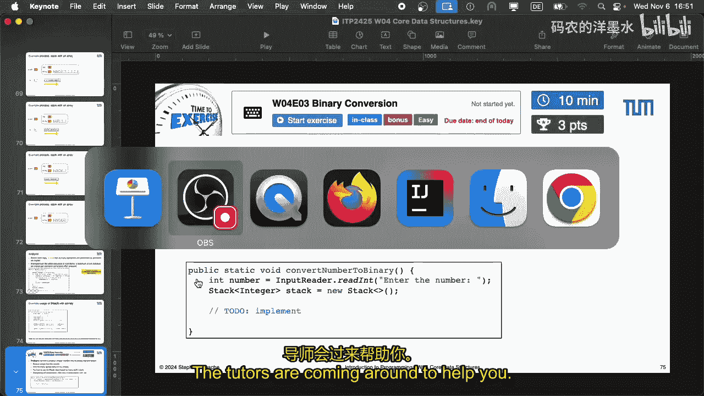
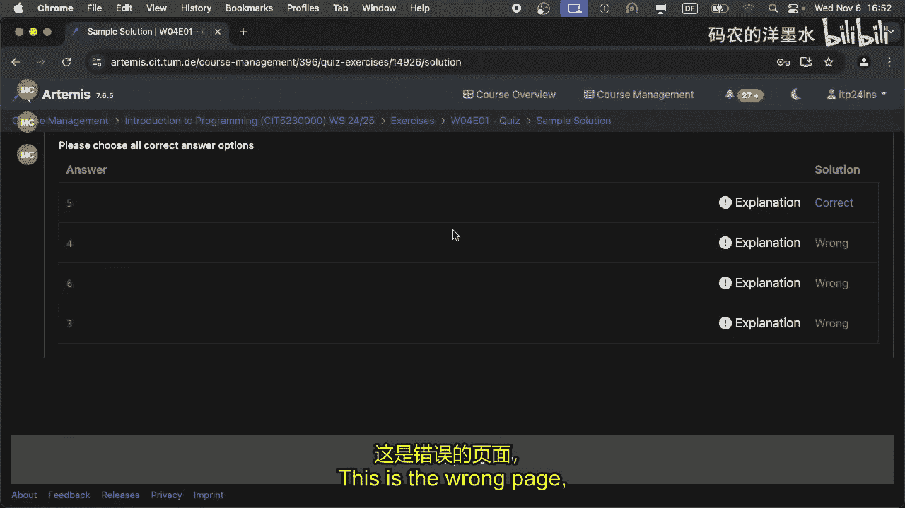
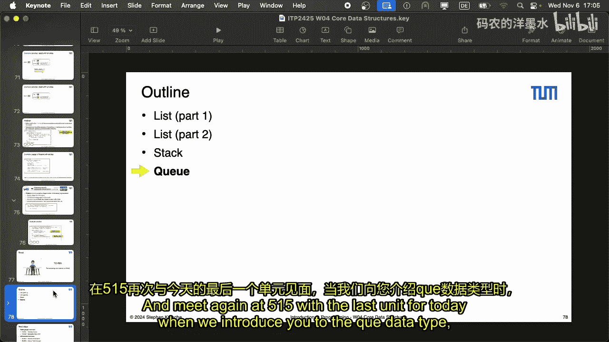

# 【全集】慕尼黑工业大学 计算机编程：从入门到实战 中英字幕 p21 Lecture 21 - 栈 -BV1WFrTBZExY_p21-

Welcome back after the break， we will continue with the next data type called St。

A stack follows the letO principle， which means the last element that you add to the stack is also the first one that you can get out。

In a stack， the operations are typically called push where you push an element on top of the stack and pop where you return the top element。

In addition， you can check for emptiness and return a string representation for debuing purposes。

 for example。The stack was。Coined and developed by a famous computer scientist from the technical University of Munich called Fritri Hluwig Bwa。

 He was one of the first computer scientists in history。

 and we even named our main lecture hall in the informatics building after him because of。

His prestigious work。When we model a stack in a UML class， this could look like this。

 we have stack as the name， and we have those four operations as seen before。

 push an element which doesn't do anything or not doesn't return anything pop which returns the object that is at the top element if there is one otherwise null is empty returns a Boolean either true or false and two string returns a string representation。

Let's quickly visionize how that works if we have an empty stack。Without any elements。

And we push the element one on top of it。 looks like that。If we now push the element 2。

 looks like that，3。4 and so on。 Yeah， it's similar to having bricks and building a tower。

 And then it's important that if you now would like to get the elements using the pop operation。

 you get always the highest element in this tower So this one would return4。

 if we do another pop operation。 it return3， then we would return2 and then we would would return one and the stack is empty again。

 if we call this on an empty stack， it would return null in the implementation。

So that's basically the specification。 Now， let's see how we can implement this。

 And the first possibility is to implement this in a generic way so you can use it for all your data types and wrappers for primitive data types。

By using a list。And we don't care if it's an array list or a link list。

 but we know that there is some kind of internal representation。 So if you use an array list。

 this is backed up by an array。 And while the list offers us methods such as add remove is empty and to string。

 we can reuse those when implementing a stack without exposing them to the outside world。

 And this is really important。 a user of the stack class is not allowed to invoke add or remove because then this could lead to illegal operations that are not allowed in the stack。

 a user of the stack is only allowed to use push， pop is empty and to string。 Nothing else。

And this is， again， an example for information hiding。Now， you might wonder what this little diamond。

 the black diamond operator means。This is called compositioner。

 And this means that the class on the right side here list can only exist when the stack actually exists。

 So if we create a stack， a corresponding list with the default here we have the default multiplicity one here。

 So we have one list， a default list is created And whenever the stack is destroyed by the garbage collector in Javava。

 the list is also destroyed。 So the list in this example cannot exist without the stack。

 very important aspect。😊，And again we're using generic types that we call E here。

 notice we can use any letter， some people also call T use T for type or anything else。

 but here we use the letter。Capital E always capital letters for generic types。

 And you see them throughout the definition of the methods as well。

Here's an implementationer of a stack with a Chava utility list。We define the name。

 we again use this generic type definition here with the diamond。Bracces。And we have one attribute。

 This is the。Association that we have modeled here。

 We turn this into an attribute in our stack class， and we。

Do this as a finalist so that no one can override this accidentally。

And this is a list that has the same type as the stack。 So when we define the stack data type。

 such as a string， we would also automatically define the list data type， then。

And this is simply a new error list。 So basically things that we've seen before。

 except now we use this generic implementation here。How do we implement push， Well。

 push means we add an element to the end of the list。 So this is fairly simple。

 We have annotations here that we should not。Allow our users to。Put null values to the stack。 Yeah。

 So this is some additional annotation based on the checker framework that weve introduced two weeks ago that allows us to make sure that we don't push null elements onto the stack。

 We don't want that。 This makes it easier for us because then we don't need to deal with null values。

So fairly simple implementation How do we implement P Well P returns something nullable as weve said before。

 if the stack is empty it returns null because there is no element that we can pop we could theoretically also throw an exception but yout you did not learn how to do that yet。

 so we simply return null here。If we still have elements， so if the if condition is false。

 we do not return， we actually go to the next line here and we need to remove the last element。

 first of all， and if you carefully look at the definition of remove。

 remove also returns the element。So instead of having two operations。

 getting the element and then removing it， we do it in one operation。😊，ok。

And we don't do this with list dot size because we start counting at 0。

 It's an array backed up list here with an index0 for the first element。

 This is why we need to do list dot size-1。I empty is fairly simple as well。

 we just delegate the implementation to the list and ask the list if it's empty or not。

 and to string is also fairly easy because list offers a to string method。

Any questions regarding this implementation？So we add elements to the end of the list。

 and we make sure if we。Use the pop operation。 We always remove the last element and directly return it。

This is a very simple implementation。In terms of lines of code and complexity of the code here。

 we only have an if statement here。 and otherwise， we have one liners， basically。

It does not really use all the features of the list。

And we could also realize the stack directly with an array and a pointer to the top element that we have in the array。

 And if the array overflows， we would then replace it with a larger one。

 So that's the first implementation stack with a list。

 Now we would like to look into how we can implement a stack directly with an array。

You have one question before？So。The array is implemented natively。 That's correct。

The list is not really natively。 It's not a language feature。

 It's an existing implementation that you can use。 It would not make a difference if you use the one that is provided by Javava or by any external provider。

so people have just used it and in fact， there is also a stack implementation that you could use if you have a custom data type and there is no build in collection data type。

 you will surely find something online in any other collections framework。

But we would like to show you how a stackbergs internal。And how you could realize that。 Yeah。

 because you should also get to know a little bit about those data types。

 And it's a good exercise to use list as well here。Okay， the question is。

 how do we tell the class the diamond operator， you don't tell this the class。

 It's just like that you don't offer for this particular scenario and access to the list from for someone else。

 Yeah， this is purely private and no one else can grab the reference and do something with it。

And this is made sure by this implementationer， there's no getta。 Yeah Otherwise。

 we could also offer a getta。 there's also no set so we can't modify the reference and we make sure that this is really purely internal and no one else can mess this up。

That's the idea here。 And this also means if the stack is not used anymore and the garbage collector will remove it。

 the list will also be removed by the garbage collector。 It does not exist。

 And this is done automatically in Javava。 In other programming languages。

 You might need to do that on your own。 There are socalled D methods。 Yeah。

 all means you allocate space。 Dal means you basically remove it and put it to trash。

 And then you need to do that on your own。 But that's a convenience in Javava that we have the garbage collector and we don't have to deal with this。

So the question is， if there's no get， how can we get values。 Well， internally。

 we can use it internally， we can access the list， but no one outside of the stack can use it。

 So if you now create a program that uses the stack。Yeah。

 you're a fantasy dream factory who needs to use a stack， then it can say stack equals new stack。

 but it cannot get access to the list。It's not possible。

 There is no get list or something or get array or whatsoever。 It's not possible。

 And this is intended。 This is really intended。 No one should mess up our data。

 This is exactly this information hiding principle。

So this is this is really important in this example。Great。

 before we show you the implementation of the stack with an array。

 let's have a quick look how this could work。 Here's the usage of stack with a list。 for example。

 an integer based stack， we say stack of type integer stack equals new stack。We have， again。

 type inference here。 We can print out that we would like to push elements on the stack。

 we say push 10， push 20， push 30， and we can print the current stack notice that if we add stack here。

 it automatically invokes it to string method。And then we can pop elements。 Yeah， for example。

 we pop one element here， print that， and then we can again print the current stack and make sure that it only includes the elements that should still be in there。

 So if you execute the last line here， it should print 20 comma 30。S接I点。

Any questions regarding the example usage of this。Generic stack class that is using the list。

Implementation。No， then we can continue Next， we would like to model a stack with an array。

 And now the implementation is slightly different。 and we need to deal with this limitation of an array that it has a fixed size。

 but our stack should not have a fixed size。 We don't know how many elements should be added in here。

 It can be one。 but it can also be1 million。 so we need to take care that we start with an certain size of our array。

 but after some time we increase the size。 And this is the main exercise here Yeah。

 that you understand how to deal with that。 all the operations that we show to the outside world。

 stay the same， except that we don't have a generic version。 we have a version with object。

 A generic version would be possible， but it would be quite complex to understand This is why I replace the generic version with object。

 In fact， under the hood。 It's the same。It's just a different way to express this。

 And now we simply remove the capital E here， replaced it with object here。

 So it' it's kind of similar。Well， we need one additional element。 We need an integer。

That stores the current top index。 We will see why this is necessary， in a moment。

Let's quickly look how this can work。 A stack with an array。 We have a classbased object here。

 Yeah lowercase stack。 This is an object that was instantiated with a class。

 and this has now a reference to an area in the memory the rounded rectangle here represents memory area And the first element is the in top。

 which is just the number And the second one is the array。

 which is a pointer to some other memory area as well。 and this memory area could for example。

 be configured that we already have three elements in our stack。 So we already pushed A， B and C。

 and now someone else is pushing B and this is perfectly fine。Yeah， so then top is increased by one。

 It doesn't show to the index 2。 It shows to the index 3 now。And。

The array is now full because it only has four elements。 So what do we do？ Well。

 we need to create a new array， for example， double the size so that we don't do this operation all the time。

 instead of having four elements， we now have eight elements in the array。

 and then we need to copy all the existing elements， A， B，C and D。

 and then we could finally insert this new array to our original array and override it and insert the element that we have been interested。

😊，Notice that the previous push operation was kind of instant。

 We just had one operation in order to add the element。 Now。

 it takes much more time because we have to create a new array。 We have to copy every element。

 and then we insert this one。So there is some overhead related to this。

 and this also means that you need to have a good number。 maybe don't start with four。

 maybe start with 100， and then double the size。Because the operation to copy the array is expensive。

And here is the implementation， and it looks difficult， but I'll explain you how it works。

 We have a public class stack。With an in top that is initialized with the value-1。

 and we start with an object array so that we can basically store all kind of objects in it。

 and it has the size 4。 Yeah So this is just a random number that we're starting with because I can have a slide with four elements。

 I can't have a slide with 100 elements。Is M is now implemented differently。

 It basically checks if top is smaller than 0。And this is currently the case for the empty stack。

 So this is correct。 If it's 0， that we have one element in it， If it's larger than one。

 we have larger than 0， we have multiple elements in it。Now， the push operator。Is a bit tricky。

 but you will see that it doesn't。 It's not too complex。First of all。

 we increase top by one with the increment operator。 So in an empty stack， we would say。Top is -1。

 Now， if we push an element， top becomes 0 because this is now one element。

 and this is the index of our top element。If and and if you now ignore the next few lines of code。

 then we simply assign the element to this position in the area。

Using the notational that you see here。 So this means put the element to the position where the in where the integer top is pointing to。

Now， in most of the cases， this if condition here is false。But if the array is full。

 if we don't have any places anymore more， then we need to create a new array。

 And we do that by increasing the size， by doubling the size。 In fact。

 top is the same as array length。 Yeah， So we say two times top。And then we copy all elements。

 all the existing elements are copied in a new array。

 and we assign a new array to the original array。So we cannot make it final anymore。

Yeah so this for loop here is a simple copy operation。 we started in next0。

 we go until we are at top minus-1 and then we copy the element from the array to the new array at the same position。

YeahSo this is really just a copy operation。So most of the cases push only executes two lines of code。

 but sometimes it has to go into this if statement and will invoke a few more。How is pop realized。

 Well， first of all， we assumed that top is larger than-1。 Otherwise we would get an exception here。

 So this time we do not return now， we just would get an exceptional。And what do we do Well we first。

Get the element at this position。And then we decrease top by one。By doing that。 Yeah。

 this is because we do the post fix decrement here。 So we first get the element。

 the current element at the top position， the top element， we return it。

 And then we decrement top by one。 And this is just shorter。 I could also write it in three lines。

 But I decided to keep it with one line because otherwise my slide is so full。

And last but not this we have the two string method， the two string method looks a bit awkward。

 it basically makes sure that we only copy all the elements from0 until the top position because。

And you will see that in the animation， if you go back。

 popping elements here does not really remove them。

We just decrease the top by minus whatever we decrease it by one。But we still keep the element in。

Because removing it is not really feasible。 I mean， we could assign nu to this particular positioner。

 but we don't get anything out of it。 And this is why we copy a certain range of the array and then create a string out of it。

And this copy uses array and goes from 0 until top plus one。Great。

Any questions regarding the implementation， I know it's not easy。Yeah， go ahead。So the question is。

 why do we do that this with an array Well， for practicing。 Yeah， to show you how it works。 I mean。

 of course， you can now say， hey， I'm a privileged developer。

 There were some people before me who implemented this nicely， I can just use the simple version of。

 but at some point you also should understand how those internal things work。 And in fact。

 the list the array list has an implementation that is similar to this one because it also uses an array and it also needs to deal with cases that when the array is full and when you add more elements to it。

 So in some case you should have a rough understanding。

 even if you don't fully understand it So this is really for practicing。Great。There。

 some disadvantage with this first implementation， we actually allocate new space when we push elements and the area is full。

 but we never release the space。 Yeah， so if we once have 1 million elements in it and we pop a lot of elements and we only have five in it in the end。

 the area is still 1 million elements large。And while this is not super super bad in a very simple program in the reality。

 it can be problematic because space is limited， and memory is limited。

 and we should think about improvements here。 In addition to implementation is not really typeafe。

 This is a big disadvantage regarding generics。 So if we have strings。

 pop still only returns an object and you don't really know if it's a string or not。

 people could put a string and an integer and a point and a grade into it and you can't really deal with that。

RightSo I don't say it's a good implementation。 This is really just for you to understand how it works。

Great， then let's get at least rid of one disadvantage。 If the length drops to half again。

 we like to release it。 So we like to change the pop method to make the array smaller in case it's feasible。

Now， if we do that and we end up with this array where we have five elements， we pop one element。

 we halfal it again。And then we push again an element， and we double it again， and then we pop again。

 and we half it again， and we push again and double it again。 You see that this is very inefficient。

Right， because we will would need to do this in every operation if we are at this particular sweet spot。

And this is not ideal。 So an idea could be that we only release space when the stack goes to a quarter。

Of the space， not half the space。 so if the stack currently has8 elements。

 we do not resize if it gets four elements， nor we resize if it only gets two elements。

 And with that， we avoid this situation at this particular sweet spot。

 and we have a better overall efficiency for our。地得头。

So if we have a stack with an array and we have three elements， yeah。

 we had already increased it before， we have three elements and we pop。

 then we only have two elements anymore， and then we can half the size。有。That's basically the idea。

 And now I could push again， two elements without the necessity to double the array again。

 And this is has just a better overall performance。

So when we do an mortar and amortized effort analysis。

 something that is covered in the course fundamentals of algorithms and data structures。

 if you're interested in， please visit this course after this course。

 they have certain requirements that you understand and then you do this effort analysis。

 then you will see that average over the entire sequence of operations that are possible。

 a maximum of two numbers are copied per operation。This is the idea。

 So we have an overall good performance。 There might still be edge cases where the performance is not really good。

 but on average， we can guarantee certain things。How do we implement this？ Well。

 the pop operational now also becomes more difficult we。First of all。

 get the element at the current top position so that we can return it later on and we decrease top by one。

 so this is basically the same code as before just instead of having one line I have three lines now。

By。Factoring out the decrement。And we again， have a new statement。 So if error length divided by4。

 it would become the top positioner。And if top is still larger than2。

 because otherwise we can't make it smaller anymore， then we again。Create an copy， a new array。

 again， default follow just copying it。 It's the same code as in the push operation。Now。

 the interesting part is which kind of size do we use。 Well。

 you've seen that we top kind of counts the elements as well。That we have。

So if we have two elements and we do the pop operational， we would like to reduce the size to4。Right。

 so we say two times top。It sounds a bit off， yeah， because。In fact。

 we would like to halve the array。But。We could also write error length divided by2 here。

 It would be the same because top equals error length divided by 4。 if top is 2， error length 8。

 this condition becomes true， and then top times 2 would be 4。

 It's the same as error length divided by 2。O。So essentially， similar， like in the push operation。

 but different result， we copy everything into a new array， and this just has half the size。

 While in push， we copy everything into a new array， and this has double the size。

Any questions regarding the pop operation。I know the array based version is more difficult。

 right this is why I personally would also prefer the list based version。

 and we still should try to understand it。 here's some example usage of stack with the array。

 you can find the whole stack code with the array on this link here in case you would like to copy this into your playground and in case you would like to debug to better understand how it works。

 feel free to do that。 then you can have a main class and a stack class and then instantiate the stack at a few elements and see what happens if you pop and push and when you do the resizing operations。

 So take this as a starting point。 if you like to try this out the example usage did not really change compared to the previous result except we do not use generics here。

 So we do not specify the data type of the stack the stack is not type safe。 You can add any element。

 We can push intes。And strings as well。 And this can， of course， be dangerous。Great。

 then let's do a little practice exercise for stacks。

 We deliberately have chosen to do this with the list based version of the stack。

 This is much simpler。😊，And we have a little challenge for you。 It's again。

 about the representation of numbers。 Remember that we at one point ask you to convert an integer number to actually revert it in the end。

Now， we have something that is comparable， but it's more about。

Turning a positive indexature number into its binary representation。Your examples。

 if you have eight as an input， this would lead to 1，0，0，0 while 9 would lead to 1，0，01。

Yeah so we would basically like to implement a binary conversion。

And while there are libraries to do that for you， we specifically ask you in this exercise where you can also get a few bonus points to use the stack class that is based on Java utility list。

 so read an in from the console S you see T here using our input reader。😊，Create a stack。

Put the elements correctly into the stack， depending on the binary representation and then print them to the console using the API。

 the application programming interface of the stack。 So you can use the push。 You can use the pop。

 You can use the is empty， and the two string operation。Please get started。

 The tutors are coming around to help you。 You find the exercise on Artemis。

 So if you go into the course。

Potentially reload。 There is the binary conversion exercise。 You can start it。This is the wrong。Page。

 sorry。

No， it's not。 Okay， fine。 And then you can copy this and we'll add this as a new project。

Into Intelliche。 So we say new project from version control。Here we go。

And we'll see we have the input reader and the main class。It is actually using Chava UTL stack。

 which is working similar so see that there is already a Javava UT implementation for the stack that we have shown you and you can then use pop and push There is also a peak operation just ignore it。

 you work with pop and push and empty is just renamed from is empty to empty it's basically the same just a different name。

And while there are certain other operations at all capacity and so on， please ignore them。

 we don't want to use them for this exercise， so we specifically ask you to only use P and push empty and to string。

Please work on this Now。 There are some subtleal hints that you might want to use the modular operator。

 like in this previous exercise that I mentioned and the division operator in the context of Integer divisioner。

So this will help you to get this work done remember we have a binary representation binary says two so maybe this is also a hint binary two moduleular2 division by two。

 maybe this can help you so please work on this for around 10 minutes and then I'll show you one example solution have fun。

Okay， the time is almost up。And。We do not have additional buffer time anymore。So。

I quickly like to show you an example solution and you can ask questions and then we have another break and feel free to further work on this during the break。

So this is the example solution。 You can see that it's。Only consisting of a few lines of code。We。

Take into account that binary。Representations are based on the number two。

 so therefore we use the modo operator and the division operator。

And after reading the number from the input， we basically say while this number is still larger than0。

 we push number what you do to and then divide the number by two using integer divisioner。

Modulular2 will either return0 or1。And the inte divisioner will basically then。

Cut the number into half。And not take the rest， the remainder into account。 So if we get a one here。

 for example， if you have 9， Yeah， then this one would be 1，9 more you do 2 is one。

But 9 divided by 2 is 4。 So we get rid of this one。And by doing that。

 we push all those elements on the stake。 However， they have now have the wrong order。

 this is why we actually need this stack。And by then using the pop Opera。

 while the stack is not empty， we can simply print it directly to the console without an LN。

 one after each other and make sure we have the correct binary representation。

Any questions regarding this example solution？I know it's a bit tricky to come to the solution。

 but we hope youll see that a stack is a useful data structure here。IfThere are no questions。

 we'll have a quick break。And meet again at 5，15。With the last unit for today。

 when we introduce you to the Q data time。 So see you in around 10 minutes。

