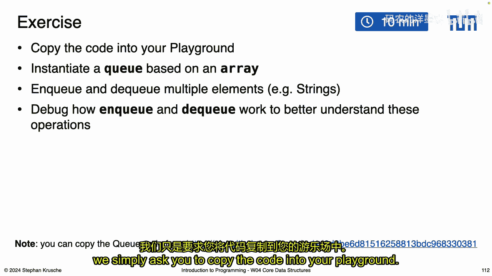
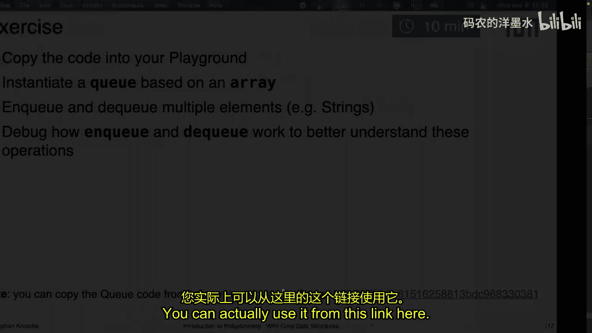
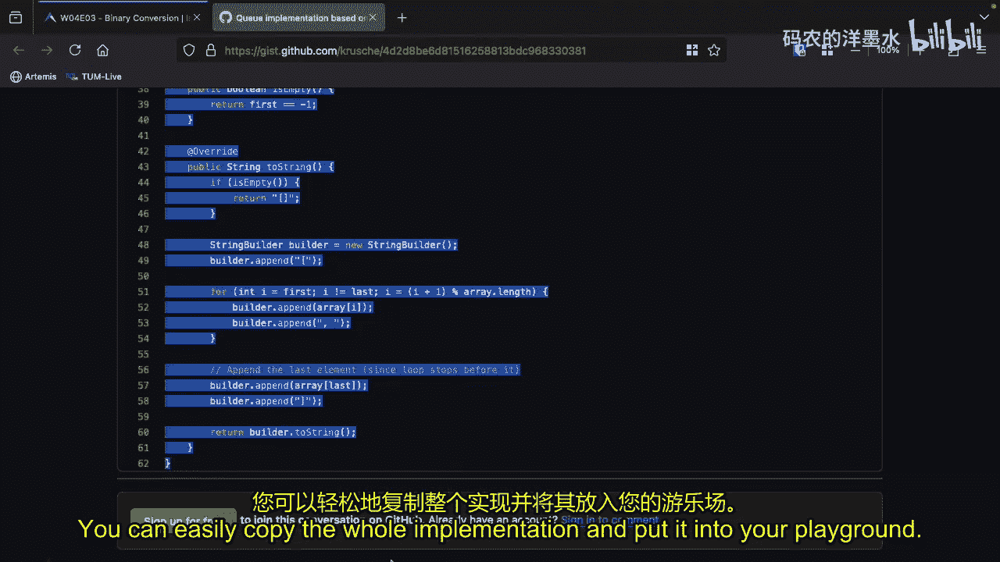
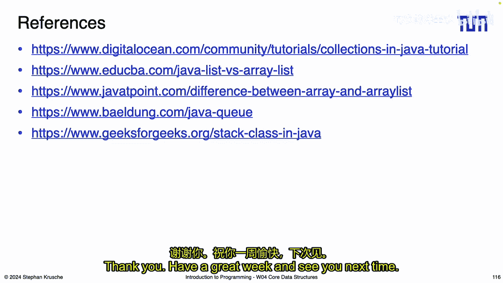

# 【全集】慕尼黑工业大学 计算机编程：从入门到实战 中英字幕 p22 Lecture 22 - 队列 -BV1WFrTBZExY_p22-

In the last unit for today， we'd like to cover the data type queue。

Instead of using the Lefo principle， like a stack， a queue uses the Fifo principle first in。

 first out， like a queue in the supermarket， the first person who goes to the cashier is the first person who can pay。

 And if you are in the sixth position you have to wait until number one，2，3，4。

5 have paid and only then you can use the cashier。So this is a big comparison when it comes to stacks。

 now Qs。Otherwise work quite similar。 They offer four operations instead of calling it push and pop。

 we call it N Q and D Q is empty into string are basically similar。

 We can model this like we've model it previously， we have N Q DQ operations that。

Where NQ inserts an element and has a void return type and D Q has no parameters in the method and returns to object is empty industry as usual。

 Let's visualize how that works。 So if we N Q elements， they will get into our queue。Like this。

And now if we Dq elements， well take the first one instead of like in this stack， the last one。

 so DQ would return1， another DQ would return 2， another DQ would return 3。

 and another DQ would return4 and the last operation would return nu。So。

Same idea of having a data structure， but completely opposite implementation for the DQ operation。

 We always take the first instead of the last element。Now。

 we can implement this using a list as we've done it with the stack。

So we have a generic queue with the element or generic data type E， and the same。

Interface the same API。 instead of writing objective， we would then use this generic type。

 And this is backed up by the list again with the at and the remove operation。

 the only difference is now that we don't remove at the end。

 we remove at the first position of the list， which， by the way， is not very efficient。

 It's much more efficient to remove the last element than the first element。

 but this is something that we take here because it's a very simple implementation。 Again。

 we use composition。 So the list can only exist while the queue exists。 And if the Q dies。

 the list dies as well， and it's completely private， no one else can access it。

This is the implementationer the generic one。 again， with the nullable and non null annotations。

 we have a final list。 We Nq elements by putting them at the end of the list。

 and we remove the first one。 So instead of saying list size -1。 like in the stack。

 that's basically the only difference here， we say list remove 0。That's it。 That's the list。

 That's the Q implementation。 So we change two things we。Change stack to Q and list size -1 to 0。

 And suddenly， we have a completely different data structure。For the Nususa it uses it。

 Any questions regarding the implementation。It's a simple implementation， again。

 it does not use all the features of list， and of course we could also realize it with an array。

Before we look into an array， let's see how to use this， we could， for example。

 use it with strings again， create a queue with the type string NQ some elements so instead of saying push。

 we now say NQ， that's just a different terminology。We can print a queue。

 and then we can Dque elements and also print a queue after the DQ operation。Great， next。

 let's model a queue with an array。 And as you might have guessed。

 is becoming more complex interimmentational。 Now， instead of dealing with just one int that shows the top element。

 we have to deal with two ins。😊，We basically would like to know the first and the last index。

 our last element index in our array。And before we actually show you the implementationer。

 we would like to visualize the process of a queue implemented with an error。When we。Do that。

 We have three elements in our memory。 We have in last， in first， and we have an array。Now。

 after enqueing a few elements， you could assume that the array looks like this。 You have。

Space for8 elements， and five of them are already filled。 ABC， D， E。 Now。

 we would like to Dque an element。And you will notice that Dqueing is not that easy in particular if it should be performant。

 because when we Dque， we have to remove the first element。 So the result of the operation will be a。

 the first element。But now， does it make sense to shift all elements to the beginning， Well。

 this would be very inefficient if we have to do this all the time。Instead。

 we simply use the first index and increase it by one。

And while it looks like that we remove the element here， it's actually not really removed。

 It stays in there， and it might be overwritten at any other point。Now。

 if if we enque another element。We will do that at the end。

And it's a rather simple operation because we simply need to increase last by one。So， we first。

Increase last by one and then add to the specific position。 That's the prefix increment here。Now。

 what happens if last our index reaches the end of the array so that last equals array length is true。

 Well， we could immediately double the array size as with the stack。

But this might not be very good because all elements on the left of first are basically empty。

And if we would always double the size， like in the stack。We would， at some point。

 end up with an infinite amount of elements。We might only have five elements in the queue。

 but we always increase， increase， increase， increase。 Yeah， So this would not be a good idea。Well。

 we could reuse the elements on the left side of first。 This will make our algorithm more complex。

 but more efficient。So listen carefully to understand how this works。

We have an example in the slide 99， so this is our current Q configuration first is at position3。

 last is at position 7， we have five elements， D， E， F G and H。And now we'd like to N Q I。

While we could extend the area， it's not necessary。 there's still enough space in the front of it。

So we assume that all the unused elements are in the beginning of the era now。

And we could simply store I in here and put last to the index0。

And you see now that the assumption that last is always larger than first does not hold true anymore more in case you had them implicitly。

When we do that， we need to make sure that。Other configurations work correctly。

 So let's assume we have done that several times now。

 and we are at the current state that we have age as the first element at the last positioner。

And I say K in the beginning。 And the last element is K at position 2。 Now， if we D Q again。

 what would be the result。H， exactly。 That's the first element in our Q。 H would be the result。

 and the pointer here or the index here first needs to get to 0。 And this is what we're doing。

And we can do that using modular operations with the length of the array so that we know if we are at the end。

 we go back again to the beginning。Great， so let's see how we can implement that。

This is a basic structure for a cube of an array。 Not that we initialize first and last with -1。

 and the array that we use with four elements initially。

First is the index of the first element and last is the index of the last element。

 to string is a very simple version right now， we will change that later on because we'll notice that this doesn't really work out how we plan it。

 but we can basically use a helper function arrays to string just to print the current state of the array and this is good enough for now later on we will adapt it。

Now let's start with the implementation of NQ。 We have to think about a few steps before we do the implementation。

Well， if the queue is empty， that's easy， then first and last are-1。

 and we can simply add the element without no doing any considerations。Otherwise。

 it could be that the array is already full， and this happens exactly when the element should be inserted at the position first。

😊，Remember， we can't assume first is 0 because it can overflow。When we Dq elements。

 it is moved to the right and it can even overflow back to the beginning。

 So we can't really assume first has a specific value。

So the array is full when the element should be inserted at a position。 In this case。

 we create a double sized array as we did it for the stay， but we also reorder the array。😊。

So that we have， again， a logical order from the first element at0 to the last element at length divided by two。

And then the new element after this doubling and reshuffling operation can be stored at the position array last。

Remember that with the modular operator， we can basically assume that first and last plus one modular length would have the same value。

 so we don't need to check if last is larger than the length。

 we can simply apply the modular operator here。 And if， for example， last is 8。And length is 8。

 Then we have 8 plus 1 is 9。 Moular 8 would be  one。And if first is' also one。

 then we would have the same value。Great， so let's see how that workss in a visual way。

 and then we implement the corresponding algorithm or operation。😊。

So this is the case when the array is full。 All elements are taken。

 The first element is at the end index 3 and second the last element is at the index2 Yeah still following the Germanman alphabet or the alphabet ABC D and now we would like to N Q E as a fifth element in our Q。

 how does that work Well we need to create a new array。

 we double the size instead of four we have eight elements。

 but now instead of simply copying everything in here。

 this would simply not work because there is no space in between D and A， we can't insert it in here。

Yeah。We reshuffle。 Yeah， we have to copy anyway， so we can also rearrange the elements。

 How do we do that， Well， we start at first， We put this into the first element。

And then we continue until we get to last。 So we have B， C and D。

And now we can basically move in the new array into our original array and add E and set first to 0 and last to 4。

So this is a visualization of our algorithm。 And now we like to implement it in code。

 So remember the visualization when we look at the code。And as you see。

 the operation becomes a bit more lengthy and complex。

But we'll go through it and you will be able to understand it。

The if statement only happens in the beginning or when the Q is empty。

 then we simply set first to 0 and last to0， we'll jump over the Ls block because if the condition is true。

 we don't execute L and an array last is our new element。Well， in all other cases， yeah。

 So this is not invoked very often in all other cases。We get the length of the array， and。

Calculate the new last。Positioner by adding one， potentially overflowing with moreular length。

So if the last index of our current element area is already taken， we go back to the beginning。Now。

 if the queue is not full yet， we jump over and don't execute anything anymore and add the element to this positioner。

In case the Q is full， which according to the previous explanation， is the case when last。

 the new last after increasing it by one would have the same value as first。

Then we need to do the copy operation。 So what we do here， we create a new array。

 double the size as in the stack operation。And we copy all the elements。

But this is now slightly different。 Instead of saying new A I equals A I。

 we have a different index on the right side。 And this index is calculated by first plus I。

 Initially， this will I is 0。 So we take first。Modular length so that we also overflow in case this is necessary。

Yeah， so this is just a different calculation。 And then we know that first equals0。

 Last equals the original length of the array。And so if we double it， yeah， this would from4 to8。

 this would be four。 last would be element at index 4。And array is assigned to the new array。

 So we override our reference friends with the copy。A bit difficult。 Yeah， I definitely see that。

 It's also getting late。 And using this complex example in the end is probably not the best decisioner。

 But if you go through it again， you will notice that it's not super difficult。

 Yeah you really just have to understand every line of code。

 Are there any immediate questions that you would like to ask now。

Ask your question now or be silent forever。Just kidding， okay。

Now the next important aspect is the DQ operation。Now。

 if we do D Q and the Q is would be empty afterwards。

 we have to make sure that the initial state is again。

Resspected So first and last need to be set to -1。Otherwise， first is just incremented by one。

 but again， modulular array length so that we again can overflow in case first is the last element。

 Then it would be again， the first element in our array。 So this is a bit more simple。 Yeah。

 we simply get the result immediately。 yeah。The element at the position first in our array。

We'll check if the array would be empty。 Then we have a special handling。 Otherwise。

 we simply increase first by one modo the length of the array。

Any questions regarding the DQ operation， okay。Some discussion。

 the implementation of D Q does not reduce space。 This would be some additional operational。 Yeah。

 we would need to think about when can we reduce space again。 Yeah。

 we could say if a quarter of the size is occupied， we could reduce space。

 and in the reduced space operation， We could also again make sure the order is correct again in the end。

So this is an additional implementation， but we don't show it to you because this is now getting too complex otherwise。

 if you want feel free to do that on your own and send it to your tutor。

 the tutor would be happy to see your implementation and give you feedback on that。And。

Keep in mind that the elements in the queue do not need to be only in at the beginning of the array。

 right？ So this is really an implementation where the elements。

 we know they are consecutive with the module operational， but they can be anywhere in the array。

 So we can't assume that something is at the end。 something is in the beginning based on this implementation。

 It can really be anywhere within the array。Except that there can't be spaces。

 multiple spaces in between。 So it can't be the case that position 0 is occupied。

 Then nothing happens。 Then position 4 is occupied。 Nothing happens。 and position  A is occupied。

 This is not possible。 So taking the mod into account， we have to have a consecutive order。

 This is for sure。 Otherwise， this would not work。Great。

 now you've seen that we do not override elements if we remove them because we simply assume those elements are empty。

 However， this would lead to this two string operation being wrong。

 because if we deque a couple of elements and still print out a whole array。

 we would see elements that are not part of the queue anymore。😊。

We can fix that by using a different two string operation that you see here。

 What we do here is we use the so-called string builder。

 This is your first encounter with the string builder。

 You can see the string builder as a very efficient way to create strings。😊，Remember。

 we told you already strings are immutable， which means some copy operation would have to be done all the time。

 and the string builder simply makes it more efficient by having a mutable internal representation where you can add additional strings。

Now， if the queue is empty， we can simply do the rectangular braces with an empty element in here。

 Otherwise， we would need to iterate through the whole array starting at first。Going until last。

 and while incrementing the index， using， again， this modular operation potentially overflowing from the back to the beginning。

And the builder simply offers us an append versioner。

 an append operation so that we can append arbitrary strings to it。

Aray at the the array element at the position I is one element that we append。

 and then we append a comma。And to avoid a trailing comma at the end， that would not be good。

 We add the last element after the loop ends。And then we add our closing rectangular brace。

And this is a very efficient way to print all the elements of our queue in the right order。

Any questions regarding the two string method here。Okay， great。

Then we still have a small exercise for you。 It's not a very defined one。

 We simply ask you to copy the code into your playground。

 You can actually use it from this link here。 That's much easier if you click on it。

 I prepared this for you。 You can easily copy the whole implementation。

And。

Put it into your playground。Let me see if I have a playground open， no， I'll open one。Here we go。

This is our playground and now I can simply paste this in on there。Package level。

 now this automatically creates a new class and inserts all the code at the right package so you don't have to think about it。

And then I can go into the main method。 Let me get rid of all the other code in here。

 I don't need that。 And now I can play around with it。 I can create a queue。Q Q equals new Q。

Here we go。 Make sure that you don't import anything because there is a Javava YouTube queue。

 which has a slightly different API。 for some reason， they use different names。And then we can。

Do certain operations。 We can end queue。 I don't know a string。First。We can end you， second。

And we can N Q third。And then we could do a few DQ operations。And then， we could en queue。

A fourth element。And while doing that， you can use the debugger to better understand how those implementations are done。

 also we put a breakpoint in here， we put a break point in here。

We can even put a break point in here and invoke this method as well。 So maybe after three elements。

 we also do。System out。Print line。Ce。And maybe we'll do it again here。And here。And now。

 if I debark the application。We'll see that the code。

We'll jump into the corresponding method and we can inspect our array how it looks like。Yeah。

 the area is here。 and the first and the last element notice that。

The array visualization here might not be ideal。But we can see it here how it would look like based on our two string implementation。

 Yeah， so after jumping into this。I see that the first element is here。

 but here I don't really see it。So this is your exercise， copy and paste the code。Instiate the queue。

 and queue a few elements， D queue a few elements and debug how it works to better understand this。

 You have around 5 to 10 minutes now， the tu will come around and after this we will wrap up the workshop and finish。

Okay， who is still debugging the code， raise your hands， okay？

All the others talking or doing something else。Okay， what about the following。

 we finished the lecture and if you would like to stay a bit longer for debugging。

 feel free to do that and all the others can then already go。Here's the example。

 solution for debuing purposes that I've showed you in the playground as well。

 just some few examples， and then you can better understand the code again。

Big recommendation from my side to really try to understand code by debugging。

 otherwise you will have a hard time in the supervised exercise。What are the next steps。

 we have two tutor group exercises to practice the newly learned content。

 number one deals with the seal train number six， and number two will be a Halloween party according to FiIO。

You might guess which data type will be used in here。 There are also two homework exercises。

 the Phantom phone book and the spooky Trek Voyager。

We have two articles about collections in Javava on digital Oceana and differences between array and array list。

And all this， and we kindly ask you to read those articles to get a better understanding how this works。

It's quite noisy。Can you listen for one more minute？And then talk with each other。

This would be much more respectful。Thank you。So tu groups。

 homeworks and the articles are due until next week Wednesday。

 one hour before the workshop starts a quick summary we have built in data types in Java and many other programming languages that help us for rapid prototyping in particular list。

 set， queue， stack and also map something that we will learn at a later point。

 there are differences in the concrete implementations。

 but it's always good to implement against an interface with a defined amount of operations。

As we have seen with the list。Notice that information hiding allows us to not understand all the nasty details in the implementationer。

 However， sometimes it's also good to look behind the curtain to better understand how the performance characteristics are。

 how efficient something works and to also understand internal implementations。

We also had a look into the enhanced for loop that allows us to easily iterate over collections。

 We don't need to deal with indices。 So this is good。 On the other hand。

 we have to be careful with concurrent modification because this can lead to exceptions。

We have a little bit of references， that's it for today， thank you。

 have a great week and see you next time。😊。

