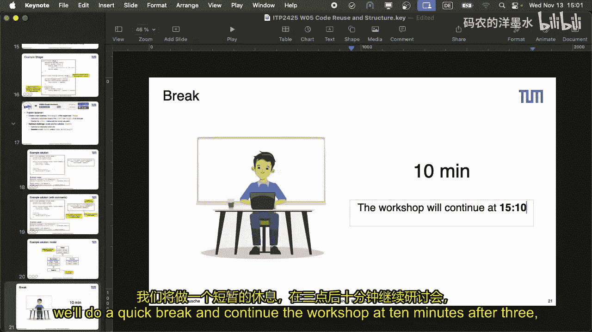

# 【全集】慕尼黑工业大学 计算机编程：从入门到实战 中英字幕 p23 Lecture 23 - 继承part1 -BV1WFrTBZExY_p23-

Welcome everyone to today's workshop5 on code reuse and code structure in the course introduction to programming。

We are still at the beginning， almost at the half of our course， we covered a few basics。

 in particular， object oriented programming basics， control， flow and basic data structures。

 and today we'd like to introduce you to the world of inheritance， abstract classes， interfaces。

 and polymorphism。We assume that you have a good understanding on the basics that we covered in the previous weeks and the learning goals for today and the rest of the week are that we hope you are able to explain the differences between overriding and overloading to important techniques in programming languages that relate to polymorphismma。

You should be able to implement inheritance taxonomies that do not only use normal classes。

 but also abstract classes and interfaces。 We will tell you what this means in a few moments。

We also tell you。About the concept of polymermorphismment。

 you should be able to explain it to others and how it is used in Javava as one example。

 but also try to understand the abstract and generic idea behind it so that you can also apply it in other programming languages。

We will when we discover polymorphism， we will also talk about the compile time type and the runtime type of objects。

 and you should be able to differentiate both based on also the concepts of overriding and overloading。

 we will see how this belongs together。This is the outline for today。

 we will start talking about inheritance。And before we tell you about this technical concept。

 let's first look into our real world and observe that。

We typically have objects in the real world that are somehow related to each other。

 They are quite similar， but they still might be different。

 And you see a couple of those objects here。 In fact， those are human beings or animals。

And you see that we have the human as an object， the monkey， the hominid， the wolf and the mammal。

 And you could say a monkey and a human have certain attributes and behaviors that are similar。

But they also differ in many different aspects。 And in order to reuse code in applications and in software。

 we would like to be able to express those similarities and differences。

 and we do that with inheritance。Inheritance is basically derived from inheritance in the real world。

 right， if you have。Relationships between different objects。

 we can also use the word inheritance in the real world。

 and it allows us to find commonalities and organize them in a hierarchy。

And the idea is that we basically collect what is common among all those objects and store it in a so called super class。

And then we have subclasses， and those subclasses inherit all the attributes and all the behavior of the superclass。

So that we can say each wolf is a mammal。And each monkey is also a mammal。

 but each monkey is also hominid， and each human is also hominid。And with this。

 we can express these relations。 And for the technical real realization。

 you will see that it has a very specific。Implications that you need to take into account。

And if we do that， we can basically store all the common attributes and the common behavior in the super class。

And the differences in the subclasses。And this is really a one way relationship， not every。Memo。

Is a hominid。 We also have other types of mammals。Not every hominid is a monkey。

 We also have other types of。Yeah。Hmins that。We know here， for example， a human being。And。

This is quite important that you understand this relationship， Yeah。

 that we specialize things from top to down and we generalize things from bottom to up。

 And this allows us to reuse code more efficiently and to apply incremental programming。

Here's an example that is more in the area of programming。We have a book。

And a book contains pages and text， and you can read a book。Now， there are special types of books。

 like， for example， dictionaries and dictionaries could be subclass。 They also have pages。

 They also have text。 You can also read them， but additionally， they offer some。More functionality。

 you have definitions。In there， and you can look up a definitioner in the dictionary。

So the subclass inherits all the attributes from superclass， but can additionally add new ones。

 and the same happens for methods。And the idea is that we do not show them again in the subclass。

Except the subclass overrs the behavior of the superclass， which is also possible。

How would we implement this in code， This is our U ML notational where we have this white triangle denoting inheritance。

 You will see this quite often in this lecture or in this in this workshops in the workshop slides today。

 How do we realize this in code。 This is what we could do。 We have a class book。

 You know that we can already translate those attributes into the code。

 We can create a constructor and we can implement a method。The sharp symbol here stands for Pro。

 which is another way to。Tell who can actually use those elements。

 We will see in a moment what this actually means。And then we have our subclass dictionary。

 and now we see there's a new key dictionary Exs book。 You might have seen this already。

 and you might have wondered what it means。 Well， this deotes inheritance。😊。

So a subclass extends a super class。 and by doing that。

 it can access all the elements that are not private from the super class。

It inherits all the elements from the superclass， and it can add additional ones。 So in addition。

 we have the private in attribute definitions， and we have another method， public void lookup。

So Xs is the keyword that realizes inheritance in Chah。And super。

Basically calls the constructor of the superclass。 So when we create a dictionary。

 we have three parameters in our constructor pages， text definitions。

We pass the first two to the constructor of the super class because we want to reuse the code。

 We do not want to add all the lines in the constructor， again。

So this is delegating it up to the super class by using the super keyword instead of the this keyword。

And then we can do some additional work。 And this is how it always works。 Yeah。

 when we have a constructor， we always call the one in the subclass。And then at some point。

 we call the one in the super class。And while you see an example with one super class and one subclass here。

We can have multiple subclass。 first of all， and we can have a full hierarchy。 Yeah。

 So it could be the case that book has another super class。 And then we would have extend。

 would have extends here as well。 So this is not just。😊，One way， or one indirect。

 we can have multiple indirects and could even have like a hierarchy of 20 classes。

 This is not common， but it could be the case that you really have a lot of subclass and subclass and subclass with a big hierarchy of all the different types of classes that you have。

Questions， Yeah， so the question is， when dictionary is a subclass of book and book would be a subclass of another class。

 could dictionary access this transitive superclass as well， yes。

If the elements are protected public。And not private。So if they are not private。

 you can directly access them as if you would define them in the class itself。They always exist。

 but if they are private， you don't have access to it from the subcom。Another question。

So the question is， is I translated already， does dictionary also inherit a constructor。

 and I could directly use this if there is no constructor defined in the subclass。This depends。

If you have the default constructor， yes， if you have a non default constructor， as far as I know。

 But please try it out in In， you have to specify a constructor here as well。 Otherwise。

 Chava does not know if there is。A specific one that you would like to use。

 And then you have to call super。 So you can't， as far as I know。 But again， please write out。

 you can't just inherit this constructor in the subclass and then immediately use it because this basically creates a book and not a dictionary。

 right。Any other questions。We have lots of examples today So don't worry。

 we will see all the different aspects of inheritance。As I said。

 protected and public elements are directly accessible by subclass。

 Private elements are not accessible， accessible， but still exist。So some comments about that。

 We have always class， subclass extends， super class。All members are automatically available as well。

 If they are protected， they are visible in the subclass， if they are private。

 they are still available in memory， but they cannot be called。 They can only be called indirectly。

 Yeah， if I call a method in the superclass that handles this attribute， then I can still do that。

 but I cannot access them directly。And。Then。We also see something about the constructors。

 So if a constructor of the subclass is called， then the constructor super is implicitly called if it is available and otherwise。

 we have to call a specific constructor， like in the previous example。How can we use that？ Well。

 we can still create books。Like we see it here。And a book would then in memory， have two attributes。

 pages and texts， as we've seen before， and those would be initialized as we would usually do it in any other class。

 but we can also create a dictionary。And in memory， we don't really see that book exists。 In memory。

 it's only a dictionary。We can check if the dictionary conforms to the book。

Which is a bit more advanced。 But technically， at run time， there's only one object instance。

 We don't have two object instances。 This is a typical beginner misconception that if you have a class hierarchy。

 there are also multiple objects in the end。 No， there's always with one new call。

 there's only one object and this object has a specific type。

And how this type is constructed based on the code。Is something else。 Yeah。

 this could be a strange hierarchy of 10 different super class relationships。

 But in the runtime here， when we create this instance， there's only one object with one type。

And this has all the attributes that are inherited from the superclass。Right。

 so I can have a class diagram with 10 different classes in an inheritance hierarchy。

 And then I create objects， and I only have one object。

 I don't have 10 objects with the hierarchy anymore。 So during runtime。

 the inheritance does not really exist anymore in some sense。

You will see later on that you can still check if the object that you get here is an instance of something So the information is still available。

But taxonomy is not really in memory。And this is really important that you understand that。

And then we would also simply fill the。Parameterters that we pass into the constructor。

You've seen that we have this keyboard super that we can use to explicitly call constructors or object methods of the superclass within the subclass。

 it's similar to the keyboard this， but always refers to a super class。D directly。

 And you will see later on that it's important if you used to say names in the subclass as in the super class that you can distinguish between this and super。

In a constructor， you have to use it in all other methods。 It depends on the concrete situation。

 whether you need to use super or whether you need to use this or whether you can leave it out at all。

So with super attribute， super dot attribute and super dot method or super and rounded braces。

 we can access or invoke the corresponding members of the super class， an attribute。

 an object method or a constructor。Any other use of super is basically not allowed。

So you can't really assign super to something or manipulate it or change it。 This is not possible。

 You can use it to access elements of the super class， but you can't really do anything else。

And super cannot access private attributes。 Pri things are explicitly hidden from subclass to avoid that you manipulate them in the wrong way。

 Yeah， So this is an explicit choice。😊，When we invoke methods。

 we can invoke them directly on the created object， no matter in which。Clas in the hierarchy。

 they are defined。 Yeah， So if we have this Oxford dictionary， we can directly on Oxford invo read。

 even though the book has defined it。And， of course。

 you can also invoke methods that are defined within a dictionary。

Think about inheritance as an is a relationship。 Every subclass also is kind of a z class。

And this is quite important because there are no rules in programming for you in terms of compiler errors。

 how you define inheritance。 So you could also say a chair。Like this。

Is a subclass of a table because you want to reuse the color attribute。 But that would be really bad。

It doesn't make any sense to do that。 If at all， you could say both elements have a color。

 and we have some kind of abstract super class to denote that。

 but it doesn't really make sense to have this relationship a chair is not a table， nor is a table。

 a chair doesn't make any sense。 So it's in your responsibility to define those inheritance relationships in a meaningful way。

 And you can really fuck it up if you do it wrongly。 And I mean， this honestly。

And while this is so important， there's even a principle for it， according to Barbara Liskov。

 a very famous female computer scientist from California， who even won a Turing Award。

 which is like the Nobel Prize for computer science。And she was a mathematician。

 but also looked into formal methods and computer science。 and basically。

Was one of the first persons who defined a principle that a superclass object should be replaceable with a subclass object without breaking the functionality。

This is always important。And this is the already dis simplified version。 If you look it up online。

 you will find a very formal definition that is quite hard to understand。

 So we translated it for you。Always make sure that you follow this principle。

 This is super important。If you developers， they don't follow this。

 and then they add methods to superclass， which are not really functional in subclass。

 and then chaos occurs because then suddenly you could invoke a method that somehow that destroys the behavior or you need to make sure in the subclass that this can't happen。

 And then you override the method with an empty definition， which is also really bad。

 or you even change the implementation just to make it work。 So this is really， really bad practice。

 Subclass should not redefine methods with a different purpose from superclass。Yeah。

 so never declare a chair as a subclass of a table or something else just because you want to reuse code。

 This is a really bad question。So the first question is， do you need to call super。 And if yes。

 which super， So the， the rule is quite simple here。

 Let me answer this first and then come to the second question。 the rule is。

If you have an implicit constructor， you don't need to do anything。 It's up to you。

 If you have an explicit constructor， you must call it。Because otherwise。

 the super class might not be valid。In particular， if you have final attributes that are initialized in the construct。

So if you have a constructor in the superclass。You also need to call it from the subclass。

 and then you also need to define a construct and the subclass。And the second question is。

 should we initialize attributes in the constructor？This depends on the use case。 Yeah。

 there are cases where this is。Quite meaningful， like the book and dictionary example that we have seen。

 but there are also cases where during the creation， you don't know the values yet。

 and it doesn't really make sense to initialize them。Great。

 so always take Liskov into account and never forget about this principle。

 We talked a little bit about visibility and modify us already。

 You've seen that we have three keywords that are quite important here， private， protected in public。

 There's also a fourth option。 If you leave out the keyword， and we have a default visibility。

And those four different cases basically define whether something。The class， the attribute。

 the constructor， the method is accessible to something else。Yeah， so。Everything is always。

Accessible to the class itself。 So if I develop a class book。I'm the book developer。

 I can access everything no matter what kind of keyboard I use。

If I develop another class in the same package。I can use everything， except private things。If I。

 if I'm the developer of a subclass， for example， dictionary。

 I can use everything that is public and protected。

 I can't use default elements except the subclass is in the same package。

And for the rest of the world， for any other object that might be somehow related to my personal class。

 I can only access elements if they are declared public。And with those keywords。

 we can realize the principle of information hiding。

 a very important principle in computer science that allows us to hide all the irrelevant details from someone else。

 So if I use a list。 as we've done in the last workshop。

 I don't really need to know about the internals， I don't care most of the times how it is implemented。

 I just want to add elements and later on get those elements again。 I don't care。

 I'm only interested in the public API。 And I only want to know how to use it。

And I also don't want to mess it up， right， I mean。

 if I accidentally evoke a private method and destroy everything， please。Hide it from me。 Yeah。

 I don't want to deal with that。And this is the idea of information hiding so that we can。Split。

Tasks and large projects to and assign them to multiple people。

 And those people can work independently and only need to know as little information as necessary from other people when they interact with the code of them。

 That's the idea。There was a question here。Yeah， it's， it's a very good question。 What is a package。

 A package is like a folder structure in your project in In Teleliche。

 and you can have multiple folders， and every folder represents a package。 And in some sense。

 classes within the same package。Belong together more tightly than classes that are in different packages。

 And this is denoted with this additional yeah default visibility here。

 So the ideas in large projects， you don't put everything into one folder or one package。

 You separate it。Like， for example， we have a package where someone works on the view of the program and a package where someone works on the model of the program。

 And then you have two different packages。And you can already work with the default visibility so that they don't really access each other directly。

That's the idea。This is specific to Cha but。 not every programming language supports packages or similar ideas。

 So this really depends。 But it's a good idea to split your project into those packages in order to。

Make it easier to organize everything。 in order to make it easier to find things in your project。

Here's another example that we would like to use。 We have a public class shape with a protected string color attribute and a method area where we would like to calculate the area。

 And this is not really define yet because we don't really know what kind of shape it is。

 So we basically return0 here without any calculation。

 and we leave it to the subclass to implement this method accordingly。

 And we already have one subclass here called circle that extends the shape。

 a circle has a radius and inherits the color。The radius is final when we create the circle。

 when we instantiate an object， we need to pass it into the constructor call and define it。

 its value， and then we can override the method that was defined here and actually provide an according implementation。

And the area of a circle is pi times radius squared。And we can return this here。 and then we know it。

 right。Notice that Ed override is an annotation that tells the compiler you are explicitly overriding a method。

This is optional。 You don't have to provide this but this helps other developers if they look at your code to see。

 oh， this is a method that was already defined in the superclass。And you override it in the subclass。

And it also makes sure that you get a warning if something changes。 Yeah， if， for example。

 I change this method here， Yeah， and I remove it in the super class because it doesn't really make sense。

 Then the compiler would warn me that I don't override it anymore。 And I。

 I do not accidentally assume that I override the method。So it's an optional keyboard question。

So the question is， do we overrite this method for all classes？ Well。

 the idea here is that this particular subclass。Overrs this method。

 and it could be declared in any super class of it。Notice that。

A class can only have one direct super class， but can have multiple indirect superclass。 Yeah。

 So shape could theoretically extend another class and another class and another class。

And it doesn't really matter which of those classes defines the method area as long as it is public or protected。

 I can override it and change by overriding change its implementation。Right， we will talk。

 So the question is， how is it done with calling this method？ Well。

 it depends on the object that you have。 If you have a circle， it is called here。

 If you have a shape， it is called here。So we always look at the subclass。 Does it include a method。

 If yes， we call it。If not， we look it up in the super class。 If not。

 we look it up in the super class and so on。Right， we will talk a little bit about this later when we come to polymorphous and overriding details for now just。

Take it as a potential thing。 Yeah， you can override a method in a subclass if it was already defined in a superclass and you should not violate list of substitution principle by doing that。

 Keep that in mind。 Yeah， so we still create an area。

 It's a slightly different calculation than for generic shape。 You have actually。

 we don't have a calculation here。 and we will see how we can fix this。

 This is not a good code In some sense。 We will introduce this later to you。

 but we don't really change the meaning of the method。 We still do it properly。Notice， again。

 we have final。 have we used this already。 final means we can assign a value once。

 and then it cannot change anymore。 and it basically avoids certain issues in the code later on。

 So therefore， we sometimes use it。Any other questions regarding this example？Great。

 then let's do a little exercise on Artemis。 We basically prepared this example in code for you in the W5 E2 simple inheritance exercise。

 And we kindly ask you now to create a new subclass called rectangle。😊。

Rectangle should also extend shape like circle is doing it， but has different attributes。

 While a circle only has a radius。 a rectangle has a width and a height。So we have two attributes。

We also would like to calculate the area for the rectangle with the correct calculation。

 So this is a super difficult task。 Yeah， find out how to calculate the area of rectangle。

If you don't know， look it up online and then calculate it and overwride this method。

 And if you think this is too simple for around 10 minutes to work on。

 we have an optional challenge for you。 create another subclass square。

Implement a meaningful constructor and think about whether it makes sense that square extends shape。

Or whether it makes more sense that square extends rectangle and take Liov's substitution principle into account。

Okay。So please work on this exercise。 Now， the tutors are going around。 if you have any questions。

 if you watch this online， feel free to ask your questions in the corresponding Artemis channel。

 We are happy to assist you and in around 10 minutes I'll show you an exemplary solution。Okay。

 the working time is up if you have not finished the exercise yet you can still work on it until tonight。

 please stop working on it for a moment and listen to me so I can quickly show you and explain you the example solution。

You can see the rectangle class here。 It's fairly simple。 we extend shape。

 create two attributes in this case， private final double with and height that are initialized in the constructor call and then we override the area method and return with times height。

 and this is really super easy so we expect you to get this done in a few minutes。

 if you haven't done it now in the almost 10 minutes that you have。

 then definitely catch up and make sure that you can implement something like this because this is really very basic。

There's a question over here。So the question is why are the attributes final， Well。

 in the it's not really mandatory to make them final in the circle example， we also had it final。

 and it's basically a good best practice that you do things as final if they are not supposed to change。

 We do not have a set so we do not change those attributes and then we can declare them as final so that we do not accidentally change them afterwards。

Great， now you could theoretically say a square directly extends a shape。

 and then you implement the corresponding functionality。 but every square is also a rectangle。

 and if we take this into account implementation， it becomes super， super easy。

 it's just three lines of actual code， if we don't take the braces into account。

 we say a square extends a rectangle。 and we create a constructor。 And as you see。

 the constructor deviates now from the definitioner， instead of having width and height。

 we say a square has a length。😊，And we simply invoke the constructor on the superclass by passing length as width and length as height。

 because in a square， both sides have the same dimensions。And with that。

 we can reuse the area method。 It's still correct for square。 We do not need to override it。Yeah。

So that's the。Easiest solution。 Of course， you could argue now。

 well your square unnecessarily uses two attributes， while those are not really necessary。

 So it consumes a little bit more memory。 On the other hand。

 it really follows the idea to reuse code and to not。Write code multiple times。

And to duplicate code question。Okay， let me address the first question。 It was。

 where is the assignment done， The assignment is done exactly here in the constructor。

 So in the constructor， we assign at length is used two times once for with and once for height。

 Remember that we distinguish between formal parameters of a method and the actual parameters of a method and by putting length into the actual parameters。

 we make the assignment to the formal parameters。 Second question， can I use a default constructor。

 No， you cannot。 if there is already one other constructor in superclass， you have to have one。

It could be a default constructor in the subclass， but then you have to somehow identify those values。

 right， and you don't have them。 So the idea is that the user of the square defines the length。

 not the class itself， because you want to use it with multiple different values as you see in the example usage here。

 and you don't want to have a constant in the in the constructor。Okay， if there are many questions。

 we don't have the time to cover all of them。 I highly suggest that you take the help of the tutors into account。

 We have to continue because otherwise， we are running late。Again， the hint。

 This is one example solution you can do it differently。 It will still work。

 but really see this as an example for you to think about。 Yeah， a square is a rectangle。

 and this is something that we can leverage and where we can be very precise and really take reuse as it is。

😊，Intended in inheritance into account Yeah， that's really the idea here that you should normally not override methods that you have from the superclass。

 And this is a very， very good example to understand that。

Heres also the model for the example solution。We have rectangle。

 we have circle and as additional one， we have square， notice that circle and rectangle。

Repeat the area method because they override it from shape。

 while square does not do that because we simply inherit it and we do not override it。

 So the convention is in UML， if you override a method from the superclass， you mention it again。

 if you just inherit it without overriding， then you leave it out。All of them have the color。

 But that's basically right now the only state that we reuse from the super class shape。Of course。

 it's a simplified example， and there could be a lot of additional attributes and methods that we inherit from the superclass shape。

And square only provides a constructor， and the constructor is not part of the U M L diagram normally。

Great， with that， we'll do a quick break and continue the workshop at 10 minutes after three with the second part about inheritance。

😊。

