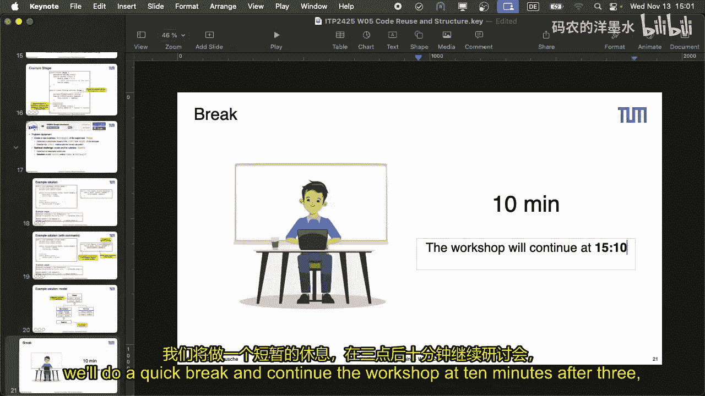

# 计算机编程：23：继承（第一部分） 🧬

在本节课中，我们将学习面向对象编程中的一个核心概念——**继承**。我们将探讨如何通过继承来重用代码、组织类之间的关系，并理解多态、抽象类和接口的基本思想。课程将从现实世界的类比开始，逐步深入到代码实现。

---

## 概述 🌐

在之前的课程中，我们学习了面向对象编程的基础、控制流和基本数据结构。今天，我们将进入**继承**的世界，并初步了解抽象类、接口和多态。我们假设你已经掌握了前几周的基础知识。

本节课的学习目标是：
*   能够解释**重写**与**重载**的区别。
*   能够实现不仅使用普通类，还使用抽象类和接口的继承层次结构。
*   能够解释**多态**的概念及其在Java中的应用。
*   能够区分对象的**编译时类型**和**运行时类型**。

---

## 现实世界中的继承 🐒

在深入技术概念之前，让我们先观察现实世界。现实中的对象通常彼此相关，它们相似但又不同。例如，人类、猴子、人科动物、狼和哺乳动物。

猴子和人类有某些相似的属性和行为，但在许多方面也存在差异。为了在软件中重用代码，我们希望表达这些相似性和差异性，这就是**继承**的作用。

继承的概念源于现实世界。它允许我们找到共性，并将它们组织成一个层次结构。其核心思想是：将所有对象的共同点收集起来，存储在一个所谓的**超类**中。然后，我们创建**子类**，这些子类会继承超类的所有属性和行为。

因此，我们可以说每只狼都是哺乳动物，每只猴子也是哺乳动物，但每只猴子还是人科动物，每个人也是人科动物。通过这种方式，我们表达了这些关系。

在技术实现上，这意味着我们可以将所有公共属性和行为存储在超类中，而将差异存储在子类中。这是一种**单向关系**：并非每个哺乳动物都是人科动物，也并非每个人科动物都是猴子。理解这种**从顶向下特化**和**从底向上泛化**的关系至关重要，它能让我们更高效地重用代码并实现增量式编程。

---

## 编程中的继承示例 📚

让我们看一个更贴近编程的例子。我们有一个`Book`类，它包含页数和文本，并且可以阅读。

现在，有一些特殊类型的书，例如`Dictionary`。字典也是一种书（它也有页数和文本，也可以阅读），但它额外提供了更多功能：它包含定义，并且你可以查询定义。

因此，子类继承了超类的所有属性，但可以额外添加新的属性，方法也是如此。子类中的方法除非**重写**了超类的行为，否则我们不会在子类中再次显示它们。

---

## 代码实现 💻

在UML图中，我们用空心三角形表示继承关系。在代码中如何实现呢？

我们有一个`Book`类，可以将其属性转化为代码，创建构造函数并实现方法。这里的`#`符号代表`protected`，这是一种控制访问权限的方式。

然后是我们的子类`Dictionary`。关键语法是`Dictionary extends Book`。`extends`关键字在Java中实现了继承。一个子类通过`extends`一个超类，就可以访问超类中所有非`private`的成员。它继承了超类的所有元素，并且可以添加额外的元素。

在构造函数中，我们使用`super`关键字来调用超类的构造函数，以便重用代码，而不是在子类中重复编写。

**重要提示**：虽然这里展示的是一个超类和一个子类，但我们可以有多个子类，甚至可以构建完整的层次结构。一个类只能有一个直接超类，但可以有多个间接超类。子类可以访问所有非`private`的传递性超类成员。

---

## 继承的关键点 🔑

以下是关于继承的一些核心要点：

*   **关系**：`class SubClass extends SuperClass`。
*   **成员可见性**：所有成员自动可用。`protected`成员在子类中可见；`private`成员虽然存在于内存中，但不能直接调用，只能通过超类的方法间接访问。
*   **构造函数**：如果调用子类的构造函数，那么超类的构造函数会被隐式调用（如果可用），否则我们必须像前面的例子那样调用特定的构造函数。
*   **内存中的对象**：当我们创建一个对象（例如`Dictionary`）时，内存中只有一个对象实例，而不是多个。继承关系在运行时并不以多个对象的形式存在，但类型信息仍然可用。
*   **`super`关键字**：用于在子类中显式调用超类的构造函数或方法。类似于`this`，但总是指向超类。它不能用于赋值或修改，只能用于访问。

---

## “是一个”关系与里氏替换原则 ⚖️

可以将继承视为一种 **“是一个”** 关系。每个子类在某种意义上也是其超类的一种类型。

这一点非常重要，因为编程语言编译器不会强制你定义有意义的继承关系。例如，你可以为了让`Chair`重用`Table`的`color`属性，而让`Chair`继承`Table`，但这非常糟糕，因为椅子不是桌子。

因此，**你有责任以有意义的方式定义继承关系**。为了指导我们，有一个由著名计算机科学家芭芭拉·利斯科夫提出的原则——**里氏替换原则**。

其简化版本是：**超类对象应该能够被子类对象替换，而不会破坏程序的功能**。务必遵循此原则。子类不应以与超类不同的目的重新定义方法。

---

## 可见性修饰符与信息隐藏 🛡️

我们已经提到了`private`、`protected`和`public`这三个关键字。实际上有四种情况（包括默认可见性）。它们定义了类、属性、构造函数或方法对其他代码的**可访问性**。

*   **类自身**：可以访问一切。
*   **同一包中的其他类**：可以访问除`private`外的一切。
*   **子类**：可以访问`public`和`protected`成员。除非子类在同一包中，否则不能访问默认可见性成员。
*   **其他任何地方**：只能访问`public`成员。

通过这些关键字，我们可以实现**信息隐藏**原则，即向外部隐藏不必要的实现细节，只暴露公共API。这使得大型项目可以拆分给多人协作，每个人只需了解必要的交互信息。

**关于包**：包就像是项目中的文件夹结构。同一包中的类关系更紧密。将项目拆分到不同包中有助于组织和管理代码。

---

## 形状示例：重写方法 🔵

让我们看另一个例子。我们有一个`Shape`类，具有`protected String color`属性和一个计算面积的`area()`方法。由于不知道具体形状，这里暂时返回0。

然后我们有一个子类`Circle`，它继承了`color`并添加了`final double radius`属性。它**重写**了`area()`方法，提供了正确的实现：`π * radius²`。

注意`@Override`注解。它告诉编译器你正在显式重写一个方法。这是可选的，但有助于其他开发者理解代码，并且能在超类方法发生变化时提供警告。

**方法调用机制**：调用方法时，会从对象的实际类型（子类）开始查找。如果子类有该方法，则调用它；否则，向上到超类中查找，依此类推。

**关于`final`**：`final`表示只能赋值一次，之后不能更改。这可以避免后续代码中的某些问题，是一种良好的实践。

---

## 练习：矩形与正方形 📐

现在，让我们通过一个练习来巩固理解。基于`Shape`和`Circle`的例子，请创建一个新的子类`Rectangle`。

*   `Rectangle`应继承`Shape`。
*   它应具有`width`和`height`属性。
*   它应重写`area()`方法，返回`width * height`。

**可选挑战**：创建另一个子类`Square`。思考`Square`是应该直接继承`Shape`，还是继承`Rectangle`？请将里氏替换原则考虑在内。

---

## 练习解答 ✅

`Rectangle`类的实现很简单：继承`Shape`，定义`width`和`height`属性，在构造函数中初始化，并重写`area()`方法。

对于`Square`，一个优雅的解决方案是让它继承`Rectangle`。因为每个正方形都是一个矩形（长宽相等）。这样，我们可以最大化代码重用。

`Square`的构造函数只接收一个`length`参数，然后在调用`super`构造函数时，将`length`同时作为`width`和`height`传递。这样，`Square`就自动拥有了正确的`area()`计算方法，无需重写。

这个例子很好地展示了如何通过合理的继承设计来避免代码重复，并遵循里氏替换原则。

在UML图中，重写了超类方法的子类（如`Circle`、`Rectangle`）会再次列出该方法；而只是继承未重写的子类（如`Square`）则不会列出。

---

## 总结 📝

在本节课中，我们一起学习了：
1.  **继承**的基本概念及其在代码重用和组织类层次结构中的作用。
2.  如何使用`extends`关键字实现继承，以及`super`关键字的使用。
3.  理解**“是一个”关系**和至关重要的**里氏替换原则**。
4.  成员可见性修饰符（`private`， `protected`， `public`， 默认）及其如何实现**信息隐藏**。
5.  如何在子类中**重写**方法，并使用`@Override`注解。
6.  通过`Shape`、`Circle`、`Rectangle`和`Square`的示例，实践了继承的设计与实现。

继承是面向对象编程的基石之一。在接下来的部分，我们将继续探讨更高级的主题，如抽象类、接口和多态，它们都建立在坚实的继承理解之上。