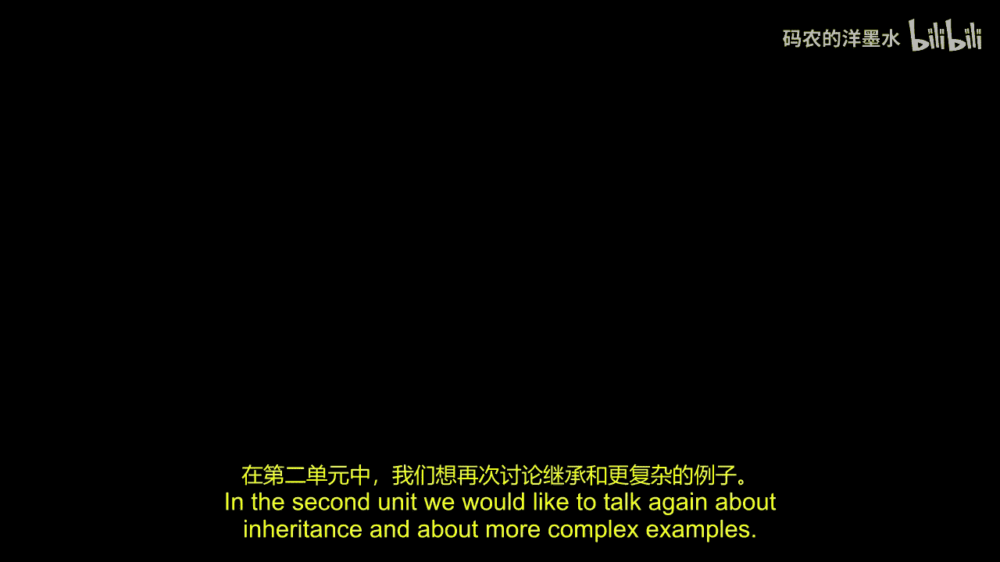
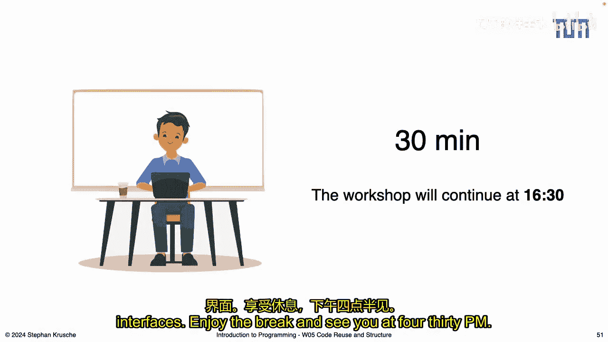

# 【全集】慕尼黑工业大学 计算机编程：从入门到实战 中英字幕 p24 Lecture 24 - 继承part2 -BV1WFrTBZExY_p24-

In the second unit， we would like to talk again about inheritance and about more complex examples。

Here's another example for a broke program called eating。

 where we have a superclass food and a subclass pizza。

 And the idea of the program is that it should output the number of calories per meal。

 Let's see how we can achieve that in our class food。 we define。3 integer variables。

 a constant calories per gram equals 9。Fat and servings， which can be。Iitialized in the constructor。

 So when we construct food， we define how much。Fat， the food has and how many servings we have。

And then， we have。Method calories that returns fat times calories per gram。

 and another method calories per servings， where we reuse calories and divide this by servings。

 And with that， we can basically。Identify how heavy the food is。

Notice that all the private elements are hiddener for the pizza object of a subclass。

And we can see how pizza works。 It's a fairly simple subclass it extends food and simply again uses the constructor Not there's no default constructor here。

 So we have to provide a constructor here and we define it with just an integer and say that for a pizza you always have eight servings。

 Yeah remember if you have a circular pizza and then you cut it three times and then you have exactly eight pieces and the amount of fat depends on the specific pizza type Yeah of course。

 a margarita pizza as less fed than a heavy cheese pizza for example。But with that。

 we can basically use our program。And again， pizza gets all the members of the superclass food。

 even though they are not directly accessible。 Now Keep that in mind。It has those private elements。

 and we can use them in the calculations implicitly， but it does not have direct access to it。

If we create our program eating now and instantiate a special pizza with 275 gram of fat or amount of fat that we pass in here and it gets passed to this work class。

We can then call on our special pizza the method calories per saving， because it's public。Right。

 so this is a public method。 It is。Available not only in the subclass， but to anyone else。

 So we can call it。 And pizza inherits it so we can call it on the subclass as well。

 And what happens if we call this， Well， this method is called。

 And then the private method is called， right， So even though the private method is not accessible to the outside。

 Well， indirectly， it can be called anyway。 So there's a difference between access control and whether something can be called indirectly。

Keep that in mind。Yeah， so we can。Use it， and we can then print out。The F timess calories program。

Yeah，So take this as a second example where you can see due to information hiding。

 only specific elements are available in the subclass and in the。Public world。

To anything else in the program， and。🎼Even though we can only access those。

 we can indirectly then by invoking the methods also。Get access to the other values。

Do the calculations internally and print to the console。

 So the program will output calories per serving 309。Any questions regarding this little example？

With inheritance。Okay， then let's continue。 We'd like to talk about binding and scope to important。

Aspects or concepts when it comes to inheritance。Binding represents an expression to a variable or attribute name。

 So with when we declare a name， we have a certain binding towards a specific variable in memory in order to use it later on。

 So the name binds。The variable to a specific value in memory scope， on the other hand。

 means that we have a specific part of our program or the whole program。

Where this name of the binding is valid。And in Chava and also many other programming languages。

 Scs are bounded by curly braces。 So by opening a curly brace or closing a curly brace。

 you basically create new scope areas where you can have new bindings。

And if you declare those new bindings within this curly brace， then after the curly braces。

 the binding might not be valid anymore。So this is important to keep that in mind。

 There are different examples here in the slide，25。For example。

 a local variable is from the declaration of the variable to the end of the block denoted by the curly braces。

 it is。It has the scope， right。 And after the curly bra， after the end of the block， it's not。

validalid anymore。 And you can't access it anymore。 Sple example。

 if you have an if statement and within the if statement， you declare a variable。

 then after the if statement， you can't access it anymore。 It's not available anymore。

 It's only inside this。Finding afterwards， it's gone same for method calls。 Yeah。

 if you have parameters in a method， they are only available within a method afterwards。

 they are not available anymore。You can also have a global binding for static variables。

 methods that are accessible application wide， classes and methods and blocks and so on all have a specific binding。

 And while this sounds a little bit theoretical now。

 it's good to think about this and to have this concept in mind。

 because when it comes to inheritance， there are thing a few things that can surprise you。

Before we look into inheritance and how it affects the scope and the binding。

 let me show you an example。 This is the Q class with arrays that we implemented last week。

And we have a few bindings here。 So the scope for the three attributes of the Q is from the definition of the class。

From the beginning， the decoration until the end of the class。 So those three attributes， first。

 last an array are accessible throughout the whole class， no matter where you are。

Even if you would define them at the end of the class， it doesn't matter。 Yeah。

 the order doesn't matter if I define them at the end， I can still access them in the beginning。

And the other way wrong。Well， the formal parameter X of the method N Q is only available between those two curly braces。

 So outside of the method， I can't use X anymore。 It's simply not available。And last but， not least。

As an example， within the for loop， the traditional for loop， we declare the counter I。

 and the counter I is only available from the beginning of the for loop until the end of the for loop。

 If you like to access it afterwards， it won't work。 and the compiler would give you an error。

So this is scope and binding for a normal class when it comes to inheritance。

 we have to take a few things into account。Notice that you can also declare identify us multiple times。

And then they can theoretically shadow each other。 And therefore。

 it's important to distinguish between the lifetime and the scope of a binding。

 The lifetime denotes the time during which the binding is valid and the scope of a binding denotes the regions in the program where the binding is visible And between valid and visible。

 there is a distinct difference that we will see now， when we talk about shadowing。

 shadowing means there is already a binding within the scope。But you declare a new one。

With the same name。And then the original binding still exists。

 but it's temporarily obscured or not valid anymore。Sounds difficult。 But as I said。

 we will see a few examples。 And here we have one。 We have so called attribute shadowing。

Attribute shadowing means that our super class defines an attribute。

And the subclass defines the an attribute with the same name again。

So this basically means we have two attributes。 They are both even accessible in the subclass。So。

 the。Age attribute in the subclass shadows the one in the superclass。

While I would consider this as bad practice， it's still allowed in the programming language。

I think you should not do that because it's super confusing， especially for beginners。

Sva has a solution for that。 We can use the super keyboard in order to make sure that we actually would like to access the name of the super。

 the variable of the super class with the name H， and not the one of the subclass。

 but it's easy to forget it。 and then you suddenly end up modifying the one in the subclass。

 even though you wanted to modify the one in the superclass。 So never write such code。

 This is really bad practice in my opinion， but it's important for you to understand this。

And when we。Look into the program output here。 We'll see that we return 3-2。 Why is this the case。

 Well， child is the subclass， So we create a subclass here。 Then we call set age。 This method here。

 it relates to the child class。Said person age relates to the super class。 And if we then say child。

 get age。We in there no get age method here， so we will reuse the one from the superclass。

 The super class returns the one， the H from the person， not the H from the subclass。

 because here only the variable H from the person is valid。 and the subclass one does not even exist。

 while child dot H。 Yeah， it's a public one here would return the one。From the subpper class。

 and therefore we have program output 3 minus2， but again， super confusing。

 Just take this as an example and don't do that in your own code。

We have another example where we do method shadowing。

Method shadowing means we have a method in the super class， get H。And we redefine it in the subclass。

You've already heard a different name for this， which is called overriding。

While overriding is something that happens quite often when it comes to inheritance。

 it's good to make this visible and to not mix it up with attribute shadowing because we still have attribute shadowing here。

 But in a good code situation， I would use the override annotation here to make it clearly visible that the child class overrides the super class method。

😊，YeahSo we have two methods with the same name and the same arguments。

 and we have a redefinition of it in the subclass or the subclass method shadows the superclass method。

Now。By doing that， the output of the same code in the main method。Would change to 2-2 instead of3-2。

 Why is this the case， Because now a child has to get age method。

And the runtime would always looks first at the runtime type child。Is there a get H method， If yes。

 I invoke it， If not I go to the super class and invoke it there。

 So we always try to use the most concrete method in a subclass。

 And only if it's not available we used one from the superclass。 And again， super confusing year。

 don't do it like that。 But notice that method shadowing or overriding is actually something that occurs quite often and you need to make sure that you understand which method is then called at runtime。

Question。So the question is。Can I access super to the age in person with super do H， Yes。

 this is exactly done here in the set person age。 So if I have attribute shadowing or method shadowing。

I can always distinguish with the super keyword and tell the program to invoke explicitly the method in the superclass or to access explicitly the attribute in the superclass。

 And with that， I can bypass shadowing。But again， this is easy to confuse and easy to forget。 Yeah。

 maybe an experience programme I says， well， this is super good code。 Yeah， I like it。

 I never make mistakes。 I don't care about the beginners。 But as so I'm confused if I read this。

 Yeah， it's hard for me even to understand this and to explain it to you。

 And this is why we show you code like this。 you will see this in practice， people do it like that。

 tell them， this is bad， don't do it like that。 and find a different name。

 If you really meet the age two times。 Yeah， I mean， in this example， it doesn't even make sense。

 There might be cases where you really need that。 But even then you can find different names to avoid this situation。

Okay。So notice we can do attribute shadowing， but it's really， really bad。

 and you should never do it。You can do method shadowing if you do it well。

 if you follow risk of substitution principle and if you call it overriding， it might be okay。

 like the area method over written in the previous exercise。 it is okay。

 but keep in mind that you need to know which method will be invoked at runtime later on。

Here we even have a verse example on slide 30， where we do attribute shadowing with different types。

 so now our person has an end age while the child has a float age。😊。

And we even need to convert the float to an end， otherwise this would not really work here and again you see that it's super confusing and finding out what the output would be here there was too fast what the output would be here is not easy In fact we would say age in person 17 and age in child 73 why is this 17。

3 Why is this the case well we create a child instance。

 we set age on the child which basically sets it to both yeah the child age and the super age。

 but the super H is an in while the child H is a float。And then we invoke get age。

 So the first print。Line here comes from the getta system outputline H in person， super H。

 So we print 17。But then we return the age of the subclass of child 173， store it in the float。

 and then pass it to the second system out line here。O。So again， attribute shadowing。

 bypassed with super， the example works， but not very easy to understand。

Here's another example that we also will use for the next exercise。

 So make sure that you actively listen to understand what's going on。

 We have the theme of banks or the application area or domain of banks and would like to implement bank accounts and there is not only one type of bank account there are multiple types of bank accounts。

 we have in this example， a checking account where we can put our daily money and pay from it。

 or we throw money， for example， and then we have a savings account where we might put some money away。

 so that we don't spend it for beer and partying。 but instead save it for the future because we want to do a trip to a nice place or we want to succeed in when we are really old and the government doesn't work anymore for our pensions so we could save some money and there's even a bonus saver account where if。

If we lock the money to the account， and if we don't access it for a certain amount of time。

 we get some special interest。That's basically the idea。

 And we would now like to bring this into code by implementing a few aspects of it and practicing inheritance。

 So this is really an example for you to practice and better understand inheritance and all its aspects。

Looks difficult， but we have a lot of system out print lines in order to show you what's going on。

 The code is actually not that difficult。 We start with the bank account class。

 which is the basic class， the super class of all other accounts。

Every bank account has an I D so that we can。Did we know how to access it and how to which。

 which bank account we' are talking about in practice， we are using an e number for that。

 But here we keep it simple。 We just have integens to not confuse people。

 and a bank account has a balance。Now， the account Id is final because you typically don't change it。

 but the balance is not final because the balance can change at any time by either depositing money。

 Then we add the amount to the balance or by withdrawing money。

 then we subtract the amount from the balance。 So two operations。

 get money out of the bank account is called withdraw。

 adding money to the bank account is called deposit。

And we have some additional logic to make sure this works correctly。

We initialize the bank account with the account I D and with the initial。

Amount of money or the initial balance。 This could be 0。

 Or if you open a bank account at a bank and you give them 500 directly to put it there。

 it could be 500。Now deposit is really simple， we just print the account ID and the previous amount and it's the amount that we deposit and the new balance。

Withthraw is a bit more difficult because normally， the bank does not allow you to。

Withthraw more money than you have a balance on the account。

 So we need to have an if statement and check if withdrawing is actually possible。

 It's only possible if the amount。Is smaller or equal than the balance。So what we do is。

 if the amount is larger than the balance， if we would like to withdraw 500。

 but we only have 200 on the bank account， then we basically say， sorry。

 insufficient funds and return faults and quit the method。In the other case， we sub the amount。

 print a new balance and return true to let the caller know that the method was successfully executed。

So far is so good， I think this is fairly easy to understand。

Some annotations that basically tell you in the comments on the slides what I just told you in the audio track of the。

Workshop。Now， the interesting part comes， we have our first subclass， the savings account。

The savings account extends the bank account， so we are able to withdraw money and we are able to deposit money。

 that's for sure。Additionally， it defines an interest rate。This interest rate is。

Fixed so it can't change for our simple example。 and the interest rate is defined when the savings account is opened。

 The interest rate could， for example， be 1%， which means that if you have 1000 at the bank。

 then within one year， the bank would give you 10 in order to。

We give you some benefits that you store the money at the bank's account and that you do not access it。

That's the idea。 And this means we can still withdraw money。 We can still deposit money。

 and we have a very， very simple method at interest， which might be invoked once a year， for example。

 at the end， 31st of。December， we invoke this method once。

 and it basically means that we increase the balance。By balance or by the， by the interest rate。

 right。YeahSo if you have 1000 and the interest rate is 1%， we would add 10 here。

That's the normal mathematical function。 how to calculate that。 Yeah。

 So balance equals balance times 1 plus interest rate，1。01 in case we have 1%。

And then we print out the account， I D and the balance。

I think this is also fairly easy to understand， are there any questions so far？Great。

Additional comments。Notice that this is an additional method。 It's not available in the superclass。

 We added only to the subclass。Now we also have a checking account。

A checking account is a bit more complex。And checking account。

Has an additional connection to a savings account。 So we store a savings account in our attributes。

And we need to make sure that we initialize it， otherwise it's null and we get nu point to exception。

 so we have to make sure that in the constructor， we initialize it。

 we call it final to avoid any issues for now， as I said， we want to keep it simple。

 and this savings account is called overdraft。And what does it mean， Well。

 if we withdraw money and we do not have sufficient amount in our balance。

 then we can actually get the money from the savings account。Right。

 also assume you're in a situation。 you go to a nice restaurant。

 You have a nice dinner with your family and friends。 You offer them to pay。

 It is 200 and you want to pay， but suddenly， you don't have enough money on your checking account and you can't pay it。

 That would be bad。 We have the bank has a solution for you。

 if you still have money on your saving accounts。 Then we can take your saving accounts， money。

 You might get less interest in the end， but you still can pay and you don't have to wash the plates in the kitchen in the end。

 right， which would be rather bad in front of your family and friends。And this is implemented here。

 So we override the withdraw method。We try to withdraw with the superclass。If it works， if this。

Method here returns。Te。We are basically done。But if this method returns false， if it does not work。

Then we try to use the overdraft in the saving accounts。

And we try to withdraw money amount minus balance from the overdraft。If this also doesn't work。

 we say overdraft source insufficient， then you really have to wash the plates in the kitchen。

And we return forward。 Otherwise， we set the balance to 0。

And because the withdraw in the overdraft account already has subtracted the money there。

 And we just need to make sure that we sub it here as well。And if you have enough on the。

Normal checking account。 Yeah。 So if super withdraw returns true。

 then we skip everything and we immediately return through。

So what we basically do is we ask the superclass， please do the work for us。 If it doesn't work。

 we ask our delegate， the savings account， please do the work for the difference for us。

 If this doesn't work， we return false， otherwise we keep going。

Any questions regarding the checking account？Then some additional annotations for you to read if you look into the P D。

 F。Great， so you see it can become a bit more complex now。

 A little bit of logical understanding is necessary。 but if you reason about it。

 I think everything makes sense。Now， we have one more thing for you to understand before we go into the exercise。

 and this is the bonus saver account。The bonus saveber account is a subclassus of the saving accounts。

 So it basically。Customizes the savings accounts with some additional behavior。

 It's still a savings account。 But the idea is to give you some bonus if you do not access the money。

If you still access it for whatever reasoner， you get some penalty。Yeah。

 and this is also quite common among banks。 So if you make sure that you do not access the money。

 you get an additional bonus for the interest rate。

If you access the account because you absolutely need it in order to avoid washing plates。

 then you have to pay some penalty。And this means we need to adapt the withdraw method。

Whenever you withdraw money from the bonus save account， the penalty occurs。 So if you withdraw 50。

 instead， we have to withdraw 75 from their account。In order to account for the 25 euros penalty。

But otherwise， we simply reuse the。Implementation from the super class。Now， if we add interest。

 we also need to change this。 We could theoretically reuse the definition in the superclass。

 but it's a bit complicated to get this working。 So we have chosen the easy solution。

 We simply override the method completely。 And instead of saying balance equals balance times 1 plus interest rate。

 we additionally take the bonus into account。 So if you normally only get 1% in the bonus saver account。

 You get 4% interest rate。 So much more interest at the end of the year。

 but you also get the penalty in case you access the money。That's the idea。

Any questions regarding the bonus Saber account。While I add the comments。Okay， great。

 So I hope I set the stage。 Let's have a quick look。 Now we looked into the code and you know。

 the code can be a bit confusing with all the logic inside。 and this is why we computer scientists。

 programmers and software engineers like modeling。 if I model this。 it's much easier to understand。

 Let's have a look at our refined UL class diagram。😊，We have a few classes now introduced to you。

 We have the bank account。With the two method methods deposit and withdraw。

 we have two direct subclass， the checking account and the saving account。

The checking account overrides the withdraw method with a specific implementation by using the overdraft account。

 which is another savings account。The savings account adds a new attribute and a new method。

 but does not override the methods from the bank account。 It inherits them and purely reuses them。

And the bonus Sar account adds two additional attributes and two additional sorry and overrides the withdraw and the add interest method。

And again， as an annotation for you， over it methods are displayed in subclass if。

You actually override them。 If you simply inherit them and reuse them， you don't mention them again。

Any questions regarding the UL diagram？Okay， great。

 here's an example usage so you can also see how to use all this。

 we can create a savings account with certain numbers， a bonus saver account with certain numbers。

 a checking account with certain numbers and the savings account here for the overdraft and then we deposit money and we withdraw money and if we do that and print this to the console we see some example output。

 for example， depositing the first time creates a new balance of 5176。😊。

Then depositing on the bonus saver creates another balance。Depositing on the sorry。

 worthing on the savings account reduces the balance by the amount。

Withdrowwing from the bonusabber account makes or lets the penalty incur 25 euro。 So instead of 120。

 we have 145。 The new balances like that。 Not that。

Computer science or or yeah programs are sometimes not very good in rounding。

 So we have some rounding issues here， which you could fix。 But for now， this is fine。

And last but not least we withdraw or we try to withdraw from the checking account。

 but the checking account does not have enough money。 So we use the overdraft account。

 and we have the new balance on the account。And we give that out two times。 Yeah。

 though the overdraft still has 4400， and the balance on the actual checking account is0 because we have used more money that we initially had。

Any questions regarding this。I have one question of you to you。 Now。

 we initialize the checking account with our savings account。

 as we also have shown it in the UL diagram。 so every checking account needs a savings account。

 Would it be possible to initialize the checking account also with the bonus saveber account。

 What do you think。Yes or no。 Who thinks this is possible， Who thinks yes is the correct answer。

 Raise your hands。So one student who is not quite sure who thinks this is not possible。

 raise your hands。Who has no idea about it。Okay， few people with no idea。 That's fine。

 Let's go back into our U diagram。 and let's have a look at the checking account。

 So the checking account has an attribute overdraft of savings account denoted with this blue line here。

 And yes， it is possible to use any subclass for it。

 like it is possible in the from the previous week。 if you have a list， you can use it with a list。

 If you have a set， you can use it with hashet here we have a checking account。

 and we can also sorry， we have a savings account。 and we can also use it with a Bolo saver account。

 So this is possible。😊，Yeah，And this is the nice thing about inheritance。 Yeah， if you define a type。

 you can also always use a subtype。😊，It would be perfectly fine to。

Replace savings with bonus saver here。 And this would still work。 Yeah。

 So I encourage you to try it out， copypy and paste all this code into a playground， run it。

 And then you would notice that the last thing here would be slightly different because when you do the overdraft here。

 you would need to pay additional penalties， but it would still be possible to use the bonus saver account。

 And this is you can see how powerful inheritance is here。

 You can simply replace a superclass with a subclass， and it still works。

 The behavior might slightly change because of the customization， but it still works。😊。

And this is really， really powerful when you create your programs in order to reuse code。Great。

 so good。Then let's go into our exercise。 It's a bit longer this time。

 you get 15 minutes to work on this。And we kindly ask you to create a new subclass。

 a credit card account， because every management student needs a credit card in order to use Apple Pay or Google Pay。

 of course， So， and this is still missing in our example。

 So we kindly ask you to create a credit card account。

 It should keep track of a negative credit balance。😊，Yeah， a credit card works like that。

 you can pay， pay， pay， pay， pay， and then you have a negative balance and once in a month。

This negative balance is compensated with your original account， with your checkings account。However。

 every credit card has a limit， you can define a limit。

 you can go for the black diamond card with a limit of 10。

000 euro or you go more for the student version with I don't know， 500 euro limit。

 but this should be configurable in your credit card account。And。

Customers should only be able to use the credit card until the limit is reached。

So if you have a negative balance of 999， you can still pay 1 Yeah for a breadtzel in the supermarket。

 But if you buy 2 pretzels and it costs 2， it won't be possible yet。

 So So the credit card will deny the payment。This is the idea。

So the withdrawal functionality basically stays the same。 You don't need to change it。

 but we ask you to create a pay method and to implement it and then create an object credit card and invoke the pay method several times in the main class or main method in order to test if your implementation works。

If this is too simple for you or if you want to explore this exercise further。

 then implement a compensate method， that's a method that would be invoked once a month where the credit balance that you have reached is basically subed from your checking account。

So it could be the case that your checking account gets negative afterwards。

 and then you can take this into account。And as a second optional challenge。

 you could implement a method handled overdraft interest。

That in case you have a negative balance on your bank account。Due to compensating the credit card。

 Yeah， So let's assume I only have 500 on my bank account。

 but I pay so many things that my balance on the credit card has 1000。 Then the bank compensates it。

And this is an exception where my amount， where my balance can become negative。

 So I suddenly have -500 on my bank account。And then， you know， the banks are really。

 really bad because they have really high overdraft。Interest rates， right。Yeah， so in this case。

 we want you to be even nice to the customer。 Yeah， only 5% overdraft。

 My bank actually wants to have 12% overdraft。Interest rate。 Yeah， I'm not sure what your bank does。

 but this is really a bad situation， but it's also to make the people aware your balance should never become negative。

 make sure that you always stay positive。 So please work on this for around 15 minutes。

 You have some additional explanations and hints on Artemis。 The tutor score around。

 You can also ask your questions on the corresponding chance on Artemis， we help you out。

 And in around 15 minutes， I'll show you a an example solution， have fun with this exercise。Okay。

 the initial working time is up。 I know you can。Take a few more minutes on this exercise。

 but we have to continue because of time reasons so please stop working on this now you can still finish it due until tonight and I'll quickly show you one example solution if you want you can make your photos to sync it with your own solution but of course Artemis also provides valuable feedback and you can also ask Iris in order to get help。

Here's the example solution for the credit card account。 We have two new attributes， the limit。

 which is final。 So we have to initialize it and the credit balance。

 which is a variable that can change。And we have a new method pay， and if there is not enough money。

 we return false and we calculate this with minus credit balance plus amount is larger than the limit。

If this is not a case， we reduce the amount from the credit balance。

 Credit balance will become negative。 Initially， it's0。

 but then it will become negative and be print it out and return true。Here's the optional challenge。

 We have a compensate method， compensate basically add the credit balance。 It's negative。

 yes will we。By using plus B subtracted from the normal balance。

 and we set the credit balance to zero and print out the new balance and the new credit balance。

And additional comments here， if we do that， we need to have an additional check for potential negative balances。

And the reduction of the amount。Optional challenge two is here。

 it's called handle overdraft interest if the balance is smaller than zero because you have used too much money with your credit card。

 we have an overdraft interest that we calculate。By using the negative balance and that we sub from the balance。

 So if you have 500 negative balance and you would pay 5% overdraft interest。

 you would need to sub additional 25 and you would have minus-525。So again， with a few comments。

Here we go。 And last but not least， we have the example usage where you can go through。

 we create a credit card account with an initial balance of 300 and a limit of 1000。

And then the first three transactions should succeed。 Yeah， But then all the money is gone。

 and even the smallest transaction of 0。01 would not。Succeed would fail if we do to compensate。

 it should again succeed， and then we could also invoke sorry it could also invoke their handle overdraft interest。

Great， if you have any questions， let us know on Artemis or talk to the tutors。

 You can also use the break now in order to finish the exercise。

 but you can also use it to relax a little bit and to refresh yourself。

 We will continue the workshop at。😊，I would suggest half past four so that we don't take too long of your afternoon and evening。

 so in around 23 minutes well continue with the workshop and then we will cover abstract classes and interfaces and enjoy the break and see you at for 30 PMm。

