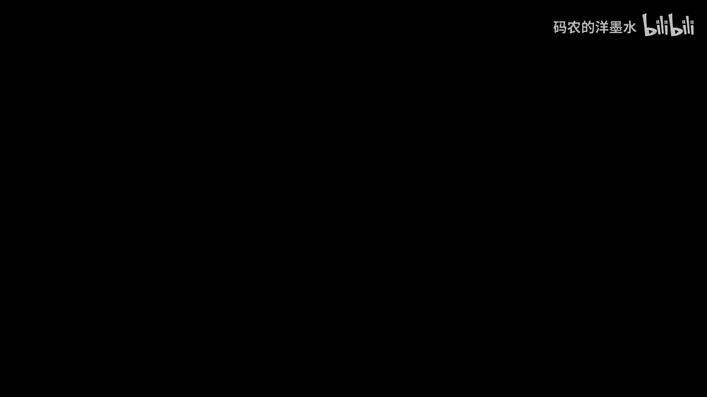
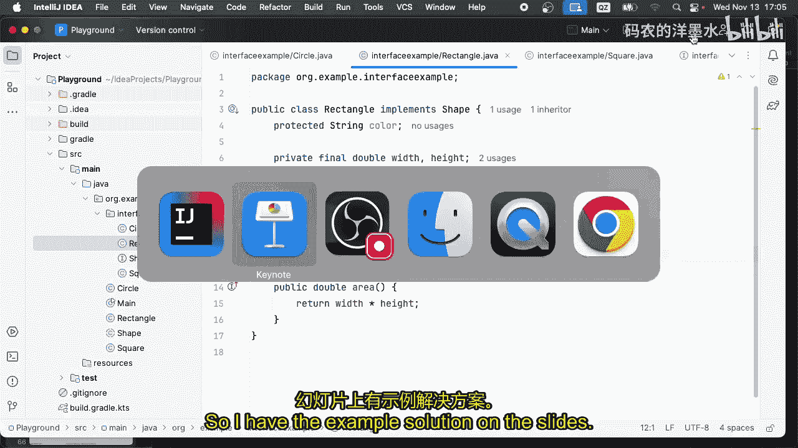
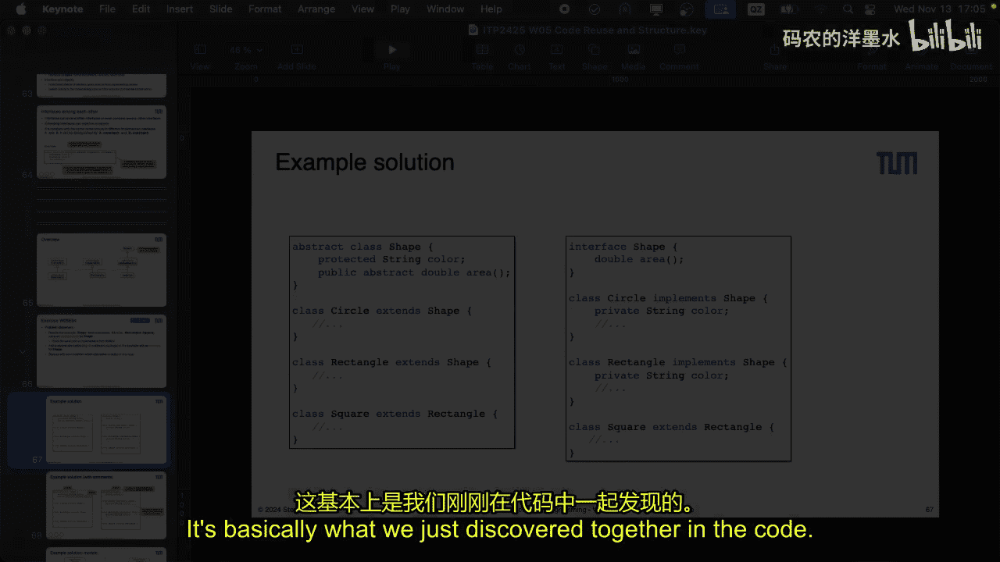
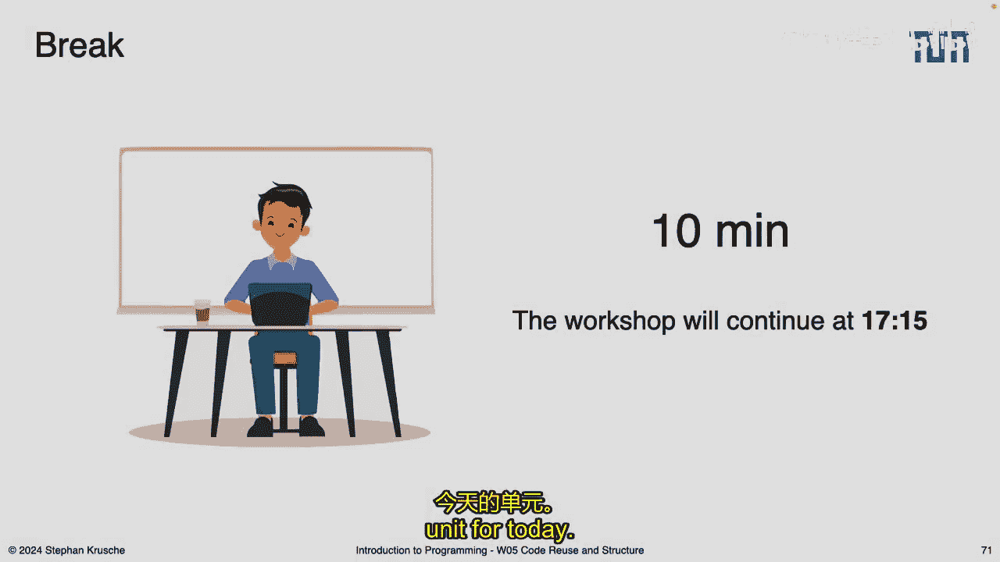

# 【全集】慕尼黑工业大学 计算机编程：从入门到实战 中英字幕 p25 Lecture 25 - 抽象类与接口 -BV1WFrTBZExY_p25-

Let's continue in our third unit for today's workshop。

 we'd like to discover abstract classes and interfaces。

Abstract methods and classes are necessary in order to specify a behavior that then must be implemented by all the concrete subclasses。

If you have an abstract object method。That is a method that is declared。With the name。

 the return type， with the input parameters， but it is not yet implemented so the implementation is left out if a class contains such an abstract object method。

 it also has to be abstract。An abstract class means that you cannot instantiate objects out of it。

If you can't insensate objects out of it， what is the purpose of the class you might ask yourself。

 Well， abstract classes allow us to group certain。Interesting behavior of subclasses in a way that allows us to reuse code while certain aspects are not defined yet。

 but must be then implemented in the subclass so we can group certain classes that have similar behavior。

We start with an example， and this example is about mathematical expressions。

And those are expressions that you use on a daily basis in your program， addition， subtraction。

 multiplication， and so on， and we'd like to see how we could implement this within the compiler。

An expression has a value。But this value might not be evaluated。

Because we still need to evaluate it and find out the value。

 So the Boolean attribute evaluated is initialized with false。

And we have a get value method If the value was already evaluated， and we simply return the value。

If it was not evaluated， we let it evaluate with the evaluate method。Set evaluated to true。

 and then return the value。However。The evaluation is not defined。

As part of the abstract superclass yet， this is something that we leave to the subclass。

The big advantage here is that we can still call this method。

 even though it does not exist yet in terms of its implementation。

And this is also called specification inheritance。 So we specify how something should work with the evaluate method。

And then subclass must implement this method， otherwise it will not work。So。

Abstract is a new keyboard that we use to declare such an situation。

Abstract methods need to declare the full signature， including the parameters， the return type。

 and if you throw exceptions， something that we will learn later on。

 you also need to declare which exceptions can be thrown。And an abstract method。

 And with first semi me call on， and not with curly braces and its implementation。However。

 an abstract method can be called in other methods within the same class。

 even though it's not implemented yet， because we have this contract that we can only iniate an object if it's not abstract。

 and every subclass that is not abstract has to provide an implementation for all abstract methods。

 This can be part of an inheritance hierarchy again。And you can even mix it up。

 You can have an abstract class， then a concrete class， then another abstract class。

 and then another concrete class。 So it can become quite complex。

But any concrete class cannot contain abstract methods。

So if we would like to implement a concrete subclass for expression。

 we have to implement the evaluate method exactly as it was defined in the superclass。

 So we still consider this as overriding。And when we have the most simple expression， a constant。

 this is super easy because we can simply return the constant value that we store as part of the expression。

So。We simply create a constructor to initialize the final cons value and then return this。

Notice that we use the final keyword also for the subclass cont here。

And this means that we cannot create further subclass。

 So it's not possible to treat Kantt as a superclass for other classes anymore。

So if we would like to avoid this， we can use this keyword file here as well。

And this improves security and efficiency， because our run time can be a bit faster。

But it's for simple program， it's typically not necessary。We can also define other expressions。

 like the additional。The additional works like that。 It has a left part and a right part。

 and both can be other expressions。could can be con。 Yeah， So 8 plus 8 would be cons plus cons。

 but it can also be any other expression。 Yeah， I can have a complex expression plus a complex other expression。

And in that sense， we kind of have a recursive object tree here because an addition can consist of another addition。

 for example。If we have an addition， we need to initialize it with two other expressions。

 As we have seen before， we can， expression cannot be instantiateated。

 So we need to pass a subclass to the constructor here。And then we store it。

And we need to provide the evaluation and evaluate method is that we get the value of the left side of the expression。

 If it's not a constant， we still need to evaluate it。

And then we add the value of the right side of the expression。 If it's not a cont。

 we still need to evaluate it。 And with that we can basically build up a tree that is made up of multiple expressions。

 you can easily come up with the subtraction with the multiplication and the division based on the same example as we have it here。

 and then we can build up a tree that has leaf node as conts。And where we can。

 at every composition node， we can basically evaluate what the result would be until we get the full result of the whole expression。

We can also come up with another expression the negationer。 So if I say minus a constant。

 I have a negationator。The negation is relatively simple。

 we have to evaluate the argument of the expressioner， which could be a const， another edition。

 another negationer， we can compose it however we want。And we have to add the minus in front of it。

And again， we provide。The implementation for a concrete subclass。 And without that。

 we would not be able to instantiate。D。How can we use this example， We can create an expressioner。

 See on the left side， we can still use the abstract type， but on the right side。

 we have to use a concrete type。 We can't use an abstract class on the right side。

 So next to the new keyboard。 You always need a concrete class。

 You can never use an interface nor an abstract class。 This is super important on the left side。

 you can use that。 But on the left side。😊，The type must be either the same as on the right side or any of its super classes or interfaces。

 Yeah， so we cannot turn it around。 We can't say addition equals new expression。

 This would not be possible。But we can say expression equals new addition。

 and then we compose it with the negation of 8 and 16。And we print out the result。

And the result would be-8 plus16 equals 8。And with that。

 we've seen how compilers basically build app， build up an abstract syntax tree based on the。

Small expressions that you have in your code。Model this as objects and then make sure that they use the precedes。

 as we have seen in the first lecture in this big table。 Remember that。 Yeah。

 multiplication has a higher precedence than addition， for example。

In order to calculate the final result。And of course， if we embed。Something within the addition。

 we can have a different precede than if we don't do that。And with that。

 you can easily come up with any other expression you can even support addition with more than two arguments with three。

 four， five arguments， and you can come up with subtraction， multiplication and division。

So this is an example where an abstract class might be useful。

Notice that get value calls evaluate successively for each partial expression。

So we really go until we end up in a constant， and then we go up again。

This is a depth first search approach。 if you're familiar with trees。

And which concrete implementationer really depends on the runtime。

 And this is called dynamic binding。 So the right side determines which method will be invoked。

This is also very important。 This is a first encounter of the difference between the left type。

 the compile time type and the right type， the run time type of the object。

And for the right method to be chosen。对。Runtime type is important。 This is called dynamic binding。

And to make this a bit more easy to understand， it works like that。 The runtime。

 if you invoke a method on an object， the runtime always searches at the lowest type。

The runtime type， if this method is available。If it is available， it will invoke this method。

If it is not available， it goes to the direct super class。If the method is available here。

 it will invoke this method。If the method is not available。

 it will go to the next super class until it comes up at the highest superclass in the hierarchy and the highest superclass is actual object。

 even if you don't see it。And then there must be an implementation of this method。

 otherwise the code would not compile， and this is called dynamic binding and it can only be decided at runtime which method is in bulk。

 we will see more about that in the last unit about polymorphosis。We can model this in UML。

 we have an abstract class notice that we have this in italics with this additional stereotype in those very specific little signs here。

 which is abstract， notice that evaluate is also abstract。

 it's written in italics it's not super noticeable but you have to carefully look into it to see that it's abstract in the UL diagram。

 so abstract things no matter if it's the class or the method are written in italics and for classes we have this additional stereotype to immediately see that。

And we have three subclasses， we have addition constant and negationer。

 they all override the evaluate method， therefore we mention it again。

Const adds a con value as an attribute with a primitive data type in。

Addition has two primitive sorry， has two attributes of type expression。 Therefore。

 we use the relationship here left and right。And negation has one attribute called argument of type expression。

And this is how we would model this in UML， and it's a very nice example。

 even if it sounds a bit complex to understand why abstract is needed and how we can use abstract classes in the code。

Are there any questions？With respect to this example。

I know this is becoming a bit more difficult now， but you have a full week with a few exercises to better understand it。

 So if you do not perfectly understand it now， it's not a big issue。

 I see that we have a small typo in here。 The T is missing。 This of course， should be in。

And we will fix that。And this is how it looks like We can make this more complex and even model rationale numbers。

 but one thing that is very important in Cha， we can't have multiple super classes。So you can always。

Have only one super class。You can't have more than one super class， this is super important。

So multiple inheritance of classes is not possible rationale cannot have a class comparable and a class at sub Maldiff with certain operations for the basic math。

 mathematical operations， addition， subsection， multiplication and division。

It can't have two superclass。 This is not possible。

Why is this not possible because it would lead to confusion？

Both super classes can exist on their own and can define the same methods。

If this is the case and you inherit from both， which method should be used in？

And how should the runtime decide whether it goes to the first superclass for dynamic binding and invoking the superclass method or to the right superclass。

 the second superclass to do that。 This is simply not possible。 and therefore。

 there are only a very small amount of programming languages that actually support multiple inheritance。

Next， we would like to cover interfaces。Interfaces are comparable to abstract classes。

 but slightly different。An interface is。A or can be seen as an abstract class where all the object methods are abstract。

 Everything is specified， but theres no implementation at all。 An abstract class can actually mix。

Non abstract with abstract methods in an interface， everything is abstract。

And all variables are constants。 So there is no mutable state。

 An abstract class can define attributes， can hold state and needs memory。 if I use it later on。😊。

An interface cannot hold state。 I can define variables， but only constants。

 They cannot change the value later on。Here's an example of an interface in Java that is used in order to allow you to compare different instances of the same object with each other。

 It's the so called comparable interface。And a comparable interface simply specifies that every object or class that conforms to it later on needs to implement the Comp two method。

Notice that all methods in an interface are automatically public。Even if you don't write it。

 there can't be private。 there can't be protected method in an interface。

 This simply would not make any sense because an interface is like a contract。If I know that。

The class is implementing this interface。 I know it follows a specific contract defined by this interface。

And you have all used interfaces before last week when we talked about the list。

Data type list is an interface in Javava with a specific contract and array list and linked list implement this contract with a specific implementation。

Here's an example in code。 We have the rationale number with a numerator and a denominator as long in this example。

 it extends one class that offers us the simple four mathematical operations， plus minus。

Times and divide。And additionally， it can implement one or multiple interfaces。

This is also a difference。 I can only extend one class。No matter if it's abstract or。Normal。

 but I can implement multiple interfaces as many as I want。

And I used to implement keyboardword and a comma separated list next to it。

And the rationale number implements the comparable interface by providing this method and basically takes the fraction。

The other fractionner。And compares it with the numerator and the denominator。

 And if the calculation would。Lead to the same result we would return 0。

 if the left side is smaller than the right side we return minus-1。 otherwise we return plus1。

 This is the contract of this method as defined in a comparable interface。

 and this allows later on a sort method in Javava to sort all the elements according to the comparable interface method compared to。

So we can have one super class， multiple interfaces are possible。

 and the keyword for interfaces is implements。Implementments is a synonym for conforms 2。

 So this class。Conforms to the comparable interface。It implements all its methods。

And we can be sure that those methods are available and we can invoke those methods as a user of this class later on。

This is how it works。 In theory， we say class A extends B implements C1。

 C2 until we reach a certain amount of interfaces， and it means a is a subclass of B。

 and a implements the interfaces C1， C2 and so on。 So only one super class。

 unlimited amount of interfaces。 however， usually you only have one to at most three interfaces that you implement。

 I typically do not see different examples。You can use interfaces as types as well。

 So we can say list list equals new array list， but we can't use them on the right side。

 So they they cannot be used with the new operator like abstract glasses。

 but we can use them as a compile time type on the left side。😊，So if you have formal parameters。

 variables or return types， they can have the type of an interface。

Insttaniateated objects of those interface types must be from an implementing class。

 You might not know which class it is。If you have a list data type。

 you might not immediately know if it if it is an area list or a link list。

 you just know that it conforms to this interface。So you can， if you need this information。

 which concrete class it is， you can cast it to the concrete class later on。

And you can also check it with the instance of operator。

 whether it is an instance of this specific class or not。 This， however。

 can be rather cumbersome and error prone because cars sometimes can also go wrong and then you get class cast exceptions。

Now， it's even possible that one interface extends another interface。And then we have again。

 the extends keyword here。 In fact， an interface can even extend multiple other interfaces。

And this allows us to group functionality to a very fine， granular way。 However。

 interfaces extending other interfaces are relatively rare。 and you don't see that very often。😊。

But it can be the case that I say comparable hasA method， cloneable hasA method。

 and I have countable interface that adds even three more methods so in the end a class that implements countable needs to provide five methods。

 the three that you see here， the one of the comparable interface and the one of the cloneable interface and with that I can really group and specify the functionality in a very concise way。

Notice that constants are always。Address by using the concrete type in the beginning。

 because they are kind of static。 If you have a static。Inter sorry。

 if if you have a static attribute in a class or aesthetic method。

 you always say class type or interface type dot attribute or a class type interface type dot method。

 And this is very important because otherwise we could not distinguish those methods。

And we would not know if they belong to comparable or cloneable。So while we can define constants。

 those are all static。A few annotations that basically repeat what I just said。Now。

 it's also important to understand that object is the super class。

For what a common super class for all Java classes。 So if you do not define my own class。

 extends something， then Java automatically。Configures your class in a way that it extends object。

We don't need to write that down， this is implicit behavior。But you always extend object。

 And this means all the methods in object， like to string， for example。

 are inherited and can automatically be used。But you can override its implementation as well。

 So if you want to have a very specific to string implementation like you've seen in the queue or in the stack。

 we can overwride those methods and provide our own implementation。And with that。

 we can build rationale numbers， complex numbers and interfaces and kind of have multiple inheritance。

 but not with classes。 So I a rationale class can have multiple。Triangles that look like inheritance。

 but only one of it in this case， at sub Maldive can be a。Class， others need to be interfaces。

 So at most one super class， but multiple interfaces are possible。

And we would like to practice this now with the example that we have used before in the exercise W5 E2。

 so please copy and paste the code that you have used in this exercise from Artemis into your playground。

 This is not an Artemis exercise we purely do this in the playground。

And we kindly ask you to rewrite it， remember， we had this weird shape class。

That had this area method， which simply returned 0。0， which didn't make any sense。

Now we have the tools to make it better so we can rewrite it to use an abstract class。

So copy and paste your solution from this exercise。

But now declare shape as an abstract class and make sure that the method area is also abstract。

And additionally， to try it out， create a second copy of it。

 potentially in a different package or in a different playground。

 and here use an interface for shape。So that we try out an interface and an abstract class and then discuss with your neighbor which of both options is actually appropriate for this particular example。

So get start to work on this for around 10 minutes。

 raise your hand if you have any questions and we'll help you with that。

 the tutors go around and I'll show you an exemplary solution after the exercise is over。

Good question系。This is a slight task， so copy the code from the previous exercise into your playground。

Yeah， so let me do that。Here as well， while you're working on it， can you don't need to follow me。

If you want to work on your own。But you can open itche。Open your playground。

And I get rid of everything else， except my。Main class。And if you remember， we had a。

Class called shape。And shape panic。A protected string。Color。And。I think it was a public。

Gober area method。And this one， that was like this to do， implement。And it basically returns 0。0。

That was the implementationer。You can copy this。 You don't need to type it in。

 And then we had a circle， if I remember correctly， which extended shape。And had a private。

 final double radius。And had a constructor。That initialized this and had。Area method。That returned。

Math。Dot。Pi times Rad times， Radius。Then， we also had a。Rectangle。

This rectangle extended shape as well。 It had a private。Do。A sorry， private final double with。

And hide it。Had a constructor。And we implemented the area method by returning with times。H。

And last but not least， we had a travel class shape。And sorry， not shape。A。Sba class。Square。

And we decided， remember to。Extend rectangle。And to create a constructor with just one。

Well you because the height and the width are the same。

And this is basically the solution of the previous exercise。

And now what you need to do is you need to look at this。 This is quite ugly， right？ I mean。

 we have a method that does something， but it's not really supposed to do anything。

So the idea is now that we simply declare shape as abstract。

And then declare this method as abstract as well。Remove its implementation。

And then you've already done So this is the first part of the exercise， super simple。

And it's a much better exercise， a much better example now。

 because a shape typically cannot be instantiateated。 We don't know its form yet。

 We don't know if it's a rectangle， a circle or anything else that we might come up in the future with。

 So it's super good idea to make it abstract。😊，And to let the subclass derive or implement a method。

 That's it。That's a simple example of an abstract class that you can easily implement on your own。

And now we'd like to copy all this。And also use the interface。 Yeah， So I make a new package here。

And I call this inter。Face。Example， I can't use interface because that's a keyboard。

And I copy and paste everything into it。 So I have exactly the same classes。 but now。

We would like to try out。Can we also make shape an interface？

 What happens if we don't say it's an abstractclass， It's an interface。Well。

 we see that we get a couple of issues now。First is that we can't extend an interface。

 We need to say implements。But then it will work again。Same here。

Square can still extend rectangle because rectangle is a class。But now we still have one issue。

And this is seen here， it says modifier protected， not allowed here。So let's remove it fine。

But what happens now， Well， color。Is not an object attribute anymore。It's aesthetic static attribute。

 We can't really instantiate a square with a color anymore。 This is not possible。Right。

And why is this the case， interfaces cannot hold state。 They only have static constants。

 So if at all， we could give it a constant and call it red。

 But then we lose the opportunity to color。Our shapes， we can't have a blue rectangle。

 a green circle or a yellow square anymore。So this is not really good。 What would be a solution。

 Well， we could move the color。To the subclasses。But then we have to define it in this circle。Yeah。

 we could still say protected extreme color。And then the rectangle would not have it。 Yeah。

 We could also define it here， but then we would have a duplication， right。

 And for any other shape subclass that we would define， we would need another attribute color。

So this is not a good solution。Right。So what do you think， What is better in this particular example。

 an interface， one abstract class。Think about it。 discuss it with your neighbor。 and then。

We can come up to a conclusion。Okay， so who of you thinks that in this particular example。

 the interface is the good solution。 Raise your hands。

Who of you thinks that the abstract class is a good solution in this example。 Okay， great。

 the majority。 And this is actually the case。

So I have the example solution on the slides。It's basically what we just discovered together in the code。

 And you see that。

On the left side where we have the abstract class， we can have state with the color。

 which is not possible on the right side where we have the interface。

 so we need to duplicate this in the code。So there are only a few and small changes compared to the previous example in the other exercise。

But you see how interfaces and abstract classes work， and you see that in this particular example。

 the abstract class， here' is the model for this。As on the left side is the preferred solutioner because shape actually contains state。

 if shape would not contain any state， you can also go with the interface solutioner。

And with the interfaces， you could also do it differently。

 You could also say shape is an abstract class。But area is part of an interface。

 And then we could say rectangle extends the shape for the state and implements。

Something that defines the area method。 So this would also be a valid solution。

Are there any questions regarding this small exercise？Okay， then before we do another break。

 here is a comparison of interfaces and abstract classes。

 This mainly resembles what I just said in the last。30 minutes round about。

It's there for you to read it and to have a good comparison。 I will not repeat everything again。

 Just remember， interfaces cannot hold state in terms of object attributes while abstract classes can do that。

However， you can only extend one class， but you can implement multiple interfaces。

You will see that interfaces are very important when it comes to functional programming。

 So in two weeks， if I'm not mistaken， we will cover。Functional programming。

 where we then talk about Lambda。Expressions and streams and their interfaces are really。

 really important， so they have been elevated a lot in the recent years in terms of functional programming。

 but abstract classes are still valid。Let's do a quick break as we are a little bit over time。

 I would suggest we do just seven minutes if that is okay for you。

 because then we can finish a bit earlier， so we would meet again at 15 minutes past five and then talk a little bit about polymorphphyma in our last unit for today and enjoy the break。

