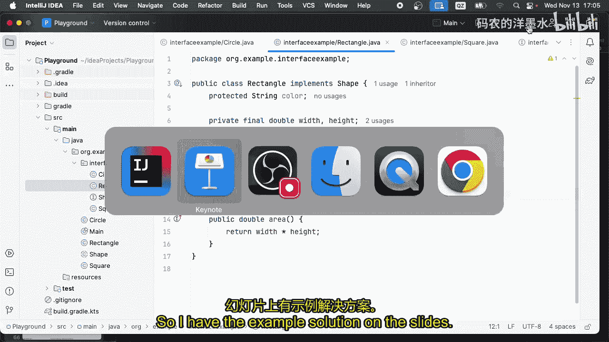
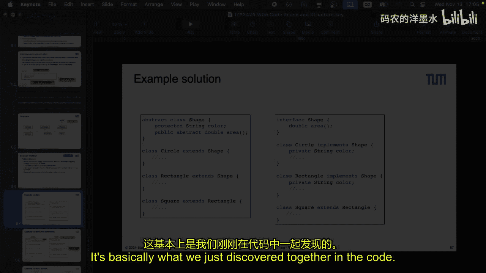
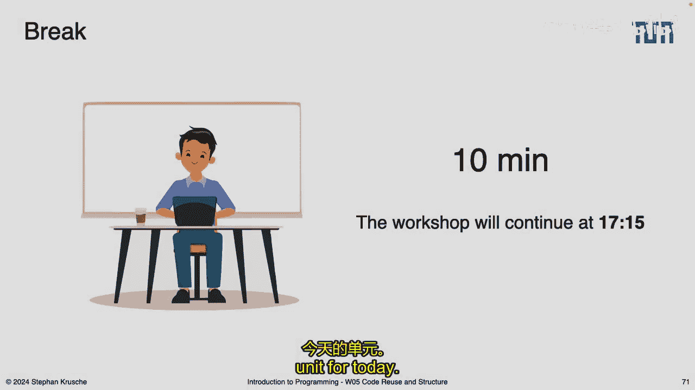

# 慕尼黑工业大学 计算机编程：从入门到实战：25：抽象类与接口

在本节课中，我们将要学习面向对象编程中的两个核心概念：抽象类与接口。我们将了解它们是什么、为何需要它们、以及如何在Java中正确地使用它们来设计更灵活、更健壮的程序。

## 概述

抽象类和接口是Java中用于实现多态和定义契约的重要工具。它们允许我们指定行为，而将具体的实现细节留给子类。本节我们将通过数学表达式和图形等例子，深入理解它们的设计目的和使用方法。

## 抽象类与抽象方法

上一节我们介绍了继承的基本概念，本节中我们来看看如何定义不完整的类。抽象方法和抽象类用于指定一个必须由所有具体子类实现的行为。

如果你有一个抽象对象方法，这意味着一个方法被声明了名称、返回类型和输入参数，但其实现被省略了。如果一个类包含这样的抽象对象方法，那么这个类也必须是抽象的。抽象类意味着你不能从它实例化对象。

你可能会问自己，如果不能从它实例化对象，那么这个类的目的是什么？抽象类允许我们以某种方式将子类的某些有趣行为分组，这种方式允许我们重用代码，同时某些方面尚未定义，但必须在子类中实现。因此，我们可以将具有相似行为的类分组。

我们从一个例子开始，这个例子是关于数学表达式的。

这些是你在程序中日常使用的表达式，如加法、减法、乘法等。我们想看看如何在编译器内部实现这一点。

一个表达式有一个值。但这个值可能尚未被求值。

因为我们仍然需要求值并找出这个值。

所以布尔属性 `evaluated` 被初始化为 `false`。

我们有一个 `getValue` 方法。如果值已经被求值，我们直接返回值。

如果尚未求值，我们使用 `evaluate` 方法让它求值。将 `evaluated` 设置为 `true`，然后返回值。

然而，求值操作尚未作为抽象超类的一部分定义，这是我们留给子类去完成的事情。

这里最大的优势是，我们仍然可以调用这个方法，即使它的实现尚不存在。

这也被称为**规范继承**。因此，我们使用 `evaluate` 方法指定了某物应该如何工作。

然后子类必须实现这个方法，否则它将无法工作。

`abstract` 是一个新的关键字，我们用它来声明这种情况。

抽象方法需要声明完整的签名，包括参数、返回类型。如果你抛出异常（这是我们稍后会学到的），你还需要声明可能抛出哪些异常。

一个抽象方法以分号结束，而不是用花括号及其实现。

然而，抽象方法可以在同一类的其他方法中被调用，即使它尚未实现。因为我们有一个契约：只有非抽象类才能实例化对象，并且每个非抽象子类都必须为所有抽象方法提供实现。

这可以再次成为继承层次结构的一部分。你甚至可以混合使用。你可以有一个抽象类，然后是一个具体类，然后是另一个抽象类，接着是另一个具体类。所以它可以变得相当复杂。

但任何具体类都不能包含抽象方法。

因此，如果我们想为 `Expression` 实现一个具体的子类，我们必须完全按照超类中的定义来实现 `evaluate` 方法。

所以我们仍然认为这是重写。当我们有最简单的表达式——常量时，这非常简单，因为我们可以简单地返回作为表达式一部分存储的常量值。

我们简单地创建一个构造函数来初始化最终的 `constValue`，然后返回它。

注意，我们在子类 `Const` 中也使用了 `final` 关键字。

这意味着我们不能创建进一步的子类。因此，不可能再将 `Const` 作为其他类的超类。

所以如果我们想避免这种情况，我们也可以在这里使用 `final` 关键字。

这提高了安全性和效率，因为我们的运行时可以更快一些。但对于简单的程序，通常没有必要。

我们也可以定义其他表达式，比如加法。

加法的工作原理如下。它有一个左部分和一个右部分，两者都可以是其他表达式。可以是常量。是的，所以 `8 + 8` 就是常量加常量，但它也可以是任何其他表达式。是的，我可以有一个复杂的表达式加上另一个复杂的表达式。

从这个意义上说，我们在这里有了一种递归的对象树，因为一个加法可以由另一个加法组成。

如果我们有一个加法，我们需要用另外两个表达式来初始化它。

正如我们之前看到的，`Expression` 不能被实例化。所以我们需要在这里向构造函数传递一个子类。然后我们存储它。

我们需要提供求值方法 `evaluate`，即获取表达式左侧的值。如果它不是常量，我们仍然需要求值。

然后我们加上表达式右侧的值。如果它不是常量，我们仍然需要求值。

这样，我们基本上可以构建一个由多个表达式组成的树。你可以很容易地基于我们这里的相同例子，想出减法、乘法和除法。

然后我们可以构建一棵树，其中叶子节点是常量。在每一个组合节点，我们基本上可以求值结果是什么，直到我们得到整个表达式的完整结果。

我们还可以想出另一个表达式：取反器。所以如果我说负一个常量，我就有一个取反器。

取反相对简单。我们必须求值表达式的参数，它可能是一个常量、另一个加法、另一个取反器，我们可以任意组合它。我们必须在它前面加上负号。

再次，我们为具体的子类提供实现。没有这个，我们将无法实例化。

我们如何使用这个例子？我们可以创建一个表达式。

在左侧，我们仍然可以使用抽象类型，但在右侧，我们必须使用具体类型。我们不能在右侧使用抽象类。

所以在 `new` 关键字旁边。你总是需要一个具体的类。你永远不能使用接口或抽象类。这在左侧非常重要，你可以使用它。但在左侧，类型必须与右侧相同，或者是其任何超类或接口。

是的，所以我们不能反过来。我们不能说 `Addition e = new Expression()`。这是不可能的。

但我们可以说 `Expression e = new Addition()`，然后我们用 `-8` 和 `16` 的组合来构造它。我们打印出结果。

结果将是 `-8 + 16 = 8`。

这样，我们就看到了编译器如何基于你代码中的小表达式构建抽象语法树，将其建模为对象，然后确保它们使用优先级，正如我们在本讲座第一单元的大表中看到的那样。记住，例如，乘法比加法有更高的优先级，以计算最终结果。

当然，如果我们在加法中嵌入某些东西，我们可以有不同的优先级。这样，你可以很容易地想出任何其他表达式，你甚至可以支持多于两个参数的加法，比如三个、四个、五个参数，并且你可以想出减法、乘法和除法。

所以这是一个抽象类可能有用的例子。

注意，`getValue` 会为每个部分表达式连续调用 `evaluate`。

所以我们真的会一直进行下去，直到遇到一个常量，然后再返回。

这是一种深度优先搜索方法，如果你熟悉树的话。

具体调用哪个实现真正取决于运行时。这被称为**动态绑定**。所以右侧决定了将调用哪个方法。

这也很重要。这是第一次遇到左类型（编译时类型）和右类型（对象运行时类型）之间的区别。

要选择正确的方法，运行时类型很重要。这被称为动态绑定。

为了让这更容易理解，它的工作原理如下。运行时，如果你在一个对象上调用一个方法，运行时总是在最低的类型（运行时类型）搜索该方法。

如果该方法可用，它将调用这个方法。

如果不可用，它会转到直接超类。如果方法在这里可用，它将调用这个方法。

如果方法不可用，它会转到下一个超类，直到到达层次结构中最高的超类，最高的超类实际上是 `Object`，即使你看不到它。然后必须有这个方法的实现，否则代码将无法编译。这被称为动态绑定，只能在运行时决定调用哪个方法。我们将在关于多态性的最后一个单元中看到更多相关内容。

我们可以在UML中对此建模。我们有一个抽象类，注意我们用斜体表示，并带有这个额外的构造型，用这些非常具体的小符号表示，这是抽象的。注意 `evaluate` 也是抽象的，它用斜体书写，不太明显，但你必须仔细看才能看到它在UML图中是抽象的。所以抽象的东西，无论是类还是方法，都用斜体书写，对于类，我们有这个额外的构造型来立即看到它是抽象的。

我们有三个子类：`Addition`、`Constant` 和 `Negation`。它们都重写了 `evaluate` 方法，因此我们再次提到它。

`Const` 添加了一个 `constValue` 属性，其原始数据类型为 `int`。

`Addition` 有两个类型为 `Expression` 的属性。因此，我们在这里使用关系 `left` 和 `right`。

`Negation` 有一个名为 `argument` 的属性，类型为 `Expression`。

这就是我们如何在UML中建模它，这是一个非常好的例子，即使听起来有点复杂，难以理解为什么需要抽象以及如何在代码中使用抽象类。

关于这个例子有什么问题吗？

我知道这现在变得有点困难了，但你有一整周的时间和一些练习来更好地理解它。所以如果你现在没有完全理解，这不是大问题。我看到这里有一个小拼写错误。缺少了 `T`。这当然应该是 `int`。我们会修复它。

这就是它的样子。我们可以让它更复杂，甚至可以建模有理数，但Java中非常重要的一点是，我们不能有多个超类。所以你总是只能有一个超类。你不能有超过一个超类，这非常重要。

所以类的多重继承是不可能的。`Rational` 不能同时拥有一个 `Comparable` 类和一个 `AddSubMultDiv` 类（用于基本数学运算加、减、乘、除）。它不能有两个超类。这是不可能的。

为什么不可能？因为这会导致混淆。

两个超类都可以独立存在，并且可以定义相同的方法。

如果是这种情况，并且你从两者继承，那么应该使用哪个方法？运行时应该如何决定是去第一个超类进行动态绑定并调用超类方法，还是去第二个超类？这根本不可能。因此，实际上只有极少数编程语言支持多重继承。

接下来，我们想介绍接口。

接口与抽象类类似，但略有不同。

接口可以看作是一个所有对象方法都是抽象的抽象类。一切都已指定，但完全没有实现。抽象类实际上可以混合非抽象方法和抽象方法，而在接口中，所有方法都是抽象的。

并且所有变量都是常量。所以没有可变状态。

抽象类可以定义属性，可以持有状态并需要内存，如果我以后使用它的话。

接口不能持有状态。我可以定义变量，但只能是常量。它们以后不能改变值。

这是一个Java中接口的例子，用于允许你比较同一对象的不同实例。这就是所谓的 `Comparable` 接口。

`Comparable` 接口简单地指定，以后符合它的每个对象或类都需要实现 `compareTo` 方法。

注意，接口中的所有方法自动是 `public` 的。即使你不写，也不能有 `private` 或 `protected` 方法。这根本没有意义，因为接口就像一个契约。如果我知道一个类实现了这个接口，我就知道它遵循这个接口定义的特定契约。

你们之前都使用过接口，上周我们讨论 `List` 数据类型时，`List` 是Java中的一个具有特定契约的接口，而 `ArrayList` 和 `LinkedList` 用特定的实现来实现这个契约。

这是一个代码示例。我们有一个 `RationalNumber`，分子和分母在这个例子中是 `long` 类型。它扩展了一个类，该类为我们提供了简单的四种数学运算：加、减、乘、除。

此外，它可以实现一个或多个接口。这也是一个区别。我只能扩展一个类，无论它是抽象的还是普通的，但我可以实现任意多个接口。

我使用 `implements` 关键字和它后面的逗号分隔列表。

`RationalNumber` 通过提供这个方法来实现 `Comparable` 接口，基本上取另一个分数，与分子和分母进行比较。如果计算结果会导致相同的结果，我们返回 `0`；如果左侧小于右侧，我们返回 `-1`；否则返回 `+1`。这是 `Comparable` 接口中定义的这个方法的契约，这允许以后Java中的排序方法根据 `Comparable` 接口的 `compareTo` 方法对所有元素进行排序。

所以我们可以有一个超类，多个接口是可能的，接口的关键字是 `implements`。`implements` 是 `conforms to` 的同义词。所以这个类符合 `Comparable` 接口。它实现了其所有方法。

我们可以确信这些方法是可用的，并且我们以后作为这个类的使用者可以调用这些方法。

这就是它的工作原理。理论上，我们说 `class A extends B implements C1, C2, ...` 直到达到一定数量的接口，这意味着 `A` 是 `B` 的子类，并且 `A` 实现了接口 `C1`、`C2` 等。所以只有一个超类，无限数量的接口。然而，通常你只实现一个到最多三个接口。我通常看不到不同的例子。

你也可以将接口用作类型。所以我们可以说 `List list = new ArrayList()`，但我们不能在右侧使用它们。所以它们不能像抽象类那样与 `new` 操作符一起使用，但我们可以将它们用作左侧的编译时类型。

所以如果你有形式参数、变量或返回类型，它们可以具有接口类型。

这些接口类型的实例化对象必须来自一个实现类。你可能不知道是哪个类。如果你有一个 `List` 数据类型，你可能不会立即知道它是 `ArrayList` 还是 `LinkedList`，你只知道它符合这个接口。所以如果你需要这个信息，即它是哪个具体类，你以后可以将其强制转换为具体类。

你也可以使用 `instanceof` 操作符检查它是否是此特定类的实例。然而，这可能相当麻烦且容易出错，因为强制转换有时也会出错，然后你会得到类强制转换异常。

现在，甚至有可能一个接口扩展另一个接口。然后我们在这里再次使用 `extends` 关键字。事实上，一个接口甚至可以扩展多个其他接口。

这允许我们以非常精细、细粒度的方式对功能进行分组。然而，接口扩展其他接口相对少见，你不经常看到这种情况。

但也可能是我说 `Comparable` 有一个方法，`Cloneable` 有一个方法，我有一个 `Countable` 接口，它甚至添加了三个更多的方法，所以最终一个实现 `Countable` 的类需要提供五个方法：你在这里看到的三个，`Comparable` 接口的一个和 `Cloneable` 接口的一个。这样，我就可以以一种非常简洁的方式真正地对功能进行分组和指定。

注意，常量总是通过使用开头的具体类型来寻址，因为它们是静态的。如果你在类或接口中有静态属性或静态方法，你总是说类类型或接口类型.属性，或者类类型/接口类型.方法。这非常重要，否则我们将无法区分这些方法，并且我们不知道它们属于 `Comparable` 还是 `Cloneable`。

所以虽然我们可以定义常量，但它们都是静态的。

一些注释基本上重复了我刚才所说的内容。

现在，同样重要的是要理解 `Object` 是所有Java类的公共超类。所以如果你没有定义自己的类 `extends` 某个东西，那么Java会自动将你的类配置为扩展 `Object`。

我们不需要写下来，这是隐式行为。但你总是扩展 `Object`。这意味着 `Object` 中的所有方法，例如 `toString`，都被继承并可以自动使用。但你也可以重写它的实现。所以如果你想像在队列或栈中看到的那样，拥有一个非常特定的 `toString` 实现，我们可以重写这些方法并提供我们自己的实现。

这样，我们可以构建有理数、复数、接口，并拥有某种形式的多重继承，但不是通过类。所以一个 `Rational` 类可以有多个看起来像继承的三角形，但在这种情况下，`AddSubMultDiv` 可以是一个类，其他必须是接口。所以最多一个超类，但多个接口是可能的。

我们现在想用之前在练习 W5 E2 中使用过的例子来练习这个。所以请将你在Artemis中用于此练习的代码复制并粘贴到你的Playground中。这不是一个Artemis练习，我们纯粹在Playground中进行。

我们请你重写它。记住，我们有一个奇怪的 `Shape` 类，它有一个 `area` 方法，只是返回 `0.0`，这没有任何意义。

现在我们有了工具来改进它，所以我们可以重写它以使用抽象类。

所以从本练习中复制并粘贴你的解决方案。

但现在将 `Shape` 声明为抽象类，并确保 `area` 方法也是抽象的。

另外，为了尝试，创建它的第二个副本，可能在不同的包或不同的Playground中，这里对 `Shape` 使用接口。这样我们尝试接口和抽象类，然后与你的邻居讨论，对于这个特定例子，哪种选择实际上更合适。

所以开始做这个大约10分钟。如果你有任何问题，请举手，我们会帮助你。助教们会四处走动，练习结束后我会给你展示一个示例解决方案。

好问题。这是一个小任务，所以将之前练习的代码复制到你的Playground中。

是的，让我也这样做。当你们自己工作时，你们不需要跟着我。

但你可以打开它。打开你的Playground。

我删掉其他所有东西，只保留我的主类。如果你记得，我们有一个名为 `Shape` 的类。

`Shape` 有一个受保护的字符串 `color`。我想它是一个公共的 `double area()` 方法。这个方法是这样的，需要实现。它基本上返回 `0.0`。这就是实现。

你可以复制这个。你不需要输入它。

然后我们有一个 `Circle`，如果我没记错的话，它扩展了 `Shape`。并且有一个私有的 `final double radius`。有一个构造函数来初始化这个，并且有一个 `area` 方法，返回 `Math.PI * radius * radius`。

然后，我们还有一个 `Rectangle`。这个 `Rectangle` 也扩展了 `Shape`。它有一个私有的 `final double width` 和 `height`。有一个构造函数。我们通过返回 `width * height` 来实现 `area` 方法。

最后但同样重要的是，我们有一个子类 `Square`。我们决定，记住，扩展 `Rectangle`。并创建一个只有一个参数的构造函数，因为高度和宽度相同。

这基本上是之前练习的解决方案。

现在你需要做的是看看这个。这相当丑陋，对吧？我的意思是，我们有一个方法做了某事，但它并不是真的应该做任何事。

所以现在的想法是，我们简单地将 `Shape` 声明为抽象类。

然后将这个方法也声明为抽象。移除它的实现。

然后你已经完成了。这是练习的第一部分，超级简单。

现在这是一个更好的练习，更好的例子，因为 `Shape` 通常不能被实例化。我们还不知道它的形状。我们不知道它是矩形、圆形还是将来可能想到的任何其他东西。所以把它做成抽象的是一个非常好的主意。并让子类派生或实现一个方法。

就是这样。这是一个你可以自己轻松实现的抽象类的简单例子。

现在我们要复制所有这些。并且也使用接口。是的，所以我在这里创建一个新的包。

我称之为 `interfaceExample`，我不能用 `interface` 因为那是关键字。

我把所有东西复制粘贴进去。所以我拥有完全相同的类。但现在，我们想尝试一下。我们是否也可以让 `Shape` 成为一个接口？

如果我们不说它是抽象类，而是说它是一个接口，会发生什么？

嗯，我们看到现在出现了一些问题。首先是我们不能扩展一个接口。我们需要说 `implements`。但这样它又会工作。这里也一样。

`Square` 仍然可以扩展 `Rectangle`，因为 `Rectangle` 是一个类。但现在我们还有一个问题。

在这里可以看到，它说修饰符 `protected` 不允许在这里。所以让我们移除它，好的。

但现在会发生什么？嗯，`color` 不再是对象属性了。它是一个静态属性。我们不能再给一个正方形实例赋予颜色了。这是不可能的。对吧。

为什么会这样？接口不能持有状态。它们只有静态常量。所以，最多，我们可以给它一个常量并称之为 `RED`。但这样我们就失去了给形状着色的机会。我们不能再有蓝色的矩形、绿色的圆形或黄色的正方形了。所以这并不好。解决方案是什么？

嗯，我们可以将 `color` 移到子类中。但那样我们就必须在 `Circle` 中定义它。是的，我们仍然可以说 `protected String color`。然后 `Rectangle` 就不会有它。是的，我们也可以在这里定义它，但那样就会有重复，对吧。对于我们要定义的任何其他 `Shape` 子类，我们都需要另一个 `color` 属性。

所以这不是一个好的解决方案。对吧。那么你怎么看？在这个特定的例子中，哪个更好，接口还是抽象类？想一想。和你的邻居讨论一下。然后我们可以得出结论。

好的，那么你们中谁认为在这个特定例子中，接口是好的解决方案？请举手。

你们中谁认为在这个例子中抽象类是好的解决方案？好的，很好，大多数。这实际上是事实。

所以我在幻灯片上有示例解决方案。它基本上就是我们刚刚在代码中一起发现的。你可以看到，在左侧我们有抽象类，我们可以有状态 `color`，这在右侧我们有接口的情况下是不可能的，所以我们需要在代码中复制它。

所以与之前练习中的例子相比，只有很少且很小的变化。

但你看到了接口和抽象类是如何工作的，并且你看到在这个特定例子中，抽象类（这里是左侧的模型）是首选的解决方案，因为 `Shape` 实际上包含状态。如果 `Shape` 不包含任何状态，你也可以使用接口解决方案。

对于接口，你也可以用不同的方式处理。你也可以说 `Shape` 是一个抽象类。但 `area` 是接口的一部分。然后我们可以说 `Rectangle` 扩展 `Shape` 以获得状态，并实现定义 `area` 方法的某个东西。所以这也是一个有效的解决方案。

关于这个小练习有什么问题吗？

好的，那么在我们进行另一次休息之前，这里是接口和抽象类的比较。

这主要总结了我刚才在过去大约30分钟里所说的内容。它供你阅读并有一个好的比较。我不会再重复一切。

只需记住，接口不能在对象属性方面持有状态，而抽象类可以做到这一点。

然而，你只能扩展一个类，但可以实现多个接口。

你会发现接口在函数式编程中非常重要。所以如果我没记错的话，两周后，我们将介绍函数式编程，届时我们将讨论Lambda表达式和流，它们的接口真的非常重要，所以近年来在函数式编程方面，它们被大大提升了，但抽象类仍然有效。

让我们快速休息一下，因为我们有点超时了。我建议我们只休息7分钟，如果这对你们来说可以的话，因为这样我们可以早一点结束，所以我们将在5点15分再次见面，然后在今天的最后一个单元中讨论一点多态性，享受休息时间。

## 总结

本节课中我们一起学习了抽象类与接口的核心概念。我们了解到抽象类用于定义部分实现的模板，可以包含状态和具体方法，而接口则用于定义纯粹的行为契约，不能包含状态。通过数学表达式和图形形状的例子，我们实践了如何根据设计需求选择使用抽象类或接口。记住，一个类只能继承一个父类，但可以实现多个接口，这是Java实现多态和代码复用的重要机制。