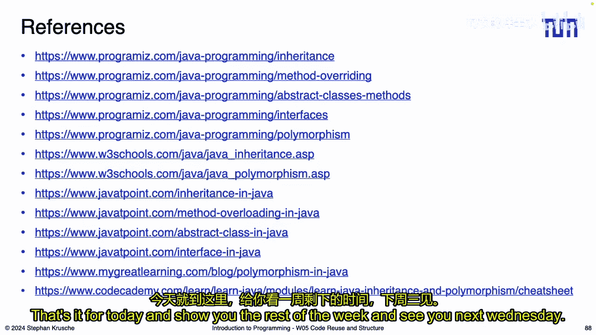

# 【全集】慕尼黑工业大学 计算机编程：从入门到实战 中英字幕 p26 Lecture 26 - 多态 -BV1WFrTBZExY_p26-

Welcome back after the last break， we'll directly dive into the last unit for today where we talk about polymerlymorph Fsma。

Polymorphism is the fourth basic concept in object oriented programming that allows us to structure the code and to do code reuse we've already covered abstraction with abstract classes and interfaces。

 we talked about encapsulation in the very first workshop where we talked about how you can define attributes in order to store states in objects。

We covered inheritance today。 And last but not least， you would like to talk about polylymorphism。

 Polymorphism comes from the ancient Greek word。That actually should show us that we have many forms。

And。Is a way that basically extends inheritance in order to allow the modification of functionality by overriding methods of a superclass。

So when you apply polymorphphysma， you need to make sure which form you would like to have either the mutant or the actual person。

 let's dive into this and see how it works。A so called polymorphic method。

Exists multiple times with the same name， but potentially different behavior。

 And we can distinguish two very concrete types for that。 We can。

We have on the one side the so calledled static or compile time polymermorph fiman。

This happens when you overload a method。Overloading means you have one class where you have the method twice or three times or more。

 with the same name， but different arguments。And here。

 the compiler will enforce which method is invoked。 So at compile time， it's absolutely clear。

 so make sure to memorize this static compile time。 polymorphcent is related to overloading。

 and the compiler decides。The other one， dynamic or runtime polymorphphysma。

Realized that runtime refers to overriding methods。Overriding is always。

When you have multiple methods with the same name， but in different classes that inherit from each other。

So overriding involves inheritance。And in this case。

 the compiler can yet decide which method will be invoked。During runtime， it will be decided。

And this is a very important distinction。When we just used the term polymorphism。

People typically refer to dynamic polymorphism because that's much more powerful。

 and static polymorphism， to be honest， is a bit boring。 If you just call it overloading。

Many people don't even consider it as a type of polymorphism。

Dynamic polymorphism basically allows a child class to adapt the functionality。Incorporate changes。

Doing whatever you want， also misusing this mechanism。And only at run time。

 we know which method is invoked， because only at run time， we have a specific type。

That we can take into account。Here's an example of static overloading。

 the boring part might not be boring for you now because it's still new。

 but compared to the other one， it's relatively simple。

Sttic polymorphism or overloading means we have a static binding。

And this happens if a class such as vehicle， declares the same method twice。

 but with different arguments。While this is not necessarily an important feature。

 it happens sometimes， and you know how to deal with it。 You need to know how to deal with it。

And the compiler can immediately tell by looking at the code。

 whether you would like to invoke the first or the second method。Now。

 this example is super easy because one method has no parameters， and the other method has one。

It becomes a bit more complex if you have the same method with one argument and one of them is an int and the other one is a double。

 Then it's not as easy anymore because then you have to make sure that you know the exact type。

 but the exact type can be inferred during compile time。Much more interesting。

 And you will see we have more slides about that is the second。Type of polymorphism。

 dynamic polymorphism。Dynamic polymorphism is also called late binding or dynamic binding。

 and it is always related to inheritance。 So we have a superclass， a subclass。

 the subclass overrides the method from the superclass。

 And then you need to know which method will actually be emvo the one of the subclass or the one of the superclass。

 And that's basically already the miracle that happens in your computer and that we want you to understand better。

 So there will be a few more slight quizzes， Don't worry。

 you don't have to go to Artemis I'll just show you code and you have to vote what or tell me what output will be produced based on this idea of dynamic polymorphism。

Here's an example。We again have the re class， but you see now a second class comes into play。

 a subclass， the motorbike。Every motorbike is also a vehicle。

 So the list of substitution principle is fulfilled。Checkmark。And we have a very simple example。

 We just printline things here。 We don't do anything。Difficult。 So here， the question is really。

 which of those two methods is involvedked。And this is decided based on the type of the right side。

This is why it's called runtime。On the left side， we have the compile time type。

 which is always vehicle， always the superclass。On the right side， we have the runtime type。

 the type that is actually used to instantiate the object， the type that is next to the new operator。

Always keep that in mind that type that is designing。So， in the first example。

The method in this subclass will be invoked because it is available。 And as I said before。

 during inheritance， when we override a method。And the runtime type is available。

 It will always use the one of the subclass。If there would be no move method。

 it would use to one of the reality class， but we have one here。Now。

 if and this is not an abstract superclass。 if we create an object of the type vehicle， then。

 of course， the subclass is not there。 Yeah， it's like it would not exist。

We could even get rid of it in the example。 And then the move method of the superclass will be invoked。

Or of the actual class， because there is no super class involved here。Right， and this， as I said。

 can only be determined at run time because。Now， this is a simple example。

 You directly see the new operator here。 But let's assume you implement a method， someone else。

Gives you a type。And you don't even know what runtime type it is。 You just have reh。

 You don't know if it's a motorbike， a car or a vehicle in its pure super class。

So it can only be decided at one time。 It cannot be。

 this is a simple example the compiler could easily design， of course。

 and there might be some optimizations that are done in order to avoid this late decision。

 which can also be time consuming。But this is a very simple example。 Yeah。

 I assume you implement a method。And you take a vehicle into a car。

 and you don't know if it's a vehicle。 It could be a motorbike。

 It could also be your riding framework code。 Someone else， an application uses your framework。

 and it's a new subclass that is not known during compile time yet。

 It's simply not available in your own code that was compiled。But someone else adds a new subclass。

 I don't know。 car， for example， In this very simple example， we。

 we don't even know at compile time that car exists， but it could be the case。

 so the runtime needs to dynamically decide which method is involved。Question。

The question is would vehicle be considered as an interface or abstract class， none of them。

 because there is no abstract key here and there is no interface key in this example it's just a class。

Any other questions regarding dynamic polymorphism？In this simple example， it's super easy。But。

 of course， if we change the code， it might be a bit more complex。 Let's see what's going on。 here。

 a few annotations that I already said。Before we look into the small quiz examples for you to try it out。

 I'd like to tell you a few problems with polymermorphphysma。And one big problem is casting。

Casting is sometimes necessary because if you get in a re。

But the subclass has additional methods that you would like to emvoke。

 which are only available on the motorbike you need to cast。The compile time type。

Must be of motorbike， Otherwise， the compiler would complain。Now， you can do this without checking。

 but then you can end up with a class cast exception at run time if。

The vehicle is not of tight motorbike， which clearly is not the case here。

If you want to make sure that you don't get this exceptions， you can use the instance of key。

 So our recommendation is always use instance of checks before downcasting。Yeah。

 and it works like that。 If we hike our variable name， instance of the downcast class， Yeah。

 the subclass。Does make sense to use a sub classy。 It must be subclass。If this is the case。

 then we cast。 Otherwise， we don't cast at all。 And casting simply means， well。

 the runtime type is like that。 And now we just tell the compiler that it is like that。Right。

 so you basically just tell it to the compiler to avoid a compile error。

 because motorbike might have a method that's not available on vehicle。In recent Javava。

 this has become a bit easier because if you additionally say if we hike the instance of motorbike and then you pass a name。

 it implicitly cast this for you and you can save one additional line of code。

So you can also use the shorter version。Great， with that in mind。

 we have three quizzes and for every quiz， it's just a slight quiz。

 You need to tell me what the program does， what it actually prints and why is this the case。

 so please read the code。😊，And if you volunteer to tell me the solution， raise your hands。

 and then I'll let you answer it。 Yeah， so have a look at the code and tell me what happens down here。

 Yeah You see that we invoke drive methods。 They print something。

And I'd like you to tell me the three different print statements that we have here。And also。

 explain me why this is actually printed to the console。

And you can see that this is already bit tricky。 You have a car of type car。

 a sports car of type sports car， and another sports car on the left side。 now we have car。

 but on the right side， we have sports car。And now you need to think about。

 is this static polymorphism or dynamic polymorphism。And by the way， this。

These are potential quizzes for the supervised exercises。Yeah， so。In a supervised exercise。

 it could be the case that you see something like this， and then you get four different choices。

 and then you have to say which of those。Are correct。Any ideas？

 Is there any volunteer who would like to try it out。This is your chance。Now。

It's also not a big problem if you make it wrong then。I help you out。 Okay， go ahead。 Okay。

 so the first one is correct。The second one is also correct。The third one is wrong。So the first。

Method here will print using car。 The second will print using sports car。

And the last one will also print using car。And why is this the case， Well， we tricked you。

It looks like this is dynamic polymorphism because we have two different types and subclasses here。

But， in fact， this is static polymorphism。 The two methods are in the same class。

 So this is overloading and not overriding。 This means they compiler theses， which method is invoked。

Based on the compile time type。Right， so the left type here is taken into account。

 And this is also explained on slide 80。 Yeah So this is an example of static polymermorphism。

 As I said， it's a bit tricky。Great。😊，Second， quiz。Have a look again， try to understand it。

 and then one volunteer can let us know。What kind of statements we get。I even added a few hints here。

 May I look at this grey。Comments here。 They might help you out。

Not sure if we have them in the supervised exercise。Baically。

 I wonder if you can copy and paste this to chat CPT and if it gives you the right answer， not sure。

It does。Yeah， the thing is with Chat CPT， I'm not sure if you read this article。

 but some Apple engineers they tried out to give it really simple quizzes and you can confuse it quite easily with like non relevant details。

 like you tell it count the oranges in the bananas and by the way。

 the bananas are black and the oranges are green and then it somehow gets confused。

With really simple， logical。嗯。Questions， which is clear because it's a statistical parrot。

 It does not reason。So it gets things wrong。No， it' it's perfectly correct。 Very well done。

 So we mix static and dynamic polymorphism here。 which of the drive methods is invo is basically the same as in the previous example。

 So we again have using car using sports car using car。

 And now the question is which speed is taken into account。 And here we use the right type Yeah。

 So the first two one has。😊，Speed 100。The second one， sorry here， the first one car。

 it has speed 100， the second one has 500 and the third one also has 500 because whether get speed is invoked on the subclass or the superclass is decided at runtime based on the runtime type。

Yeah， that's the explanation。 Very good， very well done。 You can see the explanation on this slide。

And we have one more quiz。What does the following program print and why is this the case。

So the first one is super easy。Second one。Yeah， the second one is also fairly easy。

The third one is the difficult， because we mix up the types。Yeah， we use overriding here and is it。

Is it static or dynamic polymorphism？Dynamic polymermorph， exactly。

 So we take the type on the right next to the new operator or keyboard into account。

 And this means the first one is。There's no sports car involved。

 so it's fairly easy that this one will be involved。 And for the other two。

 we use the sports car or drive a sports car is correct。 an example of dynamic polymorphism。

Any questions regarding polymorphism？I think with the examples and the quiz it becomes a bit more clear。

 you can practice this again at home and stay tuned for a quiz next week at the beginning of the workshop。

 it's quite likely that we have similar examples then。So before we finish this workshop。

 let me quickly sum it up， we've covered four different object oriented programming concepts。

 three of them in detail in this workshop， you should understand what abstraction is in terms of abstract classes and interfaces。

We've already seen encapsulation where we model the state in terms of attributes and distribute this to multiple classes so that it makes sense in our program。

We've also discovered inheritance a way to structure our code and to reuse existing functionality in super classes。

Always keep in mind that a subclass must also be a super class。 Otherwise。

 you violate Barbara Liskov's substitution principle。While this is possible， it's super bad， ugly。

 and it makes you code error prone and faulty。 And you should add absolute。

Absolutely avoid this at all cost。Notice also that inheritance is not the only way to reuse code delegationer is an alternative which proves to be very powerful and most of the times even the better solution than inheritance。

But you need to be able to use both delegation simply means you invoke a method on another class。

 while inheritance means you invoke the method and it was implemented in the superclass。

And we distinguish polymerphysma with static overloading and dynamic overr。

 the compile time type and runtime type。What are the next steps we have， again。

 two tutor group exercises with galactic seals and cosmic companions。

And to homework exercises with a space seal farm and the Deep space training center。

 So you see we always come up with funny themes， we'd also kindly ask you to read more about inheritance and polymermorphphysma on those two articles。

All of this is due until next week， Wednesday at 1 pm。So a quick summary。

Inheritance allows you to structure code in terms of taxonomy and hierarchies and prevents code applicationplication。

Abstract classes allow you to define something that cannot be instantiateated。

 and we have the possibility to have an abstract class with abstract methods and normal methods on one hand。

 which can hold state in terms of attributes。Or alternatively， we can also define interfaces。

 but those interfaces can actually only define methods。But do not hold state。

 So you have two possibilities need to decide for every specific case， which one to use。

Interfaces allow us to divide functionality into groups or features。

 and this will help us a lot later on when it comes to functional programming and also allows us to implement classes incrementally or iteratively over time。

And polymermorphphyma means that you have mutants in your code that。Can。Have many forms。

 and we need to distinguish between static compile time。

 overloading and dynamic runtime polymorphism overriding。

 and also need to take into account that there's a static binding on the one hand and a dynamic binding on the other hand。

You have a few references， if you are interested to read more about inheritance。

 overloading abstract classes and polymorphismma， that's it for today and enjoy the rest of the week and see you next Wednesday。

