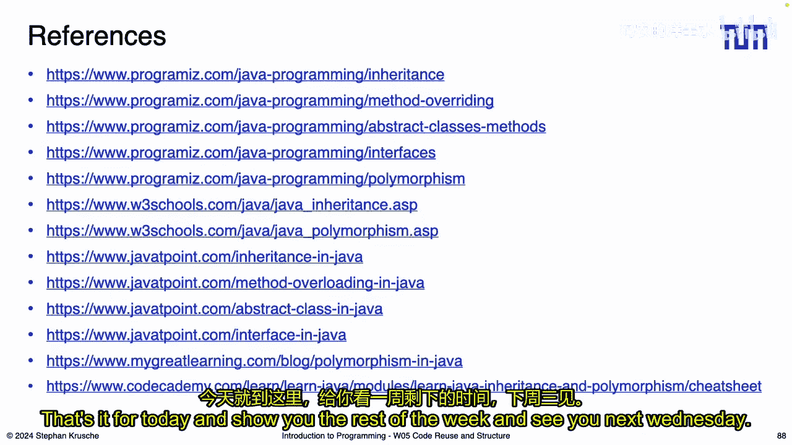

# 慕尼黑工业大学 计算机编程：从入门到实战：26：多态


在本节课中，我们将要学习面向对象编程的第四个基本概念——多态。多态允许我们以多种形式处理对象，是代码结构和复用的重要手段。我们将探讨其两种主要类型：静态多态和动态多态，并通过示例和测验来加深理解。

## 多态概述

多态是面向对象编程的第四个基本概念。它允许我们结构化代码并实现代码复用。我们已经学习了抽象（通过抽象类和接口）、封装（在对象中存储状态）和继承。现在，我们来学习多态。

多态一词源自古希腊语，意为“多种形式”。它本质上是继承的一种扩展，允许通过重写超类的方法来修改功能。应用多态时，需要确定你希望使用哪种形式——是超类（父类）的形式，还是子类的形式。

## 多态方法的类型

一个所谓的多态方法可以以相同的名称存在多次，但可能具有不同的行为。我们可以区分两种非常具体的类型。

以下是两种多态类型：

1.  **静态多态（编译时多态）**：这发生在方法重载时。重载意味着在同一个类中，有多个方法名称相同但参数不同。编译器将决定调用哪个方法。因此，在编译时，一切都很明确。
2.  **动态多态（运行时多态）**：这通过方法重写实现。重写总是发生在具有继承关系的不同类中。在这种情况下，编译器无法决定将调用哪个方法，这个决定将在运行时做出。

这是一个非常重要的区别。当人们提到“多态”时，通常指的是动态多态，因为它更强大。静态多态（即重载）有时甚至不被视为一种多态类型。

## 静态多态（重载）

上一节我们介绍了多态的基本概念，本节中我们来看看静态多态的具体表现。

静态多态或重载意味着我们进行静态绑定。如果一个类（如 `Vehicle`）声明了两次相同名称但参数不同的方法，就会发生这种情况。虽然这不是一个特别重要的特性，但有时会发生，你需要知道如何处理它。编译器可以通过查看代码立即判断出你想调用第一个还是第二个方法。

以下是一个静态多态的示例：

```java
class Vehicle {
    public void move() {
        System.out.println("Vehicle is moving.");
    }

    public void move(int speed) {
        System.out.println("Vehicle is moving at speed: " + speed);
    }
}
```

在这个例子中，`move` 方法被重载了。编译器根据调用时提供的参数（无参数或一个 `int` 参数）来决定调用哪个版本。

## 动态多态（重写）

了解了静态绑定后，我们进入更强大的动态多态世界。

动态多态也称为后期绑定或动态绑定，它总是与继承相关。我们有一个超类和一个子类，子类重写了超类的方法。然后你需要知道实际上会调用哪个方法——是子类的方法还是超类的方法。这就是计算机中发生的“奇迹”，也是我们希望你能更好理解的。

以下是一个动态多态的示例：

```java
class Vehicle {
    public void move() {
        System.out.println("Vehicle is moving.");
    }
}

class Motorbike extends Vehicle {
    @Override
    public void move() {
        System.out.println("Motorbike is moving.");
    }
}

public class Main {
    public static void main(String[] args) {
        Vehicle v1 = new Motorbike(); // 运行时类型是 Motorbike
        v1.move(); // 输出: Motorbike is moving.

        Vehicle v2 = new Vehicle(); // 运行时类型是 Vehicle
        v2.move(); // 输出: Vehicle is moving.
    }
}
```

调用哪个方法取决于右侧的类型（运行时类型）。左侧是编译时类型（总是超类 `Vehicle`），右侧是运行时类型（`new` 操作符旁边的类型）。当运行时类型可用时，将始终使用子类的方法。如果子类没有重写该方法，则会使用超类的方法。

## 类型转换与 `instanceof`

动态多态带来了一个常见问题：类型转换。有时，你获得一个超类引用，但子类有额外的方法，你希望调用这些仅在子类中可用的方法，这时就需要进行向下转型。

编译时类型必须是目标子类类型，否则编译器会报错。你可以直接转换，但如果 `Vehicle` 实际上不是 `Motorbike` 类型，则可能在运行时引发 `ClassCastException`。

为了避免这种异常，建议在向下转型前使用 `instanceof` 关键字进行检查。

以下是使用 `instanceof` 进行检查和转型的示例：

```java
if (vehicle instanceof Motorbike) {
    Motorbike myBike = (Motorbike) vehicle; // 安全转型
    myBike.someMotorbikeMethod(); // 调用子类特有方法
}
```

在较新的 Java 版本中，可以使用更简洁的写法：

```java
if (vehicle instanceof Motorbike myBike) {
    myBike.someMotorbikeMethod(); // 自动转型并调用方法
}
```

## 测验与解析

现在，我们通过几个小测验来巩固对多态的理解。请阅读代码并思考输出结果及其原因。

### 测验一：静态多态的陷阱

```java
class Car {
    public void drive() {
        System.out.println("Using Car");
    }
}

class SportsCar extends Car {
    public void drive(int speed) {
        System.out.println("Using SportsCar at speed: " + speed);
    }
}

public class Test {
    public static void main(String[] args) {
        Car car = new Car();
        SportsCar sportsCar = new SportsCar();
        Car anotherCar = new SportsCar();

        car.drive();
        sportsCar.drive(200);
        anotherCar.drive();
    }
}
```

**解析**：这看起来像动态多态，但实际上是静态多态（重载）。两个 `drive` 方法在同一个类（`SportsCar`）中，只是参数不同。编译器根据左侧的编译时类型决定调用哪个方法。
*   `car.drive();` 调用 `Car` 的 `drive()`，输出 “Using Car”。
*   `sportsCar.drive(200);` 调用 `SportsCar` 的 `drive(int speed)`，输出 “Using SportsCar at speed: 200”。
*   `anotherCar.drive();` 编译时类型是 `Car`，`Car` 类中只有一个无参的 `drive()` 方法，因此调用它，输出 “Using Car”。

### 测验二：混合静态与动态多态

```java
class Car {
    private int speed = 100;
    public void drive() {
        System.out.println("Using Car");
    }
    public int getSpeed() { return speed; }
}

class SportsCar extends Car {
    private int speed = 500;
    @Override
    public void drive() {
        System.out.println("Using SportsCar");
    }
    @Override
    public int getSpeed() { return speed; }
}

public class Test {
    public static void main(String[] args) {
        Car car = new Car();
        SportsCar sportsCar = new SportsCar();
        Car anotherCar = new SportsCar();

        car.drive();
        System.out.println(car.getSpeed());
        sportsCar.drive();
        System.out.println(sportsCar.getSpeed());
        anotherCar.drive();
        System.out.println(anotherCar.getSpeed());
    }
}
```

**解析**：这里混合了静态和动态多态。`drive()` 方法的重写是动态多态，而 `getSpeed()` 的调用也涉及动态多态（因为被重写了）。
*   前两行输出由 `car` 对象产生：”Using Car” 和 “100”。
*   中间两行由 `sportsCar` 对象产生：”Using SportsCar” 和 “500”。
*   最后两行，`anotherCar` 的编译时类型是 `Car`，但运行时类型是 `SportsCar`。因此，重写的 `drive()` 和 `getSpeed()` 被调用，输出 “Using SportsCar” 和 “500”。

### 测验三：纯动态多态

```java
class Vehicle {
    public void move() {
        System.out.println("Vehicle moves");
    }
}

class Car extends Vehicle {
    @Override
    public void move() {
        System.out.println("Car drives");
    }
}

class SportsCar extends Car {
    @Override
    public void move() {
        System.out.println("SportsCar races");
    }
}

public class Test {
    public static void main(String[] args) {
        Vehicle v1 = new Vehicle();
        Vehicle v2 = new Car();
        Vehicle v3 = new SportsCar();

        v1.move();
        v2.move();
        v3.move();
    }
}
```

**解析**：这是一个纯动态多态（重写）的例子。调用哪个方法完全取决于右侧的运行时类型。
*   `v1.move();` 运行时类型是 `Vehicle`，输出 “Vehicle moves”。
*   `v2.move();` 运行时类型是 `Car`，输出 “Car drives”。
*   `v3.move();` 运行时类型是 `SportsCar`，输出 “SportsCar races”。

## 课程总结

本节课中我们一起学习了面向对象编程的核心概念之一——多态。

我们首先回顾了面向对象编程的四个基本概念：抽象（通过抽象类和接口）、封装（在对象中存储状态）、继承以及今天的主题——多态。

我们深入探讨了多态的两种类型：
1.  **静态多态（编译时多态/重载）**：发生在同一类中，方法名相同但参数列表不同。编译器在编译时决定调用哪个方法。
2.  **动态多态（运行时多态/重写）**：发生在继承体系中，子类重写超类的方法。具体调用哪个方法在运行时根据对象的实际类型决定。

我们还学习了在处理动态多态时，如何安全地进行向下转型，即使用 `instanceof` 进行检查以避免 `ClassCastException`。

最后，通过三个测验，我们练习了区分静态与动态多态，并理解了编译时类型与运行时类型在多态行为中的关键作用。记住，动态多态是更强大和常用的特性，它允许程序在运行时表现出灵活性，是面向对象设计的重要基石。



