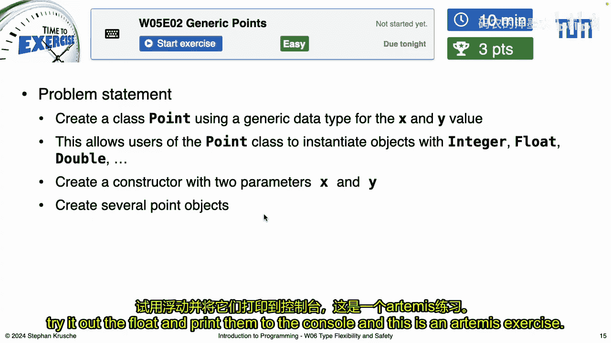
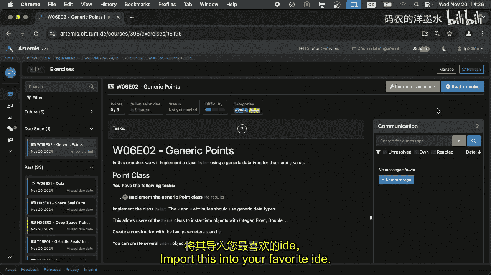
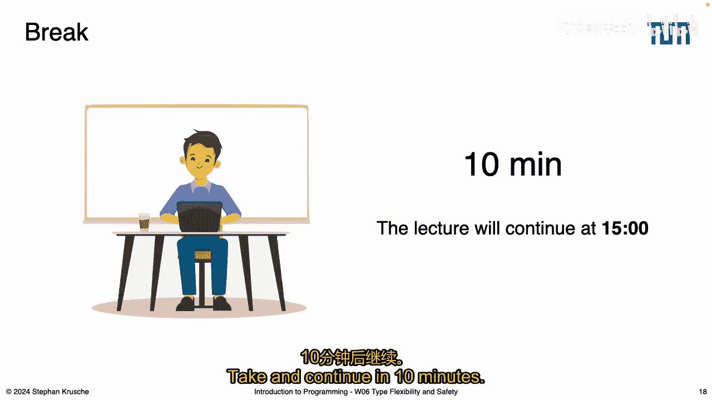

# 【全集】慕尼黑工业大学 计算机编程：从入门到实战 中英字幕 p27 Lecture 27 - 泛型part1 -BV1WFrTBZExY_p27-

Welcome everyone to today's workshop on T flexibility and Sa in the course Introuction to programming。

We are in the middle of the course shortly before the next in depthth session where we teach you a bit more about object oriented programming concepts and repeat the most important concepts from today and the previous week so that you have a better experience in particular when it also comes to the supervised exercise。

 which will take place in two weeks。We assume that you have a good understanding about all the basic concepts。

 in particular， control structures， data types， but also object oriented programming principles such as abstraction。

 encapsulation， inheritance and polymorphism。We know polymorphism is not the easiest topic to master。

 but we hope you have at least a rough understanding of what it means。

 Today's learning goals are that you。Understand the idea behind generic types even further。

 We already covered them quickly， how to use them with built in data types。 Today。

 you will learn how to create your own generic data type。

So this is also one important learning goal that you are able to create generic data types and then use to later on。

 We will again see how to wrap primitive data types in objects。 We've already looked into this。

 but we see a few more details。 We introduced you to a common data type in Shava。

 which is called map。And in the last section， we will talk about how you can handle exceptions。

 how in particular， how you can throw them and how you can catch them and we will even define our own exceptions。

 So exception handling or arrow handling is also an important topic today。

 This is the outline and we will talk about generics。 We have two parts for that。

 And there are two rather long exercises where you can try out how this works。

 And then after the longer break in the middle， we will talk again a bit more about object data types and arrow handling。

Let's get started with an example。 First， we have a class polley here。In this class。

 poorly simply has a two string method， Nothing very。Exciting， to be honest。

 And now we have a Pol test with a main function。 And in here we create a new Pol object。

 But you see it on the left side that the compile term type is object。

Which allows us to pass this into our adver method that actually takes an object as an argument。And。

We can invoke the two string method here。 so first of all。

 we can notice every class is a subclass of object and poorly implicitly has an empty constructor that we use here。

The class method at world allows us to print the object to string method plus world with any object so we can pass anything here。

 Even if there is no two string method defined explicitly in the class but in this case， it is。

 on here， we have a variable that has a specific class。Type A as as a more generic example。

 and this one can be assigned to an object of any subclass of a。 Yeah so on the left side。

 we need to have the same type or a super type or super class type。 And on the right side。

 we need to have the same type or subclass types。 right， it's not possible the other way around。

 Yeah， so this is an important constraint when we create objects。 we have always two types。

 they can be the same， that's the easiest case， but if they are different， the left one。

 the compile time type must always be in the inheritance hierarchy higher than the type on the right side。

And in this case， the output would be hello world。 Yeah， because we have poll here。 we add in here。

 and we can do that， even though the runtime type is not exactly the same。

 it can be for method parameters also that you。Invoke them with subclass types。

 and there's no casting needed in this particular case。Great， let's change this example a little bit。

 And let's assume Pony has a。Method greeting。Now， if we say object poorly equals new Pol。

 then we still have an object of Tpoly。 The runtime type is still poorly。

But the compile time type is object。And while we immediately see thatpoli do greeting should work。

Because we look at this now and the compiler could also tell。

It's not guaranteed right because it might be the case that object Pol is retrieved from somewhere else。

 Yeah the runtime type is sometimes not clear in your code。 Yeah。

 it could also be the case that someone passes an object as an argument to the method and then if you only know that the compile time type。

 this object， you cannot invoke the method。What would you need to do？

How could we make this code work without too many changes？We could change the type here。 Yeah。

 but let's assume this line is fixed， and we can just change this line here。Yes。

 we can do downcasting exactly。 That's the solution here。 Yeah， In order to make this work。

 We need to tell the compiler， hey， please compiler。

 I'm pretty sure or I'm 100% sure that Po is of Tpo。 It's not just an object。

 even though the type is object here。 and I override you or I explicitly tell you do the cost。

 And then I only need to make sure that the cost does not fail because otherwise I would get a class cast exception at runtime。

But if we don't do the cast， we would get a compile error。

 and the compiler would say cannot find symbol。The symbol here is the， the method。

 method greeting and the location is variable poorly of type object。

 So in the type object with the variable name Polly， we cannot find the symbol greeting。

 and therefore， you get a compile error， right。And this is the underlying curve here。And again。

 this is because we have a static type here that does not match the method here。

 and the compiler needs to know at compile time if it works or not。Great。Now。

 you already told me the workaround is to downcast to the appropriate subclass and ideally we do that by using the instance of method because as I said。

 this is just a simple example， but sometimes you don't really know where the object is coming from and you might not be 100% sure if this is the case and if you cannot change the actual type here or if it's part of the method if you cannot change the method signature。

 then it's better to be saved and sorry， so you do the instance off check。

 you already have seen previously that we could make this even nicer by avoiding the cast here and putting it into the instance of。

Question or or statement here。 And then we can invoke the method。 And otherwise。

 we could also handle this case and say， sorry， no cast possible。Any questions regarding costing？

This is something that we assume you understand。 Yeah， this is not really new。

 It's just a summary of what we covered and bringing it into a different context。Yeah。

 so the question is， what is the motivation behind using object。

 You will see to what I motivate in a few slides in general。

 Sometimes you can't make any assumptions of the types that you get。 so sometimes， of course。

 it's always better to make assumption if it's possible and to use the most specific type if possible。

 because then you have the greatest freedom in terms of what kind of methods you can invoke and you need less cast but sometimes it's simply not possible because you cannot make any assumptions。

 And then we need to go to super classes or even to object and we can't really avoid that。

Now there's one little change that we can apply here to the slide and just show you this how this would work。

 We can also put the name in here and do the cast immediately in this line and avoiding this all the braces that you have here。

 and then we could also write it like that。Which would be much easier to understand。

 So this is the modern way。 I， I'll change that now。 Yeah， and then in the future。

We have it in a better way。No， I don't change it because otherwise I would need to get rid of the annotations here。

 but I think it's it's somehow clear that this is the way what we need to do。

 And while it's a bit ugly and much nicer if we put it in here。

 this is just some styling improvements， I would say。Great， so some explanation。

 we have a static type， We have a dynamic type， and。😊。

Whenever you have something on the left side or whenever you have a signature in a method with a formal parameter type。

 those are the static types or compile time types。 and everything that is on the right side next to the new operator is the runtime type。

 And this is sometimes in the code， you don't really know what the runtime type is。

 actually in most cases， you don't really know it because it can always be a subclass。

So even if you specify a method， it can always be a subclass of this method。

 What is actually given to you。 an instance off allows us to check class membership at runtime。

 and then we can cast it。 And， of course， we need to be careful。 if we don't use instance off。

 if we make assumptions and cast automatically or or without doing this， then。

We might end up with a an exception， a so called class cast exception and our code will。

 or our program will crash in the worst case。Now。We already learned that generics allow us to basically。

Define types that work with multiple other types。 So instead of creating a list just for strings。

We can create a generic list with a generic type， using the diamond operator。

And then while we instantiate the list and use it。Only then we decide what kind of type we want to use。

 And with that， we can basically use any type。That follows our requirements that we specify。

And this is done with the diamond operator。 so we can create a list of our own type type。

 or we can also create a list of our first string。 Yeah， So this is perfectly possible。

 And this is something additional to the previous slides that we can take into account。

 So in addition to the static type and the dynamic type。 we also now have type parameters。😊。

Or parameter types， engineeringary classes that allow us to be typea in many different situations。

So called parameterized types are classes that work with different data types。

 typically with all the simple data types， but also with class based types with your own custom types。

 and the big advantage is that we can reuse code and we only need to specify it once。And so far。

 we just have used generics。 But today， we also show you how to create your own generic types。

In this workshop， and。Before we do that， we can again see that we have used the list， for example。

 with the parameter letter E and the set with the parameter letter E。 And later on。

 we will also learn how to use the map。 And the map always have has two types， a key K and a value V。

So here we do not only have one type like in the list， but we have two。

 So you can map a string to an integer， or you can map an integer to a string or your own class point to your own class student。

 for example， or you can map a student to a final grade。 So this is what you can do with a map。

 It's a very powerful data structure。 And we will see how it works in a few minutes。

Here's the first example of a very simple generic data type。

We basically would like to make our course。Teneric。

And we can do this by specifying this diamond operator and by specifying one letter。

 If you don't have a good reason to change it， you typically use T。

 which is a generic name for type or generic abbreviation for type。And when we do that。😊。

We now can use this as。A type for attributes。As a type for parameters。

As a type for return types and methods。And only later on， when we instantiate a course。

 we need to specify its actual type。 and we can do that with strings。 We can do this with intes。

Whatever we would like to do。 And this is really a very generic example， Don't。

Take it as a meaningful example， it's just really to get you understanding what's going on here。

Notice that we typically use T。 This is a convention。 You've seen list and set use E for element。

 You can basically use any letter or even multiple letters。 Typically。

 they are uppercase to distinguish between lowercase letters that are used for the variable or attribute names。

 and otherwise you might get confused。 Yeah So one uppercase or two uppercase letters。

 This is the conventional。 And we have here an instance of type string。

 And here an instance of type integer。Any questions regarding this example。Great。

 notice generics only work with reference types。 We discuss this quickly。

 So when you declare an instance of our generic type， you always need to use a reference type。

 You can't use the eight primitive types。 It's not possible with。 It's not possible with char。

 It's not possible with the lowercase float and so on。

 the compiler would tell you this is not possible。 And the main reason is that we need reference semantics when we deal with those types。

 and we have certain assumptions that the compiler needs to check。

 So this is not possible with primitive types。 But luckily we have a workaround。

 We have wrap classes for all the primitive types。 So you can use integer boen with uppercase B character and so on。

 And then you basically wrap the primitive data type in an object data type or class data type。

 And then you can also use it with generics。😊，We have an overview of all the wrapa classes here again。

 You see that object is the highest super class， and then we have Boolean character and the number and number has a certain is abstract。

 first of all， and then has a few subclass that you already know by short integer。

 Those are integer based numbers。 Yeah， So full numbers without the comma afterwards。

and long as well。 Sorry， I forgot that by short inter and long and float and double our floating point values where you have a very precise description of real numbers。

 so to speak。It's important that generics make your code more safe。

This is why this lecture is also called type flexibility and safety。

 It makes it more flexible so we can reuse code， but it also makes it more safe。😊。

Because you can make assumptions。 Yeah， instead of having a generic list with objects。 Yeah。

 we could also define it with objects， we can use a type parameter type parameter。

 And then when we retrieve elements。We actually are sure that they are of this specific type。

 and we don't need downcasting， right， So this is the big advantage of generics。 Now。

 what you need to understand is that generics are a complete compile time feature。

So during the compilationer， the compiler actually removes them and basically replaces T with object。

And， if necessary。Insert downcasts for you automatically。So during runtime。

 you cannot check if the type is off list string。This is not possible。 You can also not cast。

 You cannot cast a list。When we look at here list number， you cannot cast this to a list of integers。

 This is not possible because the type is not available。

 The generic type is not available at runtime anymore。 It's really erased and disappears。

 so to speak。 So those are the caveats and the small disadvantages as it is implemented in Javava。

 the main reason why it is erased is for performance reasons。

 because those types can lead to certain overhead in the runtime system。

 And if you need to follow all its aspects and all its complexity。

 the developers behind Javava decided at some point。

 this is too much overhead and we need to get rid of it during runtime。Question。Yes。

 so the question was when we use generics and we retrieve objects， for example， from the list。

It is automatically cast to the type that you want。 Yes， this is correct。Yeah， and this。

 this is how it works。 And the compiler does that for you。 Yeah， it's a convenience chop in。

 in some sense。 Yeah， you don't have to do this manually。 The compiler is doing it for you。

 And with that， you get a certain type safety。Notice that arrays can also be passed because arrays are reference types。

 so we could create a new course with an int array。 However， this is。Very strange。 Yeah。

 I've never seen that， to be honest in practice。 And this is just for you to know that it would work。

 but I don't really recommend to do that。What you can do on the other hand is you can nest generic types。

 yeah， so you could have a list of a list of string， which is possible， but again。

 it can become quite complex and you should double check if this is really what you need or if you rather model this differently in your data model later on。

Great， then let's do a quick first exercise。 We basically prepared an artemis exercise for you。

 and we would like you based on the previous definition of the point class， remember。

 we either had int X and Y or float X and Y or double X and y， which is quite cumbersome。

 because we need to decide which data type to use。 And now we would like you to use a generic data type。

 So instead of using int float or double。😊，And then being restricted to only this specific type。

 we would like to use a generic type T。And then x and y also have this generic type T。

And then we ask you to create a constructor to pass the parameters to the attributes。

And to create several point objects later on tried out with Inteter。

 right out with float and print them to the console。

And this is an artemis exercise。 So please open Artemis。Go into the， it's already here。

 next exercise。 so I can click on this here。 start the exercise。

 The problem statement is relatively short because it's not a big exercise。

Import this into your favorite IDE， work on it， and I'll show you an example solution in around 10 minutes。

It's a new concept， but it's relatively easy。 Yeah， this is really just8 to 10 lines of code。

 nothing fancy。 and it's really for you to exercise。

 So double check how we created the different the course example if you are completely lost look at slide 11 and think about how can I transform this example into a point class where I do not only have one attribute but multiple attributes and not only one parameter in the constructor but multiple parameters in the constructor And if you do that yeah if you are able to replace course with point object with X or why then you're almost done it's not really difficult here and if you have any questions raise your hands。

 our tutors will go around if you watch us online ask your questions iris or in the communication channels so the tutors can help you。

Were there。Okay， the time is up， please。Listen again。

And I'll show you an example solution and we can quickly discuss。The implications。

This is our example solution。 We define a class point with a generic。Type parameter T。

 you can use any other letter as well， but we have used T here。We have two attributes of type T。

 X and Y， and we have a constructor where we pass。X and y also of type T and simply assign it to the attributes。

 and of course， you can also let In generate corresponding get us and set us if if you' are interested in。

 we can now use this and for example， say point integer equals new。

1 and 2 or  point double equals new。1。52。3。Any questions regarding this。Okay， so the question is。

 can you use different types here and different letters， multiple ones， even， and theoretically yes。

 and it probably will give you all the points。 But normally you would make want to make sure that both attributes have the same type。

 Otherwise it could be the case that now the first one is an integer and the second one is a double。

And then it might be difficult to do calculations later on， right， So in this particular case。

 I would stick to one specific type。 And， in fact， this is not a perfect solutioner。

 We will see later on how to improve that， because right now， you can basically use anything。

 You could have a point out of strings。Which doesn't really make any sense。 And while you could say。

 hey， this is the responsible of the user of this class。

 of the color of those methods and constructors that it's useful。

 there are also ways to restrict what kind of types will be used here。 We will learn that later on。

The question is what happens if you use object X instead of T Well。

 then you will have a hard time to implement shift。

 to implement rotate and all the other methods that we previously implemented just for doubles。

 because in every case you need to check which actual type it is。

 you need to downcast to integer to double or whatsoever。

 because you can't really do all the calculations on object， you can't say x plus y。

 if you have an object data type， it's simply not possible。Okay， great。 With that。

 we'll do a short break and continue in 10 minutes。

