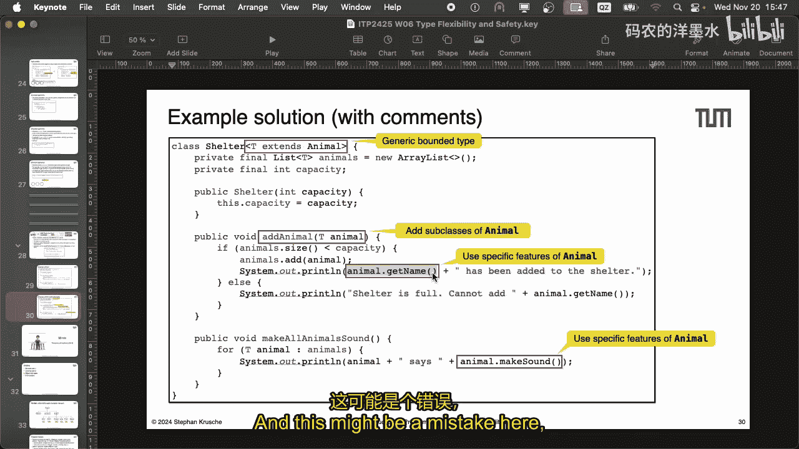
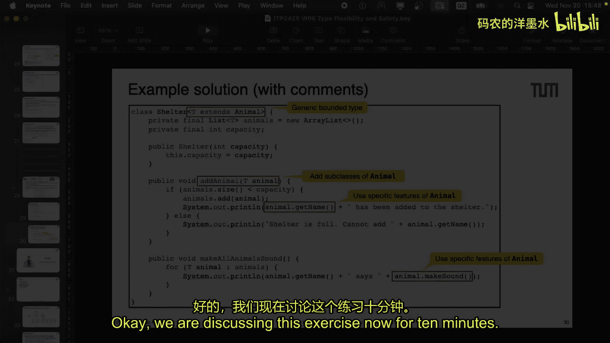
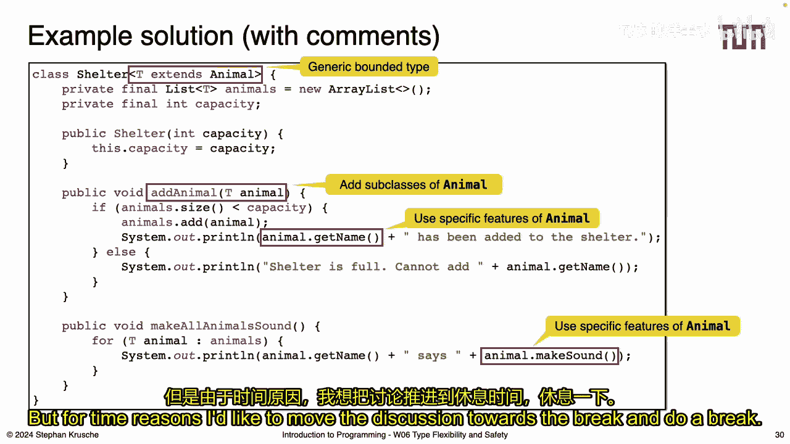
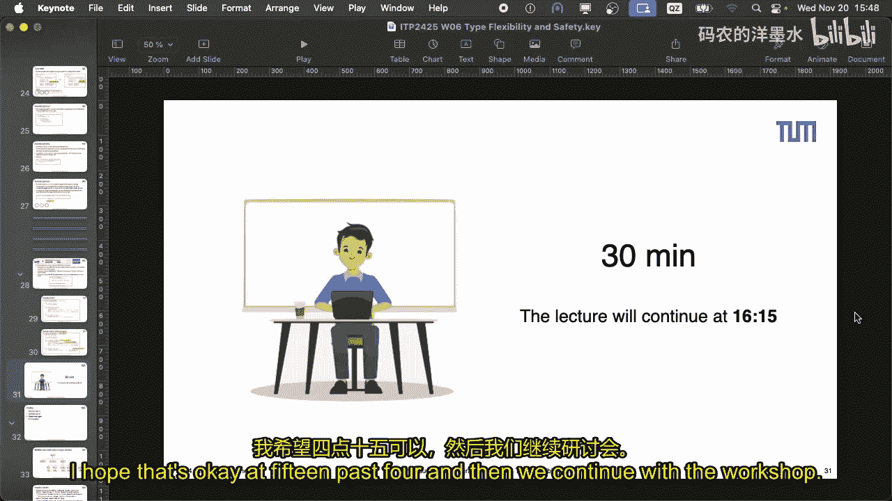

# 【全集】慕尼黑工业大学 计算机编程：从入门到实战 中英字幕 p28 Lecture 28 - 泛型part2 -BV1WFrTBZExY_p28-

Then let's continue with the second part on generics。

 we would like to have a few more aspects in order to better understand them and also a more difficult exercise where you need to do a bit more than justing a class。

We already talked about it quickly， T Esia is important to understand generics have been introduced into Java to provide better type safety and better type flexibility。

 so we have tighter type checks at compile time。But the implementation actually removes them during compile time。

 and。Types are not available anymore at runtime。 so all the type parameters are replaced with their specific bounds。

 if you define a bound， we will see what that means in a minute or with object with the most common superclass。

 if the type parameters are unbounded， there are certain type costs in if they are necessary in order to preserve type safety and in order to prevent compile issues。

 and sometimes if you have polymorphism integrated into this， yeah you can have a。

Generic type that has a subclass that overrides methods。 and then polymorphism is a thing。

 And this might also then depend on the generic type。 And in those very specific cases。

 the compiler even。Tenerates some kind of bridge methods in order to make sure that everything is working correctly。

If you want to learn more about that， feel free to read documentation。 but in my opinion。

 this is enough for beginners to know the types are only there at compile time and not at runtime。

 So you can't do any instance of checks and you can't convert a list of string in a list of objects or the other way around。

 This is simply not possible and especially beginners。As me， when I learned it。

 we often want to do that， but it's simply not possible。Here's an illustration how that works。

 So let's assume you have a generic class。 And this is a method where you define the return type and sorry。

 where you define the generic type here。 Then you have a return type list of type T and you even have an input list of type T。

 What does Javava do during compile time。 Well， it basically for illustration purposes replaces it with this kind of implementation。

 So we have list object here。 and we have list object here。

 and the generic type will disappear completely。In fact。

 this is basically the same as not using any generics at all and just writing public list and here list as an argument。

 right， because at run time， there are no。Generic arguments and no tie parameters。

 so we can simply also leave it out。Right， but at runtime， you can assume that。

The runtime does know about the generic type and assumes that there is a generic type in there。

Notice that you can define multiple types and we can also just define generic methods so we don't need to have a generic class just because we would like to make one method generic and in this example here we have a class tutors with a main function and we basically would like to define those types as generic one so we could use them with different types later on and we just print them out so there is no need to have a very concrete and specific type and what we do here is basically we have the beginning of the email。

 some kind of identifier and then the end of the email so normally we would assume this is a string。

 an integer and another string but we could also make this more generic in case we would like to support different cases in the future。

And this means we have three generic types here。 when you have a generic method。

 you always define the generics in the beginning。After public or end or static。

Before the return tide。And then you can use them as you want in the parameters or also within the method。

 implementation and work with those generic types。And again。

 a generic method does not necessarily need to be in a generic type。

 It can be associated with each other， but it can also be independent。

 The class only needs to be generic。 if you have generic attributes。

 They can't exist without the class being generic。Any questions regarding this example？The。

 the letters， you mean。Yeah， so the question is， how do we come up with the letters。In this case。

 they are just random。 Yeah， I mean， I can't use the same one as here。 Yeah。

 So I just use the first letter of the variable。 So if you have multiple type parameters。

 you need to make sure they are unique。Okay， what are the benefits of generics。

 We talked a little bit about it already。 But here you have a slide that summarizes it。

 So always look at slide 23。 if you're interested in the benefits。 First of all。

 we can reuse code much， much better。 And as I said before。

 duplicating code is a really bad idea because it lead to a lot of maintenance issues leads to bugs that you don't fix and is considered really dangerous even and whenever we can reuse code。

 we should try to do that。We can implement generic classes and algorithms。 In fact。

 Chava has a very generic implementation of the sort algorithm that works for any data type。

 And this is only possible because of interfaces and generics and this is really powerful what you can do with it。

 you can have the core of the nature of an algorithm or an implementation completely independent of a specific type。

 maybe with a few boundaries， and then you can use it in any place。

 So if you have your own student object， your own Su object or your own X Y set object。

 you can sort it。 you just need to tell Chava how to sort with which attribute you want to sort them。

 but the sorting is then done automatically for you。

 you don't have to implement that if you trust the algorithm that is India。

 and this is really powerful and allows you to come up with very concise code where you only at the pieces that are necessary in order to implement something meaningful。

It also prevents lots of errors due to the stronger checks at compile time。

 we can avoid the downcasting issues with class cast exceptions。

 And we also don't need to do those instance of checks。

 the instance of checks also prevent class cast exceptions。 but they are quite cumbersome。

 and you also then might be tempted to you check the else case and having the if X instance of something。

 then do that else to that is quite a。Long code base， if you can avoid it， it's。

 it's much better to avoid it。 And then the individual type casting is not needed when you use generics。

And。In case you would make errors because you add the wrong type to a generic type。 Yeah。

 let's assume you have a list of string and you would add an integer。

 We can prevent this add compile time。 So the code gets safer and errors that you would only see at run time do because your application crashes can already be identified at compile time。

 So it's always a good idea to use strong types。 There are nowadays， a few programming languages。

You had the new kids on the block， so to speak。Where people。Get rid of types。 and they just use any。

 for example， in Javascript。 And this is for a good program。 And this is horrible。

 because if you have any type or the object type， then you have no type checks at all。

 And while you might be a bit faster initially to get something done。

This will definitely make problems later on。 So whenever it's possible， use strong types。

 use a strong type system in order to prevent that people just misunderstand your code and use it in an unintended behavior。

Here's an example to better understand the type safety。 We have a list without a generic type。

 And as you see， we add strings， but we also add an integer。Now we， first of all。

 we need to cast and of course， the last cast here will not lead to a compile error。

 This is perfectly fine for the compiler， but will lead to a runtime error。Right。

 so we get a class cast exception at runtime， and the programme crashes because an integer cannot be cast to a string。

And， of course， this is really bad。 Now， if you would use a list of string here。

 if you would properly use。Generics， then adding 10 accidentally will lead to a compile error。

 and you can avoid it， and you can turn the 10 into a string as well。Okay， great。Now。

 I already spoiled it a bit。 You can also bound generics。

Or generic types or type parameters to a specific upper bound。In our example。

 when we talked about points， we don't really want to pass in strings。In fact， what we want。

 we want to have a type that is some kind of number。Remember， number being the superclass。

 the abstract superclass of。Bide short in a， long， float and double。Wouldn't it be nice to say the。

Type in point， must extend number。And only then we can use it。

And this is possible with bounded generics， so you could say class T extends number and then only number data types or any subclasss of number you might want to define your own in the future can be used。

In this particular example that I show you here， we have an executable list。

And this executable list has a generic type E， and。

In order to invoke a method on E that does not exist on any data type。

We need to bind it to an upper type。 And this is executable here。 executable， if you don't know it。

 it's an interface。 actually， it can be a superclass or an interface。

And this interface only has one method， the execute method。And with this bound。Here。

 we can make sure that all the types that we use have this specific interface implement this specific interface。

 and it's safe to invoke this method on E。 E cannot be a string。 E cannot be an integer。😊。

Inter turn string， they don't have to execute method。

 So it's completely safe to assume that there is an execute method。

And what do we basically do while we have an executable list？That which points to the next element。

 So this is a kind of linked list that we implement here。

And what we do is we in the execute all method， we execute it on the current element。

And if the next pointer is valid， if we point to a next element in the linked list。

 then we invoke execute all on the next element。 Otherwise we stop it。 And with that。

 we would basically navigate through all the elements in our linked list and invoke this method and with the bound generic we make sure。

That this method actually exists。Sounds a bit difficult， I know。But， this is。

Something that you can configure here。And where you can make sure in your own type that the generic type is cannot be anything。

 but must be something specific。O。Now。Extense is also used for those bounds in the generics。

And you can have further restrictions。 Yeah， the or further restrictions apply here。

 the parameter parameterized class can be a super class。

 It can also be that you have interfaces Yeah， in particular， with generic types in particular。

 the interface comparable。Can be parameterized。 They are comparable with generic type T。

And this is a relatively interesting interface because it allows you， if you implement it。

 to compare different elements with each other。😊，So we can have a quick look in the playground。

 Let me see if I've open it， yes。So we could， for example， say our rectangle。

Does not only implement shape， but also comparable。

And then we need to specify that comparable now works on a rectangle。

And you will see that immediately， because were now implementing an interface。

 We get a compile error。 We need to implement a Comp two method here。

We can automatically generate this with the IdeE。 And a nice thing is， yeah， if you look at this。

 this is the comparable interface。 it has a lot of documentation。

 so people understand how to use it with examples， but it really just has one method here。That's it。

And it works with a generic type T。 And while we define rectangle and implement it。

 we define this type T to be of type rectangle。And now， later on。

 we could say we can compare two rectangles with each other。 So we could， for example， say。

According to the area。And then， we could say。This is the other one here。 This is the other rectangle。

If。Other area is larger than this area。Return， I think it's one， but don't take this for granted。

 I always need to look it up。Else if。Both are identical。Like this， we return 0。Otherwise。

 we return -1。And this is how we could implement this。 And now we can sort。Pectangles。

Isn't that great， This is all you have to do in order to sort a rectangle。

 I can now create a main function。😊，And say。List of rectangle。Rectangleist。Equals new array list。

And on this rectangle list， I can invoke the。Sort method。Or what I also can do is。

 I think it's called list dot。Collections， thank you。 Collections dot sort。

And then I can pass this rectangle list in here。And now I can sort it and this will take this sorting method。

 which is to be honest， a bit cumbersome， yeah， if you need to know if it's plus one or minus-1 into account and sort the rectangles according to the area。

So this is the comparable。Interface that has a generic type parameter。

And this allows you to basically sort your custom data types based on certain attributes or methods。

 as we have seen it in the playground now。And this is really， really powerful。

Poounded basically means restricted。And the restrictions is that you have an upper bound。

So we can specify a method that accepts a type in all its subclasses and we have an upper bound。

Or a type and all its super classes。 then we have a lower bound。 This is also possible。

And to declare an upper bound type， we use extends。Followed by the upper bound that we want to use。

 So here we could say we have convert functional。Or method， we convert an array to a list。

 and we only want to allow this for generic types that extend number。 So this only works for integer。

 long float and double， but not for a string， for example。 There's no specific reason。

 It's just an example。 Yeah， And then we have this in the generic definition。The number class。

 So the question is， the abstract class number。 is it part of the Javava ecosystem， Yes。

 it is available。 So if you。Go into。The definition here of a long。You will see that long， Ex number。

And number is really an abstract class。Yeah。So。You can use that。 Yeah， I could also say。

That we have a rectangle。 So instead， we can convert that actually here。 Yeah。

 So instead of using double， I could say this is a generic1， but I don't just want to use the type T。

 Yeah， like this one here。I want to make T Xs number。

The only thing that's then a bit cumbersome is that there are no generic ways of how to do multiplication。

 additional and subtraction and with that， our whole idea basically breaks at this particular point。

Right， and I don't think that。嗯。We have some multiplication method here。 Yeah。

 So this is simply not possible。 So it's not fully working like that。 Yeah。

 if you would like to calculate something here， then this can be quite cumbersome。

But it would be possible to define it like that。In theory。Yeah， and one thing。

 then we would basically also return T here。 But then you would need to make sure that the。

Mulipplication is also possible with any kind of data type。 Yeah If you have something Yeah。

 it might be possible that we have a math。Function to do that。Multiply exact。

 not sure Maybe this works， but I， I， I doubt it， yeah because。This is probably not overloaded for。

All the values， yeah。Yeah so this， this one doesn't work。

 but if you would have a genericric way to multiply numbers， then it would work。Any other questions？

Okay， then let's practice a bit more， we have another exercise for you。

 it's called generic An shelter。And this one is a bit more difficult， gives you more points。

 You have more time， and we consider it as medium。The idea is here we ask you to create a generic shelter for animals。

 and this shelter should have a bound generic type that only accepts animal subclasses。

And this shelter has a limited capacity。And we would like you to implement a method at An so you can add more animals to the shelter as long as the limit is not reached yet。

And secondly， you implement a method make all ama animals sound。

 which invokes the make sound method on each animal。

And we provide an abstract class animal for you with a final string name and an abstract method makes sound。

We also have subclasses， dog， extends animal and cat extends animal。

 and you need to implement a generic shelter， and you need to use dog and cat as examples but the shelter should be independent of the concrete animal。

 So if you add a chicken or a horse in the future， the shelter should also be able to deal with those but not with any types。

 So only subclasss of animal， it does not need to deal with strings。

 It doest need to deal with intes and so on。 So only subclasses of animal。 That's the basic idea。

 So please open this exercise on artemis and work on it for around 50 minutes。

 we are here to assess you as to assist you and have fun。Okay， we need to continue。

 please stop working on this for a moment and listen to me。I'll show you an example solution。

And then you will see that exercise is not too difficult if you get all the keywords and all the magic right。

So this is our example solution。We have a class shelter which uses the generic type T。

 and T has an upper bound animal。 So T extends T， we only accept。Animal or subclasss of animal。

 And as animal is abstract， we don't really accept animal anymore， right。

 so we only accept subclasss of animal。Now we have a private final list of with this generic type。

 yeah， so we basically reused the generic type within the list like we've done it for stacks and cues before。

Create a new error list， and we have a capacity。Now。

 the capacity is provided in a constructor so that we know how many elements or animals we can put into our shelter。

And then we have an add animal method， and we only add elements if the current size is smaller than the capacity。

Then we add them to the list。 Yeah， so we basically just delegate the call to the list。

And print this on the console。 So we know it worked out。 If we can't do that， we say shelter is full。

 cannot add animal get name。 An animal get name now uses the upper bound。

 if you leave out extends animal， you will not be able to invoke get name because any other type does not provide this method。

 right。Great， so this， I hope， is relatively clear and easy。Now to make all animals sound。

Also is relatively straightforward。 We have a list。 we iterate through it， and invoke。

 make sound on all the elements of the list。 We can do this with a traditional for loop。

 with a Y loop， or with the for each loop。 as you have learned it you don't need to hassle with any entitiesdities。

 It's much easier for this particular example。😊，And it works like always you have a type。

 a variable and a list set or any type that is compatible with for each loop。 and also in this case。

 T animal。For each tea animal in the animals list system our print line。 And then we have animal。

Says animal make sound。Okay， so the question is that apparently the exercise description was not accurate enough。

 and it wasn't unclear that you need to implement says and make sound here。

 And I think for this particular exercise， it doesn't really make a difference。 Yeah， Of course。

 now we can say， the exercise and。 Why do you implement such nasty tests that actually make me fail。

 even though I have implemented the general structure of this exercise correctly。

 And then I would argue as the professor of the course。 Yes， you're right。

 it shouldt matter how you exactly define the strings here。 the test should be independent of that。

 But of course， sometimes this is also rather difficult to test。

 And I don't like those overspecations in the exercises。

 Because then we end up with this as a problem statement。

 And then you need 10 minutes to read everything。And coming back to the questioner， yes。

 if you have the feeling something was unclear in the problem statement and you still have a correct solution。

 but the test cases on Artemists don't take it into account。

 you can complain and then a human being will look into the complaint will see if it makes sense and will award you the points in case it is valid。

Any questions regarding the exercise content or the example solution。

 Because if you have very personal questions now， I like to do a break and then you can still ask them but if it's relevant for everyone here。

 we do the chance now。The question is， can we write animal instead of tea here， Yes。

 it would be fine， but a more precise solution would use tea here。Yeah。But as T extends an animal。

 you basically could， in all the cases here， replace this with animal as well。

The only thing is that it's not as precise in the end， right？But theoretically。

 you could use different types then。 Yeah， You could instantiate this and add things here。

 The only small challenge is if you have a list animal。You can add a dog。

 You can also remove elements， but then iterating over it might be a bit more cumbersome if you need this specific type T later on。

Yeah， within the class definition， I don't care if it's a dog or something else。

 But if I need a specific type， because I define a shelter to only work with dogs or to only work with cats。

Then I have an issue later on。 If I use animal instead of tea。Not necessarily for internal stuff。

 but everything that you expose to the outside world。And the second questioner。

 what happens if you just write animal here， well the two string method is invoked？

I'm not sure if the two string method is defined。 If it's not defined。

 you will get garbage in the console or something that some things that you don't understand。

 probably， And this might be a mistake here。 Probably it should be animal dot get name here as well。

 Okay， we're discussing this exercise now for 10 minutes that's great。

 And I I hope you learn out of it。 But for time reasons。

 I'd like to move the discussion towards the break and do a break now。 We will meet again in。

 I would say。😊。

20。

5 minutes。 I hope that's okay at 15 past。

F。And then we continue with the workshop。