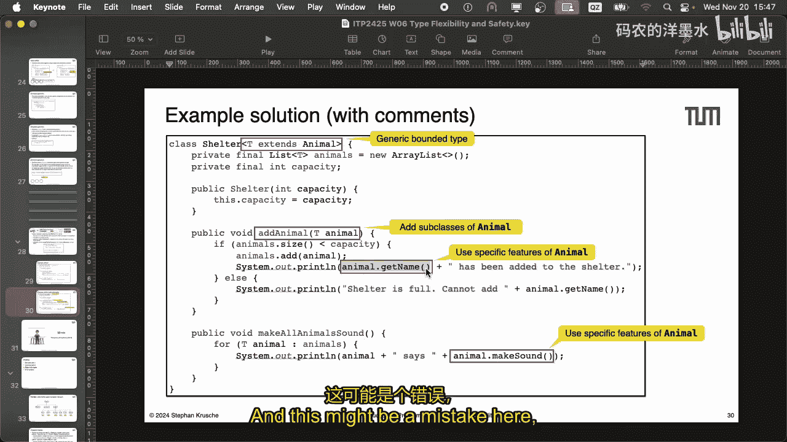
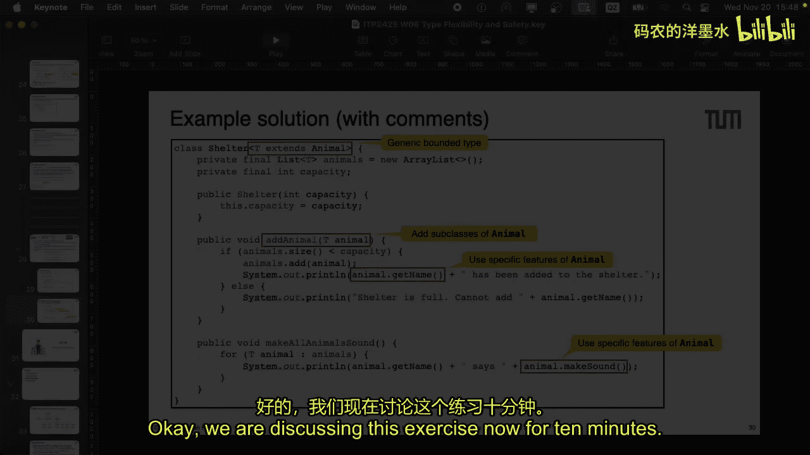
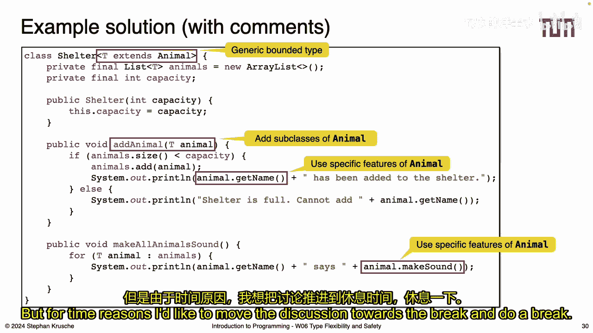

# 慕尼黑工业大学 计算机编程：从入门到实战：28：泛型（第二部分）


在本节课中，我们将继续深入学习泛型。我们将探讨泛型的更多方面，包括类型擦除、有界泛型以及一个更复杂的练习。通过本课，你将能更好地理解泛型，并学会如何在实际项目中应用它们。

## 类型擦除与运行时

上一节我们介绍了泛型的基本概念，本节中我们来看看泛型在Java中是如何实现的。理解这一点对于避免常见错误至关重要。

泛型被引入Java是为了提供更好的类型安全性和灵活性。编译器在编译时会进行更严格的类型检查。然而，泛型的实现实际上在编译时进行了**类型擦除**。这意味着在运行时，类型信息不再可用。

所有类型参数在编译时都会被替换：
*   如果定义了上界，则替换为该上界。
*   如果类型参数是无界的，则替换为最通用的超类 `Object`。

为了保持类型安全并防止编译问题，有时会进行必要的类型转换。在某些涉及多态性的特定情况下，编译器甚至会生成一些**桥接方法**以确保一切正常工作。

对于初学者来说，需要知道的关键点是：**类型仅在编译时存在，在运行时不存在**。因此，你不能进行 `instanceof` 检查，也不能将 `List<String>` 转换为 `List<Object>`，反之亦然。

以下是一个类型擦除的示例：
```java
// 编译前（源代码）
public <T> List<T> merge(List<T> list1, List<T> list2) { ... }

// 编译后（概念上的表示，类型T被擦除）
public List<Object> merge(List<Object> list1, List<Object> list2) { ... }
```

## 泛型方法

泛型不仅限于类。你可以定义独立的泛型方法，而无需让整个类都成为泛型类。

以下是一个泛型方法的示例：
```java
public class Tutor {
    public static <T, U, V> void printEmailParts(T localPart, U domain, V extension) {
        System.out.println(localPart + "@" + domain + "." + extension);
    }
}
```
在这个例子中，我们有一个 `Tutor` 类，它包含一个静态的泛型方法 `printEmailParts`。我们可能希望这些部分能适用于不同的类型（例如，本地部分可能是字符串，域名可能是整数），因此我们将其定义为泛型方法。

定义泛型方法时，你总是在方法返回类型之前、修饰符（如 `public static`）之后声明类型参数。然后，你就可以在方法参数或方法实现中使用这些类型参数。

**请注意**：泛型方法不一定非要位于泛型类中。但是，如果类中有泛型属性，那么该类本身必须是泛型类。

## 泛型的优势

我们已经简要讨论了泛型的优势，以下是更详细的总结：

*   **代码重用性**：泛型允许我们编写可重用于多种数据类型的代码，避免了代码重复及其带来的维护问题和潜在错误。
*   **通用算法实现**：Java的排序算法就是一个很好的例子。它可以用于任何实现了 `Comparable` 接口的数据类型，这得益于接口和泛型的结合。
*   **更强的编译时检查**：使用泛型可以避免因向下转型而导致的 `ClassCastException`，也无需进行繁琐的 `instanceof` 检查。
*   **提高代码安全性**：如果向一个 `List<String>` 错误地添加一个 `Integer`，编译器会立即报错，而不是在程序运行时才崩溃。

以下是一个展示类型安全性的对比示例：
```java
// 不使用泛型（不安全）
List list = new ArrayList();
list.add("Hello");
list.add(10); // 编译器不会报错
String s = (String) list.get(1); // 运行时抛出 ClassCastException

// 使用泛型（安全）
List<String> list = new ArrayList<>();
list.add("Hello");
list.add(10); // 编译错误！无法添加整数
```

## 有界泛型

有时，我们希望限制可以传递给类型参数的类型种类。这可以通过**有界泛型**来实现。

例如，在我们之前提到的 `Point` 类中，我们可能不希望传入 `String` 类型。我们只希望使用数字类型。我们可以这样声明：
```java
public class Point<T extends Number> { ... }
```
现在，`T` 只能是 `Number` 类或其子类（如 `Integer`, `Double` 等）。

有界泛型也常用于确保类型参数具有某些方法。以下是一个 `ExecutableList` 的例子：
```java
public class ExecutableList<E extends Executable> {
    private E element;
    private ExecutableList<E> next;

    public void executeAll() {
        element.execute(); // 安全，因为E上界是Executable
        if (next != null) {
            next.executeAll();
        }
    }
}
```
这里，我们通过 `E extends Executable` 确保列表中的元素都有 `execute()` 方法。

## Comparable 接口与泛型

`Comparable` 接口是一个参数化的泛型接口，它允许实现它的对象之间进行比较，这对于排序等功能非常有用。

以下是如何让一个 `Rectangle` 类实现 `Comparable` 接口的示例：
```java
public class Rectangle implements Comparable<Rectangle> {
    private double area;

    @Override
    public int compareTo(Rectangle other) {
        if (this.area > other.area) {
            return 1;
        } else if (this.area == other.area) {
            return 0;
        } else {
            return -1;
        }
    }
}
```
实现 `compareTo` 方法后，你就可以使用 `Collections.sort(rectangleList)` 来对 `Rectangle` 列表进行排序了。

## 练习：通用动物收容所

现在，让我们通过一个练习来巩固所学知识。这个练习要求你创建一个通用的动物收容所。

**任务概述**：
创建一个泛型类 `Shelter<T>`，其中类型参数 `T` 的上界是 `Animal`（一个抽象类）。收容所有容量限制。你需要实现两个方法：
1.  `addAnimal(T animal)`：在容量未满时添加动物。
2.  `makeAllAnimalsSound()`：调用收容所内每个动物的 `makeSound()` 方法。

已提供 `Animal`、`Dog` 和 `Cat` 类。你的收容所应该能处理任何 `Animal` 的子类，但不能处理其他类型（如 `String`）。

**示例解决方案要点**：
```java
public class Shelter<T extends Animal> {
    private final List<T> animals;
    private final int capacity;

    public Shelter(int capacity) {
        this.animals = new ArrayList<>();
        this.capacity = capacity;
    }

    public void addAnimal(T animal) {
        if (animals.size() < capacity) {
            animals.add(animal);
            System.out.println("Added: " + animal.getName());
        } else {
            System.out.println("Shelter is full. Cannot add " + animal.getName());
        }
    }

    public void makeAllAnimalsSound() {
        for (T animal : animals) {
            System.out.println(animal.getName() + " says: " + animal.makeSound());
        }
    }
}
```
**关键点**：
*   使用 `<T extends Animal>` 来限制类型。
*   内部使用 `List<T>` 来存储动物。
*   在 `addAnimal` 和 `makeAllAnimalsSound` 中都可以安全地调用 `Animal` 类的方法（如 `getName()`, `makeSound()`），因为 `T` 一定是 `Animal` 的子类。

## 总结








本节课中我们一起深入学习了泛型的第二部分。我们探讨了**类型擦除**的原理，了解了泛型仅在编译时有效。我们学习了如何定义**泛型方法**，以及使用**有界泛型**（`<T extends UpperBound>`）来限制类型参数，确保其具有所需的方法或属于特定的类层次结构。我们还看到了 `Comparable<T>` 接口如何利用泛型来实现通用排序。最后，通过“通用动物收容所”的练习，我们实践了如何设计和使用一个有界泛型类来解决实际问题。掌握这些概念将帮助你编写出更安全、更灵活、更可重用的代码。