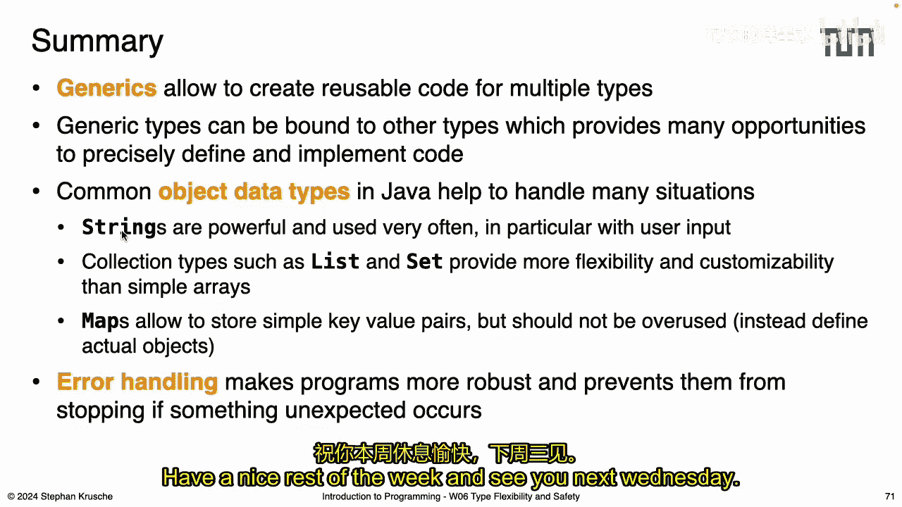

# 【全集】慕尼黑工业大学 计算机编程：从入门到实战 中英字幕 p30 Lecture 30 - 错误处理 -BV1WFrTBZExY_p30-

In our last unit we would like to talk about error handling。

 you've already seen quite a few exceptions probably in your own code but also in the slides that we referred to。

 and we always said you will learn more about this later and this is the time to learn more about error handling now so this is the later that we always said and that we promise to you。

It's important to understand that there are different kind of errors in programming。

 and one is the so-called runtime error。 The runtime error is an an exceptional that happens during the program execution and leads to the program being terminated。

And， of course， this is not good because if your end users would like to use the software that you develop and they can't do that because the software。

Termininateates， because of an exceptional。They might have paid for it。

They might need it very critically。 Yeah， this is a bad situation。And therefore， you need to be able。

 first of all， to write code that does not lead to errorss in the first place。

 But this is very difficult in computer science， we。

Kind of understood that reaching this goal that a software as error free is unfortunately not possible。

 Software is way too complex。 It changes way too often that we can guarantee this。 And therefore。

 we have basically come up with different ways how to handle errors。

 So if we cannot make the software completely error free。

 we can at least provide some kind of error handling。 And with that， we hopefully can， at least。

Solve the most important issues。And in Javaba， we do that with the class throwable。

 Thrable basically captures all kind of runtime errors and everything that is throwable like an exception can then be caught by your program code。

 So within your program code， you can actually catch exceptions。

 So in case someone has an Alpointer exception in some other code。

 you can catch that and try to repair from this state。

Or if you assume a string that represents an integer， but your end user types in something else。

 and there is a number format exception， you can catch that and prevent that the program terminates。

And with that， you can do error handling。So error objects。

 errors are also objects in shama and follow the class structure and can have an inheritance hierarchy。

And all those errors can be caught and handled appropriately。In fact。

 there are three main categories of exceptional conditions。We have so called checked exceptions。

 Those are the ones where you are required to handle them。 You cannot ignore them。

 You have to do error handling。Then there are the so called unchecked exceptions。

 some people also call them runtime exceptions。For example， another point to exception。

Aray index out of bounds， exceptional。And those are the ones where you are not required to handle them。

 but where it sometimes makes sense to actively handle them。 So it's your choice。

 You can ignore them。Or you can provide code in order to handle them。And last but not least。

 number three， we have errors， errors represent serious and sometimes irrecoverable conditions。

 like if you have incompatbilities between different libraries。

 if you have memory leaks out of memory exceptions if you have an infinite loop or infinite recurs。

 those cannot be handled appropriately， and then your your program terms and you can't really do something against it。

 then you simply need to restart a program investigate widely actual error occurs and try to prevent the error in the future。

There's lots of literature about that， for example on Belung。

 you can find out a lot more about Cha exceptions， I'll try to summarize the most important aspects now。

The good thing is that with this explicit separation of normal program flow flow。

 that should be efficient， clear， easy to understand。 and error handling。

 we can divide those two aspects quite well。 And we do that by。😊，Focusing on this。

Inheritance hierarchy that we have here and throwable is the super class of all different kind of exceptions or errors。

 And for exceptions， we can have checked and unchecked ones。

And this always depends on a specific type。 A runtime exception is unchecked。

 All other exceptions are checked and you need to handle them。 And for runtime exceptions。

 we have this index out of bound， null pointer and number format exception that we already have seen。

 So those are the ones that you don't need to check。 but you can do it。

 All the other ones the checked ones， all other subclasss of exception you need to handle。

Troable is the superclass of everything and allows us to define multiple subclasses。

 The two direct subclasses are error and exceptional， as defined before。

And here is an example where you can use that as part of a method definition。

 So if you define a method that reads a file based on a given file name。

 this could lead to an IO exception input output exception。 and a IO exception could， for example。

 happen if the file does not exist。Or if another process is right into the file while you are reading it。

 and this would lead to corrupt data。So read file can throw an I O exception。

 and I O exception is a checked exception。 So if someone else invokes read file at this particular code。

 you need to either handle the exception with a socal try catch block。 we will see that。

Or you need to rethrow it。And pass it on to the end of the chain。

But someone at some point needs to handle it， except you don't handle it at all。

 And even your main function throws this exception later on。

Good thing is the compiler helps you with all this and notifies you if you have a case where the exception is not。

En。Now， runtime exception does not need to be handled。 You can do it， but you don't have to。

 So there are different types of error handling。 You can just ignore it and assume that such errors don't appear。

 And if you're a good programmer， this might work out。 If you're not yet a good programmer。

 you might come up with now point exceptions。 error index out of bound exception。

And then it might be the case to catch them。And treat them where they occur。

Sometimes this is possible。 Yeah， So if you have have an null point exception and something is now。

 you can think about a plan B。 How do I handle this case if this object is now。

And you could also catch them， but treat them somewhere else and pass the error。

I higher in the method chain。What happens if we do no error handling？ Well。

 no error handling means the program terms。We have an example here， a class called zero。

Where we have to integer， two primitive integer values， and we divide by 0。If we do that with int。

 then we get a arithmetic exception。This is the type of error that we have。

 and every exceptional typically also returns an error message。

We will see that when we throw exceptions， we typically define a message， a string。

 And here the string is division by 0。Very short message， very efficient message。

 maybe not uneas to understandable by everyone。 And the good thing is Chava always tells us at which place this exceptional occurs。

 And if this happens to during the development phase。

 we can simply click on it and jump to that place and easily fix it and that's quite convenient。

 Yeah， that's quite a service of the programming language that if such an exceptional curse。

 it basically captures the so-called stack trace， this is a very simple stack trace here。

 and allows you to click on it and to understand better why this can occur。 And of course。

 you can also debug all this。😊，We will see that， in a moment。

When you have such an exception statement， it typically tells you which in which threat this occurs For now。

 we only have one thread， we don't know about concurrent programming， but in more complex programs。

 you have multiple threads。 and then it's also good to understand in which threat this occurs。

 You have the name of the error type of the class type and the message and we have the stack trace and even the line number where the actual error occurs so we can directly jump into it。

Here's an example for error handling。 If you don't want the program to terminate。

 you must catch the error and handle it。So let's assume we don't define x and y on our own because that's too easy。

But we let the end user define those。Then， we could。Handle this。

 and you've used this code already before in our input reader class。 Yeah。

 that's basically copied from the input reader class。How does that work now？We。We use the scanner。

We can。Invoke the parse int method。Based on the input of the scanner。

And the parse int method throws the number format exception as we've seen before in slides。Now。

 we don't know what kind of input the user types in。 if the user types in an a letter A as an input。

 the exception will be thrown。If the user types in5 as a number。The exception will not be strong。

 We don't know that yet。So we need to provide  error handling if the user inserts invalid data。

Of course， it would be much nicer if the user is not able to input invalid data。

 but sometimes this is out of our control。Now let's assume the user can input invalid data。

 the exception occurs， and then with the try catch mechanism or try catch block。

 we can catch the exception， we literally catch it。Hand it。And the program can continues。

And what do we do here？Everything that is in a trip block。

Which would lead to an exception can be cacheed in a catch block。

If the exceptional is of the specific type or of any subclass。

So we have some kind of pattern matching here。And if this number format exception occurs。

The code immediately ched over every other statement in the tri block。

Immediately jumps into the catch block， and。The code in the catch block is executed。

And what do we do here， Well， we tell the user of the output， wrong input。

 we would like to have a number， not a string or anything else， right。

And based on the wild true loop， we can do this now as often as the user actually provides a valid number。

So please copy and paste this code into your playground and try it out。

 and then you will see how it works。 Any questions regarding this。

So some additional annotations for you to better understand that。 We have try catch。

 If there are any errors in the try block， we immediately jump into the catch block。 In this case。

 if the number is not syntactically correct。We jump in there and we can try this out yeah。

 this is example output we say first number and then we type in an E and then it says wrong input then first number one it works。

 second number we wrong input， second number two it works and then finally we go up into our main method again and we can sum up both valuess。

So this is a first example for a try catch block where you try out some code that might lead to an exceptional。

And then you catch this particular exception， you handle it。And then you continue the code。

After the tri catch clock， and we have a while loop here。 So and even a while true loop。

 So we would actually continuously try this out until it succeeds。 and until we can return。😊。

A validale inte。So exception handler always consists of a try block。

That is followed by one or more so calledled catch rules。

 So every catch entry you can have mild with ones is a rule。 And the rule is， if the exception is。

 of instance， of this catch block， we jump into it。If not， we go to the next one。

 We go to the next one。 We go to the next one。 if we don't reach one。Then the program will terminate。

 or anotherarrow handling might be invoked。So the handler sequentially searches through all the different。

 different catch ruless until the throne error object is。Mched。

Based on the class itself or any subclass。So this is， again， something like instance off。

 If the error is instance off， then do it else。 If the error is instance of the next catch block。

 then do it。 That's the intention behind it。And each catch rule has this form catch。

 Then we have an exception type。With the name， you can just name it E， you can name it error。

 Some people name it E， X， whatever you prefer and。

This block is only invoked based on the curly braces。

 if and only if this exception or a subclass occurs。If there's no catchule that is applicable。

 the error is propagated。And potentially terminates the program。

Let's see how this works with a small visualization。 In programming。

 we have something that is called a call stack。And the call stack occurs by entering。The main method。

 the main method is always at the bottom of your call stack。

 And if the main method calls another method， this gets put on top of the call stack。

Because the idea behind method calls is I jump into a method。If the method finishes， I jump back。And。

 of course， I can concatenate this， and I jump from method A to B to C to D to E。

 and then I jump back， and then to F， and then I jump back and then to C。 and then I jump back。 Now。

 This is what we can visualize here with the method called stick。Now。

 some of those methods in our call stack might。Use， try， catch， arrow handling。

 Some others might not。Right。This depends on the implementation， whether we use it or not。

 So let's assume we have a try catch block in the first one。

 Then we have some code and another tri catch block。 and then we have method C。

 which again invokes method C。 Yeah So it's a recursive function call。 And then finally。

 we call method F。Yeah， that's the state of our program at the moment。 So let's us assume in F。

 an exceptional course， null point number format whatsoever， some kind of exceptional course。

 Then the call stack will be。Immediately shortened until the next catch block。

So everything in between see that is not executed anymore。

And this is important to understand that there can be 100 entries in between。 They are all ched over。

 and we ch back to the first place where we have a tri catchch block。Then the runtime will check。

 does the catch rule。Is it applicable， Does it apply to this particular exception， If yes。

 we'll do something here。 If not， we go to the next try catch block。

We propagate the arrow back the chain。And try to match a rule over there。If it still doesn't match。

 the program will terminate。 No one is handling this error so we can't do anything。 We have to quit。

If the error is caught， then we can execute more code and potentially recover。

 notify the end user about wrong input or whatever kind of error handling we would like to apply。

Does that make sense。That's an really important principle of。Programming， yeah， if an error occurs。

 you go back until the first error handling。 If it doesn't work， you go back。

 and potentially the program quits。Question。Okay， so the question is。

 what is exactly happening in the caustic。 So let's assume F has this。Division by0 exception。

And if F has a tri catchch block， you stay in F。Nothing happens。 Yeah。

 you jump over the other code next to the exceptioner。 You go into the catch block。

 and then you continue working。 But here， F does does not have a try catch block。

 so it doesn't handle the exception。And this is why we jump over。That's the answer。Great， now。

 sometimes you don't want to jump over all the catch blocks or you would do some kind of cleanup in the end。

And this is where the finally keyword comes in。 So we finally you can make sure that a certain code is invoked even。

 no matter if there is an exception or not。So with that。

 we have some kind of guarantee that cleanup is done， like， for example。

 closing input output streams or doing anything else。And。

The statements in this final block are then executed in any case， if no errors is thrown。

 theyre executed。After the end of the tri block， if an error is thrown and it's handled by a catch rule。

 it's executed following the block of the catch rule。And if thearrow is not handled。

 the final block is still executed， and then the arrow is passed on up the chain。O。

Just important to understand That's the theory behind it。

 And then you can practice it and try it out。 Here's an example where we have a null pointer exception。

 So we have a program kill。And this program kills itself。

If you invoke it and the idea here is that so you should never program this。 Yeah， this is bad code。

 but we have say object x equals null， and then we invoke a method on X。 Yeah， and of course。

 the I DE warrants immediately。 but the purpose really here is to kill the program。

And now if we invoke this skill method。We have another pointer exception。So what happens here。

 We go into the main function。We invoke， kill。Kill leads to an exceptional。

We now go into the first catch block。 It's not a class cast exception， So the rule is not matched。

But we go into the finally。So we print out nothing was caught。

And then we have the exception and the exception is passed up the chain or propagated up the chain。

 and the program will terminate。The good thing is with newer Java versions。

 they tell you why an point exception occurred。 This was not available a couple of years ago and developers had a hard time to tell what was actually null。

 now they tell you which variable is null and this is improved the developer experience quite a lot and here you see cannot invoke object hash code because x is null and you see the stack trace or call stack consists of two lines now and both if you do this in Inr underlined and you can click on it and immediately navigate to the place where the exception occurs。

😊，You can define your own exceptions as well。 We have a kilt exception now that extends a normal exception。

And we simply have to provide a constructor when there is a message passed。

 and we simply pass it to the super class Yeah， so the。In this case， they。

Killed exception simply provides us a new type of error that we can deal with。

And now we don't need to fake。The error with the null point exception or with the division by 0。

 we can actually throw an exception on our own。 So whenever we think something is off or something doesn't work out as intended。

 we can throw an exception。So in the kill method， we don't do nu pointer anymore。

 we say throw new kilts and kill the program。And this can now also be。

 we can also try this code here we can try to invoke the kill method。And in the catch method。

 rules here， we have runtime exception。 This is not a runtime exception。

 doesn't extend runtime exception。 It extends to normal exception。

 So the first one will not be matched。 but the second one is the one that we are looking for。

 So it's matched and this will be invoked so it will be print and killed it。

 it will print the object Yeah， the object is simply print out a type and the message and you can also invoke get message on an exception and simply print this message or what you can do。

 you can inspect the message and based on different message types， you can do different handy。Yeah。

 but with that， you see throw is a new keyboard。 You can throw new exceptions。

Youll see you'll see that this is again using object syntax。 Yeah。

 So we create a new object and then we throw it and the runtime will handle it accordingly。

And we have to provide the， or we should provide the specific message what is happening so that the developer who gets the exception。

Can understand what's going on。 The more specific you are here。

 the more easy it is for others to handle this case。Any questions regarding this。Great。

 then continue。You can have any kind of customized errors。 It's typically that you say an X Y set。

 whatever you want exception as a subclass of exception， we have typically two constructors。

 the empty one， that you don't have to implement and you always have to implement one with the message and that's also the one that you should use later on and then you can say throw new X Y set exception ideally with message。

And this is then thrown。 And then the runtime system has to handle it。

 according to the logic that we just discussed。Notice that in the previous example。

 killed is not a subclass of runtime exception， so only the second catchule is matched。

So errors in Cha are objects and can be handled by the program itself。We have to try， catch finally。

Idea or statement that allows us to clearly separate thearrow handling part in the catch。Blocks。

From the normal program execution in the tri blocks。 So it's clearly separated。

 and we don't mix it with each other。 And with the final leap block， we can clean up。Typically。

 the predefined error types are sufficient。 There are lots of different exceptions that you can find in Java。

 but sometimes you need your own custom errors， and then you can create them on their own。

And it's very important to mention that exceptions must not be used to fix programming errors。

 So whenever you have a programming error， and Ill point to exception division by 0。

 that really is your mistake and does not depend on end user input。 You should fix the program code。

You should not just let the exception occur， handle it somewhere else。 And then you're done。 Yeah。

 this is not the idea。 Yeah， we do error handling for a specific purpose to avoid terminating our program。

 but it's not meant to get rid of bad code experiences。 Yeah， so fix the bad code。

 make sure your code works correctly。And only usearrow handling， if you don't know。Dis error。Happens。

 or if you have specific  errors that you even throw in your own code or that a runtime system throws because a file does not exist。

That's the idea here。You also need to be quite careful because Chaba's error mechanism should only be used for error handling。

 It's cheap to install a handler， but catching an exception on the other hand， is expensive。

So your normal program flow should not include exceptions。

It's a bit tempting to use it to break method chains and to communicate back in this call stack。

 But you should not do that。 This is really bad behavior and bad code。Don't obfuscate the。

Program execution with exceptions。 This is really， really not good。

And it can be the case that in your catch block， another exceptional occurs。

Or in your final leap block， another exceptional curse。And you should avoid that Yeah。

 because then you have another f catch block in the catch block。 And， I mean。

 we could do this infinitely。RightThis is not the idea。 So keep it simple。

Catch blocks should be easy。 Finally， blocks should be easy， and ideally。

 they should not lead to any kind of error。And it's typically better to catch specific errors instead of general ones with catch exceptional。

 you can catch any kind of error， accept those out of memory out of memory errors that are impossible to handle。

But on the other hand， sometimes you catch too much and you catch errors that you are not responsible for。

 and someone else up in the method chain wants to handle。 And if you prevent that。

 then you can also make your code bad。With that， are there any questions？Yeah。Yeah。

 so the question is， within the catch block， could you then use instance off。

In order to potentially reuse variables or something like that。 Yes， this is possible， but I would。

Not overdo it。 Yeah， the idea is really that with the catch block， you do the instance of checks。

You could do that if you definitely have a large catch block and you want to reuse code in there。

 it might make sense to do instance off there， but I don't see that quite often。Yeah。

So the question is， whenever there's user input， you probably need to do arrow handling。 And yes。

 I agree。 As I said before， ideally， you avoid invalid input based on the user interface。 Yeah。

 so for example， if an end user should insert a birth date。Don't let them type a string。

 It will definitely be wrong， according to your date format expectation。

Ask them to use a date picker。 Yeah， And with that， you can already avoid many errors。

 That would be my best solution。 If this is not possible for some reasoner。

 then you need to do error handling because users will input wrong data。That you don't。

 that you're not able to handle， and I will do that as close to the user interface as possible。Yeah。

 so as early as possible， because if you basically pass the wrong input to different parts of the program and only handle it there。

 you can't communicate it easily back。 And then you suddenly have a bidirectional connection between your user interface。

 and some kind of logic in the database or something like that。 And that would be quite bad so。

Doarrow hand as early as possible directly next to the user interface logicing。

And avoid passing the input to other places， if possible。So the question is。

 where do we doarrow handling I would。Think about this in the following。

 If you have an input reader to as much asarrow handling within this input reader。

 whether you make it in the in read in method or whether you have a separate function in there。

 doesn't really matter。But don't spread the code into other classes。

 because that is difficult to handle。 Yeah， with this principle that one class is responsible for one thing。

 I would handle all the  errors that can occur directly next to the。Reading part in this case。

That's idea点。Of course， there might be cases where you have specific arrow handlers and where this can become more complex。

 but for easy programs like you right now do it the as locally as possible。

More complex scenarios depends on the frameworks that use。Great， before we finish。

 we have one more little exercise for you to get used to exceptions。 It won't take long。

 We basically do this again in the playground， and we kindly ask you to。😊，Use。

Or to write a program for validating the access for adults in order if they want to buy some alcohol。

 for example， or do some stuff that children are not allowed to do like for example。

 going to the lecture。And we。Basically have a little template here for you that you can copy。

 It's called public class H。And this age has a， this age class has a method， check age。And。

We would like you to reuse the illegal access exception。 So if the age is below 18， you throw it。If。

The person is already an adult， you don't throw it。

And then we would like you to invoke the check age method and handle the exception appropriately。

And if that is too easy for you， we have an optional challenge。

 then you can create your own exception class。We call it the below 18 exceptional and use it instead of the illegal access exception。

So open your playground again， copy and paste the code into Intelliche。Let me do that now here we go。

And we can also， as it's becoming a bit late， we can also quickly do this together。 Yeah。

 so copy and paste H into your playground。And then。Use it。 And what we do here is we say， if。

H is smaller than 18。And then we would basically say throw new。And you see it， this is amazing。 Yeah。

 Thr you。 And now I get all the different exceptions that are typically used。😊。

And we use the illegal access exception， right， because a child wants to get。

Illegal access to something， alcohol， smoking。Going to elections whatsoever， driving a car， maybe。

 And then we can pass an argument here。Like， I don't know you are too young。

I don't think we specify a message here， yeah。Come again， if you are 18。

And now you see that the code does not compile。 And why is this the case， Well， illegal access。

Is a checked exception。Yeah。And。Illegal access。Basically， needs to be handled。And right now。

 our method does not handle it。So what we can we do， We have two choices now。

 We can either embed this。In a tri catchch block。IntelHH is helping with that。

 But this doesn't really make sense。 Yeah， that's not what we want to do。

What is more more appropriate here is that we add the exception to the method signature。

We need to tell Chava that this method potentially throws something。And is not handling it。

And now we can actually invoke it。 So now we can create our main function。

And invoke check age with the age of 17。And now again it's a checked exception， so Chaba tells you。

 hey， unhanded exception， this is not okay， I won't let you go through it through the compilation process。

And then again， you have two choices。The easy one is， hey， I don't care。Main also throws it。But then。

 of course， if we run this program now。It will crash， right， And this is， of course。

 not what we want， right？ So that's not a good idea。 In this case。

 you actually need to go to more actions and say， surround with try catch and see， this is amazing。

 I don't even need to know how， how it works exactly。 Yeah。

 the integrated development environment does all the job for me， yeah。😊。

But it's good to know that you have this strip block here。 and then the catch block。

 and then we can handle it。 Yeah， and this， this is the default solution。

 It throws and you runtime exception。 Maybe we can just。😊，Print out the。Message， yeah。

 that's the easy part。 So we say system or print like E get message。 And now。

 if we invoke the code again。Yeah， it says you are too young， come again if you are 80。

And this is how it works， right？ So we can also invoke this now with， I don't know。

20 and provide an else block。Yeah， something like system or print line。You are old enough。And Choi。

And then if we invoke this， we will see。That once the check age leads to the exceptional。And it says。

 you are too young， come again if you are 18。And in the second case。For some reason， this is not。

Printed。Yeah， sorry， of course， it's not printed because。

It jumps over it and it goes to the catch block， so we have to do that afterwards again in another try catch block yeah。

So， here we go。And now if we run the program again。We'll see you are old enough and joy。

 And that's basically the idea。 So we have our method that throws an exception because something happened that should not occur。

And then we try。Out if the code works。Catch an arrow。 if it does not work。And。Then， we can continue。

Now， with the optional challenge， if you don't want to use the illegal access exception because it's actually meant to do something else。

 we can also create our own exception。So let me do that quickly。

 I create a new Java class below 18 exception。And this below 18 exception。You see， I can。

 I need to extend exception。And I I could literally leave it empty。

 but it's typically quite nice to have it with a message。And simply call super with the message。

And now I can go back to my main program。 I now have my exception。 You see Intenche also displayed。

 it displays this differently。And now in my age class I can say I don't throw an illegal exception。

 I throw a below 80 exception and then of course I now need to check change the catch block I can add another one if I want。

Yeah， and this is also something that Intelche shows me at below 18 exception as a second one here either with this。

Concatedation here or。I could also do a。Second， catch block。And handle this appropriately。

And let's leave out a second case for now。 And what does it complain about。Yeah。

 this is just a warning because illegal access is never thrown， it's not really necessary。

 I could put this in here as well and even if it's not thrown here I have now two of them and now of course only the second catch will be matched and the first one will be omitted and you can also debug this we can basically set breakpoint in here and see what's going on so if we debu the application we see that we jump into this dry block。

And we see we have just have one method in our call stack。Now， if we jump over， we have a second one。

 main is at the bottom。 Check H is at the top。We directly jump into the throw block。

And then we jump into this catch block， and we are。Returning。

 even though there is no return statement。 So a throw statement also finishes the method。

But it basically propagates this spec until someone handles the error。Great。

 so much about this little interactive exercise。😊，We have some example solutions on the slides as well。

YeahSo you can see the code here with a few annotations。

And the example solution with the below 18 exceptional。

And then this is it for the unit about exception handling。

 Now the next steps are that we again have two tudtor group exercises。

 Chef Salelzo's generic empire and sealed security。

We have two homework exercises seal the deal shipping in New Zealand with an。S here， not buffer C。

And the seal boot class。We also have。It's funny。 When I come to that slide， people are。

Immediately starting to talk very loudly， and I can't finish it。We can play this game every week。

It's not so much fun， actually。We have two articles。

 Geeks for Geeks about Genes and Chava and Chava TPo tells you more about exceptionalal。

 we highly recommend to read more about this to try out the example in the slides and debug them to better understand how it goes all this is to you until next Wednesday 1 pm。

Quick summary， we learned more about generics that allow us to provide safe and reusable code for multiple types。

 They can be bound to other types based on this extent superclass mechanism and that allows us to really provide very concise code and solves many problems in a reusable and independent way。

 We talked about the common object data types and discovered string as a very powerful and often used type in particular when it comes to user input handling。

 we talked again about list and set as the collection types that we use most often。

 but also covered a new collection type， the map that allows us to store key value pair and that is very。

 very powerful but it also should not be overused So don't come up with a lot of maps in your data types properly used classes and only use。

Maps， if it actually makes sense。 And we also talked about error handling。

 where you can make your program more robust and prevent it from stopping in case something unexpected occurs。

 That's it for today。 Have a nice rest of the weekend。 See you next Wednesday。

