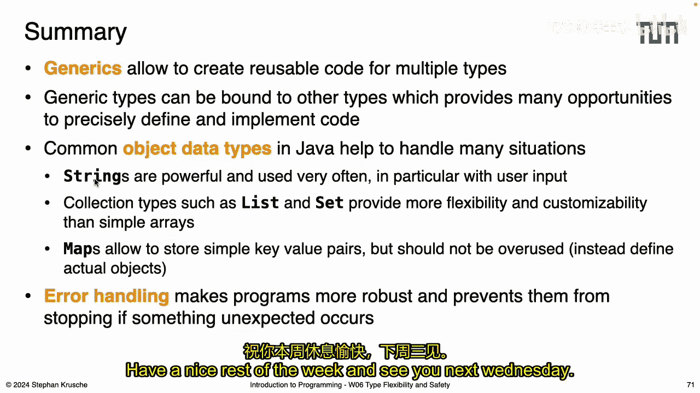

# 慕尼黑工业大学 计算机编程：从入门到实战：30：错误处理 🛡️


在本节课中，我们将要学习编程中一个至关重要的主题：错误处理。我们将了解不同类型的错误，学习如何使用Java的异常处理机制来捕获和处理它们，从而使我们的程序更加健壮和稳定。

## 概述

在之前的课程中，我们已经多次遇到过异常。现在，是时候深入学习错误处理了。理解错误处理对于编写可靠的软件至关重要，因为它能防止程序因意外情况而崩溃，并为用户提供更好的体验。

## 错误类型

在编程中，存在不同类型的错误。其中一种是所谓的运行时错误。运行时错误是在程序执行期间发生的异常，会导致程序终止。

当然，这并不理想。如果最终用户想要使用你开发的软件，却因为异常导致软件终止而无法使用，这可能会是一个严重的问题。因此，我们需要能够处理这些错误。

首先，我们应尽量编写不会导致错误的代码。但在计算机科学中，我们认识到要使软件完全无错误几乎是不可能的。软件过于复杂，变化过于频繁，我们无法保证这一点。

因此，我们提出了不同的错误处理方法。既然无法使软件完全无错误，我们至少可以提供某种错误处理机制。通过这种方式，我们希望能解决最重要的问题。

在Java中，我们使用 `Throwable` 类来实现这一点。`Throwable` 基本上捕获了所有类型的运行时错误，任何可以像异常一样被抛出的东西都可以被你的程序代码捕获。

在你的程序代码中，你可以捕获异常。例如，如果某些代码中出现了空指针异常，你可以捕获它并尝试从该状态中恢复。或者，如果你期望一个表示整数的字符串，但最终用户输入了其他内容，导致数字格式异常，你也可以捕获它并防止程序终止。

错误对象在Java中也是对象，遵循类结构，并可以形成继承层次结构。所有这些错误都可以被捕获并适当处理。

实际上，异常条件主要有三类：
1.  **受检异常**：这些异常要求你必须处理它们，不能忽略。
2.  **非受检异常**：有些人也称之为运行时异常，例如空指针异常、数组索引越界异常。对于这些异常，你不被要求处理，但有时主动处理它们是有意义的。这是你的选择，你可以忽略它们，也可以提供代码来处理它们。
3.  **错误**：错误代表严重且有时无法恢复的情况，例如不同库之间的不兼容性、内存泄漏、内存不足异常、无限循环或无限递归。这些通常无法被适当处理，程序会终止，你对此无能为力，只能重启程序，调查错误发生的原因，并尝试在未来预防它。

## 异常处理机制

通过明确分离正常的程序流程和错误处理，我们可以很好地区分这两个方面。正常的程序流程应该高效、清晰、易于理解。

我们通过关注这里的继承层次结构来实现这一点。`Throwable` 是所有不同类型异常或错误的超类。对于异常，我们有受检和非受检两种。这总是取决于特定的类型。运行时异常是非受检的，所有其他异常都是受检的，你需要处理它们。

`Throwable` 是所有异常和错误的超类，它允许我们定义多个子类。两个直接子类是 `Error` 和 `Exception`。

以下是一个在方法定义中使用异常的例子：

```java
public void readFile(String fileName) throws IOException {
    // ... 读取文件的代码
}
```

如果一个方法基于给定的文件名读取文件，这可能会导致 `IOException`。`IOException` 是一个受检异常。因此，如果有人调用这个 `readFile` 方法，你需要使用 `try-catch` 块来处理异常，或者重新抛出它。但最终，链上的某个点必须处理它，除非你完全不处理。即使你的 `main` 函数稍后抛出这个异常，编译器也会帮助你，并在异常未被处理时通知你。

运行时异常则不需要被处理。你可以处理，但不必这样做。

## 未处理错误的情况

如果我们不做任何错误处理会发生什么？没有错误处理意味着程序会终止。

这里有一个例子，一个名为 `Zero` 的类，其中有两个基本整数值，我们进行除以0的操作：

```java
public class Zero {
    public static void main(String[] args) {
        int x = 5;
        int y = 0;
        int result = x / y; // 这里会抛出 ArithmeticException
    }
}
```

如果我们用 `int` 类型这样做，我们会得到一个 `ArithmeticException`。这是我们会遇到的错误类型，每个异常通常也会返回一个错误消息。当我们抛出异常时，我们通常会定义一个消息字符串。这里字符串是“除以0”。Java总是告诉我们这个异常发生在哪个位置。如果在开发阶段发生这种情况，我们可以简单地点击它，跳转到那个位置，轻松修复它，这非常方便。

当你有这样的异常语句时，它通常会告诉你这个异常发生在哪个线程中。目前，我们只有一个线程，但在更复杂的程序中，你会有多个线程。了解异常发生在哪个线程中也很有用。你有错误类型的类名、消息、堆栈跟踪，甚至实际错误发生的行号，这样我们就可以直接跳转到那里。

## 错误处理示例

如果你不希望程序终止，你必须捕获错误并处理它。

假设我们不自己定义 `x` 和 `y`，而是让最终用户定义它们。那么，我们可以这样处理：

```java
import java.util.Scanner;

public class InputExample {
    public static void main(String[] args) {
        Scanner scanner = new Scanner(System.in);
        int number;

        while (true) {
            System.out.print("请输入一个数字: ");
            String input = scanner.nextLine();
            try {
                number = Integer.parseInt(input);
                break; // 如果成功，跳出循环
            } catch (NumberFormatException e) {
                System.out.println("输入错误，请输入一个有效的整数。");
            }
        }
        System.out.println("你输入的数字是: " + number);
        scanner.close();
    }
}
```

我们使用 `Scanner`。我们可以基于 `Scanner` 的输入调用 `parseInt` 方法。`parseInt` 方法会抛出我们之前在幻灯片中看到的 `NumberFormatException`。我们不知道用户会输入什么。如果用户输入字母“A”，异常就会被抛出。如果用户输入数字“5”，则不会抛出异常。我们事先不知道，所以如果用户输入无效数据，我们需要提供错误处理。

当然，如果用户不能输入无效数据会更好，但有时这超出了我们的控制。现在假设用户可以输入无效数据，异常发生，然后通过 `try-catch` 机制或 `try-catch` 块，我们可以捕获异常，程序可以继续运行。

我们在这里做什么？`try` 块中任何会导致异常的代码都可以在 `catch` 块中被捕获。如果异常是特定类型或其任何子类，就会发生匹配。这里我们有一种模式匹配。如果发生 `NumberFormatException`，代码会立即跳过 `try` 块中的其他语句，跳入 `catch` 块，并执行 `catch` 块中的代码。

在这里，我们告诉用户输出“输入错误，我们需要一个数字，而不是字符串或其他内容”。基于 `while (true)` 循环，我们现在可以重复这个过程，直到用户提供一个有效的数字。

请将此代码复制粘贴到你的编程环境中并尝试运行，你会看到它是如何工作的。

## 异常处理器的结构

异常处理器总是由一个 `try` 块组成，后跟一个或多个所谓的 `catch` 规则。每个 `catch` 条目都是一个规则。规则是：如果异常是这个 `catch` 块的实例，我们就跳入其中；如果不是，我们就转到下一个。我们依次检查，如果找不到匹配的，程序将终止，或者可能调用另一个错误处理机制。

处理器按顺序搜索所有不同的 `catch` 规则，直到抛出的错误对象基于其类本身或任何子类被匹配。这又类似于 `instanceof` 检查。如果错误是某个 `catch` 块类型的实例，则执行该块。这就是其背后的意图。

每个 `catch` 规则都有这种形式：`catch`，然后是一个异常类型和一个名称（你可以命名为 `e`、`error`，或者你喜欢的任何名称）。只有当这个异常或其子类发生时，才会调用这个块。如果没有适用的 `catch` 规则，错误将被传播，并可能终止程序。

## 调用栈与异常传播

在编程中，我们有一个叫做调用栈的东西。调用栈是通过进入 `main` 方法形成的，`main` 方法总是在调用栈的底部。如果 `main` 方法调用另一个方法，这个方法就被放在调用栈的顶部。方法调用的理念是：我跳入一个方法，如果方法结束，我就跳回。当然，我可以串联这个操作，从方法A跳到B到C到D到E，然后跳回，再到F，再跳回，再到C，再跳回。

我们调用栈中的某些方法可能会使用 `try-catch` 错误处理，有些则可能不会。这取决于实现，我们是否使用它。

假设我们在第一个方法中有一个 `try-catch` 块，然后有一些代码和另一个 `try-catch` 块，接着是方法C，它再次调用方法C（这是一个递归函数调用），最后我们调用方法F。这是我们程序当前的状态。

现在假设在方法F中发生了一个异常（空指针、数字格式等任何类型的异常）。那么调用栈将立即缩短到下一个 `catch` 块。这很重要：中间的所有代码都不会再执行。调用栈中可能有100个条目，它们都会被跳过，我们跳回到第一个有 `try-catch` 块的地方。然后运行时会检查：`catch` 规则适用吗？它适用于这个特定的异常吗？如果是，我们就在这里做些什么。如果不是，我们就转到下一个 `try-catch` 块。我们将错误传播回链中，并尝试在那里匹配规则。如果仍然不匹配，程序将终止。没有人处理这个错误，所以我们无能为力，必须退出。

如果错误被捕获，那么我们可以执行更多代码，并可能恢复，通知最终用户输入错误或应用我们想要的其他类型的错误处理。

这是一个非常重要的编程原则：如果发生错误，你回退到第一个错误处理程序。如果不行，你再回退，最终程序可能退出。

## finally 关键字

有时，你不想跳过所有的 `catch` 块，或者你想在最后进行某种清理。这就是 `finally` 关键字的用武之地。通过 `finally`，你可以确保某段代码被调用，无论是否发生异常。

因此，我们有了某种保证，清理工作会被完成，例如关闭输入输出流或做其他事情。`finally` 块中的语句在任何情况下都会被执行：如果没有抛出错误，它们在 `try` 块结束后执行；如果抛出错误并被 `catch` 规则处理，它们在 `catch` 块之后执行；如果错误未被处理，`finally` 块仍然会被执行，然后错误被传递到链的上游。

理解这一点背后的理论很重要，然后你可以实践并尝试。

## 自定义异常

你也可以定义自己的异常。我们有一个 `KilledException`，它扩展了普通的 `Exception`。我们只需要提供一个构造函数，当有消息传递时，我们简单地将其传递给超类。

在这个例子中，`KilledException` 只是为我们提供了一种可以处理的新错误类型。现在我们不需要用空指针异常或除以0来伪造错误，我们可以自己抛出一个异常。每当我们认为某些地方不对劲或某些事情没有按预期进行时，我们就可以抛出一个异常。

在 `kill` 方法中，我们不再做空指针操作，而是说 `throw new KilledException("Kill the program")`。这也可以被捕获。我们可以尝试这段代码，尝试调用 `kill` 方法。在 `catch` 规则中，我们有 `RuntimeException`。`KilledException` 不是 `RuntimeException`，它不扩展 `RuntimeException`，它扩展了普通的 `Exception`。所以第一个不会被匹配，但第二个是我们要找的，它会被匹配并调用，打印出“Killed it”。它会打印出对象的类型和消息。你也可以在异常上调用 `getMessage()` 并简单地打印这个消息，或者你可以检查消息并根据不同的消息类型进行不同的处理。

你会看到 `throw` 是一个新的关键字。你可以抛出新的异常。你会看到这再次使用了对象语法。我们创建一个新对象，然后抛出它，运行时会相应地处理它。我们应该提供具体的消息说明发生了什么，这样收到异常的开发者才能理解发生了什么。你在这里提供的信息越具体，其他人处理这种情况就越容易。

你可以有任何类型的自定义错误。通常你会说一个 `XYException` 作为 `Exception` 的子类。我们通常有两个构造函数：一个空的（你不必实现），以及一个带消息的（你应该在以后使用这个）。然后你可以说 `throw new XYException`，最好带上消息。然后它被抛出，运行时系统必须根据我们刚刚讨论的逻辑来处理它。

## 异常处理的最佳实践

Java中的错误是对象，可以由程序本身处理。我们有 `try`、`catch`、`finally` 语句，它允许我们清晰地将 `catch` 块中的错误处理部分与 `try` 块中的正常程序执行部分分开。这样清晰地分离，我们不会将它们混在一起。通过 `finally` 块，我们可以进行清理。

通常，预定义的错误类型就足够了。Java中有许多不同的异常，但有时你需要自己的自定义错误，然后你可以自己创建它们。

非常重要的一点是，异常不应用于修复编程错误。每当你有一个编程错误，比如空指针异常、除以0，这真的是你的错误，不依赖于最终用户的输入。你应该修复程序代码，而不应该只是让异常发生，然后在其他地方处理它。这不是我们的本意。我们进行错误处理是为了特定的目的，以避免程序终止，但它并不意味着要掩盖糟糕的代码体验。所以，修复糟糕的代码，确保你的代码正确工作。只有在不知道错误会发生，或者你在自己的代码中抛出特定的错误，或者运行时系统因为文件不存在而抛出错误时，才使用错误处理。

你还需要非常小心，因为Java的错误机制只应用于错误处理。安装一个处理程序是廉价的，但捕获异常另一方面是昂贵的。所以你的正常程序流程不应包含异常。用它来打破方法链并在调用栈中通信回去是很诱人的，但你不应该这样做。这是非常糟糕的行为和糟糕的代码。不要用异常来混淆程序执行。这真的非常不好。

在你的 `catch` 块中，可能会发生另一个异常。或者在你的 `finally` 块中，可能会发生另一个异常。你应该避免这种情况，因为那样你会在 `catch` 块中又有另一个 `try-catch` 块。我们可以无限地这样做下去。这不是我们的本意。所以保持简单。`catch` 块应该简单。`finally` 块应该简单，理想情况下，它们不应导致任何类型的错误。

通常，捕获特定的错误比捕获一般的错误（如 `catch (Exception e)`）更好。使用 `catch (Exception e)` 可以捕获任何类型的错误（除了那些无法处理的内存不足错误）。但另一方面，有时你捕获得太多，捕获了你不负责处理的错误，而链上游的其他人想要处理。如果你阻止了这一点，你也可能使你的代码变糟。

## 练习：年龄验证

在我们结束之前，我们还有一个小的练习让你熟悉异常。这不会花很长时间。我们再次在编程环境中进行，我们请你编写一个程序来验证成年人访问权限，例如他们想买一些酒精，或者做一些儿童不允许做的事情，比如去听讲座。

我们这里有一个小模板供你复制。它叫做 `public class Age`。这个 `Age` 类有一个方法 `checkAge`。我们希望您重用 `IllegalAccessException`。如果年龄低于18岁，你就抛出它。如果这个人已经是成年人，你就不抛出它。

然后我们希望您调用 `checkAge` 方法并适当地处理异常。如果这对您来说太简单，我们有一个可选的挑战：您可以创建自己的异常类。我们称之为 `Below18Exception` 并使用它来代替 `IllegalAccessException`。

打开您的编程环境，将代码复制粘贴到 IntelliJ 中。让我们现在一起快速完成这个。

复制粘贴 `Age` 类到您的编程环境中。然后使用它。我们在这里做的是：如果年龄小于18，我们基本上说 `throw new`。您会看到，这太棒了。`throw` 您。现在我得到了所有通常使用的不同异常。我们使用 `IllegalAccessException`，因为孩子试图非法访问某些东西，如酒精、吸烟、参加选举、开车等。然后我们可以在这里传递一个参数，比如“你太年轻了，等你18岁再来”。

现在您看到代码无法编译。为什么？因为 `IllegalAccessException` 是一个受检异常。它需要被处理。现在我们的方法没有处理它。我们可以做什么？我们有两个选择：要么将其嵌入一个 `try-catch` 块中，但这并不合理。更合适的是将异常添加到方法签名中。我们需要告诉Java这个方法可能抛出某些东西，并且没有处理它。

现在我们可以实际调用它了。我们可以创建我们的 `main` 函数，并用年龄17调用 `checkAge`。现在它又是一个受检异常，所以Java告诉你：“嘿，未处理的异常，这不行，我不会让你通过编译过程。” 然后你又有两个选择。简单的一个是：“嘿，我不在乎。” `main` 也抛出它。但当然，如果我们现在运行这个程序，它会崩溃。这当然不是我们想要的。所以这不是一个好主意。在这种情况下，你实际上需要去“更多操作”并说“用 try-catch 包围”，看，这太棒了，我甚至不需要知道它是如何工作的。集成开发环境为我完成了所有工作。

但知道你有这个 `try` 块和 `catch` 块是很好的。然后我们可以处理它。这是默认的解决方案。它抛出并给你运行时异常。也许我们可以打印出消息，这是简单的部分。我们说 `System.out.println(e.getMessage())`。现在，如果我们再次调用代码，它会说“你太年轻了，等你18岁再来”。这就是它的工作原理。

我们也可以用20来调用它，并提供一个 `else` 块。说 `System.out.println("你已经足够大了。")`。然后如果我们调用这个，我们会看到一旦 `checkAge` 导致异常，它就说“你太年轻了，等你18岁再来”。在第二种情况下，由于某种原因，这个没有被打印。当然，它没有被打印，因为它跳过了它，进入了 `catch` 块，所以我们必须在另一个 `try-catch` 块中再次做这个。

所以，我们有了我们的方法，它抛出一个异常，因为发生了不应该发生的事情。然后我们尝试代码是否有效，捕获错误，如果无效，我们可以继续。

对于可选的挑战，如果你不想使用 `IllegalAccessException`，因为它实际上意味着做其他事情，我们也可以创建自己的异常。让我快速完成这个。我创建一个新的Java类 `Below18Exception`。这个 `Below18Exception` 需要扩展 `Exception`。我可以完全留空，但通常带消息会更好。只需用消息调用 `super`。

现在我可以回到我的主程序。我现在有了我的异常。IntelliJ 也以不同的方式显示它。现在在我的 `Age` 类中，我可以说我不抛出非法异常，我抛出一个 `Below18Exception`，然后当然我现在需要更改 `catch` 块。我可以添加另一个，如果我想要的话。这也是 IntelliJ 向我展示的，`Below18Exception` 作为第二个在这里，要么用这种连接方式，要么我可以做第二个 `catch` 块，并适当地处理它。

让我们暂时省略第二种情况。它抱怨什么？这只是一个警告，因为 `IllegalAccessException` 从未被抛出，它并不是真正必要的。我也可以把它放在这里，即使它在这里没有被抛出，我现在有两个，当然只有第二个 `catch` 会被匹配，第一个会被忽略。你也可以调试这个，我们基本上可以在这里设置断点，看看发生了什么。所以如果我们调试应用程序，我们看到我们跳入了这个 `try` 块。我们看到我们的调用栈中只有一个方法。现在，如果我们跳过，我们有第二个，`main` 在底部，`checkAge` 在顶部。我们直接跳入 `throw` 块，然后跳入这个 `catch` 块，然后返回，即使没有 `return` 语句。所以 `throw` 语句也结束了方法，但它基本上传播这个异常，直到有人处理错误。

关于这个小小的互动练习就讲这么多。幻灯片上也有一些示例解决方案。你可以看到带有一些注释的代码，以及带有 `Below18Exception` 的示例解决方案。

## 总结



本节课中我们一起学习了错误处理。我们了解了不同类型的错误（受检异常、非受检异常和错误），并掌握了使用 `try-catch-finally` 块来捕获和处理异常的核心机制。我们学习了异常如何在调用栈中传播，以及如何创建自定义异常来更精确地表示特定的错误情况。最重要的是，我们明白了异常处理应用于处理预期之外的、无法完全避免的错误情况（如用户输入错误、文件不存在等），而不是用于掩盖程序逻辑本身的缺陷。通过合理的错误处理，我们可以使程序更加健壮，为用户提供更好的体验。