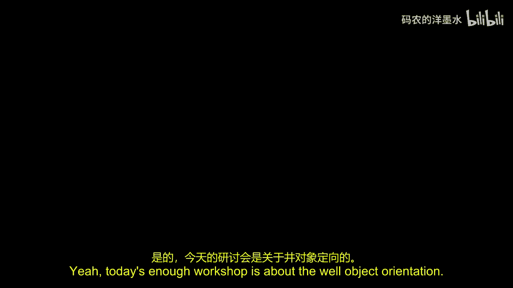
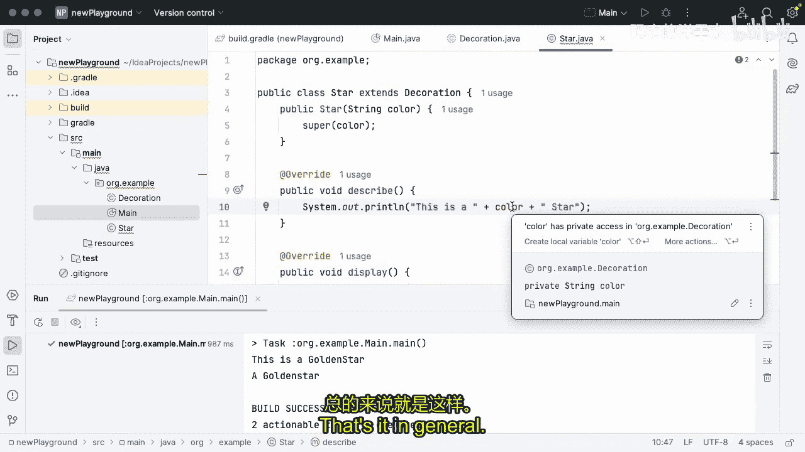

# 【全集】慕尼黑工业大学 计算机编程：从入门到实战 中英字幕 p31 Lecture 31 - 继承part3 -BV1WFrTBZExY_p31-

Yeah， today's Internet workshop is about the well object orientation。 Again。

 we will repeat and practice。

嗯。Essential parts of Java object orientation as a context。

 you should be able to apply the basic concepts of object orientation。

 use controlled structuress like four loops， Y loops， switch statements。Implement basic data types。

 data structures。And also apply incapsulation， inheritance， polymermorphism， stuff like that。

 We will also practice this today again。😊，Yeah， the learning goalss are to apply these concepts that like inheritance。

 elaosis， polymorphism， generics。😊，And you should also understand about the supervised exercise。

 as well as get familiar with the Artimist exam mode。

 and we will do this in the second part of today's workshop。😊，One the second half or other。

So let me start with the recap on inheritance， inheritance is a mechanism where child classes inherit functionality or fields attributes from a parent class or superclass。

😊，The key that we use for this is extends， so the child class extends the superclass in the method definition。

 you can see with the red box on the slide。😊，And this is useful as it promotes code reuse。

 we do not need to define everything twice three times。

 four times if the parent class and the child class use the same parameters or attributes。😊，嗯。

How can we reuse the parameters of our parent class so the access modifiers public and protected for these attributes allow the child class to directly access these parameters these fields if we use private as an access modifier。

 we would have to use well getter methods or。😊，Something like that to access these fears。嗯。Exactly。

 we can then。Provide a basic implementation in a superclass for a method， basic functionality。

 and if child classes need a different implementation。😊，For it。

 they can override the content and you can see it in the right box here where we have the override annotation and then override the speak method that is defined in the parentnic class on the left as well。

 right。Yeah。Are there any questions regarding inheritance at this point？No。Okay。

 so here we have then the main class that calls or creates two objects。

or one object rather of dog which well extends animal and then we let the animal speak and we let the dog speak and in the common you can see the different outputs it would produce and well the animal would well execute the speak method of the parent class so the animal speaks or makes a sound in our case and for the dog dot speak method its body barks right because the。

😊，Daw class overrs the speaking method， and this is the output。嗯。

If there are no questions regarding that， let's dive into the first exercise where you should define an abstract class with a name of decoration。

With a string attribute called color。And a construct to initialize our class and also initialize the color attribute。

We would have an epic method called Describe。And a normal method called display where we output text in the well describe method。

 for example， this is a decoration for the describe method in our case， and the display method。

 while its abstract does not have a specific implementation。

 we will then extend this class with a child class star。😊。

Which then overrs the Ft method or implements it rather。

 and we then have another output for both methods。Are there questions regarding the problem statement？

No， then I would give you around about 10 minutes， yeah， sorry， yeah。

 we do it in the playground right， so we create a new class。To。

Well implemented ourselves and I will create the playground afterwards as well and show you the solution。

😊，Okay， so let me quickly start。I will create a new playground。Okay， playgrounds not empty package。

 So let's call it。New playground。Create， okay， why it's best aren not allowed。😊，So like this。

The name doesn't really matter right now。And。And let us quickly trade center the。

Project is built okay， so we want to create right， according to the problem statement， a new class。

New Java class， and you want to name it。What name in decoration？

And it should have an attribute color of the type string open。We want to also create a constructor。

 so I let it auto generate。To save some time and then we would also like to have the non abstract method describe。

Yeah， here we would like to print something to the console in our case it's this is a。系啊。Decoration。

They个 reason。And then we'd like to have an abstract method。Sorry。Not yet。HaW。But we had in the task。

 okay。And this method is called display according to the task。Ans changeds。Well yeah。

 it doesn't have an implementation because it's abstract， so let's remove these and。Where， of course。

 did classic creation needs to be abstract as well。Okay。

 and now we would like to have a child class in our case， star。New demo class。Star。

And this one also needs a constructor。Okay， we need to， of course。嗯。Extend our。Superclass first。

 so the class decoration， right？And now we would need a constructor。

 so let me auto generate a spa where we could call the superconor with the calla。

And then would also need to override the two methods， so describe and display。

 so let me generate the method bodies。And in thescribe。

 you would like to print something little differently。So let's say， for example。I don't know。

 This is a。Maybe with a color。And then。Star， so this is a whatever colored star。

And the method display。Then says， I don't know。嗯。The star is。Sparkling， something like that。Yeah。

Or let's maybe name it just。Because display， it doesn't really describe anything。

I then the color as well。And then。Star again。And that's it for the implementation of the child class。

 where we override the methods with the。When overri keyboardword and then override them and implement a different functionalityninality。

 let's now open the main class where， okay， we don't need this example code。😊。

Let us quickly create two objects of our own， for example。Decoration。G。Star。And let's， sorry。

 let's do together。It new star。And we need the color， let's name it gold or golden。

And then we could also。Use goldinstar dot describe， as well as goldstar dot。Display。

 and then we can see the different outputs and see that even though there is a well decorated the static type。

 we will have the output according to the runtime type。😊，In our case。

 this is a golden star and a golden Star。 So I seem to have missed the space here， so let's add this。

And that's it for this exercise， are there any questions regarding this exercise？No。Okay， yes， sorry。

Yeah， well， I didn't specify any， so in our case it's packaged private。

 this is the default access modifier。😊，This is why we can use it the star here in the color class if I were to make it private。

Then we would now see in this dark class that we can access this so we would need to use a gett method or something like that。

 but Yasmina will explain about this now in the second part of the exercise， that's it in general。

