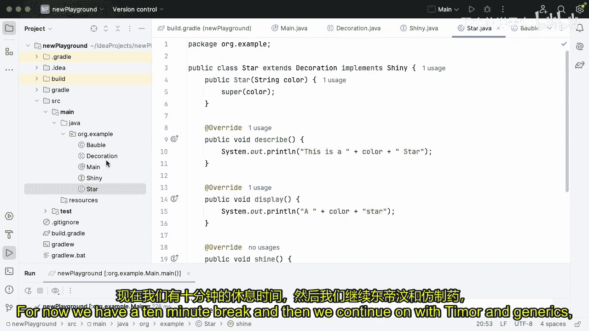

# 【全集】慕尼黑工业大学 计算机编程：从入门到实战 中英字幕 p32 Lecture 32 - 抽象类、接口与多态 -BV1WFrTBZExY_p32-

My name is Esmina and today I will be recapping with you three following topics。

 starting out with abstract。😊，Yes， so。Building on what Jann explained about inheritance we introduced the concept of an abstract class as we have seen last week and the main difference between a normal class and an abstract class is that an abstract class has an abstract method now why do we want to have this is because an abstract class is just like any other method with the difference being that we don't have method implementation directly in the super class as we can see here on example on the left we just say that the abstract method abstract screening sparkle which means basically that we have a method which we define in our super class but we leave out the implementation implementation for later in our child classes this allows us to。

Have different implementation in the subclasses， but each subclassus will share that method through the common superclass。

And how does exactly look like we can see on the right where we have our class Christmas tree。

 which extends the Christmas Day decoration， as Janan said previously that we use the extend keyword in order to declare inheritance。

 and because we have an abstract method called Sparkle in our superclass we need to actually implement it in our child class and here we provide implementation which is just that the tree types sparkles with bright Col lights。

And this helps us because later on， if we want to have multiple different decorations。

 each of them will have their own specific implementations of this method。

 but they will all share this method。Makes sense。Okay， perfect。And yeah。

 the important thing here to remember is that we don't have a method body defined in the superclass。

Now we move on to interfaces and you can think of an interface just as a set of methods that a class must implement should it implement this interface now you might be wondering why do I have an interface when I can just define 10 different abstract methods within my abstract class right the reasoning behind that is is that two classes can have the same behavior but don't necessarily have to be connected via the same super class what do we mean by this is that for example。

I want to have。Something that can illuminate and decorate but isn't necessarily extending extending from the decorative superclass and if we take a look at our example here we see that in our interface we defined these two methods that I previously mentioned and in the class where I actually implement this interfaces where I will provide the concrete implementation an important thing here is that whereas you can inherit only from one superclass。

 you can implement multiple interfaces， so for example in our case。

 if I wanted to implement multiple interfaces I could just add a comma after decorative and they mentioned different interfaces that I also want to implement from。

 everyone clear on the differences the main differences between interfaces， abstract classes methods。

😊，And similar concepts。I see no hands， so I hope that everything is clear。😊，All right。😊，And yes。

 to note here， it's important that you have to implement all of the methods that you have defined in the interface。

 so you cannot just speak and choose and you have to implement them all。Okay。

 and the last thing that we want to recap today is polymorphism and polymorphism you have already seen in Yang's previous example with the method overriding。

 and I think the best way to approach explaining it is through examples as well。

 so when we're talking about method overriding， we just essentially mean that even though you may have defined a concrete implementation in the superclass。

 you can in your subclass provide a different implementation for that same method。

 and when you instantiate an object from that subclass。

 that concrete implementation from the subclass will be called。All right。

 and another point is a method overloading， which we have an example for here。

 which just basically means that you can have the same method signature as we can see here。

 we have void display type and void display type that takes in a different parameter。

 this is the biggest difference because as we can see here everything is the same but the parameters。

The first method void display type takes no parameters and just print out some default lines such as this is a Christmas decoration。

 whereas if you provide it a type it will have a different output and when you're calling these method depending on what parameters you provided in the brackets。

 different method will be called， and that is essentially method overloading。Is that clear so far？

All right， so everything that we have seen so far is inheritance when we introduced that， okay。

 we can have a child class and a parent class with child class inheriting attributes and methods from its superclass。

 we introduced abstract classes that have abstract methods which basically say the implementation is delayed to the specific subclasses。

 and we also have introduced interfaces， we just basically mean we group behavior in a single file and then we can pick and choose which class can implement it or not。

With polymorphism， we just say that we have a method overriding a method overloading where either we provide a different implementation for the same method that we have in a superclass or that depending on what parameters we give to a method different method implementation will be called。

Okay， and that's everything for the recap part， are there any questions so far to this？All right。

 cool。All right， then we extend our program that we have previously written with Janan with the following tasks。

 we first add an interface calledSny， this interface should have a method called shine that brings a unique message about how the decoration shines。

 youre free to choose what you're going to print there。

Then we want to make our star class implement a shiny interface and you can choose what you want to print out there as well。

Then we want to create a new class calledBbble， and this will extend decoration and also implement Shiny。

Then we are going to modify the main method where we're going to create an array of shiny objects and where we're going to store the decorations and we're going to iterate through the array calling both Shi and describe for each object and then we're going to see how what gets printed out。

Okay， are the instructions clear so far？All right， cool。

Then I will give you 10 minutes to work on this and then we do the exercise together。All right。

 then I will slowly start to work on the exercise。Okay。

 so what do we have here in the exercise problem statement。

 it says that we need to extend our program by adding another interface calledSny。So。

We can do just that by clicking on new Java class and then calling our interface shiny and also choosing an interface。

The problem statement also says that this interface has a method called shine that prints a unique message about how the decoration shines。

So inside， we will add one method called shine and implementation is of course。

 going to be found out later in the subclasses。Cool。And then we continue。

We say that make a star implement the shiny interface， for example。

 the golden star glows beautifully all right， so we go to our star class and we see that it already extends the so we just add implements shiny。

And now as you can see， it's underlyingd red Y because we didn't implement all the methods from our interface。

 so that's exactly what we were going to do。And now we're going to just let it print。🤢。

The star glows。Our。嗯。I don't know， what。All right。The next task is to create a new class called Babble and that class should extend theation and it should implement Shi。

 so we do just that。If then。How do you。How do we do。So we do a new Java class called Bubble。

And we say extends decoration。Implements shiny。And now as we can see here again。

 we have read underlined why because we didn't implement the methods and we also didn don't have a constructor so we can let that be auto generated and then just provide different implementations and here we can say。

诶。I don't know。Bobble is displayed or whatever， and in shine。We can say。And bubble shine。

So it doesn't matter what you type in here， the most important thing is that you have implemented everything。

All right， and the last task for this exercise is to alter a bit our main class and what we want to do here。

 we want to have an array of shiny decorations so we can do just that。Shiny and。诶。

And now we can provide。Some decorations， for example， bubblebble， which can be green。

Then we can have， for example， a star。Which can be。Yellow。And let's say we have another。Bobble。

 which will be blue。All right。And let's call all those methods。 for that， we can use a for loop。

 and we know that we are dealing with shiny objects called。For example。

 decoration and we want to iterate over our decorations variable。And if we just do decoration dot。

 we can see that。Every decoration can shine。But now。

Depending on if it's actual an instance of decoration。

 we can call the method describe so we can do the check that we have also seen in the tutor exercises。

 which is just saying if the is instance of decoration。oops。Then we can call thecorat。 describe。

All right。That would be it basically， and let's see if everything is okay。And we can see this is yes。

🤢，We can see that the star glows nicely， that we have a yellow star that the bubble shines and that this is a decoration。

All right。So this is basically everything what we have。

 we have defined an interface that has a method shine。

We have defined tool classes that implement this interface and also extend our abstract class decoration。

 we have seen the difference between overriding methods and overloading methods。

 we covered basically all the concepts that we have talked so far and you should be able to use this knowledge and apply this knowledge also in the coming exercises for the later weeks and also for the exam as well。

All right。Now that would be it from our side for now。

 we have a 10 minute break and then we continue on with teamwork and generics and afterwards we have the test supervised exercise。

