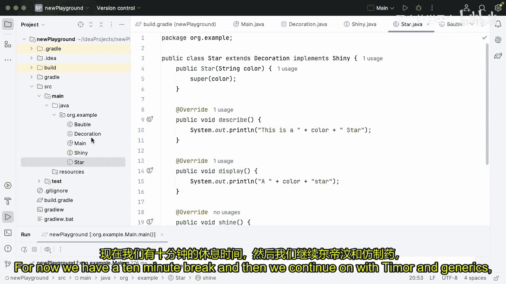

# 计算机编程：从入门到实战：32：抽象类、接口与多态


在本节课中，我们将要学习面向对象编程中的三个核心概念：抽象类、接口与多态。这些概念是构建灵活、可扩展软件架构的基础。

## 抽象类 🎄

上一节我们介绍了继承的概念。本节中，我们来看看抽象类。抽象类与普通类的主要区别在于，抽象类可以包含抽象方法。

抽象方法是一个没有具体实现的方法，其实现被延迟到子类中完成。这允许我们在超类中定义一个方法签名，而将具体的实现细节留给各个子类。其语法如下：

```java
abstract void sparkle();
```

在左侧的示例中，我们定义了一个抽象方法 `abstract void sparkle()`。这意味着我们在超类中声明了 `sparkle` 方法，但没有提供方法体。

在右侧的示例中，`ChristmasTree` 类继承了 `ChristmasDecoration` 类。由于超类中包含抽象方法 `sparkle`，子类必须提供该方法的实现。这里我们提供的实现是打印“树用明亮的彩灯闪烁”。

这样做的好处是，如果我们后续有多种不同的装饰品，每个子类都可以有自己的 `sparkle` 方法实现，但它们都通过共同的超类共享这个方法。

需要记住的重要一点是，抽象方法在超类中没有定义方法体。

## 接口 ✨

现在，我们继续讨论接口。你可以将接口视为一组方法的集合，任何实现该接口的类都必须实现这些方法。

你可能会问，既然可以在抽象类中定义10个不同的抽象方法，为什么还需要接口？原因在于，两个类可以有相同的行为，但不一定需要通过同一个超类来关联。

例如，我可能想要一个既能发光又能装饰的东西，但它不一定继承自“装饰品”这个超类。在我们的示例中，我们在接口里定义了两个之前提到的方法。在实现这个接口的类中，我们将提供具体的实现。

一个重要的区别是：一个类只能继承自一个超类，但可以实现多个接口。例如，在我们的案例中，如果想实现多个接口，只需在 `Decorative` 后面加一个逗号，然后列出其他想要实现的接口。

以下是实现接口的示例：

```java
public class MyClass implements Shiny, AnotherInterface {
    // 必须实现所有接口中定义的方法
}
```

需要注意的一点是，你必须实现接口中定义的所有方法，不能只选择实现其中一部分。

## 多态 🔄

我们今天要回顾的最后一个概念是多态。你们已经在之前的例子中见过方法重写，这是多态的一种形式。

解释多态最好的方式是通过例子。当我们谈论方法重写时，本质上是指即使在超类中已经定义了具体的实现，你仍然可以在子类中为同一个方法提供不同的实现。当你实例化一个子类对象时，将调用子类中的具体实现。

另一个要点是方法重载，我们这里有一个例子。方法重载基本上意味着你可以有相同的方法签名，但参数不同。如下所示：

```java
void displayType() {
    System.out.println("This is a Christmas decoration.");
}

void displayType(String type) {
    System.out.println("This is a " + type + " decoration.");
}
```

最大的区别在于参数。第一个方法 `void displayType()` 不带参数，打印默认信息。第二个方法 `void displayType(String type)` 带一个参数，输出会根据参数变化。当你调用这些方法时，根据括号内提供的参数不同，将调用不同的方法。

## 练习：扩展程序

现在，我们将用以下任务来扩展之前编写的程序。

首先，添加一个名为 `Shiny` 的接口。这个接口应该有一个名为 `shine` 的方法，该方法打印关于装饰品如何发光的独特信息。你可以自由选择打印什么内容。

其次，让我们的 `Star` 类实现 `Shiny` 接口，同样可以选择打印内容。

然后，创建一个名为 `Bauble` 的新类，它将继承 `Decoration` 类并实现 `Shiny` 接口。

最后，修改主方法。我们将创建一个 `Shiny` 对象数组来存储装饰品，然后遍历数组，对每个对象调用 `shine` 和 `describe` 方法，观察打印结果。

以下是实现步骤的简要说明：

1.  创建 `Shiny` 接口，并声明 `shine` 方法。
2.  在 `Star` 类中使用 `implements Shiny`，并实现 `shine` 方法。
3.  创建 `Bauble` 类，使用 `extends Decoration implements Shiny`，并实现构造函数及 `shine` 方法。
4.  在主方法中，创建 `Shiny[]` 数组，放入 `Star` 和 `Bauble` 的实例。
5.  使用 for 循环遍历数组，对每个对象调用 `shine()`。如果对象是 `Decoration` 的实例，则调用 `describe()`。

通过这个练习，我们定义了一个包含 `shine` 方法的接口，创建了两个实现该接口并继承抽象类的类，并实践了方法重写和重载的概念。

## 总结

本节课中我们一起学习了面向对象编程的三个关键概念。

我们回顾了继承，即子类可以从父类继承属性和方法。我们介绍了抽象类，它包含抽象方法，将实现延迟到具体的子类。我们还介绍了接口，它用于将行为分组，类可以选择实现一个或多个接口。

关于多态，我们学习了方法重写和方法重载。方法重写允许子类为超类中的方法提供不同实现。方法重载允许同一方法名根据参数不同调用不同的实现。



你应该能够运用这些知识来完成后续的练习，并在考试中应用它们。