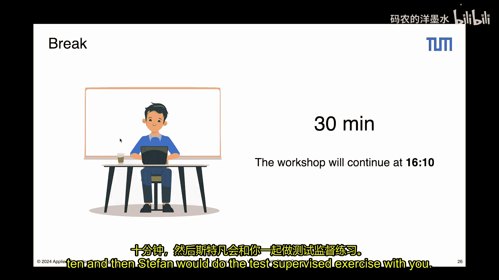
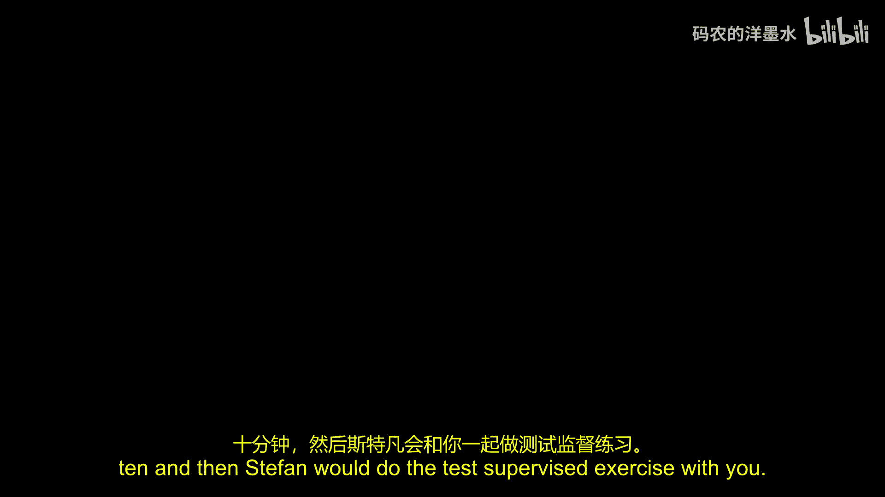

# 【全集】慕尼黑工业大学 计算机编程：从入门到实战 中英字幕 p33 Lecture 33 - 泛型part3 -BV1WFrTBZExY_p33-

Al right。 so then as Yas Minino already announced， I will now do a little recap on generics。

 which is a。😊，Pretty important topic in Java and maybe somewhat hard to understand。

 So I hope after this recap。You are secure in using generics and Java。

So the first thing about using generics is you have already used them before you even knew what they were properly。

When you were using collections， so for example， you did something like list and then these angle brackets string。

 which is just a list containing strings。And you could then use the exact same class but put something different in the angle brackets。

 like， for example， train， and then you would have a list of trains instead。All right。

 so you can see you have this exact same class and it can take different data types in it。😊。

So if you know for an array， this will not be possible， so this is a special thing about generics。

You can dynamically impose which type is allowed in a data structure。So one class。

 but multiple possibilities， what data type to use？So。Every time you see these angle brackets。

 it's generics in Java。So then it's all finding good to use them， it's pretty simple。

 you just always do the class name and then the angle bracket the dynamic types that you want to use。

Then the interesting part now is how do you use generics for your own classes。

 so using lists all fun and good， but it is also important that you know how to use it for your custom classes。

And it is also very simple here， you just do public class then the class name and then angle brackets and the name of the generic type。

 so usually in Java we just do single letteral names for this like T that way it is always clear that we are using a generic type and not some class。

That exists somewhere in Java， but technically。You could use any valid character sequence， like。

 for example， content for a present， however。It is somewhat discouraged， but it's possible。

 So if you see that。It's not wrong， it can be done。Then。

You can then use this generic type just like any other type， so for example。

 just like a class an interface an extract class on Eam。So for that。

 you just put it in the same place and just write， for example， T。You can have it as a return type。

 as a parameter， as a variable， as an attribute， anything you may want to use a class for。

 you can use a generic type for nearly。So。Then。The next bigger part。

 which is a little more complex are generic bounds。

So sometimes you want to have a data structure that imposes certain limits on the types it accepts。

 So， for example， you may want to。Compare it to something else。

 like you have a list and you may want to sort the list。

 then in that case you would require that the items in the list have some natural order that you could use。

And for that， you can use bounds， which means that the generic type can only be set to a specific type that。

Implement some interface or abstract class。So you use the extend keyword。

 which very clearly shows that is's really。Highly linked to inheritance。And if you do that。

 for example， here， we have a generic type T and it extends comparable。 and in this case。

 auto T because called comparable itself is generic。It has a generic type so and basically means。

This。A class that is implement comparable。Is comparable based on this generic type。 So， for example。

You could be very generous here and just say it is if you have like a class animal seal and mouse。

 then you could say the mouse is comparable against every animal， not just mouses。

 so that is why comparable also it's generic， but it's a bit more complicated and not super early。

 just know if you do something like this was comparable。

 generally you just run T extends comparable T。All right， And this basically no means that。

TheComparable defines the compare2 method， and since T extend this。

 it is always guaranteed in the code whenever you have a T that this compare two method is available on it。

 So you can see down here we have the parameter other and。And also content。

 and we can do content not compared to because content is T and T is guaranteed to extend comparable。

All right。Then the very last thing is now I've shown you how to use generics on a class level。

 but there's also the case that you can use it on a method level。

And here you define the generic type not on a class， but before a method。

 usually after static or after the X modifier， and before the return type。

 so you can see here in the angle brackets T， we define the generic type T。

Then this method returns T and takes T as a parameter。And it just then prints it and returns it。

 So what this does is when you。Call this method and give it， for example， a seal as an object。Then。

 it is。The compiler knows this method will always offer return a seal。

So it is you don't have to do like this returns animal and that then works because seal is an animal。

 No， it is very specific and you know it is a seal afterwards。

And you can also obviously use binding here。 So T XNs animals。

 and you can also then this method only works for animals。And yeah， when you call them。

 you pass in a seal and， you know， you can assign it， for example。

 to a variable of type seal because the generics just ensure that。T is always the same。

 and it automatically detects it T as a seal in this case。And then that means if it returns to you。

 it also returns the seal。All good so far。Yes。😊，The。What。us Lord committee。

The test exam will come later after my part。Yeah。That's not really right I of that right now。

All right， so yeah， then I have a little exercise for you for which you can reuse the same playground that you already used for Jans and Yasmins exercises。

And the task here is that you should create a container class that should have one generic type。

And this container class then has a content。In it of this generic type。

And then also you should add a constructor and get a set for this attribute。Then after that。

 you should create a static method， transfer that takes in two containers。

It ensures bio generic types that these containers contain the exact same type of content。

And then it should swap the contents of the two containers。And then afterwards。

 you should test your implementation in your main method in a mind class。All right。

 and if you have questions， ask your tutors that go around。All right， two minutes are over。

 so now I would。Go through the solution with you， so let me just quickly create the container class first。

All right。Now we have the class container here。And the first thing that we should do is just define the generic type。

 and that is really easy， just treat characters， angle brackets， and inside the angle brackets。

 the name of the generic type， which I use T for。Then the second part was that we want to have one attribute with that generic type to represent the content。

 so for that we just do private tea content。All right， next up， a constructor and getter feter so。

For that， I'm just going quickly do that。无异议。Get a container。Constructor that is just empty now。And。

Then we want to have aceturnron getter， which just for clarity。I will name a little bit differently。

 and will name an unload and load。Just so it is a bit more clear because we have a container here。

 but they do exactly。What you would expect。All right， content， obviously。All right， and then。

And again， you can see I just used tea like any other type in Java。

 so I could have also written animal here， it wouldn't make much of a difference here。

 it's just how we use a generic type。All right。Now。

The next part was that we should create a static method transfer。

That has also a method level generic type to transfer the content from one container to the other。

So for that， first of all， a public static method。 And then we need a generic。Type again。

 and I could use tea here now。But it would be a little unclear because it would not be the same T as this one。

 So instead I'm now going to call it C here。So then we have container。With C as a return type and。

It's not complete yet， so let me first complete it， then I will explain it。

So now it takes in two containers。All right。So， now。This。

It now takes in two containers and these containers should have both have the generic type C。

 and the C is a method level generic type， and what this effectively means when you call this transfer method with any container with any specific generic type。

It the compiler will see aha， so this container contains a seal。

 so then it knows this one also has to contain a seal， otherwise it wouldn't work。And。That way。

 you can really make sure that with generic types， you can take in。

Two attributes that have that use the same generic type， and Java does the rest automatically。Good。

 now that。We have said I will also rename these for clarity， so let's just complete it quickly and。

Here we can just do。Load， and then。From dot。Unload， and then。From dot。L。I thats。All right。

 I'm just going to do half of it now because it's not super relevant to the example here。All right。

Now I want to do the main class now， all right。So here， first of all。

 I want to create a new container。And now I， as you can see， have prepared something。

 So in order to properly do this， I will actually need。呃。Two more class， three more classes just for。

Supporting this analogy that I'm going to do now。But。You don't have to necessarily do that。All right。

Alright， I've just created now a seal and a mouse。 and they both are animals。 Allright。

 so now I want to have a container that contains。😊，I seal。

And this is now my first container and this is a new container。

 and you can also define the generic type here， but that is somewhat redundant。

 so I'm going to leave it out here because it works fine like this and Java knows because you have it in one line here that it works like that。

Allright， so now what have I just done。So basically I have created a container here。

 and you can see already here this container has also here a generic type。

Now I have defined that this generic type should have the specific type seal。

So now I have a container that is labeled as seal basically。

And what I can do with this container now is it wouldn't make sense to put a mouse in this container because why would you put a mouse into a container that is labeled as seal？

And that is the same way that generics work， this container has a generic type seal。

 so Java doesn't allow us to put a mouse in there instead what we can do is we could put a seal in there and if we do this now it works and a seal is in the container。

All right。So now we can also do a second container。That then has a type mouse。And。Yeah。

 so now we have a container of for mouse。And then we can also do this。This here again。

 so here we have a second container with a generic type T。

 and in this case it has a specific type mouse。So now we can do container2 dot load。New mouse。

 and this will work。 So here we have floated a mouse into it。

So now what would happen if you were to try to load， say a seal into the mouse container。

 Java would say， this is not valid and would even tell you， hey。

 you were supposed to put a mouse in there， but you did put a seal in there， which is not valid。

 and the compiler really checks here。This is not valid。All right。

 and then the other thing that you can do now， obviously is to use the。Static method to transfer。

Something from one container to another container。And here， now。

 if we would try to use the containers that we。Have。Then。Java would， again， tell us。

This doesn't work。😡，We were supposed to get two classes at two instances of a container with the same generic type。

 but what we got were one container with a generic type seal and one with a generic type mouse so here for example。

You just can't really transfer anything here because if you were trying to transfer the seal into the mouse container。

 it wouldn't make any sense， so Java doesn't allow it。And vice versa。

 transferring the mouse into the seal container also doesn't work。And， additionally。

If you would now remember here， it also returns the container of that type。

 so now if we were to do this。Then what would be the generic type here。

You couldn't define it clearly， because。Well， you have two containers with different generic types。

 and yeah。Knowing what would then come out here。Java just couldn't know it because it uses the same generic type C here。

So to fix that， we would have to make sure that both use the accept same generic type and then also both contain a seal。

 which well。I don't have a second seal right now， so I'm just going to comment it out。

 and then what I've now done instead of having a mouse container。We know。Well。

 we now have a seal container again， and now we can load。Something from container actually。

 from container one into container 2 and the result。Is a container of type C。

 So here what we just did， we took it from this container， put it into this container。

Everything clear know how generics work and how they are basically putting a label on a box in some way。

Yes， so the question here is in the static method。Why we use the。嗯。The sea here， instead of a T。

So the reason for that is you could use T， but it would be a little bit unclear because generic types just like everything single in Java have a scope whether I apply in。

 so for example， if you have a local variable， it's only valid in the scope of a method， for example。

And。A generic type on a class level is only valid。For on a basically object basis。

 so an object has this stotype。But not static methods or static attributes。

Because they really are only meant to be used on a class level when they are then used for object attributes。

 methods and constructors。So since this message is now static。We actually cannot use this directly。

 So， for example， if I would remove this new decoration here and try we try to use tea。

It would tell me that。You will try to use the container this instance。

 so basically an object of container。In a static context， which doesn't work。

 It's the same how I couldn't do access this dot content here because。We are not in。

 and we don't have any object that we are currently and we are in a static context that is outside of。

Object。So。What we instead now have to do here is we have to ensure that this static context。

And the static method， Ly。Has its own。Generic type declared。

 and now the reason why I've named the T instead of T is just to make it really clear。

 this is not the generic type that is used up here。Yes。

 so basically the question now was why this method is static in the first place。

So the reason is just。It was a good example to demonstrate method level generics。

 You could also do it as an a non static method where you wouldn't then only take one container and then。

Use this instead， however。With static， it just is always a good opportunity to use method level generics。

And then the second question it was。Can this message be put into any class。

 And the answer to that is yes。Static classes， typically， are completely independent。

And I say typically not always， but in a lot of cases。

 if they don't use any static attributes or other private static classes。

 they are pretty independent from the class they are defined in。

And this one is completely independent here because it takes into parameters。

 uses their public methods， so this code could be written anywhere in your Java code base， so yes。

 the static method could be placed。Anywhere in your Java code。Okay。

 so you want containers that contains apples and bananas， right， So， for example。In this case。

 we have containers that can only contain a single item。And yeah。

Let's say this container could hold two items， and then it's obviously up to how you want to define it。

 how you want to use it。Let's just pretend these two are one container now that can hold two items。

 So there are two ways how you could use them。 The first one is。

You only want to put the exact same stuff in here， So two seals， two apples， two bananas。

 or you could also。Labeled them differently， one side is for an apple， one side is for a banana。

Then you would have to basically in Java， use two generic types。And it。

 it's somewhat of a design indecision， but。For example， if you would have like a chain of them。

 So a list of containers and they could create a list of contents， then you may want to say， hey。

 I want to this list should contain any animal that would be fine。 However。

 you may also want to say this。A list should contain only seals because sometimes you may want to have a list that can only contain seals and not also bananas or apples。

So。And with generic types， it also basically allows you to do all that。For example。

 I could also use a super class animal here。And in this case。

If I would be consistent and make every container to contain an animal， this would still work。

 and now it is even possible that we have one container containing a mouse， one a seal。It's。

You just have to make sure that they have a super class and then declare the super class。

As a generic type。Allright， and I think we are almost at our time limit， so。

If you have any more questions， you can also ask your tutors。

And now to get back to the presentation here。I had a second part of this exercise plan。

 however we don't have the time now， so you can maybe do this in your own time and then also think about how you would transfer this to this analogy I've provided here。

And then I also have a challenge， which that's not really a real world analogy for。

 where you can use。The how you could use a second generic parameter in your static message to get rid of all of the three container tea declarations that only have one so。

Yeah， I could maybe quickly show you the solution here because it's not super intuitive。

 but I think it's interesting to know how you would do that， so first of all。

 you can create a bound I hope bounds are somewhat clear by now otherwise ask your tutors or just look it up on the internet。

But you can then also， I've already alluded to when I answered one question there。

 you can have multiple generic types per method or per class。

 so for example here we have still the T which this case also now extends comparable T。

But we have the generic type T and then this method also has a generic type C。

 which I know this is now inconsistent from what I have in intelligent。

 but basically this C is now extends the container extends container so the generic type C is always a container or subclassus of container。

And。Since container is a generic type， we also need to decor it here。

 so what this now basically does is we have a type T which is a content of a container。

 and then with generic type C which is a container with the content type T。I said。

 I really don't have the time to explain it further。

It's a pretty interesting concept and you can do a lot by combining generics in this way as well。

 so if you are interested in that， there are resources on the internet or maybe your tutor has some time to talk about this with you。

All right。Now we would have a 30 minute break until 1610。

 and then Stean would do the test supervised exercise with you。

