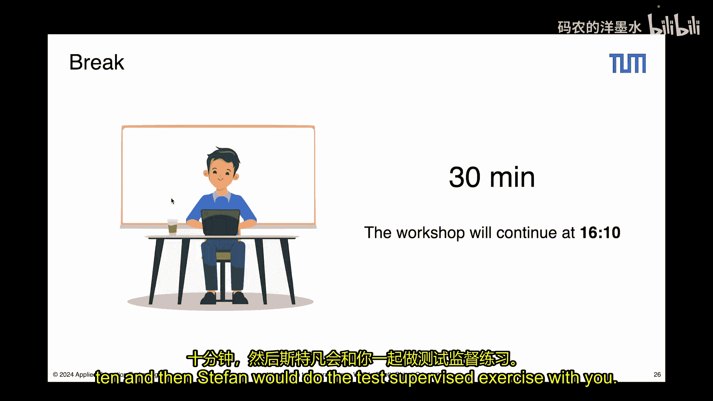

# Java编程：33：泛型（第三部分） 🧩


在本节课中，我们将深入学习Java泛型。泛型是Java中一个强大但可能有些难以理解的概念。我们将通过回顾和练习，帮助你掌握如何在自己的类中使用泛型，以及如何应用泛型边界和方法级泛型。

---

## 概述

泛型允许我们创建可以处理多种数据类型的类、接口和方法，同时保持类型安全。你已经在使用集合（如 `List<String>`）时接触过泛型。本节课，我们将学习如何为自己的类定义泛型，如何限制泛型类型，以及如何在方法级别使用泛型。

---

## 泛型基础回顾

上一节我们介绍了泛型的基本概念。本节中，我们来看看泛型的具体语法和用法。

每当你看到尖括号 `<>`，就表示在Java中使用了泛型。使用泛型很简单：在类名后加上尖括号，并在其中指定动态类型。

**代码示例：**
```java
List<String> stringList = new ArrayList<>();
List<Train> trainList = new ArrayList<>();
```

你可以使用同一个 `List` 类，但通过尖括号指定不同的数据类型（如 `String` 或 `Train`）。这与数组不同，数组在创建时就固定了类型。泛型允许一个类动态地决定其内部可以容纳的数据类型。

---

## 为自定义类创建泛型

了解了基础用法后，现在我们来学习如何为你自己的类添加泛型功能。

定义泛型类非常简单：在类名后添加尖括号和一个类型参数名。在Java中，通常使用单个大写字母（如 `T`）作为类型参数名，以明确表示这是一个泛型类型。

**代码示例：**
```java
public class Container<T> {
    // ... 类内容
}
```

定义后，你可以在类中将 `T` 当作任何其他类型来使用：作为返回类型、方法参数、变量或属性。

**代码示例：**
```java
public class Container<T> {
    private T content; // 属性

    public T getContent() { // 返回类型
        return content;
    }

    public void setContent(T content) { // 参数类型
        this.content = content;
    }
}
```

---

## 泛型边界

有时，你希望泛型类型有一定的限制。例如，你可能希望一个列表中的元素可以相互比较以便排序。这时，你可以使用泛型边界。

泛型边界使用 `extends` 关键字，这与继承的概念紧密相关。它要求类型参数必须是某个特定类或接口的子类/实现类。

**公式/代码描述：**
`<T extends Comparable<T>>`

以下是如何在类定义中使用边界的示例：

**代码示例：**
```java
public class SortedContainer<T extends Comparable<T>> {
    private T content;

    public boolean isGreaterThan(T other) {
        // 因为 T 扩展了 Comparable<T>，所以可以调用 compareTo 方法
        return content.compareTo(other) > 0;
    }
}
```

通过 `T extends Comparable<T>`，我们确保了 `T` 类型的对象一定实现了 `compareTo` 方法，从而可以在代码中安全地调用它。

---

## 方法级泛型

除了在类级别使用泛型，你还可以在单个方法上定义泛型类型。这在工具方法中非常有用。

方法级泛型的定义位置在方法修饰符（如 `public static`）之后，返回类型之前。

**代码示例：**
```java
public class Utility {
    public static <T> T printAndReturn(T item) {
        System.out.println(item);
        return item;
    }
}
```

当你调用 `printAndReturn(new Seal())` 时，编译器知道 `T` 是 `Seal` 类型，因此返回值也是 `Seal` 类型。你也可以在方法级泛型上使用边界。

**代码示例：**
```java
public static <T extends Animal> T handleAnimal(T animal) {
    // 此方法只接受 Animal 及其子类
    return animal;
}
```

---

## 练习：容器类

为了巩固所学知识，我们来进行一个练习。以下是练习的具体步骤：

**任务：**
1.  创建一个名为 `Container` 的泛型类，它有一个类型参数 `T`。
2.  该类应有一个类型为 `T` 的 `content` 属性。
3.  为该类添加构造方法以及 `getter` 和 `setter` 方法（可以命名为 `load` 和 `unload`）。
4.  创建一个静态方法 `transfer`。该方法应使用**方法级泛型**来确保传入的两个 `Container` 对象具有**相同**的类型参数 `C`。
5.  `transfer` 方法应交换两个容器的内容。
6.  在 `main` 方法中测试你的实现。

**提示：** 静态方法不能直接使用类级别的泛型参数 `T`，因为它属于类而不是对象。你需要在方法上声明自己的泛型参数，例如 `<C>`。

---

## 练习解析与深入讨论

让我们一步步解析练习中的关键点，并解答一些常见问题。

首先，我们创建 `Container` 类：

**代码示例：**
```java
public class Container<T> {
    private T content;

    public Container() {}

    public void load(T content) {
        this.content = content;
    }

    public T unload() {
        T temp = this.content;
        this.content = null;
        return temp;
    }
}
```

接下来，实现静态的 `transfer` 方法。注意，我们使用新的泛型参数 `C` 来避免与类级别的 `T` 混淆。

**代码示例：**
```java
public static <C> void transfer(Container<C> from, Container<C> to) {
    C item = from.unload();
    // 假设这里将 item 装入 to
    // 实际练习中需要你完成交换逻辑
}
```

**为什么 `transfer` 方法必须是静态的？**
这个练习特意设计为静态方法，是为了演示方法级泛型的用法。当然，你也可以将其设计为非静态的实例方法。

**`transfer` 方法可以放在任何类中吗？**
是的。只要这个方法不依赖所在类的特定状态（即只使用传入的参数和它们的公共方法），它就可以放在代码库的任何地方。

**关于类型安全：**
泛型就像给容器贴上了“标签”。如果你创建了一个 `Container<Seal>`，Java 编译器会阻止你向其中装入 `Mouse` 对象，从而在编译期就保证了类型安全。

**使用泛型边界：**
你可以让 `Container` 只接受特定类型的对象，例如只接受 `Animal` 的子类：

**代码示例：**
```java
public class AnimalContainer<T extends Animal> {
    private T content;
    // ...
}
```

这样，`AnimalContainer<Seal>` 和 `AnimalContainer<Mouse>` 都是有效的，因为它们都扩展了 `Animal`。

**高级挑战：**
你可以尝试使用多个泛型参数，并应用更复杂的边界，来创建更灵活的API。例如，一个方法可以接受任何 `Container` 及其子类型，并操作其内容。这涉及到更高级的泛型组合技巧。

---

## 总结




本节课我们一起深入学习了Java泛型。我们回顾了泛型的基本语法，学习了如何为自定义类添加泛型参数，如何使用 `extends` 关键字设置泛型边界以限制类型，以及如何在静态方法或工具方法上定义方法级泛型。通过“容器类”的练习，我们实践了这些概念，并理解了泛型在编译时提供类型安全的重要性。掌握泛型将极大地提高你代码的复用性和安全性。