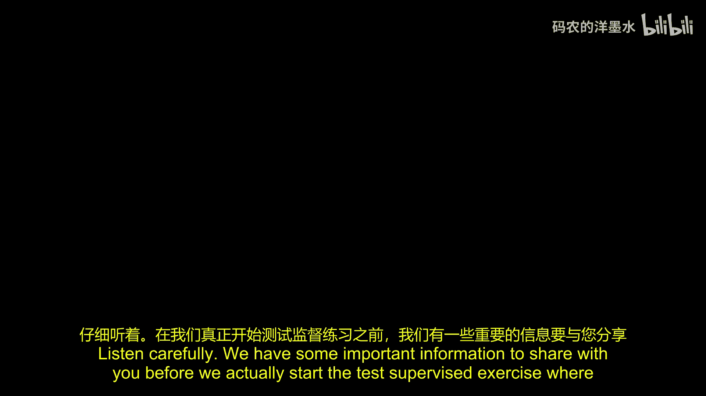
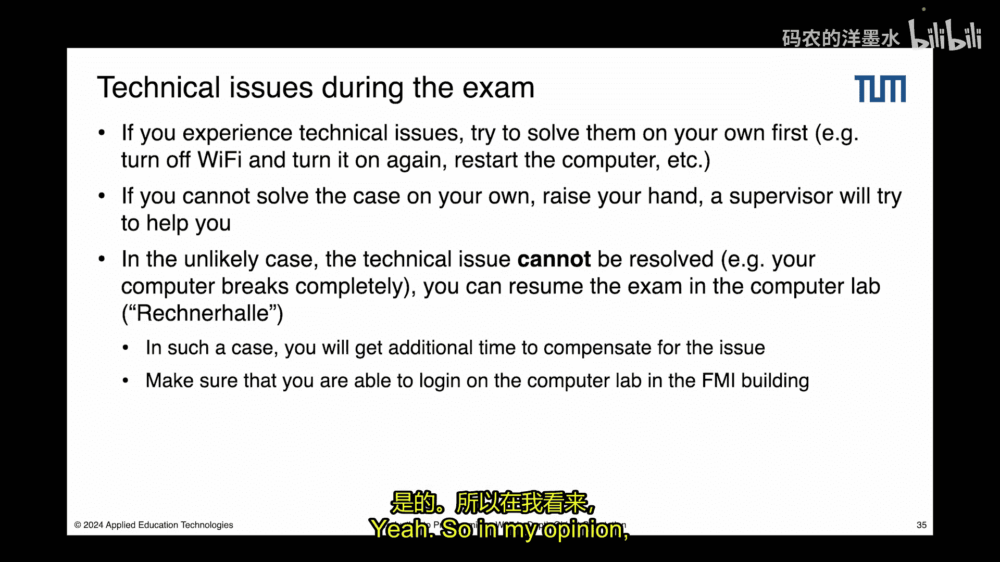
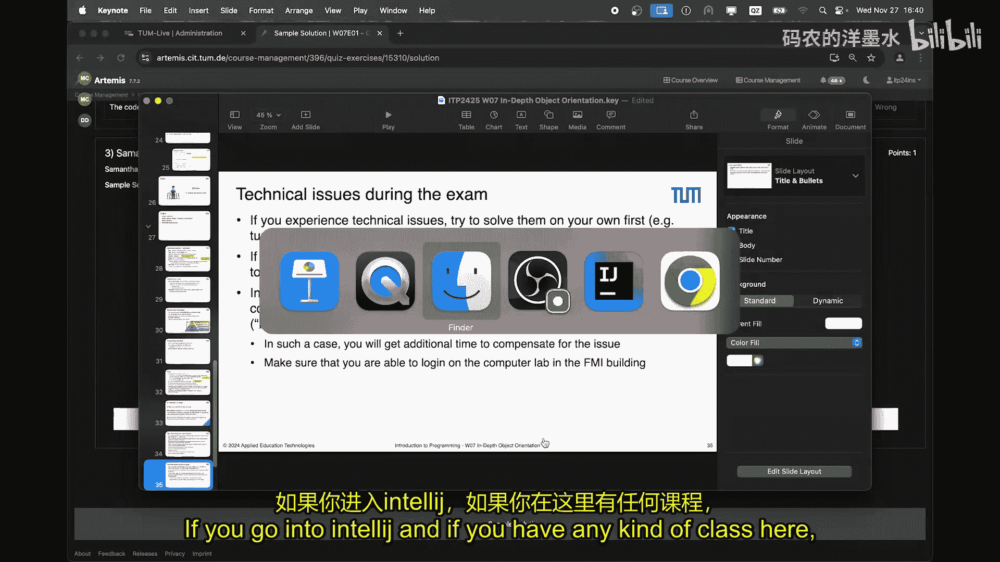
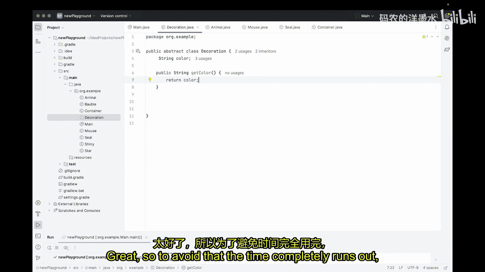
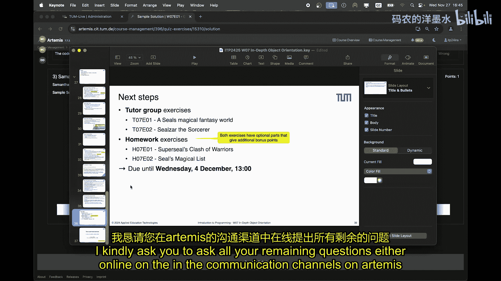
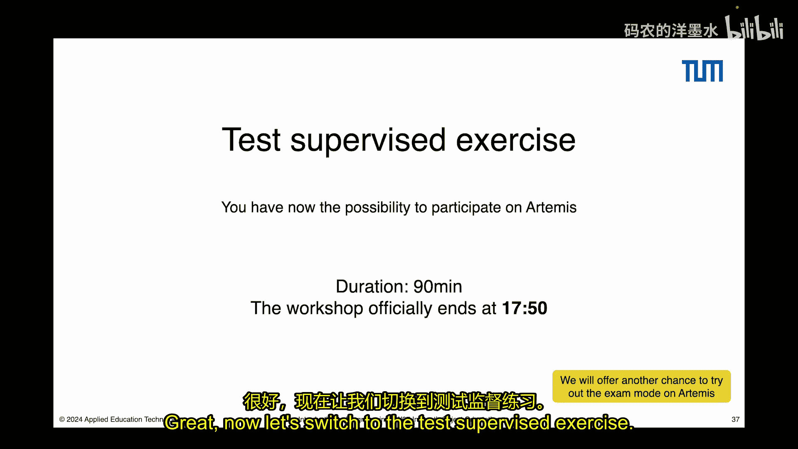
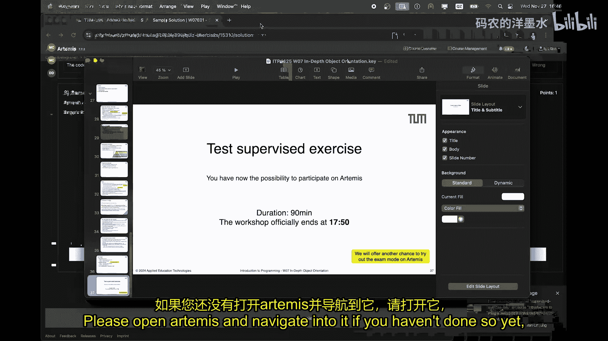
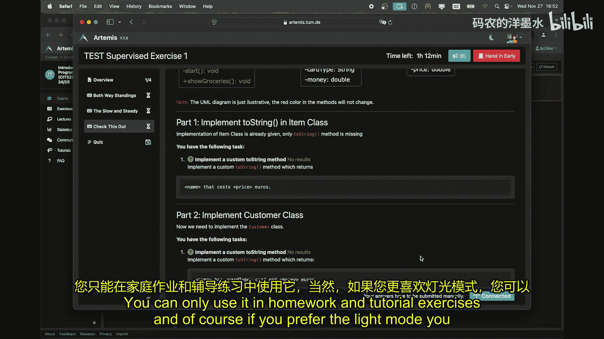
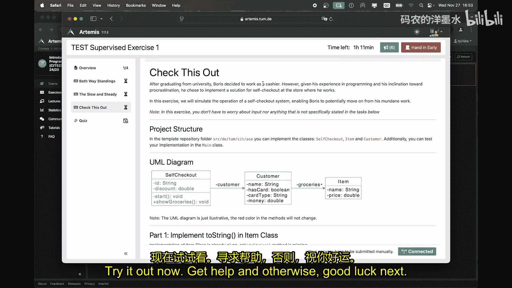

# 【全集】慕尼黑工业大学 计算机编程：从入门到实战 中英字幕 p34 Lecture 34 - 监督测试练习 -BV1WFrTBZExY_p34-

Listen carefully， we have some important information。

To share with you， before we actually start the。Test supervised exercise where you can try out everything。

We'd like to give you some information about supervised exercise number one next week。

 it will take place Tuesday evening， we'll start at 7 pm maybe a little bit delay but we suggest that you try to be here in Garing at latest at 6 45 pm in your assigned lecture hall so that there is enough time for you to set up everything if you can do it even come a little bit early the thing is U6 sometimes it late and sometimes the U6 doesn't work out and we can't really take this into account of course if there is a big outage then we might start a little bit later but just because you miss one U6 doesn't mean we can wait for you this is a supervised exercise with 600 participants distributed in many different lecture halls so please plan ahead。

And have some buffer time so that you don't get into a rush。The official working time is 90 minutes。

 but will give you 10 minutes extra for any kind of technical issues。😊。

If you don't experience any technical issues， you can also use them as a working time。

But if you experience technical issues within those 10 minutes of then you don't get anything extra so this really depends。

 make sure that you have a proper setup and of course there are people going around and they can support you in a limited way but you are responsible for your own setup we cannot fix your computer in the end。

You can get up to 100 points in this supervised exercise and if you calculate it now this means in around 10 minutes sorry in around nine minutes。

 you need to work on around 10 points so if there is an exercise that is worth 30 points just as an example。

 you should roughly spend 27 minutes on it。😊，And this is something that you have to manage the order of the exercises within the supervised exercise will be random yeah so it's not the case that the easiest one is in the beginning and the hardest one is in the end it is a random order and you need to decide which time you take for which exercise okay as a suggestion go through all of them quickly and then make a plan and then try to stick to the time that you spend for the different exercises we do a lot of math beforehand in order to estimate how much time you need to read the problem statement。

 how much time you need to read the template code and how much time an average student。😊。

Will take to solve the exercise。We can't calculate this for the weakest student and for the best student we can only do it for an average student and you might feel this is completely off then we are already sorry。

 but this is not possible that we personalize this for every student based on the previous exercises。

 but we really try to give you enough time to work on this。

 it's not the idea that this is a rush exam where you need to write 100 pages and dump out your brain。

 this is not the idea that the idea is really that you have time to work on this。

All the supervised exercises will take place in Garhing。

 we will not offer them in Munich in the city campus， we just don't get rooms there。

 you have to do it here。You have to come to Garing and you must participate in the assigned lecture hall you cannot just randomly go to another lecture hall。

 this is not possible so go to the lecture hall and only if there is a very valid reasoner that you agree upon with the supervisors on site。

 then you might be allowed to go somewhere else but this is really something that the supervisors have to write down and that has to be part of the protocol you cannot just go somewhere else。

For the setup， we highly recommend that you use your own notebook， so bring your notebook。

 make sure it's charged， make sure everything is set up properly。

 your integrated development environment， your wF， make sure that you can connect to EdoO and as a backup plan to buy on Vlam。

And then use your own notebook， that's the basic idea so that you can work with your familiar setup。

If for any reasoner you do not have a notebook that you can use next Tuesday。

 you can use a computer in our computer lab called Rashnahalle。

Raihinahala is located in the FMI building where the main informatics side is。

And there are around 80 to 90 computers over there， they have a specific setup。

 so you need to get familiar with the setup if you want to use them， and if you plan to do that。

 please send us an email to the email address that is linked on slide 28 and do that until latest until Sunday evening so that we can plan accordingly。

If your computer breaks during the supervised exercise or you can't use it anymore for any other reason yeah。

 maybe you have Windows updates activated or something like that。Then。

Please go to one of the supervisors， they will try to fix this quickly with you if this is not possible you can also switch from your personal computer to a computer in the computer lab。

 so we will have a few spare computers over there， this typically does not happen。

 but just in case we have planned a backup for you。

 then you will also get some additional time that you need in order to walk there and to log in and to set up everything so if you I don't know。

 need 15 minutes to walk in there you will get an individual extension time extension for around 15 minutes to compensate for that。

The whole thing will be open book so you can basically use any resources but you need to work alone。

 you cannot use anything that is based on AI。And you are not allowed to communicate with someone else so while you can use Google。

 the main search function in Google， not the AI function in Google。

 while you can search something on Google and read something from ST overflow if you have an issue or something from the Java documentation on the Oracle website。

It's not allowed that you post a question online or in any chat tool。

 you cannot post a question on St overflow on GitHub， you can also not use WhatsApp。

 Facebook or any other social media app that you are used to do。YeahYou have to do this alone。

 this is really important and we will have multiple people going around and we will verify that you work alone and if you think we can't do that。

Don't underestimate our people。 Yeah， we have done this several times。

 And if we identify that you don't follow the rules， there will be very strict punishment。

We are not taking anything into account here。 if we catch you doing something that is not allowed。

 you're out。 That's the basic idea。You will receive an email with the actual lecture hall until Tuesday morning。

 and if you intend to use therehinahale or even if you don't intend to， it might happen。

 make sure that you are able to lock in there， you will get some emails with some instructions on how this works later on。

Aremis has a specific exam mode and even if this is not a real exam。

 it's a supervised exercise we use this dedicated exam mode。

 the exam mode is very well documented on the links that you see here you can find out the different features。

 there is a student guide in the documentation and we even uploaded tutorials for you where it's dedicated how you navigate into it。

 how you use the different features and what it for example means if your code does not compile there's lots of documentation check it out and of course let us know if you have any questions。

😊，We also have a tutorial on this particular link how to deactivate AI features in Intelliche。

 we already communicated this in the tutorial groups， this is really important。

 you have to deactivate it if we notice that you use AI features in Intelliche。

 then this also counts as a plagiarismma attempt， and it might be the case that the people in the lecture hall go around and verify your settings in Intelliche。

So make sure that you follow the tutorial and you disable all the AI features it's a super clear tutorial which says hey basic code completion is allowed and this kind of feature is not allowed if something is unclear communicate with us and find it out but you are responsible for this this is not the responsibility of us this is the responsibility of you and there is no excuse yeah you can't say I didn't know it or I may are sorry I forgot to do that I had it on my to- do list but then I forgot it no there's no excuse for that take it serious otherwise you will have an issue。

😊，We have a test exam now in a few minutes or a test supervised exercise where you can try it out and get familiar with it。

 and this will also be， so right now we have one with a time limit you have to participate in a specific timeframe but we will duplicate that and in the duplication of it you can actually try it out at any time within the next couple of days。

😊，but you can only do it once here or online in this particular timeframe。

 and then for the second one you can also just do it once， you cannot do it multiple times。Okay。

Some general information， all the exercises that we have in this supervised exercise focus on understanding and problem solving。

😊，If you are used to learn things by heart based on your original study program。Yeah。

 I don't make any assumptions here to notice how I phrase this， if you are used to do that。

 it will not work out here。This is a completely different culture。

You can learn everything by heart if you want， but will not pass the supervised exercise or the course in the end and I really would like to make this clear again I made this already clear in the first workshop a few weeks ago and I'd like to make this again super clear。

 you really have to practice practice practice and apply the concepts that we teach you to a very concrete problem statement like you do in the homework exercises。

 like you do in the lecture exercises or workshop exercises and like you do in the tutorial group exercises。

 so the best preparation if you ask me is do all the exercises that we give you。

And if you have done them， but you feel unsecure do them again in the practice mode on Artemis。

And what you also can do， review the learning goals of the slides in the beginning。

 every slides in the beginning state certain learning goals。😊。

AndThese are the competencies that we expect you to get out of the participation here。

 and these are also the competencies that we assess during the supervised exercise。

There will be programming exercises， of course， you can work on them in your IDE。

 yeah you have to clone them。Get them into your IDE and then you have to commit and push your changes it's super important that your code compiles on our build service and this is also the only information that you get there will be no feedback during the supervised exercise。

When it comes to the correctness， we only tell you if your code compiles or not。If it compiles。

 it will be assessed later on， if it does not compile， you we willll get zero points。

And I know some people think this is unfair only because a Simic colonon is missing and everything else is correct I get zero points。

 but this is how it is and this is also unfair for business owners if they have an out pointer exception and then their business crashes and they get bankrupt and this is also unfair for people who die because Tesla cannot program correctly and then suddenly two cars crash yeah this is also unfair but this is how life is and we think the earlier you get used to it。

 the better it is this is how programming works if it does not compile you will get zero points and there is no way that you get around this even the best complaints。

 even if you send a letter to the dean， even if you send a letter to our chancellor whoever it will be it will not help you so this is a fixed rule that we will not change if you have a compile error it will lead to zero。

Points no matter how unfair you think we are。There are a few more rules that I'd like to point out and then I will give you the chance to ask questions。

Do not use any kind of artificial intelligence in particular everything related to OpenaiI chattCT GiHub Copit。

 any similar systems， I can't name all of them here are forbidden。

 even if they are integrated into your IDE so any GiHub Copit InCha features make sure to disable them you can find the instructions online。

 do not use any chat applications and make sure that you completely close them on your computer because it looks suspicious even if they are running in the background and we can't tell if you actively use them or if you switch between them very quickly so make sure to close all of them。

 turn off any notification， it's also very suspicious。

 if you suddenly get a Whatsapp notification on your computer。

 or any other kind of notification make sure to turn everything off because you also want to focus there's no need to listen the messages in your family group during。

The supervised exercise。 You can do this afterwards。

It's also important that even if this is technically possible。

You are not allowed to participate from home， this is not possible。

 this is not a remote supervised exercise， yeah this is an onsite supervised exercise。

 you must be in the assigned lecture and we will verify this and if you participate from home you cannot tell us hey I didn't know。

 this is a clear rule that we stated from the beginning and if we identify this this is also counting as a plagiarism。

Yeah you are cheating and cheating or any suspicious behavior。

 any communication that we identify is classified as inman untoash life and there are very severe consequences mentioned in the prefx an or in the examination rules。

 make sure you get familiar with them and if we identify you with plagiarism of cheating then the corresponding module into online will be marked as failed and there's also there's no excuse for it really。

 I was also a student back then and I also had no chance to excuse myself we have to be very strict when it comes to cheating so please please please follow the rules。

😊，This is the slide that we showed you already， again reminder。

 no AI allowed during supervised exercises。We have some tips when using your own computer。

 you are responsible for it， yeah make sure that you prepare everything before the exam。

 you need to have a working browser， you need to have JDK 17。

 we recommend to use In Telelichbe with a working JDK installation and with a working Git installation but of course you are free to choose your own integrated development environment just make sure it works。

Make sure that you're not interrupted due to very important operating system updates during the supervised exercise we highly recommend that you disable them。

We also highly recommend that you close all windows and applications completely that you don't need for the supervised exercise。

😊，Make sure to test your wfi setup， make sure that you are connected to EerO last year we had a student who came and who never connected to EerO。

 he came 10 minutes late and then even accused us that we didn't help him to connect to EerO。

 right this is unacceptable。Try it out， I don't think I have to tell the people here in the lecture hall。

 but people will listen to the recording afterwards， try out your setup。

 ERo is also available in the inner city campus and make sure it works for your computer。😊。

Disable all the notifications， make sure all the configurations also when it comes to GiA correct and that you are able to log in。

😊，Cge your battery， you can also bring a charger， we make sure that in the lecture halls there are enough possibilities if you are unsure that you are in the range of some charger outlets then bring an extension cord。

 this might save you and if you aim to use a Bluetooth mouse then also make sure to charge it。

It's important that you are only allowed to use one monitor during the supervised exercise。

 so you cannot use a second device， no smartphones， no iPads or tablets， no external monitors。

 just one monitor， okay？Great， if you experience any kind of technical issues you have those 10 minutes additional time。

 try to solve them on your own for example， if your w-fi doesn't work， turn it off， turn it on again。

 and if it still doesn't work， try to restart your computer if it still doesn't work and after two to three minutes you can't solve it we can offer you limited support raise your hand a supervisor will try to help you but they are not 100 supervisors in the lecture halls。

 there are four to five so there' limited support you might need to wait， they try to help you。

 but they cannot fix everything on your computer they could provide generic tips like you get on a first level support phone if you try to turn it off and on again might be a very valid question that they ask you so it's limited。

 they cannot solve the issues on your computer this is your setup。If in the unlikely case that。

Neither you nor the supervisors can fix the technical issues。As I said before。

 we have the chance that you move to the Reshinahalle and that you continue your session over there。

Aremis saves all the work， this also means you should regularly push it if you work on a programming exercise so that it just in case something breaks。

 you still have most of the changes online and then you can resume at this particular stage in the Rainahale at one of our computers。

😊，Great， are there any questions regarding the supervised exercise， go ahead？😊，Okay， first question。

 are you allowed to listen to music？Theoretically， yes， with headphones。 Yeah。

 but it's also not easy for us to verify that you're really listening to music and that you don't have a phone call from someone。

Yeah， yeah， you're laughing but things are quite difficult nowadays， so I would say no， yeah。

 if you use earplques to get away from distractions this might be fine if there are nontechical。

 yeah you know that the soft thing once here， but I would say listening to music。

 also watching lecture recordings is only allowed without sound I would say， okay。😊。

Yeah I don't think if。Yeah。Yeah， anyway， but the thing is really we can't make sure that you don't disturb anyone else and we can't make sure that you have an illegal phone call the second question you can push as often as you want。

Yeah， but。There's limited amount of time right so I don't think it's feasible to do it like 15 times and it might also be the case that you have to wait 20。

 30 seconds like in homework exercises until you receive a build result and what was the third one cit？

Yeah about the citations， if you copy code from somewhere else its always better to cite it。

 if you completely adapt the code and change it to your personal leads。

 the citation might not be necessary anymore， but if you're very close to the original source。

 I think it's better to save it， but we designed the exercises in a way that no code from external sources is necessary。

😊，Yeah， another question over there。So the question is， can we use an online compile checker？this。

Yeah， that does not utilize AI as long as it could be considered an integrated development environment。

 we don't care if it runs online or offline on your computer。

 as long as it is an integrated development environment without AI support， I would say yes。

But the thing is， also。If you have a build failure in the end and you tell us it worked on my computer or it worked on this particular online side。

 yeah doesn't help you， this is why I explicitly mentioned it needs to compile on our systems。

 of course you can complain afterwards and of course we will look it up if something in our systems is wrong。

 but I've not experienced that if students experience a compile error that our systems were the issue in the end it could be theoretically it could be the case and we will verify it。

 but most likely it is your it's a problem in your code。So the question is， if I get it correctly。

 are the exercises related to each other and the answer is no。

 each exercise is worked on individually。😊，It can be the case， however。

 that one exercise has multiple parts。And if you're completely stuck in the first part。

 you might not be able to work on a second or the third part。

This is something that we can't exclude of course one exercise has multiple tasks and then within those tasks there could be dependencies。

 but it could also be the case that I don't know， you get task one。

 you don't get task two and then you can still work on task three。

 but we can't guarantee that all the tasks within an exercise are completely independent。Yeah。

 so the question is how does it work with compile errors between multiple exercises and the answer is a compile error is only relevant for one exercise。

 so if let's assume we have three exercises， three programming exercises and you have a compile error and exercise one。

 you can still get all the points in the other exercises。So the question is。

 does that mean we have to clone different repositories for different exercises， yes。

 like you're doing a homework exercise， if you have two homework exercises。

 you clone them two times and then you work on them？😊，And in the supervised exercise。

 you have two or three programming exercises， you can clone of them all in the beginning。

 but then make sure that you are always aware in which window you work on them。

 right this can be confusing， but we have distinct exercises here and clone work on it push has to be done for every single exercise。

Yeah， I get your question so the question is basically let me translate at which submission counts and it's the last one so there have been cases where a student would have get almost 100% of the points but thought that something is wrong。

 changed the code pushed it 10 seconds before the end of the supervised exercise and then had a build failure and then heavily complained yeah but look at the previous one。

 I would have gotten all the points but again the last one counts right and therefore I highly recommend that you do not upload your submission in the last nanosecond。

😊，Or in the last minute， even yeah， we from experience and from looking at the systems。

 we know that most of you still do that。 and this is up to you。 Yeah， this is your responsibility。

 but I recommend that。😊，I don't know， two minutes before the time is over， you push everything。

 you verify that you don't have a bill failure， and then you say， okay， that's it， I'm done。

It doesn't make sense to really work until the last second and the thing is also as many of you push the code in the last minute。

 it can also be the case that our build system is a little bit overloaded and it doesn't take 20 seconds until you get feedback whether your code compiles or not。

 but it takes one minute because there is a build queue and you have to wait。😊，Right？Okay。

 two more questions and then we go into the test supervised exercise because otherwise we're running out of time and feel free to ask your questions afterwards。

Yeah， so in my opinion， the basic functionality in Intelliche， let me show that to you。

 if you go into Intelliche and if you have any kind of class， yeah， maybe something like this。

 I don't know， and you press command n， and you say constructor， get getter setter。

 all this in my opinion is allowed is this allowed yeah。

So if you say let's create a getA， that's fine， you don't have to type this on your own。

 this is not considered AI， this is a standard feature in an integrated development environment。

 also if you do something like and I don't even think you can deactivate it。

 also if you do something like this， I always forget it。Yeah， this is also okay。

 yeah those are the basic suggestions， what was again the one to system out printline？Ah， this one。

 for some reason it doesn't work right now， I don't know。

But the one where you get system out printline， yeah， you might know that， you might have seen that。

Yeah， I'm in the class， yeah it doesn't make sense。Yeah， this one here， also perfectly fine， yeah。

You can also have shortcuts for that yeah if you prepare yourself and you know that system outline is something that you might use。

 yeah you can also store that in a little text editor next to it Yeah that's perfectly fine Okay last question for now。

😊，Okay， it's a very complex question， if you have two methods and they depend on each other。

 one is correct， one is wrong， can you still get the points？It depends。

 you get points if you solve the tasks， we write test cases accordingly。

 we will also what we do after the supervised exercises that we do some quick checks。

 we go through a couple of samples and we also look at all the build fails and we check if our test cases make sense and if you get the points for the tasks and if this is the case then everything is good if this is not the case we will adapt to the test cases so it's not completely automatic there's a lot of human effort in writing and adapting those test cases。

 this takes a lot of time believe me。And you have the chance if you still after we did all the random samples。

 if you still disagree， you have the chance to complain afterwards so for the programming exercises you can complain and if you think you did a certain amount of work and it's valid and your code compiles and we only give you zero points or one point but you should deserve five。

 ten points or whatsoever， you can complain about that and then one person will look into it but it can be the case and this happens quite often that this person has a different opinion right and our last word counts and while we really try to get into your position and really think about hey。

 is this work correct or not， there is typically a disagreement here。

and we don't do that because we want to be mean to students or we want to be unfair to you。

 we actually try to be as fair as possible for everyone。But if you ask me。

 there is no fair supervised exercise or there is no fair exam in the end， and we can't make this。

Perfect for everyone yeah so please bear with us but what I can tell you is that we like to motivate you to keep up learning programming because we think it's super important in the future to learn and to know how to program and how to interact with software no matter if you program in the future or not but also if you are project manager and you communicate with other people if you found a startup if you work in any shop in the future you have to have basic programming and basic AI skills this is super super important so our main idea with all this is to motivate you to keep up the good work and of course it could be the case that you fail and of course it could be the case that you don't get 100% of the points but still our intention is to motivate you and the goal is that you all have really a good experience next Tuesday and a lot of points in this supervised exercise keep that in mind and of course there can be issues of course there can be mistakes。

And then it's perfectly fine if you communicate with us， but don't。

Think that we do something in a bad way or in a mean way to you。 This is not our intention。Great。😊。

To avoid that the time completely runs out， I kindly ask you to ask all your remaining questions either online in the communication channels on Artemis or to your tutors in the upcoming tutor groups some information about the next steps because that's officially the end of the theoretical part after that we do the test exam we have two more tutor group exercises and two more homework exercises and there are due until next Wednesday one hour before the workshop starts as usual and also make sure that you take the chance and present those in the tutorial group exercises because after the Christmas break we will have only a few more tutorial group and homework exercises because we will focus on the project work so don't wait for the last moment to do the presentations from what I heard the people who participate in the tutorial groups。

Been reduced a little bit。 so it should be possible to do the presentations now。Great。

 now let's switch to the test exercise， please open AremIS and navigate into it if you haven't done。

 so yet you can go into the course overview and I assume I have to use the other account。😊。

Let me see if that one is still available。Okay thank you now it's working so just in time。

 I click into it， I go to exams。There's only one， so you click into it。Yeah。

 we have already working time updates， I think this is because we had to change the start。

 click on of course read all the statements， I have read them before and then click on this little。

Option here that you confirm that you have readit rules and that you comply to them and then type in your name。

To verify yeah this is like a signature you verify that you are yourself and then you click on start and then this is how it looks like you have an overview of the different exercises in this case we have three programming exercises and one quiz。

 this might be similar to next week but of course it can also deviate a little bit and then you can navigate through the different ones through the problem statements with the code button you can copy the URL and clone it and Intelliche and for the quiz you can basically participate。

 the nice thing is that you see the safe status on the left quizzes are automatically saved。

 either either if you navigate or if you wait a few seconds。

There's also an exercise save button here if you want to do that and for the programming exercises。

 if you push your changes， there will be an animation on the right here and you will see whether your called compiles or not and we basically took this test supervised exercise from the previous year so it's identical to the one that we had last year the exercises are somewhat comparable but might slightly differ in terms of difficulty and of course in terms of the content that we have so have a look you can try it out now if you want you can work on this for the next hour and 15 minutes roughly but you don't have to this is really just for you to get used to it if you say you have something else you can also do this afterwards again in a second chance yeah but this is your chance now to get familiar and if you have any questions our tutors can。

Go around and assist you but notice during the supervised exercise you cannot ask any content question it's not possible to say hey。

 I don't know what a selfcheckout is can you please explain it to me this is not possible and as you see iris is not active yeah it's not part of the supervised exercise you can only use it in homework and tutorial exercises。

And of course， if you prefer the light mode， you can also switch to the light mode and it should still look fine。

There's a question over there， maybe some of the tutors can go up and help out。Okay。Great。Then。

Try it out now， get help。 and otherwise good luck next。

