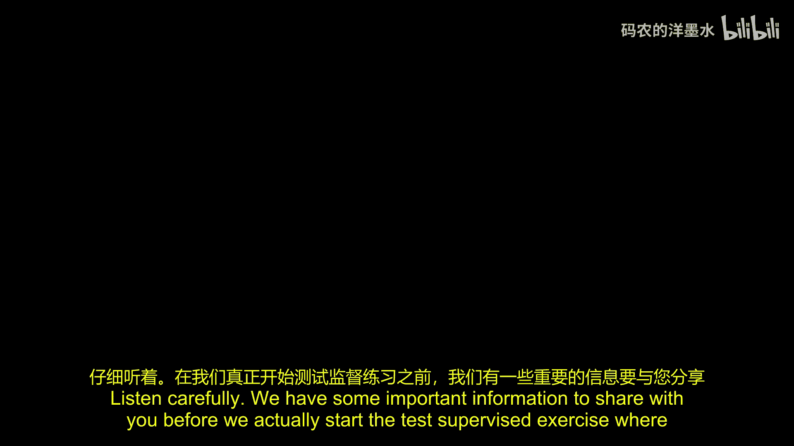
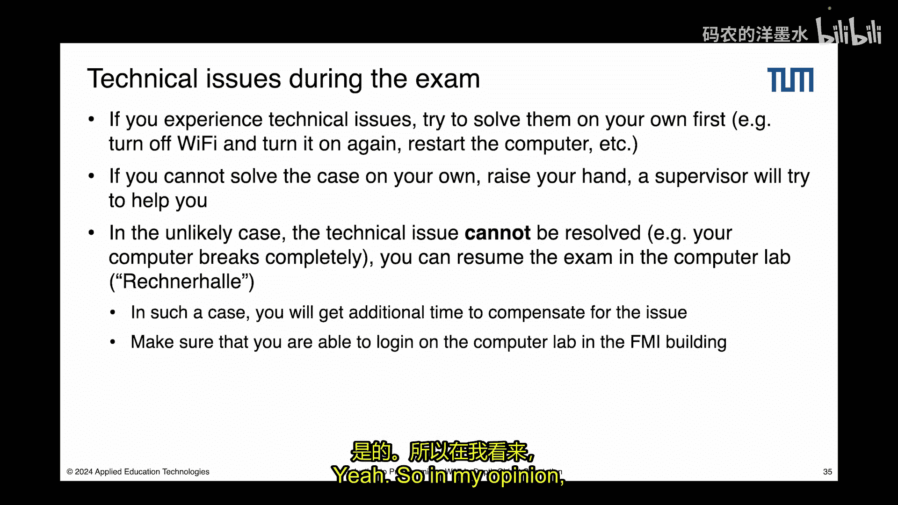
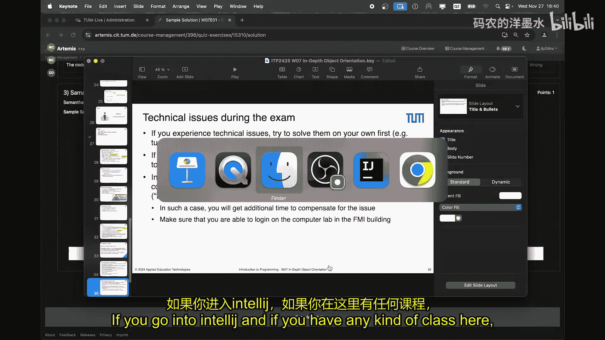
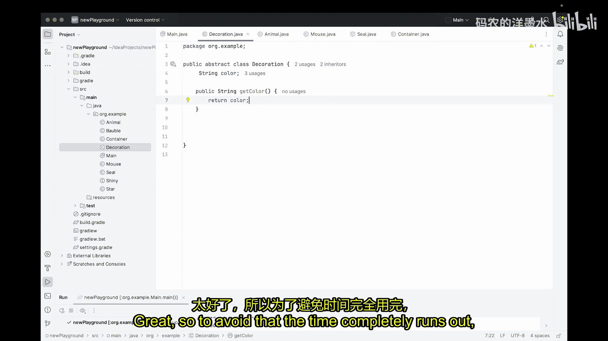
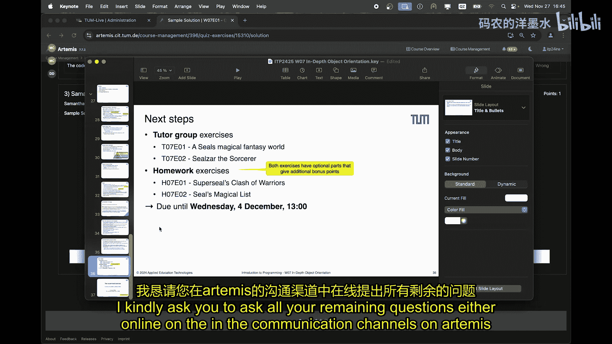
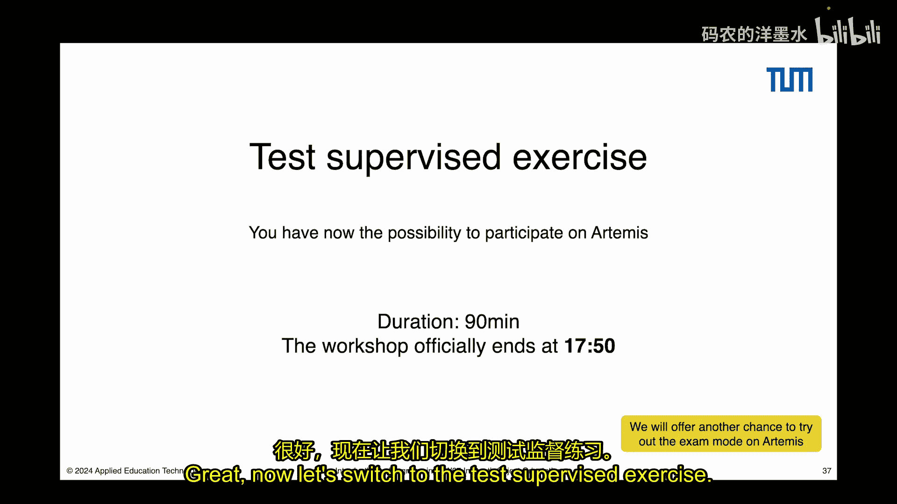
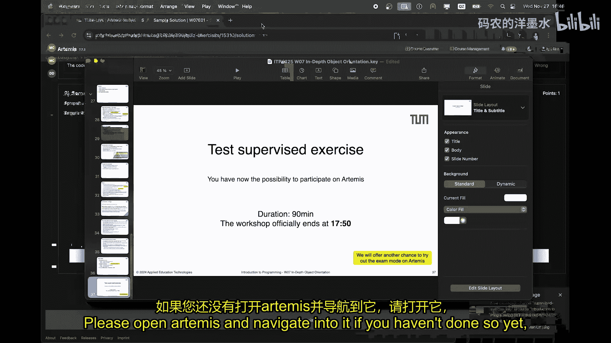
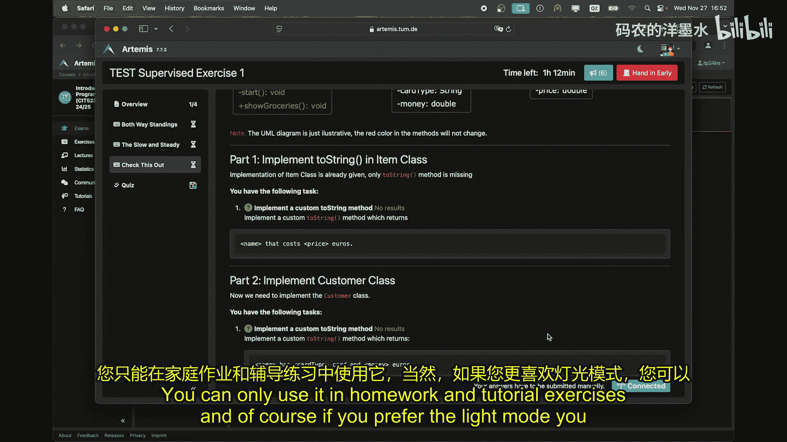
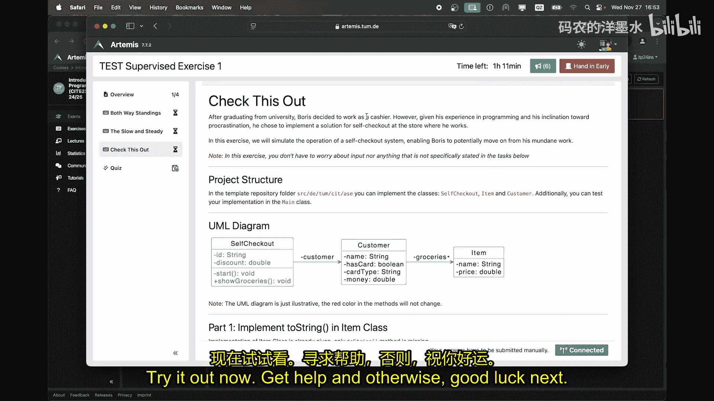

# 计算机编程：从入门到实战：34：监督测试练习指南

在本节课中，我们将详细介绍即将到来的监督测试练习（Supervised Exercise）的所有重要信息、规则和准备事项。请仔细阅读，以确保你为测试做好充分准备。

## 概述

监督测试练习是课程的重要组成部分，旨在评估你对所学编程概念的理解和应用能力。本节将涵盖测试的时间、地点、规则、技术设置要求以及有效的备考策略。

## 测试基本信息

下一周的监督测试练习将于周二晚上7点开始。我们建议你**最晚在6点45分**到达指定的加兴（Garching）校区教室，以便有足够时间进行设备设置。考虑到U6地铁有时会延误，请务必提前规划行程，预留缓冲时间。

官方答题时间为**90分钟**，但我们会额外提供**10分钟**以应对可能的技术问题。如果你没有遇到技术问题，这10分钟也可用作答题时间。

测试总分为**100分**。根据时间分配，你大约需要每**9分钟**完成**10分**的题目。例如，一道30分的题目，你应计划花费约27分钟。

## 练习顺序与时间管理

练习的顺序是**随机**的，并非由易到难排列。因此，我们建议你快速浏览所有题目，制定答题计划，并尽量遵守为每道题分配的时间。

我们已预先估算阅读题目、模板代码以及平均学生解题所需的时间。虽然这无法为每位学生量身定制，但我们尽力为大家提供充足的答题时间。测试的目的不是进行一场仓促的考试，而是让你有时间认真思考和解决问题。

## 地点与设备要求

所有监督测试练习都将在**加兴校区**进行，**不提供**慕尼黑市中心的考场。你必须前往指定的教室参加测试，未经现场监考人员许可，不得随意更换教室。

我们**强烈建议使用个人笔记本电脑**。请确保：
*   电脑电量充足。
*   集成开发环境（IDE）和Wi-Fi设置妥当。
*   能够连接到校园网（Eduroam），并准备好在VPN（Byon）上使用的备用方案。

如果你因故无法使用个人电脑，可以使用位于FMI大楼（Rashnahalle）的机房电脑。机房里约有80-90台电脑，但它们的设置特定，你需要提前熟悉。若计划使用机房电脑，请务必在**周日晚上之前**通过第28张幻灯片上的邮箱地址联系我们，以便我们做出相应安排。

## 技术故障处理

如果测试期间电脑出现故障（例如，系统自动更新），请立即联系监考人员。他们会尝试帮你快速解决。如果问题无法解决，你可以转移到机房使用备用电脑。因此产生的额外时间（如步行至机房的时间）会获得相应的补时。

Artemis平台会保存所有工作。对于编程练习，请**定期推送（Push）你的代码**。这样，即使设备出现故障，你已提交的大部分更改也会被保存，可以在机房的电脑上从该阶段继续答题。

## 考试规则与行为准则

本次测试为**开卷考试**，你可以使用任何资源，但必须**独立完成**，严禁以下行为：
*   使用任何基于人工智能（AI）的工具（如OpenAI ChatGPT、GitHub Copilot等）。
*   在线发布问题（如Stack Overflow、GitHub）或使用任何聊天工具（如WhatsApp、Facebook）与他人交流。
*   从家中远程参与测试。**必须**在指定教室现场参加，监考人员会进行核实。

任何作弊或可疑行为（包括未经允许的交流、使用AI工具、远程参与等）都将被视为学术不端，并依据考试规则受到严厉处罚，可能导致该模块直接判定为不合格。

## 特别提醒：IDE中的AI功能

你必须**禁用**IDE中的所有AI辅助功能（如IntelliJ IDEA中的AI助手）。我们已提供详细的禁用教程。监考人员可能会在考场内检查你的IDE设置。使用AI功能将被视同作弊，没有借口可言。

## 测试内容与评分

所有练习都侧重于**理解和解决问题**的能力。如果你习惯于死记硬背，这种方法在此行不通。最佳备考方式是完成我们提供的所有练习（作业、课堂练习、研讨会练习、辅导课练习），如果仍不自信，可以在Artemis的练习模式下重做。

测试中将包含编程练习。你需要在IDE中克隆（Clone）题目，完成后提交（Commit and Push）更改。**至关重要的一点是：你的代码必须在我们的构建服务上编译通过。** 在测试期间，你只会收到代码是否编译成功的反馈，而不会获得正确性评分。

**如果代码编译失败，无论错误多么微小（例如缺少一个分号），该练习都将获得零分。** 这是一条不可更改的硬性规定，旨在让你尽早适应编程工作的严谨性。

## 实用准备建议

为确保测试顺利进行，请提前做好以下准备：
*   **设备检查**：确保拥有可用的浏览器、JDK 17、正常工作的IDE（推荐IntelliJ IDEA）和Git。
*   **系统更新**：禁用操作系统的重要更新，以防测试期间被打断。
*   **关闭无关程序**：完全关闭所有与测试无关的应用程序和窗口。
*   **网络测试**：提前测试并确保能成功连接校园网（Eduroam）。
*   **禁用通知**：关闭所有社交软件、通讯工具的通知，避免干扰和嫌疑。
*   **充电与配件**：为电脑充满电，可自带充电器和插线板。如果使用蓝牙鼠标，确保其有电。
*   **单显示器规则**：测试期间**只允许使用一个显示器**，不得使用智能手机、平板、外接显示器等第二块屏幕。

## 问答环节摘要

以下是针对学生常见问题的解答：
*   **能否听音乐？** 原则上可以戴耳机听，但为避免干扰他人及难以监管（如接听电话），建议不要听。
*   **可以推送代码多少次？** 次数不限，但推送后需等待构建结果（可能20-30秒），请合理管理时间。
*   **是否需要引用外部代码？** 如果大量借鉴或改编了外部代码，最好引用。但题目设计上通常无需外部代码。
*   **能否使用在线编译器？** 只要是不含AI功能的集成开发环境（在线或离线均可），原则上允许。但最终评分以代码在我们的系统上编译结果为准。
*   **各练习之间是否关联？** 不，每个练习独立。但一个练习内的多个任务之间可能存在依赖。
*   **编译错误是否影响其他练习？** 不影响。一个练习的编译错误不会导致其他练习得零分。
*   **以哪次提交为准？** 以**最后一次**提交为准。强烈建议不要在最后一刻提交，以免因系统繁忙或最后时刻引入错误而失分。
*   **IDE的基本代码补全功能是否允许？** **允许**。例如，自动生成构造函数、Getter/Setter方法、`System.out.println`的代码补全等，这些是IDE的标准功能，不被视为AI辅助。

## 测试练习与后续安排

现在，我们将进行一次**模拟监督测试练习**，让你熟悉Artemis考试模式、界面和流程。模拟测试的题目取自往年真题，难度和内容与正式测试类似。你可以利用接下来的时间尝试，也可以稍后在提供的第二次机会中完成。

请注意，在正式监督测试期间，**你将无法就题目内容提问**，Artemis中的Iris助手也会被禁用。

理论部分到此结束。接下来还有两次辅导课练习和两次作业，请在**下周三研讨会开始前一小时**提交。请抓住机会在辅导课上完成演示，因为圣诞节假期后，课程将更侧重于项目工作。

## 总结

本节课我们一起详细了解了第一次监督测试练习的全部关键信息。核心要点包括：测试的时间地点、必须使用个人电脑并做好充分技术准备、严格遵守独立完成和禁用AI的规则、理解编译失败即零分的评分原则，以及通过完成所有既有练习来有效备考的策略。请认真对待这些指导，提前做好准备，祝你在测试中取得好成绩。现在，请开始体验模拟测试练习以熟悉环境。