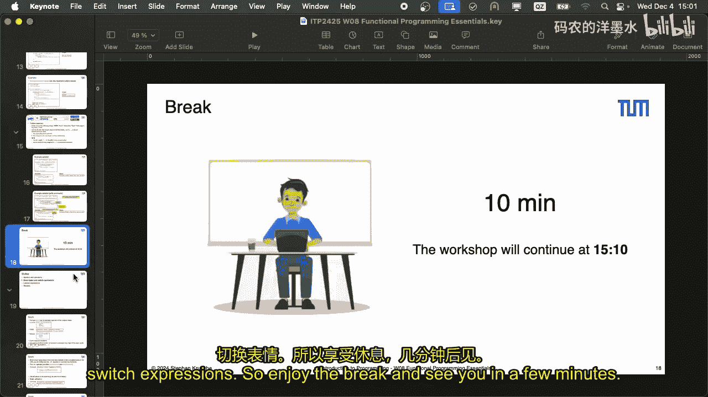

# 慕尼黑工业大学 计算机编程：从入门到实战：35：迭代器与集合

欢迎来到软件工程导论课程的第八次研讨会：函数式编程基础。课程已进行过半，我们昨天完成了第一次监督练习。希望你有良好的体验，并对课程内容感到满意。今天我们将聚焦于迭代器、集合，以及如何利用它们为内置数据类型和你自己的数据类型（基于接口）编写 `for-each` 循环。我们还将讨论 `switch` 表达式，这是一种更现代的控制流方式。你将学习匿名内部类和 Lambda 表达式，这些是当今非常重要的函数式编程概念，能帮助你更快速地完成任务。我们希望在本周结束时，你能够实现自己的 Lambda 表达式，因为当你想使用流（Streams）来编写更简洁的代码时，这些知识也至关重要。

让我们开始吧，首先从迭代器和集合讲起。

## 迭代器与可迭代接口

实现对象的有序集合有多种方式。我们有字符串，它是字符的有序集合。你见过列表和数组，它们是预定义类型对象的有序集合。即使是列表，也是以一种非常通用的方式实现的，因此你可以将它们用于任何类型。我们还见过集合（Set）、映射（Map），你基本上也可以创建自己的数据类型。

无论它们是有序还是无序，大多数时候你希望以特定顺序访问单个元素。为了做到这一点，重要的是知道之后是否还有另一个元素，以便能够跳转到下一个元素，并在处理完当前元素后将其移除。

由于这是一个反复出现的实现和想法，开发者为此设计了一个接口，这个接口叫做 `Iterable`。它是一个泛型接口，因此可以应用于任何类型。其核心思想是，除了可以定义相应的构造函数外，它还有三个方法：`hasNext`（用于检查实现此接口的可迭代对象是否有下一个元素）、`next`（用于导航到下一个元素）和 `remove`（用于移除当前选中的元素）。这基本上就是可迭代接口的理念，它也将是 `for-each` 循环的基础，稍后你将看到。

该接口还定义了 `iterator` 方法。这个方法返回一个 `Iterator`（迭代器）对象，这个对象稍后允许你遍历可迭代数据结构中的所有元素。这里需要非常小心：`Iterable` 是集合（Collection）的一个属性，一个集合可以是可迭代的；而 `Iterator` 是一个独立的对象，负责遍历集合。它们基本上是协同工作的：`Iterable` 定义了我们的集合，而 `Iterator` 是另一个可以遍历集合的对象。

我们可以看一个简单的例子：`IterableString`，我们基于 `Character` 类（记住，它是 Java 中 `char` 元素的包装类）来实现 `Iterable`。我们通过提供一个可以初始化字符串的构造函数，然后返回一个迭代器来实现。这个迭代器是我们自己的实现 `IterableStringIterator`，我们将在下一张幻灯片中看到它是如何工作的。我们看到 `IterableStringIterator` 实现了 `Iterator` 接口。

所以，`Iterable` 元素本质上是一个字符集合，我们可以遍历它。然后我们有 `Iterator`，一个实现了 `Iterator` 接口的独立类，它由 `IterableString` 返回。这里我们创建了一个新的 `IterableStringIterator`，以便使用它。

这个 `IterableStringIterator` 现在实现了我们在上一张幻灯片中提到的三个方法：`hasNext`、`next` 和 `remove`。我们不实现 `remove`，因为字符串不支持修改（字符串是不可变的）。如果你有自己的数据结构，如列表或数组，你可能会实现它。但现在为了保持简单，我们想专注于 `hasNext` 和 `next`。

`hasNext` 基本上告诉你是否已经遍历完字符串。我们存储一个当前位置 `position`，初始设置为 0，因为我们从字符串开头开始遍历。如果当前位置仍然小于数据结构（本例中是字符串）的长度，则返回 `true`；否则，如果我们在末尾，则返回 `false`，因为没有下一个元素（没有下一个字符）了。

`next` 方法基本上有一些安全机制。如果 `position` 等于字符串长度，那么就没有下一个元素了，因为调用者可能在没有事先验证 `hasNext` 的情况下直接调用 `next`。然后我们抛出 `NoSuchElementException`。如果不是这种情况（即我们基本上小于长度），那么我们返回字符串在当前位置的字符，之后将 `position` 增加 1。我们有一个指向当前元素的指针，返回这个元素，然后将指针后移一位。如果我们第二次调用这个方法，就可以返回第二个元素，并遍历整个数据结构。

## 使用迭代器

以下是使用它的方法。你可以创建一个 `IterableString`，创建迭代器，然后可以使用 `while` 循环：当迭代器有下一个元素时，导航到下一个元素并在同一行打印它（不换行），最后打印一个新行。注意，这里我们使用了一个你可能没见过的新关键字 `var`。`var` 是任何类型的占位符，它基本上使用类型推断，就像我们并不真正关心编译时类型是什么，只是使用你在这里得到的类型，它允许你为更有经验的人编写更短的代码，所以它更适合放在幻灯片上，这是这里的主要原因。然后你不需要指定类型。注意，如果类型从变量名中完全清楚，这有时是好的（在这个例子中，`s` 可能不是一个好主意，因为 `s` 并没有真正告诉你它是什么数据类型），但有时它是有帮助的。开发者之间总是有很大的讨论：我们应该使用它吗？

如果你实际上遵循了 `Iterable` 和 `Iterator` 接口，那么你可以写得更短。你可以使用 `for-each` 循环。所以你不需要使用 `while` 循环，你可以使用 `for-each` 循环，就像我们为集合数据类型看到的那样。这基本上意味着所有可以使用 `for-each` 循环的集合数据类型，它们都实现了 `Iterator` 和 `Iterable` 接口。这是 Java 中允许你使用增强型 `for` 循环的主要机制。增强型 `for` 循环由 `Iterable` 和 `Iterator` 支持。理解这一点很重要。这意味着你可以创建自己的数据结构，并支持其他开发者使用 `for-each` 循环。

让我们快速尝试一下，打开 playground，以便你能更好地理解这一点。请跟我来，将此代码复制并粘贴到你的 playground 中。我们从 `IterableString` 开始，你可以直接复制粘贴到这里。它会创建一个编译错误，因为 `IterableStringIterator` 尚未定义。我们只需转到下一张幻灯片，复制所有元素并同时粘贴进去。然后我们就有了它。然后在主类中，我们可以复制粘贴使用代码。现在，我们也可以根据你之前的问题看看它是否正确实现。我们需要导入 `Iterator`。无论我们使用 `while` 循环还是 `for-each` 循环都没关系。如果我们现在运行程序，你也可以调试它。然后，当然，好的，我有一些其他不工作的代码。让我去掉其他代码，我们现在不需要它。好的，我重新开始。我们看到它工作了。所以它打印了整个元素。当然，你现在可以导航，你会看到你进入了超类或接口。这不是我们想要的。我们想进入 `IterableStringIterator`。你真的可以在这里设置一个断点，以更好地理解它是如何工作的。如果我们再次运行代码，我们会看到 `position` 是 0。0 小于长度，所以我们可以继续。然后我们看到 0 不等于字符串长度，在这种情况下会是……让我看看我是否能在这里看到。不，我们必须……是的，看，这确实是由一个数组支持的，我们必须数一下，但它绝对不等于。是的，所以我们返回元素。我们可以一直走到最后，看到它实际上在工作。现在，之前的问题是，我们是否应该在这里放 -1。让我们看看会发生什么。如果你这样做，它只打印 “hello world”。所以代码绝对是正确的。如果我们去掉这里的 -1。我们也可以再次检查 `for-each` 循环是否真的有效。我猜这正是 IntelliJ 在这里推荐的：用增强型 `for` 循环替换 `while` 循环，这正是我们想在这里做的。然后你会看到这也有效。即使你没有在这里调用 `hasNext` 和 `next`，我们仍然可以调试它。我们仍然可以使用调试器。让我回去。由于某种原因断点被删除了，我们仍然可以使用调试器，看到在 `for` 循环中，它实际上首先调用 `hasNext`，然后调用 `next`。这是一个隐藏帧。隐藏帧基本上意味着这是由 Java 编译器完成的，它们将增强型 `for` 循环的代码翻译成你在这里看到的 `while` 循环。所以在后台使用了这种机制，但对我们来说，增强型 `for` 循环更容易阅读和理解，这就是为什么我们可以这样写它。

很好。所以，让我们继续。让我们看看这如何融入 Java 集合框架。我们已经使用过带有泛型类型 `E` 的集合。我们见过 `Set`、`List`、`Queue` 和 `Map`，它们使用 `Set` 作为键，使用集合作为值。

现在你可以看到，实际上 `Collection` 接口扩展了 `Iterable`。记住，接口可以扩展其他接口，这实际上我们可以在代码中看到。我们可以转到我们的 `IterableString`，然后转到 `Iterable`。是的，这确实是一个非常简单的接口。现在，如果我们打开 `Collection` 接口并转到定义处，我们可以看到 `Collection` 扩展了 `Iterable`。`Iterable` 使用 `Iterator`，所以它有一个 `Iterator`，有一个对 `Iterator` 的引用，这也是一个接口，这就是我们如何建模的。是的，`Collection` 作为接口扩展了 `Iterable`。`List` 也是一个接口，扩展了 `Collection`，后来 `ArrayList` 会实现 `List` 接口。通过实现 `List` 接口，它也符合 `Collection` 接口和 `Iterable` 接口，并且也可以使用 `Iterator`。无论你有一个 `LinkedList` 还是一个 `ArrayList`，一个 `HashSet` 还是另一个 `Set`，这都是基本思想。所以 `Iterable` 和 `Iterator` 允许我们使用增强型 `for` 循环，并对遍历某些元素的含义有一个非常简洁的定义。虽然我们可以仅为 `Collection` 接口实现这一点，但将其分解为多个接口是有意义的，这样其他人也可以重用 `Iterable` 和 `Iterator`，而无需符合 `Collection` 接口。

很好。当涉及到集合时，还有一些我们可以使用的额外代码，这些代码存储在 `Collections` 类中（注意末尾有 ‘s’，非常重要的区别，这是一个类，不是接口）。`Collections` 有一些静态方法，所以这并不完全是面向对象的。这些或多或少是函数，它们允许我们以特定方式操作集合。我们可以检查两个集合是否不相交（即它们没有任何重叠）。我们可以计算集合中特定元素的频率。我们可以反转列表的顺序，这在操作数据时有时很有用。我们可以用新值替换列表中的所有旧值，这也可以用字符串完成。我们可以根据 `Comparable` 接口的 `compareTo` 方法对列表进行排序，注意这里在泛型类型中有 `Comparable`。我们还可以根据给定的 `Comparator` 对列表进行排序。这里再次看到，我们分解了事物。我们有 `Iterable` 和 `Iterator`，你刚刚在例子中见过。现在我们有 `Comparable`，所以一个对象可以是可比较的；我们还有 `Comparator`。这是编程语言中的一个常见模式，你使用这些术语。`Comparable` 意味着你需要指定如何比较某些东西，所以你的数据类型（如果你有一个带有 X 和 Y 的点）可以实现 `Comparable`，然后你可以在点内部定义如何比较两个对象。你可以说，我先比较 X 值，取较小的那个，如果 X 值相同，我再比较 Y 值。然后你就定义了如何在你的数据类型中比较对象。但这只能使用和指定一次。因此，你也有机会定义 `Comparator`，我们稍后会看到，这些 `Comparator` 可以为特定目的指定。所以你可以说，在这个特定例子中，我想按 X 排序，但也许在另一个例子中，我想按 Y 排序，你可以根据需要定义按对象的哪个属性或特征对列表进行排序。所以是非常方便的方法，我们可以用来实现某些功能。你可以在 playground 类的静态 `void main` 方法中找到一些示例代码。我们使用 `Arrays.asList` 辅助方法创建一个列表。这也是静态的。我们还基于列表创建一个集合。然后我们可以反转它，排序它，使用 `disjoint`、`frequency` 和 `replaceAll` 方法。你总是看到灰色的注释，输出会是什么，所以检查一下，确保你理解这一点。这些都是你以后可以使用的辅助函数。所以这真的非常非常有帮助和强大。你可以看到，有了所有这些方法，你可以快速创建一个程序，而不需要考虑如何反转某些东西，如何排序某些东西。这就是使用接口进行面向对象编程的力量。

## 比较器与匿名内部类

现在我们已经看到这里使用了 `Comparator` 接口。`Comparator` 定义了一个你必须实现的方法 `compare`。这个 `compare` 方法的逻辑与 `Comparable` 接口中的 `compareTo` 方法类似，它们使用相同的逻辑。它们基本上接收两个相同类型的对象并返回一个整数。如果第一个元素被认为小于第二个元素，整数通常应小于 0（即 -1）。如果两者相等（无论你如何定义，这取决于你），则应返回 0。如果第一个元素大于第二个元素，则应大于 0。这是此方法的基本语义，然后你就可以对元素进行排序。例如，如果你想对整数排序，我们可以这样做。我们可以说，我们可以创建一个列表。是的，再次使用 `Arrays.asList` 辅助方法。这个列表有 18, 46, 18 和 12。然后我们可以说 `Collections.sort`，我们刚刚看到的静态方法，再次强调是静态的。我们将对象列表传递给它，并创建一个新的 `Comparator`。这个新的 `Comparator` 现在是在行内定义的，它是一个所谓的匿名内部类。这允许我们就地定义我们想要如何排序。我们不需要稍后创建一个对象，我们只是就地完成。所以这是一种实现类并直接使用一次的新方法，基于一个接口。这个 `Comparator` 必须实现一个 `compare` 方法，对于整数，我们可以简单地通过说 `i2 - i1` 来实现。这是一个所谓的匿名内部类，一个新概念。所以我们定义一个类并立即实例化它一次，以便使用它，然后它基本上就消失了，对吗？所以，如果你只想实现一个接口一次，并且就地实现，你可以像这样使用它。你不需要将它提取到你程序、项目、IntelliJ 中的单独文件中，并在那里实现它然后引用它。不，你可以直接就地完成。所以匿名内部类可以使你的代码更简洁，并允许你同时声明和实例化一个类。这些类没有真正的名字，没有必要，这就是为什么它们被称为匿名内部类。你像使用局部类一样使用它们，所以它们只能在你定义它们的文件中访问，不能在其他地方使用。在 Java 中，它们实际上经常被使用。

现在，如果你的接口只声明一个方法，它被称为所谓的函数式接口。你会看到这如何引导我们走向今天的函数式编程概念。那么你就不再需要定义它了。你可以使用 Lambda 表达式，我们今天稍后会学到一点，这是对今天下一个单元的预览。如果你想做得更短更简洁，你可以像这样写，避免所有样板代码。虽然这对初学者来说更难阅读，但它更简洁。你知道，程序员喜欢如果他们能写简洁简短的代码并避免所有周围的样板，因为代码越少，需要维护的东西就越少，这是其背后的基本思想。如果你将其与上一张幻灯片比较，你会看到最重要的信息——你将两个整数映射到 `i2 - i1`——写在这里，并且是以你能想到的最简洁的方式。我们并不真的需要说我们想实现一个接口并想重写一个方法（如果只有一个的话），我们可以写得更短，但关于这一点稍后再谈。

在这个特定例子中，你可以使用的另一个替代方法是 `Comparator.reverseOrder()`，因为有一个预定义的 `Comparator` 用于降序排序。这对于整数来说是开箱即用的。所以甚至不需要定义它，因为你并不是第一个想对整数排序的人。许多人以前已经做过。这就是为什么他们在 `Comparator` 接口中提出了这个静态方法 `reverseOrder`，你可以使用它，它允许你降序排序列表，然后结果将与之前相同。

到目前为止有什么问题吗？很好。这是匿名内部类的另一个例子。我们有 `Runnable` 接口，它定义了任何可以运行的东西（通常是任务）。再次看到，它是 `Runnable`，就像 `Iterable` 和 `Comparable`，它们总是使用这些名字，以便更容易理解。所以 `Runnable` 是任何可以运行的东西，你可以通过实现 `Runnable` 接口来定义你自己的 `Runnable`。再次，我们在这里使用这个匿名内部类语句。是的，我们说 `new Runnable()`，基于接口名。如果你在代码中这样做，在你的 playground 中，如果你进入 `main` 方法，如果你说 `new Runnable()`，好处是即使在 IntelliJ 中，没有 AI，它也会为你完成所有需要做的事情，并自动为你补全。然后你甚至可以创建相应的方法。是的，如果你点击它，你可以说“实现方法”。然后一切都为你完成了。是的，我可以说 `var` 或 `Runnable myRunnable = new Runnable()`。是的，它们甚至建议用 Lambda 表达式替换它，但现在我们对实现这个感兴趣，所以我们不会替换它。工具支持真的很棒。然后你可以运行代码，在这个例子中，它将调用这个行内定义的方法。你仍然可以在其他地方这样做，你仍然可以说，嘿，`Runnable myOwnRunnableClass implements Runnable`，但大多数时候这是不必要的。

匿名内部类也可以实现多个方法。所以，如果你定义你的接口 `Executable`，你想执行某些东西或异步执行某些东西，这也是可能的。再次，IntelliJ 帮助你重写接口中定义的所有方法。在这种情况下，我们需要实现两个方法。此外，你可以定义你的辅助方法。所以匿名内部类就像一个真正的类，你可以定义属性，甚至可以声明更多方法。唯一的问题是，这些方法可能无法从外部访问，因为这里我们使用的是接口类型。所以，如果我现在定义额外的方法，让我们在我们的例子中这样做。是的，如果我说，这个得到一个，我不知道，一个字符串 `s = "test"`。是的，像这样的东西。我必须正确书写，`private String s = "test"`。我有另一个方法，我甚至可以把它做成 `public`。是的，例如 `getS()`。那么这段代码是不可访问的，是的，我们可以运行它，因为我们这里有接口，但我们不能调用 `getS()`，即使它是 `public` 的，因为我们没有这个类型。它是一个匿名类型，我们无法真正获取它。所以对于匿名内部类来说，这并不真正有意义。是的，当然，我们可以在这里面使用它，我们可以说 `getS()` 并做任何我们想做的事，但在它外面，我们无法真正访问属性和方法，因为类型是匿名的，不可用，而且也不可能将这个对象强制转换以获取运行时类型。所以再次，你必须区分编译时类型和运行时类型。

很好，让我们做一个快速练习。我们恳请你打开 Artemis 和 IntelliJ，完成这个小练习 W8E2。这是一个相对较短的练习，你有大约 10 分钟的时间来完成。想法是创建一个包含一些字符串的列表，随意使用你最喜欢的汽车品牌或任何其他类型的字符串，这取决于你。你可以使用 `Arrays.asList` 方法来完成这个。然后我们希望你能根据字符串的长度对列表进行排序，所以最长的汽车品牌应该排在第一位。通过使用匿名内部类来实现。所以回去看看我们在幻灯片 11 中是如何做的：`Collections.sort` 与 `new Comparator`。像幻灯片 11 那样做吗？你应该根据两件事排序：首先是最长的字符串（在这个例子中，应该是 Volkswagen），如果两个字符串长度相同，则按字母顺序排序。我们有两个提示给你：你可以在 `compare` 方法中使用 `s2.length() - s1.length()`。你可以使用 `String.compareTo` 方法进行字母顺序比较，你不需要自己实现。所以检查一下这个练习并完成它，如果需要帮助，导师会四处走动。大约 10 分钟后，我们继续研讨会。玩得开心。

好的，我们需要继续了。我给你看一个快速的示例解决方案，你仍然可以在今晚之前在 Artemis 上完成这个练习。这是一个示例解决方案。这是我们打算用匿名内部类实现的解决方案。注意，我们说 `Collections.sort`，我们传递一个列表，你可以在理论上随意命名它，然后我们有基于 `String` 的 `new Comparator`，这很重要，这不是一个整数列表，而是一个字符串列表。`compare` 方法的工作原理如下：我们检查两者是否具有相同的长度，然后我们使用 `s1.compareTo(s2)`，这是我们的字母顺序排序，我们的字母顺序比较。如果不是这种情况，如果它们长度不同，那么我们返回 `s2.length() - s1.length()`，类似于之前整数例子中的 `i2 - i1`。所以，字母顺序比较是第二级比较，只有在长度相同时才进行，否则我们从最长到最短的字符串排序。

这在理论上也可以用 Lambda 表达式解决。你也不一定需要使用 `Collections.sort`，列表本身也有一个 `sort` 方法，所以这当然也是一个有效的解决方案。当然，这个例子侧重于 `Collections.sort` 中的 Lambda 和匿名内部类，但只是让你知道，我们可以用不同的方式写这个。然而，正如你所见，Lambda 表达式在这里有点复杂，它不是只有一个简单的一行代码，因为我们有两种排序方式。还有其他问题吗？你是指在第二个替代方案中吗？让我推迟这个问题，我们还没有介绍 Lambda 表达式，我们将在今天晚些时候详细介绍。这只是供你参考，如果你在今天研讨会后重新查看幻灯片，它会是什么样子。

还有其他问题吗？好的，这些是非常典型的练习。是的，所以假设类似这样的东西可能会出现在二月的第二次监督练习中。我们现在快速休息一下，在下午 3:10 继续第二个单元，然后我们将看看枚举类型和 `switch` 表达式。所以享受休息时间，几分钟后见。

