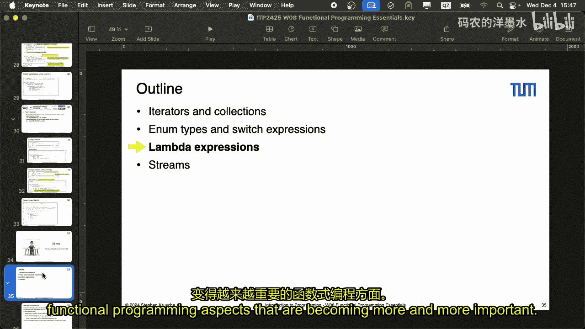

# 【全集】慕尼黑工业大学 计算机编程：从入门到实战 中英字幕 p36 Lecture 36 - 枚举类型与 switch 表达式 -BV1WFrTBZExY_p36-

Okay， please take a seat， we slowly like to continue。In the next unit。

 we'd like to cover inum types and switch expressions。Enums are types with a finite range of values。

 so in contrast to strings where you can have arbitrary many values。

 you sometimes want to limit the amount of values that a data type can have， for example。

 a P status can't be anything it could be that it's ordered that it's ready and that it's delivered。

 maybe a few more but for now let's keep it simple。

 and this is how you can define that instead of saying public class or public interface or anything else。

 we say public enum， we give it a name and then we have different values in a comma separated list。

 and this is the most easy example that you can define。And with that。

 you can only have three different values， which is much faster than using strings or inte just later on。

 and which also makes sure that you cannot come up with a wrong value。You can use it very easily。

 you don't need to create an instance of it with the new operator instead you can use it as it would be static。

 a static attribute in a class and you see an example here how to do that。

 we can just say P status statusus equals P statusus。 ordered，😊。

On purpose that we write it in capital case because it's a constant it this value here is constant cannot change。

 of course the status can change， you can simply reassign a different one and you can also print it out if you want so the general schema is public enum then you define a name and then you have multiple values in a comma separate list it's not mandatory to write it in capital case you can also write it in any case but it's recommended。

And the idea here is that you have a fixed number of constants。

 you can change that during compile time， but you cannot change it later on during runtime。

 and this is particularly useful for many different things in our real world。

 so if you for example want to specify the days of the week from Monday till Sunday or the points of the compas north。

 south， West and east or certain positions or any kind of status that you want to track in your application。

The enum types ensure that only one instance of the constant exist in the whole process so we can safely use the double equals operator to compare to variables and this also means that it's super efficient they are basically backed up by integers that are stored internally and this means that it's much faster to use an enum instead of a string so it's always a thing that you can consider if you want to limit the amount of values to constant。

Types， yeah， values then you want to use an enum。If you want to give the end user free choice。

 it's not a good idea if you have a system where the end user can type in their name。

 you probably want to use a string because you don't want to list all the names in your system and people might even come up with new names later on。

 so this is really only necessary to use enNs if there's a fixed amount of values that you know during development time。

The inam type has a method dot values that allows you to get all of them， for example。

 in case you want to iterate through all of them or you want to print out all the different possible values。

 for example， to the end user so that they can decide。

You can even define that this is now a bit more advanced and not necessarily used very often。

 you can also define attributes， constructors and methods in enums as you would do that in a class itself。

 so in addition to the three values ordered ready and delivered which now look a little bit more difficult。

 we can also define an attribute time to delivery， we can define methods is order is ready is delivered and another method public and get time to delivery and a constructor pizza status that takes the time to delivery。

Now， during the values， you basically invoke the constructor。Of this type， later on。

And then you pass5，2 or 0 into it。 And this also means if you create。A P status， for example， ready。

 or if you use the one， the dot ready one， you can also invoke methods on it。

And you see that we can even override methods。Similar to a subclass。

 it looks similar to a subclass here。 And while the standard methods are all returning falses。

 we only。Override， the one that returns true。Again， this is a very advanced example。 Tpically。

 you don't really mess up with overriding things in in values。 This is something that you only do。

In rare cases。And enum values or enum types can particularly used very well together with switch statements。

 remember in the second workshop we focused on control flow and you learn that if you have multiple if。

 else if， else if cases， then it's quite useful to use the switch statement and you see an example for the switch statement for an enum type here。

 we can use it with an enum type and then do switch on the specific name of our variable and then use the different values next to the case statement。

 so in case the status is order we return five in case it's ready be return to and so on。

While this is particularly useful， switch statements have certain， let's say。

 weaknesses that we want to get rid of and that are not particularly nice in terms of the development experience。

😊，So first of all。If you forget an in value。Either because you didn't really look into all the values or because someone added an enum value later on to implement new functionality。

 maybe you have a new pizza status delayed。IfIf the pizza service personnel is ill， for example。

And then we don't really get a warning， we don't really get something out here yeah but it's forgotten and it might not be handled in some places of your code and you also even if you would cover all of them you still need to provide a default value even though it doesn't really make sense we have covered all the different values of our enum type and it can't really go into this so in some sense this is that code it will never be invoked but we need to specified and this is cumbersome because then it's easy because you return an in。

 I can just say minus1 but let's assume you might return an object how would I do that yeah I mean I could return null but then my method is not null safe anymore so this can be quite a hassle。

Good news is we have an alternative called Sw Expresss which is a bit more difficult so we teach it to you a little bit later。

 not in the second workshop but now in the eighth workshop and this is available since Cha 14 luckily we use Cha 17 in this course and you can even use later versions and here we have a more elegant syntax for the case distinctioner。

😊，And。😊，Coup of those problems of the switch statement have been solved。

 Remember that in the second workshop， we also distinguished what is a statement versus what is an expressioner。

And his theory also applies to this particular case。

 so a switch statement is really a pure statement。😊。

While a switch expressioner is an actual expression in Java。 So looking back。

 you see that we have returned five here。😊，Because we return the whole method。

But the statement itself cannot return something。While in the other case。

 we returned the whole statement。Or the whole expression to be correctly。

 we return the whole expression because the expression itself returns something。

So it's also possible to capture the return value of the expression in a variable or to directly return it。

It's a real expression。And the good thing is we are forced to cover all the values。

 we have to cover all the inum values here。😊，And if we don't do that， we get a compiler error。

 Our code will not compile。 This means if you later on change your code and you add a new value delayed。

Then your compiler would give you an error in all the different places where you're used to switch expressioner。

 you can edit and you will make sure that you will not forget it。😊，You could still use the default。

Statement， but especially for enum types， it's not really necessary because then you lose this compiler feature。

Another difference is that it's super difficult to understand that the switch statement has this fall through mechanism。

 remember if you don't return or break it falls through and this is really very hard to understand especially for beginners and this is not the case anymore for switch expressions。

 they do not fall through。😊，Only the case is executed that is actually hit based on the current condition。

 so this is a big difference。So let's assume we add De and then we would get a compiler error here。

 the compiler would say the switch expressioner does not cover all possible input values and it's kind of illegal and you have two options either you add the delayed case or you add 84 case if you don't care。

 but it's up to the developer it's not up to the compiler to define this and in this particular example we add delete in order to make the compiler happy again and in order to have a good program that does not forget some kind of implementation and this would not be possible with the oldst switch statement。

And in fact， the old style switch statement should not really be used anymore whenever you try to use it。

 and Teleliche will immediately provide a hint whether you would like to switch to the new style for the switch expression because it's so much more powerful and this is what you can see in the additional examples on slide 27。

😊，We can also use it for a string and with some kind of what is called PEal matching。

 you can even combine multiple cases with a comma。And。We can do different things。 We can。

In bulk methods， we can assign values。And we can even have with Curly Bra's multiple statements after each other。

We can also assign the result of a switch expression directly to another variable。😊。

The only thing is we then need to make sure that all the different cases and the default statement if or the default case。

 if we have it， actually returns something。😊，And in order to do not confuse the return statement of a method and what is returned in the switch expression。

 the developers created a new。😊，keyeyword called yield。And we see it here。

 So this is an alternative where we。Have a big block and then instead of doing a return here to make sure that the switch expression returns something in the end。

 we have the yield statement which is kind of similar to the return statement but allows us to not confuse this with the method that in which the switch expression is embedded。

So a new keyboard， if you see yield， you will notice this is a switch expression。Great。

 here's another example that makes a little bit more sense， or we could， for example。

 left an Enam day of the week， Monday， Tuesday， Wednesday， Thursday， Friday， Saturday and Sunday。

 and in our playground we could then create。😊，Value out of that inum， so for example， Friday。

And then we could simply return the number of characters， very simple example here。

 and you see we can collapse multiple cases Monday。

 Friday and Sunday will yield six while Tuesday will yield7， Thursday。

 Saturday8 and Wednesday will yield nine， and we can capture the result of this expression in a new statement and then。

😊，Priinntted to the console。And this is what you need to do in a small exercise now。

 so we would like you to try out enums and try out switch expressions。

 and we have an easy exercise for you， we'd like you to create a switch expression to return the number of days for a given month。

So you need to implement the method in days of months， end month， that's the old way of doing that。😊。

Yeah， but you can still use a switch expressioner。Counting with 1，2，3，4，5，6，7，8，9，10，11，12。

For the integer， so January would be one， February would be two， and so on。Or。

 and this is the optional challenge if you find this is too easy doing this in a switch expressioner。

😊，You can create your own inner month。With all those 12 values。

 which is much better than storing it in an inte show or even in a string and use this one instead。😊。

So please work on this now， you have around 10 minutes tutors will go around and then we'll show you an example solution。

Okay， because of time reasons， we need to continue。 so please stop working for a moment。

 You can still finish until tonight， and I'll quickly show you an example solution。

 The first part in the slide 31 solves the。Initial part of the problem statement where you use int。

And we can then define that January representing1， March 3， and so on， 57，8， 10，12。Yield to 31。

 and this is then returned in the method as well。February normally yields to 28。

 we don't do handling of the exceptions every four years and then April， June。

 September and November yield 30 now if we do it with an end we still need to do the default case because people could invoke the method with negative numbers with zero or if anything larger than 12 and then we can for example。

 throw an illegal state exception or any other。Meaningful exception。

In the optional challenge we actually define an enum called Month with the values， January， February。

 and so on， so you see it's already easier for people to use it because they don't need to remember whether June is6 and Julyli is seven。

 while this might be easy for most of us when it comes to 12 months。

 there could be other cases like for example in the pizza status。

 I can't recall if ordered or delivered is the state one or state2。

 so using ver is much easier for people to identify that。And。😊，Secondly。

 we can get rid of the default statement and can still combine all the cases that yield the same number。

There are a few。Annotations on slide 32 that explain the code as well。

Are there any questions regarding this example solution？Great， when we carefully look into the。

Java frameworks that are delivered as part of the TDK well see that there is already an EnM month so we don't really need to define it。

 we just did that on purpose for this particular exercise but later on if you want to deal with months then you don't need to do that you have given EnM and this is actually quite powerful because it also takes the leap year into account and can then yield 29 if February has 29 days or 28 if February has 28 days and they also call it length。

And Liia is a para here so you can either define it or you can use the calendars in Java to automatically determine that。

 so you might not need to define your own enums， some of them for given elements are already available inside Java。

Great， that's it for the second unit， we'll have a 30 minutes break and continue at 15 past four and enjoy the break and see you afterwards when we talk about Lada expressions and streams。

 functional programming aspects that are becoming more and more important。😊。

