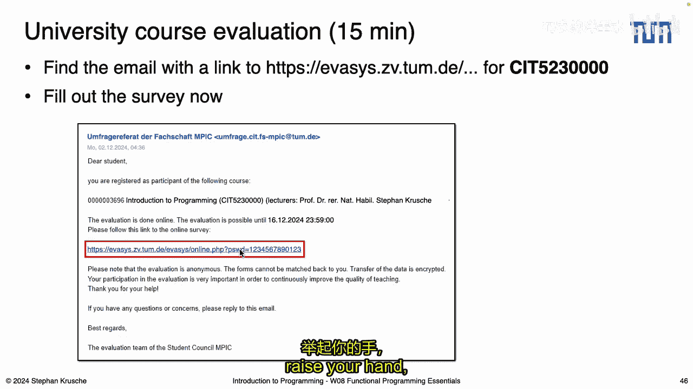

# 【全集】慕尼黑工业大学 计算机编程：从入门到实战 中英字幕 p37 Lecture 37 - Lambda 表达式 -BV1WFrTBZExY_p37-

In the next unit we would like to cover Lambda expression， you've seen a sneak preview。

 and now we'd like to explore them in more detail。First of all。

 Lada expressions provide a way to write very clear and concise code。

 even though it might be a bit more difficult to understand for beginners but you will get used to it。

 the idea is if you have an interface with only one method， a so-called functional interface。

 then you can turn it into a Lada expression and this is particularly useful for many data manipulation operations。

 for example， if you would like to iterate over something。

 if you would like to filter something or if you would like to extract data。

And this allows you to save a lot of boilerplate coat。Now。

 Lambda expressions are kind of shortcut for anonymous inner classes。

 and you can see the syntax of them on slide 37。The idea is we have an argument list as input on the left side。

 and then we have an arrow and on the right side we have the body。

 the body can contain expressions and statements， and it can include curly braces if you have multiple lines。

 but it is also possible that you leave out the curly braces。😊。

The argument list can be empty if you have a method without any input， it can be one argument。

 or it can contain multiple arguments。😊，Here's an example when you have no arguments。

 you need to write the rounded braces so that the compiler knows there are no arguments。

 if there's only one argument you can leave out the parentheses and this is even shorter and easier to understand and if you have multiple arguments you need the parentheses again and you need to put them on a comma separate list。

😊，Notice that we do not define or do not write down their types here。

 their types are already defined part of the functional interface。

 you do not need to repeat them here， and again this is in order to avoid boiler plate code。

We have an example here。 We have a list with integers，1，2，3，4，5，6，7，8，9，10 and now。😊。

Even another way to implement a loop， so instead of doing the traditional for loop。

 instead of doing the Y loop， instead of doing the enhanced for loop you have a fourth alternative。

 you can invoke a method called for each and this for each method takes as an argument a lambda expressioner。

 this Lada expression has one input。Parameter， which is namely the value。

 the element in the corresponding list， you iterate through all of them。😊。

And it has an output and in this case the output does not return anything。

 so there is no return statement involved， but you can print out something。

 so for each method takes one argument and does not produce an output。

This is important to understand， and this then is another way in order to loop through something when you are not even interested in any four or while loop syntax anymore。

😊，Here are more examples on how to deal with Lada expressions we can for example use them to sum up values。

 we have another list from one to9 with integer values。

 and we create a filtered list and first of all， we used it for each method with the lambda function or expressioner with the input n and represents one then two then three and so on。

And then you see we have curly braces because we have a more difficult statement here。

 we do not just have one liner， and we say if the number is dividable by3 with the modular operator。

 then we add it to the filtered list， so the filtered list only contains elements that are dividable by3。

 so this would be3，6 and nine。😊，And then we can。To use another ada expressioner this time without a body in order to sum up those values。

Notice that if you want to use a variable inside this Lada expression， this is possible。But then。

This variable。Needs to be。Dfined in a specific way。 It needs to be effectively final。

 If it is effectively final， you can't manipulate it。 And this is why we use a static。

Integer sum here and not one that is defined in here。

 This is a limitation because those lambda expressions are invoked multiple times。

 and they cannot easily capture mutable state they can only capture something that is effectively final。

 we will see that in a few minutes in more detail。 And finally， we end up with the P sumal 18。

3 plus 6 plus 9 is 18。 Any questions regarding this first example or these first examples on slide 38。

We have some annotations so that you can understand it a bit more easy。Great。

 so I already told you that Lambda expressions use this idea of a functional interface。

 Any interface that only has one single method is a functional interface。😊。

And its implementationer can be treated as a Lada expression。

And this follows the idea of the interface segregation principle。

 and one important principle for object oriented programming。😊。

And this means that if you want to implement an interface。

 you should never be forced to implement something that is not required to you。

 and this is perfectly implemented if you only have one method to implement。

 if you decide to follow this interface， you implement a method。

 but there are not any other methods that you don't that you're not interested in that you have to do。

😊，We can use this on our own。 We can define a functional interface。

 we call it square and annotate it。 This annotation is optional。

 but helps you to better understand that。😊，And then we simply say a square。Has an area。

 And that's the only thing that we want to do with the square for for now。

 So it's a functional interface， only one method。 And in order to calculate the area of a square。

 we need the length of the square because the width and the height are identical。😊。

And this now looks quite interesting， but you could implement a square using an anonymous inner class。

 you could say equals new square and then implement a method， or you can use a Lada expressioner。😊。

And this Lada expression is just a definitioner of the area method。

 so you say I input length and I output length times length because we have one input here and we have a return value。

😊，And then we can use square as if it would be a real object of a real class。

And we can invoke it with the input 5 and print the area， the return value 25。Now。

 let's have a look at how this works in our playground。 So let's copy the functional interface。

And paste it into our program。 You see， this is perfectly fine。 There are no  error messages。

 And now in the main。Class or in your playground class in the main method， we can now say square。

Square equals。And what you normally will do test with the information that I。Showed you before the。

Large break。 We would create a new anonymous inner class like that。

 And Intelliche is super helpful with the。Actual boilerp code。

 except that it doesn't get it right how to implement a method and now you see this is gray。

 gray always means that there is some kind of improvement that you can do or it's a comment。

But for this improvement here， we can say replace with lambda。 And then you see the square。

Reduces or the， the， the inliche reduces all the boilerp code around it。

 And what remains is the essential information。 We have an input length。 We call it length。

And we have an output， length， times length。 And this really looks like a pure mathematical functioner in the end。

 And this is why we also call this functional programming。 And then we could say。😊。

In area equals square area with5。 And then we could do a system out print line area。

 And then you can。Run this code and potentially debug it as well if you want。

 and then you see it will output 25。 and I don't know if I do 15。 it will output 225。

So while this looks really interesting and maybe a bit overwhelming for a beginner。

 you see it's a very concise and clear way to define what we want to do and while of course it might be difficult to define your own interfaces in the beginning。

 you will see that there are many functional interfaces within the Java programming language already defined for you。

😊，Any questions regarding this？Greatly then we can continue。😊。

There's another thing that you need to know。 And this is that those lambda expressions。

Even annoy some developers， because sometimes it's really more or less the case that you want。

The method to invoke another method。And this is。The case when you basically just pass input towards the other method。

 and then people find it annoying to write it like that， right。

 So here we see an example of a method reference。 A method reference is something that is not super easy to come up with。

 but where Intelche also will recommend you to use it。And there are different kinds that you can do。

 And just to show you how this would work。Normally。

 we can put that into Intelliche into our playground and give it a try。 So let's assume we have this。

List of car brands that we have used before。Maybe we also call this car brands here。2。

Better show you what's going on。 And now， let's assume I would like to print them。

 So a beginner after workshop 2 should be able to do it like that。 Yeah， for in I equals 0。

 I smaller than car brands size。😊，I plus plus。And then system out print line， car brands。Get I。

 right， So except that we use the list now， this is the easiest way in the beginning that you do。

 right？ Now we can replace this with an enhanced for loop。Looks already better。

 We have to do less handling of indices and so on。 And we can't get things incorrectly。

But if you are now opting for functional programming。 So after workshop6。

 you can also do it with the for each loop， right， we could say for each。

Or for each method that takes alumna expressioner。 And you see， this basically works with a consumer。

 So we could do this with the。Anonmous inner class based on this consumer interface。

 we can look that up a consumer。 It's a functional interface。😊。

With one method except and a few other things that we ignore for now。And then， we could say。

System out print line， S。RightSo this would be the way to do it with an anonymous inner class。

 but that's not very concise and looks even more difficult than this one here。

 So let's turn this into a Lada function inlichse our friend。😊，And then you see for each S， yeah。

 that's the string， maybe we can rename that now car brand to make it more concise。

 we print out this car brand to the console。😊，And as you see。

 the input that we use here in the Lada expression is the same as the input in the method that I pass here。

 and some people find this annoying because they have to write things multiple times and they are so annoyed that they came up with the idea of method references。

😊，And again， Intelliche helps us here and say replace Lada with method reference。

And now it's even more concise and it basically tells you for each car brand in this particular list。

😊，Just print it to the console。 And I don't care if you call this S。

 if you call this car brand or if you。Use any other name。 I don't care。

 I just want you to pass the input that I give to you in this Lada expression into this particular method system out line。

 And that's the main idea behind method references。There are different ways。

Where you can use method references， you can use that for static methods。

 This is a static method that we have used here， system out print line。

But you can also use this for object methods or for an instant method of an arbitrary object with a specific type or even for constructors。

 And while I personally don't program like this that I say car brands for each system out Co on colon on print line。

 Intelliche will always ask you to convert like that and you need to decide if you do that or not。

 I personally find Lambda expressions。😊，Good enough。I am not a big fan of those method references。

 if you ask me， I think it's a bit too much optimization in the end and a bit too concise and also hard for beginners。

 but some expert developers， they really love it and this is why we have to teach it to you as well because a lot of code that you find later on will use it。

😊，We have another example here where we have some numbers， again， based on an error list，5，3。

50 and 24。And we to we want to sort them， and you've already seen how to sort using an anonymous in class。

But you can also use a Lada expression now。 Yeah， we have two input parameters in the Compm method。

 Remember， this is the compator interface。 We have two inputs。

 and then we can use the compare two method of the underlying integer in this case。

 So we compare two integers with each other。😊，And of course， if you like method references。

 you can then also just write it as inteture compared to。 and this means you。😊。

Passed to input parameters into this particular method。As a reference。 But now the question is。

 is it really obvious that a， the first parameter is used as an object here。

Where in on which you call the method and the second one B。

 the second parameter is used as an input to the method。 I would say that's not really clear。

 And this is why I would not write it like that in the third line here。

 I would always prefer the second line because for me personally， that's easier to understand。

But again， this is up for discussion。And if you ask yourself what kind of method reference you use。

 this is kind3 is an instance method of an arbitrary object with a specific type。

 and this is how we write it like that， we used to compare two methods of the integer class。😊。

Any questions regarding method references？Great， here's another example and this is now where it becomes interesting also for your own projects with your own data types。

 so assume you create a project where you want to do some kind of drawings in a two dimensionional space then you need points we've covered them already so the first code here should be familiar to you just have two attributes of type double X and y and constructor to create new points based on that information and a gather for X and Y and a two string method。

😊，Now let's assume we create a few points， P1， P2， p3， P4。

 with some arbitrary values for x and Y it doesn't really matter here。

 and then we have a points list again with our little nice helpPA arrays S list， P1， P2 p3， P4。Now。

 let's assume you would like to sort those points after their X values， Well。

 you could come up with your own sorting algorithm。Have fun。 Of course。

 you could also use Lada expressions and anonymous in classes。

 but you could also use something like this。 Yeah， we say comp dot comparing。

 And then we only specify the attribute based on the getta。😊。

Because this is the public one that we want to use in order to sort。 And that's， again。

 a very powerful way to do that。 You don't need to implement sorting。

 You can just trust that the sorting within Java is fast enough。

 You also don't need to implement some kind of compwriterator with this ugly interface。

 Yeah I always forget to a need to return negative number0 and a positive number in which cases you don't really care。

 you can just say comperate comparing and then you sort after x in an S caning way。😊，Now。

 if you want to get。sortred in a descending way， you can just reverse it and of course you could also say。

 hey， I'm not really interested to sort after X I'm interested to sort after Y and then you specify that here and with that you can really specify in a very concise way no matter if you use Lada expressions or a method reference here。

 how to sort things in your own data and this allows you to have very fast prototyping in your projects question。

😊，So the question is question is is sorting in an ascending way default。

 if you use the compator comparing yes， this is the way you can also look this up again in the documentation if you go to the comparator class。

And if you look up the structure。You can see they have quite a lot of useful stuff in here， sorry。

Let's do it again。 Yeah， Here we go。 And then we see that there's this comparing。Method here。Yeah。

 and you see how they call it。 They have a key extractor。 Yeah。

 so you have to extract the key after which you want to sort it。 and then they have a key comperator。

 This is how they define that。 And I think there's also a method where you only have one。

Argument exactly here。 you only have the key extractor。

And then you see this accepts a function that extracts a sort key and returns the comp that it compares by that sort key。

 and this is then the one that you can use and pass into the sort method。

And this is by default sorting it in the ask any way and then you see that is this reversed method here it's a default method and this will basically reverse the order and the underlying code looks quite difficult and also you see that we have those weird question marks we have。

Generic types。 But if you just ignore this for a moment and also ignore the implementation。

 you might recognize that this is really， really powerful。 we have a natural order。

 which is the default one。 We have the reverse order and so on。 so this is this is really powerful。

 And coming up with this code on your own。😊，Can be quite cumbersome。

 if you have to do this on your own， the underlying code that is。

The idea in order to get the functionality done， this is quite difficult。

And you see that we also have some documentation the most essential aspects of it in here。

 in this case， we use it for double， but of course you can also use this for any other data type question。

So the question is in the previous exercise， you had to sort in a descending way based on the length。

 if I remember correctly， and you could use this one here as well， Yeah。

 that's for sure you could use those statements。However。

What you see here is you always only sort after one key after one aspect。

 if you want to sort after multiple aspects， it gets a bit more complex and then you would basically need to combine those compators and tell Chaba how you want to combine and what is the first key and what is the second key after which you sort and I'm to be honest I'm not sure if this is possible with those Lada expressions and method references in such a concise way。

 pretty sure people thought about that already and there's some kind of framework that can do that。

But in in those cases， it might be necessary to use if statements again。Any other questions。

So the question is， can we also do minus x here somehow if you define a get。Get minus x， yes。

But then you would need to add this as a method here。

In a direct way I don't think it's possible in a direct way to reverse the number itself yeah but might be possible yeah find it out and nowadays the good thing is with artificial intelligence this becomes much easier to identify so in your case I would now copy and paste this code。

 give it to CCT and ask it can I revert the number can I do multiple sort characteristics with a similar approach or not and then you can find it out on your own。

So you might ask yourself now what's the difference between a lambda expression and an inner class。

 well they are quite different in terms of scope， and this is rather important to understand。

AndIn class always creates a new scope and I've seen that I've shown this to you before。

 you can use attributes， you can create additional methods and those are available within in this scope and you can even use to this keyword within this scope and anonymous inner classes are then a bit more powerful in lambda expressions in that sense however most of the times you don't need this and Lada expressions are much easier and more powerful to use then in terms of functional programming because you can if you easily concatenate things you are not interested in scope and you're not interested in state yeah this is also quite interesting that with Lada expressions you typically do not have any state that you hold and this is something that is quite important for functional programming Now Lada expressions on the other hand work with a so-called enclo。

😊，scopecope。 And this means that。You can't really hide variables from the enclosing scope inside Lambda's body。

 what would be possible with anonymous inner classes。

 you can still use this as a reference to the enclosing instance that's the outer class to speak while in an anonymous inner class if you use this。

 you would always refer to the inner class and not to the outer class that's the difference here。

Some best practices when you use Lada expressions， try to keep them short and self-explanatory if you have very。

 very large method bodies， that's not the intention of Ladas。

 Ladas are typically just one line us and in rare exceptions they are two， three， four。

 five lines long， but I've never seen a Lada expression that was really really much longer because then you don't really get the benefits out of them。

😊，If you can avoid blocks and write it as a one liner。

 sometimes this is not possible but try to do that and if there's only one input parametermeter。

 then also leave out the parentheses and use type inference to automatically determine the type。

 this also means that you need to use good variable names if the type is not visible to the programmer who is reading the code or someone else might have a hard time understanding it。

 but if you use good variable names that somehow tell you what kind of type it is。

 then it's much easier to understand。Avoid parentheses， if possible。Yeah。

 and also are basically the best practices。 and there's one additional concept that we need to talk about effectively final variables。

 this is also important if you want to use。Variables of the enclosing scope in U a lambda。

 Then those need to be effectively final。 This means that。You don't need to use the keyword final。

 but if the compiler sees that their value will be changed at some point you might not be able to use them within the a Lada expression and then in those cases you actually need to declare a final method so effectively final means that you only have one assignment。

 no matter if you use the final key or not and it's safe to use this variable inside a lambda function because the compiler can control the state and even trigger a compile term error immediately after you want to change them。

So let's assume we have the following code， we have a string value。

 we first assign it the value1 and then the value 2。

 and then we have the super nice Lambda expressioner。

 but this will basically create a compile error and it says variable used in Lada expression should be final or effectively final and then there are a few ways on how to circumvent that if you need to use something that can change the value at any time then it might not be safe to use lambda functions。

 lambda functions should be threadsa and should not。😊，Allow any race conditions by using them。

 we will cover what threatsSafe means at a later point。

 but for now you can assume that it is possible to easily use Ladas in multiple threads and the programming language just wants to protect us from doing simple mistakes when multiple threats x the same value and manipulate it。

Great。😊，Before we go to the next step， are there any other questions regarding Lambda expressions？

We won't have an exercise now we will practice this in the next unit together with stream operations what we kindly ask you now is that you participate in the university course evaluation。

 you know that we put a lot of effort into this course and we really like to create the best learning atmosphere and provide you with the latest concepts。

 tools and workflows with fast feedback and even AIbased systems like IIS that can help you if no tutor is available and we also try to tailor the course a lot to this quite heterogeneous group and international student group of management students and we hope that you appreciate our effort and that you can also comment on this in the university course evaluation。

If you have any ideas on how we can improve the course concept in the future。

 please tell us because your feedback is really， really valuable to us and of course。

 also to the university so that they know which our courses are good and modern and which courses are maybe a bit outdated and should be further improved in the future。

You should have received an email by the department Student Council， it should be called MPIC。

 the Germanman term for this is Fshaft， and in this email they reference the course ID。

 CIT 5230 and 3 more0s。😮，And we will give you now 15 minutes to fill out the survey this is completely anonymous。

 we don't know your identity and we will also not look at your computers except you need help to find the survey then raise your hands I have a screenshot I'm not sure if it's entirely how you see it but it should look similar to this so please open your email program now and find the link to this system it's called Evass。

 setwe。tmd and make sure that you find the email either with my name in it yeah you can see it here or with this identifier ciT523 and then there is a link you click on it。

AndThen a browser window will open and you are able to fill out the survey and we'll give you around 15 minutes now。

To do that， again， this is completely anonymous and we hope that you appreciate our effort。

 so you have now 15 minutes and at in around 15 minutes we'll continue with the workshop if you have any questions raise your hand。

 then we can assist you。

