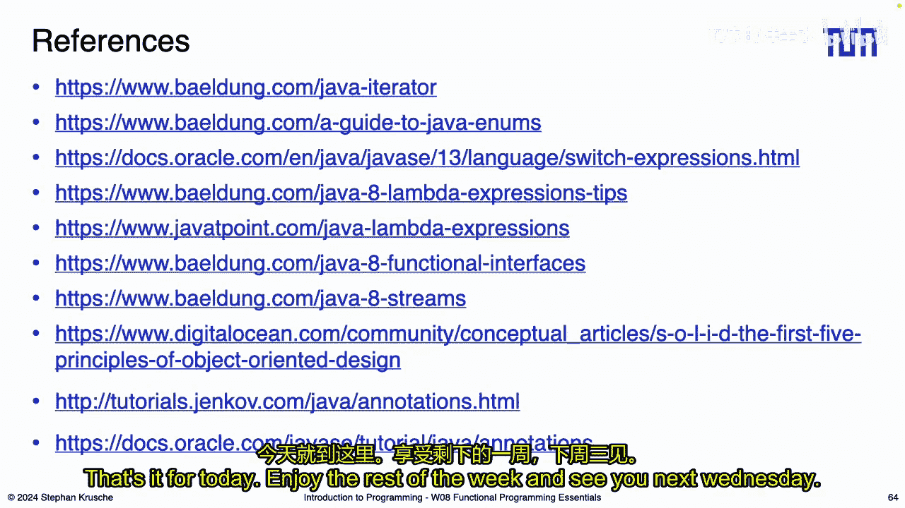

# 【全集】慕尼黑工业大学 计算机编程：从入门到实战 中英字幕 p38 Lecture 38 - Streams -BV1WFrTBZExY_p38-

Please take a seat， we would like to continue in our last unit， we would like to talk about streams。

 a very interesting programming concept that is used more in programming languages。

 Java has a very specific implementation of that， and you will notice that there are also other programming languages that support that。

We've seen that Lambda expressions have a more mathematical ground。

 yeah you have something like a pure mathematical function input。

 arrow output and this is because they come from theoretical computer science where we also have an area which is called Lambda calculus that is basically an abstract programming language that allows us to compute all computable functions。

 so functional programming itself is strongly influenced by Lambda calculus。

 and Javava is one example where object oriented programming and functional programming is both possible and can be combined in a very powerful way。

😊，So functional programming focuses on mathematical functions and in those state that is produced by object does not really exist and is not really possible and this is why some people like functional programming because you can't have side effects that's one of the downsides of object oriented programming that you sometimes have unintended side effects and people like to overcome this with going a little bit more into the functional programming area。

 because in particular when it comes to concurrent programming。

 side effects and state can be cumbersome， especially if multiple concurrent processes or threats would like to access the same state and this is why。

Functional programming is currently on the rise。The central idea of functional programming is that you have some kind of data structure like a list and even if the list only has one element。

 yeah you still have a list and then this list can be manipulated and you can have certain functions that you apply on this list or on one element of the list one is called map and the other one is called fold and map then applies a function to each element of the list and fold would then combine all those elements into a new expression a single value or another list and this is basically called reduce in Javava and then functional programming allows you to completely program all the concepts that you know from iterative programming like Y loops and for loops but without loops。

 that's the idea so pure functional programmers they don't use loops anymore。

And of course we teach you both concepts， and then you have to decide for each in every case。

 which concept is more appropriate。So in JavaA functional programming is realized using Lambda expressions and is then even more powerful using streams and this is what we would like to talk about now。

 so streams basically allow us to apply functional style operations on，😊。

Collectioners or discrete sequences of。Data。Or data elements。

What you typically do is in the first step， you create a stream。

 then you have some kind of pipeline with multiple operations。

 those can sometimes be even done in parallel， so this can also help you to optimize for concurrent programming and multiple CPU course。

Tubpical operations are filtering elements， sorting elements， converting the types， and so on。

 and you can really chain those operations one after the other。😊，And then last but not least。

 you always have a terminal operation， and this produces a result。This can be， you count something。

 you sum up something， or you create a new collection like a list in order to further work with the data。

So it's always the case and it's always those three steps。

 and this is what we call the stream life cycle or stream pipeline。

Here's an example of how this can work with the first two operators map and filter。

 Ma produces a new stream。After applying a functioner to each element of the original stream。

A new stream can have a different type， but it can also be the same type。

 so let's assume we again have our car brands。And we would like to convert all brands to lowercase。

Of course you can create a traditional for loop or do a for each loop and do that and collect all the data in a new array or error list。

 but with streams it's a bit easier and it can even be written in a very concise way so we can't directly do that on the list itself we always need to convert it into a stream this is super easy in Java all the collection data types have a stream method so we can just say list dot stream and then we can apply this map functionality and we can use a method reference string to lowercase and then we have a terminal operation we convert this again into a list and we don't need to define the type because we use the same type as the initial list and as you see I do not use the type string at any point here except for the method reference here because Javava can infer that if I add strings to an array list I get a string。

List in the end so using type inference also reduces the amount of types that we write here。

 and then we get the same list， but instead of capital case， BMW。

 we get it in lowercase and all the other car brands as well。Next， we can filter elements and again。

 same pattern， you start with a list， you first first operation， you create a stream。

 then you have one or multiple。Intermediate operations like map filter and so on。

 here we have filter， and then last but not least you have a terminal operation。

 which is the most easiest one here to list again。😊，Filter。

Can use Lada expressions as well and basically has as an input， the element of the stream。

 in this case， a string。And as an output， a boolean value。

 and this Boolean value determines whether the element stays in the stream or whether it will be removed。

😊，And remember， when we talked about removing elements from a list in a for loop that you have to take care that there is no concurrent modification exception。

You don't need to worry about that when you use filter and streams， so that's one big advantage。

Filtering here is really easy。 You just need to provide a conditioner。

And then all the elements that fulfill the condition stay in while the others are filtered out。

 In our example， we checked that the length of the car brand is four。😊，And with that BMW used out。

 only three characters， C it and Audi stays in and all the other ones are too long。

 they are also filtered out。Any questions regarding those two first examples here？

So the syntax might be new， might be cumbersome to learn， might be difficult to understand。

 but believe me， if you follow the syntax it's relatively easy to come up with those simple examples again first you create the stream or you open the stream second you have one or even multiple operations that we can concatenate and those two examples we have only one。

 and last but not least number three， we have a terminal operation in this case converting the stream back again into a list。

There are some comments here notice that to list is a shortcut that is available now the alternative would be to collect the elements and pass it into a new list or into a new set。

 we can also collect elements in a set。And it's important to understand that tool list creates an immutable list because typically we would like to further use it and immutable lists are easier when it comes to functional programming。

 if you want to have a mutable alternative because you want to mutate the list later on again。

 then you need to use collect collectors to list。😊。

Another important example is reduce you might have heard of the map Red mechanism。

 which is a very powerful mechanism in many different programming languages。

 Java also offers a reduce functionality and reduce is a terminal operation so it's at the end of the stream。

😊，Afterwards you typically have one element or one list for example。

 but you do not need another terminal operation if you want to further work on it。

 you would need to convert it into a stream again， so this means there is no collect or no two list operator here。

And reduce typically takes a sequence。And combines every element of the sequence into a single result。

😊，In the two examples that we have here we have Inte streams。

 so this is also now a new way in order to create an int stream yeah I don't need to create an array list。

 I can just say in stream range from  one to 10， this is similar to a list12，3，4，567。

8910 but it's already part of a stream so I don't need to convert it。😊。

And then in the reduce function， which is a bit more tricky to understand。

 I provide a starting element， so this is the first element that I get started with。

 and then I typically identify a method that sums up values or multiplies values or does any kind of other reduction。

 but it has to be something where we combine elements。😊。

It should not be something where the sequence stays as it is。

 we fold back the sequence into one element， or in case we have a two dimensional array for whatever reasons。

 you can fold it into a one dimensional array， but you always go one dimension back。😊。

And here we used the sum of integers in order to sum up all the values from 1 to 10。

 and the sum will result 45。We can also create a stream of just three numbers，5。

9 and 15 same as error list as list 5，9， 15， but then we have a list here we directly have a stream。

And if we reduce that， if we want to have the product of those three numbers。Based on multiplication。

 we can't really use like something like Integer multiply because this is not available。

 and we have to make sure that we start by using the number one because one is kind of the neutral element when it comes to multiplication。

😊，If you multiply any value of1， it stays at this value， if you sum up any value of0。

 it stays with this value， so this is the kind of neutral element and this is why we have0 for the sum and  one for the multiplication。

😊，How does the reduce method then work internally， let's go through it with the second example here。

 so Red initially invokes this lambda expression here with a equals 0 B equals5， the first element。😊。

And we multiply one with5， so the result is5， right？😊，Now， in the second instance。

 it uses the result of the previous operation and inserts it as the first parameter a， so we insert5。

 and the second element as P9。😊，F times 9 is 45。Again， the result。

 and this is taken as the first element of the next operator。45 times B15， and this results in 675。

And then we are done because we are at the end of the list or at the end of the stream。

And this is how reduce works。 So we apply one function or a Lada expression or method reference。

 however you want to call it to every element in the。😊，Stream。And we have a starting point。

 and we always used to re to combine it with the next element。And this is really， really powerful。

 you can do a lot of different things in here。😊，Any questions regarding reduce。Good ahead。

So the question is what would happen if we would use one here instead of0， you would end up with 46？

It's just the starting value。 Yeah， so basically， if you write that down。

 it would be 0 plus 1 plus 2 plus 3 plus 4 plus5 and so on。 So if you change 0 here。

 you have just one。As the initial part of the equation。And in the multiplication， so the question is。

 what if we add two here， would it be twice as much， Yes。

 because here we basically do one times 5 times 9 times 15。😊，And if you exchange one by two。

 you would have twice as many。In the result and the final result。Any other question。Great。

 here's another example where we now combine three operations map。

 filter and reduce let's go through it so first of all we take a stream of those numbers， one，2。

 three， four， again， four， two times four，5 and6。😊，Then we do something interesting。

 we do it in parallel。So we can apply operations in parallel to get them done faster。

 you won't notice a difference with six elements， but let's assume you have6 million elements because you are getting data from a database and you have lots of customers in your customer relation management database。

 for example， then parallel might speed that up quite significantly。But for this example。

 it doesn't make a difference， we just want to show you that this is possible。

 concurrent programming is easy when you use streams。

Then we basically map all those elements and multiply them by three。

 so the result of the first operation is a stream with 3，6，9， 12， 12， 1518。As super easy。

 there's no follow loop involved， nothing else。Then we filter and only include elements that are smaller than 15。

So if you carefully look， we basically get rid of the last two elements。

And then we do the same as in the。Example here， we take the sum of all values。

Using0 as the initial value and the inte has sum as the method reference。

And then we get a magic number and this magic number is the answer to all questions or to the most important question in the universe。

 it is 42。And if you know the movie， you know my reference。

Any questions regarding this third example here？So this is quite typical。 Yeah， you have a stream。

 you do certain operations map filter， And then at the end。

 you either collect or you reduce the remaining elements into。A list， if you collect them in a set。

 if you collect them or into one element， if you reduce。

Looks difficult but iss quite powerful and if you practice it multiple times you will get used to it and I can promise you one thing in the second supervised exercise。

 there will be an exercise about streams， so you need to learn that this is really super important programming knowledge in our opinion。

😊，Let's quickly talk about the collect operator， we've seen a simple collect operator with the two lists yeah that collects the stream elements into an immutable list instance but there are also other ones you can even write your own collectors if you are interested in that and the main idea is that we fold the stream again into some kind of data type and this is basically done with this collector interface that provides a few handy default operators to list to set and so on and we have another example here where we say collect and then collectors to list in order to collect all the car brands that have the length of four so it's the same example as before and this is amutable list that's important if you instead just write two list like in the previous slide it's immutable and then you would get an exception if you change elements。

😊，In the era list。But if you use collectors tool list and a collect method。

 then you get a mutable list and you can further modify them in subsequent parts of your program。

 and this is a typical mistake even for advanced programmers that they create an immutable list and want to change it somewhere else in the code。

 so be careful and think about it， which kind of collectors you want to use。Now， quick summary。

 before we practice this， we have Lada expressions on the one hand， and streams on the other hand。

 and you might ask yourself now。😊，Well， Stefan what's basically the difference here and you could summarize it like that Lambda expressions are functions without names so someone defined a functional interface and you just implement the functionality behind it and we can even have method references if we just。

😊，Don't w to get， yeah。Dealing or we don't want to deal with the input and output streams。

 on the other hand， are sequences of values yeah similar to a list where you can apply functions you can also apply Lada expressions and something that you can reduce and this is typically stacked so multiple lambda operations are stacked within streams in order to have very concise and elegant code。

 which might be difficult to understand for beginners but again， I tell you expert developers。

 they really love that。 Yeah they really like to write a lot of operations afterwards in order to be very efficient。

😊，And with Lada expressions and streams， we can kind of conclude。

The solid principles of object oriented design。AndSoli is an acronym that stands for five principles。

 The first one is the single responsibility principle where we say a class。

 no matter if it implements an interface or not， should only have one reason to change and should only have one chop。

Second， we have the open closed principle where we say objects should be open for extension so we can extend them with additional functionality。

 but they should be closed for modification except you really want to modify them right but if it should not be easy to mess them up this is meant with close for modification you should not be able to mess up objects in any other way。

 so this is also the idea behind information hiding if you don't expose internals。

 you can't modify internals。We talked about list of substitution principle when it comes to inheritance。

 where subclasses should always be replaceable with a super class or the other way around without breaking the application。

Then something that is quite new is the interface segregation principle。

 we've learned that with the functional interface， developers should never be forced to implement something if they don't like to。

 this is quite well done with interfaces if you keep them small， if you have large interfaces。

 it can be problematic in the end。😊，And last but not least we have the dependency inversion principle where we say that high level components should not depend on low level components。

 but instead we would like to have abstractions in order to have a loose coupling between those。😊。

And if you try to follow those solid principles， then you basically develop software that is easy to maintain that other people can understand easily。

 that can easily be modified and refactored with fewer complications so keep that in mind that behind programming。

 even if it is new to you， even if you don't understand it now。

 many people think about why they design a programming language like that。

 and all programming languages have shortcomings and I don't want to say Java or any other programming language is the best one。

 it's just important to understand those principles behind this and to apply them in order to come up with a good software that is easy to develop easy to maintain and provides a really nice user experience to your end users。

Great， with that we have one last little exercise for today， the comma separator。

 we would like you to try out streams and Lada expressions and we have a relatively simple exercise for you。

 you need to combine multiple strings into one。😊，Using comma as a separator。

So please use streams in order to do that and use the collect function which is called collector dojo this is another collect function that you should be able to use assume you have to input hello world highbra it could be also anything else yeah I assume in the exercise it might be slightly different it's just an example and in the output would be hello comma world。

 comma higherbraun but everything within one string。

And if you think this is too easy and you can do this in a one liner。

 then optional challenges filter all words that begin with an H。

 so then it would just be world in the end。😊，And append an exclamation mark to the end of each string using the map function with the corresponding Lambda expression。

 so easy exercise with the standard and then you have some optional challenges where you can also get additional bonus points。

 have fun the tutors go around if you need help and in around 10 minutes I'll show you an example solution and we wrap up the workshop for today。

😊，Okay， apparently many of you already have a solution and a noise level goes up。

 so let me show you an example solution and explain you how it works and then we can wrap up the workshop for today。

This is the example solution for the most easy part and you can see that creating the array list and printing it is one line but combining it is also just one line。

 so whatever you call it but I call it vers， you invoke the stream and then you directly invoke collect。

 with collectors join and you pass the comma as the element that you want to use in order to join。

 of course this could also be a semi code on a tap， a space or anything else。

 whatever you want to use and then the output would be hello comma world， comma Hyron in one string。

Now if we fulfill the optional challenges， we can filter and only include words that start with an H and map every ver into ver plus exclamation mark and you see that it comes really handy that you don't need to use parentheses or return statements in here by using the most concise version of lambmbda expressions and for the ver we say words dot starts with now this is only capital H if you also want to exclude lower case H in the beginning then you would need to have a second condition either a second filter mechanism or you combine them with the doubleend operator like you would do it in an if statement in the beginning。

 so the condition here can also be a bit more complex。

 of course and then the output for this particular example would be hello exclamation mark comma Hyron exclamation mark。

You also have to slide with a few comments， are there any questions regarding this example solution？

Okay， great， make sure to practice this。 There will be tutor group exercises and homework exercises and our tutors who create them have been very creative again。

 we have return of the iterator we have the seal wars， not Star Wars seal wars。

 the cargo awakens and we have the seal carrier Chless and we have stream wars and new hope I think you can clearly see what kind of idea is behind those names I hope they are making also so much fun to you while working on that if you have any questions。

 let us know we try to assist you as good as possible。

 they are also two articles that we recommend one about Lambda expressions and the other one about streams make sure to read them in order to find out more and see a different perspective and see more examples on how you can use them in order to achieve the。

😊，Requirements that you aim to achieve all this is to due you until next Wednesday shortly before the workshop quick summary for today we talked about iterators that allow you to process data using for each loops with the iterator and the iterable interface and we also had a look into comparable and comperator in order to sort things so interfaces are really powerful and there are lots of given interfaces in the programming language that allow you to achieve things without worrying about the internal implementation。

We also covered inum types， data with a finite range of values that are seen as constant and that can well combined be with switch statements。

 the old fashionashed style， or the more modern way so-called switch expressions where you can have a more compiled safe way of handling those different cases without the unintuitive fall through of the switch statement。

And we really dived into functional programming based on Lada expressions that allow us to。😊。

Implement functional interfaces in a very small and concise way。 input， arrow output。

 This is the most important message when it comes to Lada expressions。And we covered streams。

 functional style operations on。Data sequences or data elements or collections where we have this pipeline approach。

 Yeah remember， we start or create a stream。 Then we have our pipeline of one or multiple operations。

 and then we terminate the stream using a collection mechanisms in order to collect the data。

 or we reduce the stream into one single element。😊，Make sure to practice this again。

 the hint streams and Lambdas will be part of the second supervised exercise in February。

That's it for today， enjoy the rest of the week and see you next Wednesday。

