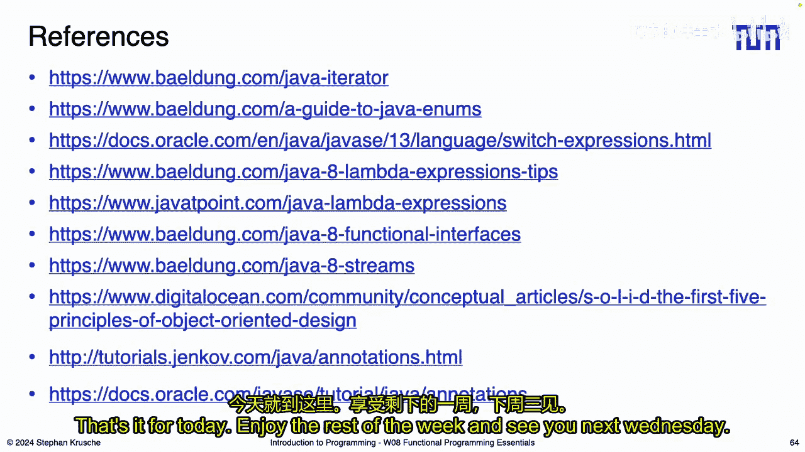

# 计算机编程：从入门到实战：38：流


## 概述
在本节课中，我们将要学习一个非常有趣的编程概念——流。流在多种编程语言中都有应用，Java有其特定的实现。我们将探讨流如何与Lambda表达式结合，以函数式风格处理数据序列。

---

## 函数式编程基础
上一节我们介绍了Lambda表达式，本节中我们来看看其背后的函数式编程思想。

函数式编程深受Lambda演算的影响，它专注于数学函数，强调无状态和避免副作用。这在并发编程中尤其重要，因为多个进程或线程访问同一状态会变得复杂。函数式编程的核心思想是操作数据结构（如列表），通过`map`和`fold`（在Java中称为`reduce`）等函数进行转换和聚合，从而替代传统的循环结构。

Java结合了面向对象和函数式编程，通过Lambda表达式和流来实现后者。

---

## 流的概念与生命周期
流允许我们对数据集合或离散序列应用函数式风格的操作。

流的处理遵循一个清晰的生命周期或管道模型，包含三个步骤：
1.  **创建流**：从数据源（如集合）生成一个流。
2.  **中间操作**：形成一个操作管道，可以包含过滤、映射、排序等。这些操作可以链式调用，并且可以并行执行以优化性能。
3.  **终端操作**：产生一个最终结果。结果可以是一个值（如总和）、一个集合或触发一个副作用。

以下是流的典型操作：
*   **过滤**：根据条件筛选元素。
*   **映射**：将每个元素转换为另一种形式。
*   **排序**：对元素进行排序。
*   **归约**：将所有元素组合为单个结果。

---

## 映射操作示例
`map`操作会对流中的每个元素应用一个函数，并生成一个包含结果的新流。

假设我们有一个汽车品牌列表，希望将所有品牌名转换为小写。使用传统循环需要多行代码，而使用流可以更简洁地实现。

```java
List<String> brands = Arrays.asList("BMW", "Audi", "Mercedes");
List<String> lowerCaseBrands = brands.stream()        // 1. 创建流
                                     .map(String::toLowerCase) // 2. 中间操作：映射
                                     .toList();       // 3. 终端操作：收集为列表
// 结果：["bmw", "audi", "mercedes"]
```
代码解释：`list.stream()`创建流，`map(String::toLowerCase)`将每个字符串映射为其小写形式，`toList()`将流收集回一个**不可变**列表。

---

## 过滤操作示例
`filter`操作根据给定的条件（一个返回布尔值的Lambda表达式）来筛选流中的元素。

我们继续使用汽车品牌列表，现在只想保留长度为4的品牌名。
```java
List<String> brands = Arrays.asList("BMW", "Audi", "Mercedes", "Ford");
List<String> filteredBrands = brands.stream()       // 1. 创建流
                                    .filter(b -> b.length() == 4) // 2. 中间操作：过滤
                                    .toList();      // 3. 终端操作：收集为列表
// 结果：["Audi", "Ford"]
```
代码解释：`filter(b -> b.length() == 4)`是一个Lambda表达式，输入是元素`b`，输出是布尔值。只有满足条件（长度为4）的元素会保留在流中。使用流过滤无需担心在遍历时修改集合导致的并发修改异常。

---

## 归约操作示例
`reduce`是一个终端操作，它将流中的所有元素组合起来，生成一个单一的结果。这是“MapReduce”编程模型中的“Reduce”部分。

以下是两个归约的例子：
1.  **求和**：计算1到10的整数和。
    ```java
    int sum = IntStream.range(1, 11)  // 创建包含1到10的整数流
                       .reduce(0, Integer::sum); // 归约，初始值为0，操作为求和
    // 结果：55
    ```
2.  **求积**：计算几个数的乘积。
    ```java
    int product = Stream.of(5, 9, 15)          // 创建包含5,9,15的流
                        .reduce(1, (a, b) -> a * b); // 归约，初始值为1，操作为乘法
    // 结果：675
    ```

**归约工作原理**：以乘法为例，`reduce(1, (a, b) -> a * b)`。
*   第一步：`a=1`（初始值），`b=5`（第一个元素），结果 `1*5=5`。
*   第二步：`a=5`（上一步结果），`b=9`（第二个元素），结果 `5*9=45`。
*   第三步：`a=45`，`b=15`，结果 `45*15=675`。流结束，返回最终结果675。

初始值通常是该操作的“单位元”（如加法为0，乘法为1）。

---

## 组合操作与并行流
流的强大之处在于可以轻松地将多个中间操作链接起来。我们还可以使用并行流来利用多核处理器加速处理大量数据。

下面的例子组合了`map`、`filter`和`reduce`操作，并使用了并行流：
```java
int result = Stream.of(1, 2, 3, 4, 4, 5, 6)
                   .parallel()                         // 转换为并行流
                   .map(n -> n * 3)                    // 映射：每个元素乘以3
                   .filter(n -> n < 15)                // 过滤：只保留小于15的元素
                   .reduce(0, Integer::sum);           // 归约：求和
// 结果：42
```
操作步骤：
1.  原始流: `[1, 2, 3, 4, 4, 5, 6]`
2.  映射后 (`n*3`): `[3, 6, 9, 12, 12, 15, 18]`
3.  过滤后 (`n<15`): `[3, 6, 9, 12, 12]`
4.  归约求和 (`0+3+6+9+12+12`): `42`

---

## 收集操作详解
`collect`是一个常用的终端操作，用于将流中的元素重新聚合成一个集合或其他容器。

之前使用的`toList()`方法会生成一个**不可变**列表。如果需要可变的列表，应使用`Collectors.toList()`。
```java
List<String> brands = Arrays.asList("BMW", "Audi", "Mercedes");
List<String> mutableList = brands.stream()
                                 .filter(b -> b.length() == 4)
                                 .collect(Collectors.toList()); // 收集到可变列表
mutableList.add("Ford"); // 可以修改
```
重要区别：
*   `stream().toList()` -> 返回**不可变**列表。
*   `stream().collect(Collectors.toList())` -> 返回**可变**列表（通常是`ArrayList`）。

---

## Lambda表达式与流的关系
让我们总结一下Lambda表达式和流的区别与联系：
*   **Lambda表达式**：是**无名函数**，用于简洁地实现函数式接口。格式为 `(输入) -> 输出` 或使用方法引用。
*   **流**：是**数据序列**（如集合的视图），在其上可以应用一系列函数式操作（常使用Lambda表达式实现）。

简单来说，**Lambda是定义操作的单元，而流是应用这些操作的上下文和管道**。专家开发者喜欢将多个Lambda操作串联在流中，以编写出简洁而高效的代码。

---

## 编程原则回顾：SOLID
结合我们所学，可以回顾面向对象设计的SOLID原则，这些原则有助于构建易于维护和扩展的软件：
1.  **单一职责原则**：一个类只应有一个引起变化的原因。
2.  **开闭原则**：对扩展开放，对修改关闭。
3.  **里氏替换原则**：子类必须能够替换其父类。
4.  **接口隔离原则**：使用多个专门的接口，而非一个庞大臃肿的接口。函数式接口（只有一个抽象方法）是很好的例子。
5.  **依赖倒置原则**：依赖抽象，而非具体实现。

遵循这些原则，能使代码更健壮、更灵活。

---

## 实践练习：逗号分隔符
请尝试使用流和Lambda表达式完成以下任务。

**基础任务**：将字符串列表中的元素用逗号连接成一个字符串。
*   输入示例：`["Hello", "World", "Hibra"]`
*   输出示例：`"Hello,World,Hibra"`

**可选挑战**：
1.  过滤所有以字母“H”开头的单词。
2.  使用`map`函数为每个字符串末尾添加感叹号“!”。

**示例解决方案**：
```java
// 基础任务
List<String> words = Arrays.asList("Hello", "World", "Hibra");
String result = words.stream()
                     .collect(Collectors.joining(","));
// 结果: "Hello,World,Hibra"

// 完成可选挑战
String challengeResult = words.stream()
                              .filter(w -> w.startsWith("H"))
                              .map(w -> w + "!")
                              .collect(Collectors.joining(","));
// 结果: "Hello!,Hibra!"
```

---

## 总结
本节课中我们一起学习了：
1.  **迭代器与比较器**：用于遍历和排序集合。
2.  **枚举类型**：定义固定集合的常量，可与switch语句结合使用。
3.  **Lambda表达式**：实现函数式接口的简洁方式，核心是 `输入 -> 输出`。
4.  **流**：处理数据序列的函数式管道，包含创建、中间操作和终端操作三个阶段。`map`、`filter`、`reduce`和`collect`是核心操作。



请务必多加练习，流和Lambda表达式是现代Java开发中的重要组成部分。