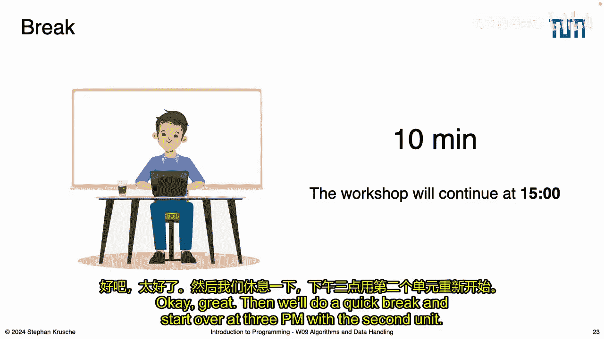

# 【全集】慕尼黑工业大学 计算机编程：从入门到实战 中英字幕 p39 Lecture 39 - 哈希 -BV1WFrTBZExY_p39-

Welcome to today's workshop， algorithmriths and data handling。

In the course， introduction to programming。We are over half of the course in our schedule and we will tell you a little bit about algorithms and data handling。

 input output for example today next week there will be another workshop on programming languages then we have the Christmas break and after the new year we will have a few more advanced topics that we will cover so we are kind of finishing the easy ones and going a little bit more into the advanced topics。

That are also a bit more diverse。 So you will see that today's topics， they basically。

Requiring you to have a good understanding about the basics。

 but not necessarily all the topics like for example。

 streams are really relevant to understand what we cover today。

 so of course it's good if you have a good knowledge but。

Some of the topics that we already learned in the last workshops are not super relevant。

 the learning goals for today are that you get familiar with an important concept in computer science called heshing。

 you should be able to explain hesing afterwards and also tell us a little bit about why we use it in many different cases in computer science。

 we will talk a little bit about advanced sorting algorithms so you should be able to understand how they work and we will talk about typical input and output mechanisms you already know some of them we have the scanner that takes basic input from the end user and you have the system output line as one of your main tools to output something to the console but of course input and output is much more versatile in programming and we'll quickly talk about that today and。

In the end， in the last unit we will announce the project Bur and tell you what it all is about and how you can participate in it。

 what kind of rules we have and what kind of guidelines we have that you need to follow。

 and then you can also ask all your questions about it， so stay tuned for that。😊。

But before we go to the fun part， we have to do the let's say more challenging part and we'll start withhing what ising hesing basically means that you would like to transform an input。

 any kind of input into something that is typically smaller and has a fixed size and this is something that we call hash code。

😊，The input typically has arbitrary many possibilities。

you are only interested in a smaller size because you have certain advantages with smaller sizes。

 you can easily sort it， you can easily find things in it and so on。

 so it's all about efficient data indexing and data retrieval。

 and it's the foundation of many different data structures。

 two of them you already have used hash set and hash map。

 Those are one of the default implementations of the set interface and the map interface and Chama。

 if you remember and。😊，Hshing basically makes sure that all the operations that you do on those collections。

 like adding elements， reading elements， removing elements are as efficient as possible so that your program has a good performance in the end。

😊，There are lots of real worldor applications that use hashing very heavily in particular databases and everything that is related with security uses it and of course there are also very prominent parts in computing and in applications where you actually have to cache something in particular and distributed computing so if you open your smartphone and you open Whatsapp。

 you don't want the app to download the messages all the time again and again no the latest messages are already stored on your device and in some sense your device is also then a cache because the real messages are stored in the cloud in the database of the corresponding application and you only have a specific view about the latest messages so if you're online if you're offline and your best friend in the WhatsApp conversation edits a message you might still not have the latest version because you still have to。

Cash that is on your system， which is not necessarily the truth in this particular example。

 So there are lots of different applications， and this is why it's good to understand the basics。

It's important to differentiate hashing from encryption and decryner。

 if we encryptpt and decrypt something， this is a bidirectal。😊，Protocol， so to speak。

 yeah so it could be the case that you have plain text like your password that you used to look in and then the password is encrypted when it is sent to the actual server where the user management is done but the server then has to decrypt it again in order to verify that the password is actually the same as the one that you have stored before。

 that's a very typical example of encryption and decryner。

 everything that you encrypt can also be decrypted afterwards。Hshing， on the other hand。

 is a unidirectional protocol。If you take an input and you hash it。

 then your hash function that actually creates the hash code in the end or the hasht text should be implemented in a way from the design that you cannot go back so from the hash text。

 it should not and in fact it must not be possible that for some application this is super important to go back to the plain text。

😊，And that's a big difference that you need to understand first， encrypt， decryption always。

In both ways， and hashing is only in one way， and you should not be able to retrieve the original information afterwards。

When it comes to hashing， it's all about converting an input into a fixed size output。

 most of the time this fixed size output is an integer or a string。

 but generally in hashing you could use any data structure and the purpose is to have quick data retrieval most of the times。

 and this is for example， ideally if you have very large data sets because if you can create a hash code for the 500 million people who use your application。

 then you can find them much easy， much more easily。😊，So you always have an input。

 a hash function that you can configure and sometimes you decide and then a unique hash value。

 and then it's much faster。😊，In terms of performance and time complexity to retrieve the data and for some algorithms it's even essential otherwise they would be too slow for real end users to use it so every Google search that you do also involves hesing by the way。

 every time you search something they have huge data sets that they need to look into and this is only possible so fast because they use some kind of hesing mechanisms。

There are a lot of different hash functions， some of them are quite well known and are also used for cryptography。

 for example Shah 256， but you can basically also come up with your own hash functions。😊。

A hash function takes an input and then returns the output in a way that it cannot be reversed。

 this is important， some people call the output hash value， some people call it hash code。

 some people call it digest or some people just call it hash so whenever you find those terms。

 they basically mean the output of a hash function。

And most of the times you store those hashes in a so called hash table。

The hassh table can also include the inputs， but sometimes it's not necessary to store the inputs。

 sometimes you just store the hashes in there。Ideally。A hash functioner should be deterministic。

 this means the same input always results in the same hash code， otherwise you have an issue。

 and it should be rather fast to compute it because if it takes a very long time to compute。

 then all the performance improvements when looking up data later on are not really justified。😊。

Ideally it should have a uniform distributioner， we will see that in a moment across the whole set of possible values。

 and this is important to avoid collisions if you have arbitrary input and a fixed size output it means you could potentially have a collision。

And this is for any hash function you can't。Guarante that you avoid that。

 so you will always find two inputs that will lead to a collision where they have the same output and of course this is a problem and the solution to it is not to make the hash function so complex that you can make sure that it will never happen but to make it so unlikely that it won't happen in practice that's the basic idea here。

In trauma， this is。Well integrated into any object or class that you deal with based on the hash code method hash code is implemented in object。

 you know object is the superclass of all other objects or other classes implicitly and it provides a default implementation of hash code and you can override this and customize it whenever you want。

😊，So ideally， you have a detertministic function with minimal collisions that is easy to compute。

 but hard， very hard to reverse。😊，That's the main idea of heing。

Here's an example of how this can look like， so let's assume we have a string。

A word of multiple characters as0， S1， and so on。And then a hash function could be that you just take the integer value of the character。

 remember every character in the string has a corresponding integer value and you sum up those integer values。

 and in the first example H you only sum up the first and the last one。Very， very simple to compute。

Let's see if it fulfills all the other requirements that we just stated。Hsh function 1， H1。

Takes all integer values of the characters from the first one， second one， third one。

 and so on until the last one， so a bit more complex。

 instead of having always two or only one edition， basically。

 you have many additions as many as you have characters。And the third one。

 H2 is a bit more difficult， so initially you multiply the inte values with a prime number P and sum them up in a very specific way。

😊，🤧So。Object method hash code that you have uses in in Javava。

 the default one uses for string objects uses H2 with the value P equals 31。

 So this is not an arbitrary example。 This is a real world example。

 Let's see how those different hash functions from very simple to。Simple to medium complexity。

 I would say， how they actually perform。And what we do here is we have a few typical strings。

 those are strings that are also used in computer science， in particular in compilers。

And we have the corresponding hash codes or hash value use in the table the first column is H0 the most simple hash function that you can come up with second one is H1 a little bit more difficult but still relatively simple and the third one is H2 and for this example we use P equals7 because if I use p equals 31 the numbers get so large that I can't display them anymore on the slide just for you to see how it works and if we just randomly look we'll see that。

All the black ones are basically unique， but all the colored ones there you have another hash code with the same value。

 so we have a collision so those two。😊，And this one basically all lead to 214。

 so in terms of collisionitions not a very good function， even if it's very easy to compute。

 and we have a second collision here with diiff and Chmp， they both lead to the hash code 218。

YeahSo not very good， the second one， H1。It's a bit better。

 you also see the numbers get a bit larger but they're still already with those two alloc and false as a collisionitioner。

 so still not performing really good and for the last one you see that the numbers now get much。

 much larger which is clear， the more characters you have the more multiplications and additions you do and always with this prime factor so you really get large numbers and here we at least for this limited amount of strings we do not see a collision。

😊，So this is already better now if we go back we'll see that the last one is also more performance intense instead of just having one addition or n additions。

 if we have n characters we have n multiplications plus additions also in a very specific way so this is already at least double the complexity of the H1 hash function and then it depends on how fast your CPU can compute addition and multiplication nowadays CPUs are very。

 very fast with that so even this one can be calculated in nanoseconds so for more computer this is not an issue and for more than computer this is not a very complex。

Function。Any questions so far？Yeah， so the question is。

 how do you make sure that hash functions are irreversible if you know the output and the hash function itself？

Well， first of all。More complex hash functions than include specific。Keese。

that are not known to the outside world yeah so that's first of all important that you have secrets for more complex ones and for the example that we have here。

 this is known so you could basically compute this and you could also reverse it relatively easy I mean it's not super easy because you see those numbers are also。

Similar， also the ver are similar， so it's not super easy。

 but at least I can say small numbers have two letters， large numbers have three。

 more higher numbers have five letters and so on。But still it's not easy to reverse them and again this is something where you can say how difficult does it have to be if you have a endless compute you can always reverse it but we don't have endless compute and compute especially the expensive one can be very very expensive in the end you have to pay for it and the same is what kind of passcode do you have on your smartphone。

Do you have the four digit one， six digit one or a custom one， if you have four digits。

 there are only a certain amount of attempts until you can get access to it， that enough。

What do you think yeah I don't know yeah and what happens if someone looks over your shoulder while you're inserting it right so perfect security is not achievable it's typically always a best effort approach and if you have an intruder that has enough compute then you can break any system in some sense of course there are very complex ways to protect systems but this is out of scope for this particular lecture。

😊，Cool， then let's continue characteristics of good hash functions we already talked a little bit about it and this is in particular important for cryptography。

 and this is not a cryptography lecture so I keep it on the surface， it has to be deterministic。

 it should be quick， it should be irreversible， it should be collision resistant。

 this is what we talked about already， so quick summary here， two additional aspects。

 uniform distributioner， this is also quite important in order to make it collision resistant。

 that if you have a uniform distribution among the whole spectrum of your hash code。

It's much less likely to have collisions， and it's also much。

Harder to compute the reverse function and then there is something which is called avalanche effect and this means that a small change in the input leads to a completely different output and this is also important to make it irreversible because if small changes in the input lead to small changes in the output。

 then it's easy for people， they can just take I don't know 100 inputs compute the outputs and then based on the patterns that they see think about what kind of method and what kind of secret is actually used in here question。

Okay， so the question is how do you store the output values of a hash function。

 do you store them comma separated or in a database。

 the answer is it depends on your specific use case。I mean。

 in a hash set in Javava and in an hash map in Javava。

 they have an internal data structure which is called hash table in which they store it。

 and this is a bit more advanced but what they basically do is that they have multiple lists and then based on certain patterns they add things into one list or into another lists。

😊，And then they only need to go through those lists， for example， based on the hash code。

 so every hash code could lead to a bucket in the hashet where you store things in the list。

And then the retrieval is much faster， but again， there are a lot of different ways how to do that and computer scientists are very creative in how to store data。

 so I could fill a whole course about hashing cryptography and how to store data efficiently。

What happens if you have a hash coalitioner， then two different inputs produce the same output。

 the same hash code， this is， as I said， inevitable in any hashing system due to the so-called whole principle where you have those lovely pitchons and if you have 10 pitchons and only nine holes。

 there will always be one where two of them are in there， so it's unavoidable if the output。

 the hash code has a smaller size than the input and this is the main design。😊，Well， if that happens。

 there are ways on how to work with this， but it typically leads to a performance degradation of the system and it can also affect the efficiency of the data retrieval。

 so typically people when they implement them and use hashing they take care if that happens。

 but then it gets a bit slower。And again， the frequency and also the。

How severe the issue is really depends on the hash function quality and on the table size。

Here's another example of how you could implement it on your own， it looks quite difficult。

 but it's basically our pointcast that we have seen before and in addition to the attributes and the constructor and potentially other methods。

 we offer an equals method where we can find out whether two points are equal or not。😊。

Based on the comparison of their x and y values。And a little bit of boiler platelate code to ensure that you deal with null value use or with potential subclasses correctly。

But in the end， we basically just compare the x value of the。

Past object with this x and the past y value with this y， and if they are identical。

 then we return true。And then we have the hash code function and you see we override them。

 it returns an integer so a relatively small size， and here we basically have a starting number 17。

 then we have a Y and then sorry an x hash and a Y hash。

 based on a method that transforms doubles to a long。😊，And then， we basically multiply the。

Well used with each other in very specific ways and add them to the existing result。

 multiply them again， we convert the logs to integers。

 yeah make the whole size smaller and then we return them and while you don't really need to understand completely how this works it's also described in the next slide this is just one example of what you could do and there are also。

Online pages where you can come up with a good hash function。

 and I think even in Teleliche can generate a good hash function for you based on the different attributes that you would like to take into account。

And then you can use the point in a set。AndThe set will internally use the hash code so you can even put a breakpoint in here and see how that works and you can also use it in a hash mapap and then the hashmap will also use the hash code function and do that notice hash code is relatively small intertegers you can't save a lot of intertegers。

 but that's also not the purpose here it's not the idea that you want to have a perfectly collision free function that can store millions or billions of values the hash already。

Has a few other advantages， and this is basically if you can compute it very quickly。

 we can store the data more efficiently and we can retrieve the data more efficiently without the need to search through the whole data structure in the end。

😊，That's the main idea and here on slide 14， if you are interested you can read why we have actually chosen implementation like this and the different methods。

 yeah whether we use X or or others or shifting the bits are actually explained in here。🤧。

Why is the previous function a good function， well it tries to uniformly distribute the hash codes。

 this reduces the likelihood of coalitions， it's still fast to compute and deterministic。

 we don't do any random stuff in here that's always important。

Then it also takes both attributes into account， that's also important。

 so small change in a way that small changes of the coordinates lead to significantly different hash codes。

And this basically ensures that the point objects are well distributed in the hash map and makes the whole use of them in those data structures more efficient and more performant。

😊，There are lots of different real world applications that use hashing we already talked a little bit about databases here。

 it's mainly used for index， creation and indexing so that you can access data as fast as possible datacaching is a typical example。

 your browser cache as a lot of data so that it doesn't have to be loaded from the web server again and again and again to reduce network usage and to improve the performance。

 we can use it to store passwords securely and that's also quite important passwords should not be stored in an encrypted way in a database。

 but instead in a hash way， in a database so that even administrators can get the password out of it afterwards。

There are lots of cryptography applications where you need it also for integrity checks for secure message transmission。

 for example Bitcoin uses it very heavily， another example is that did uses it。

 yeah you might have seen the commit hash already， the commit hash also uses a hash function based on the time or date and you created it based on the changes that you do and based on the commit message and then tries to come up with a unique hash for this particular repository and then lots of distributed systems are heavily depending on hash functions and this is why it's so important to understand it。

😊，Some best practices， there's always a tradeoff between complexity and efficiency so try to somehow come up in the middle where you have a good efficiency。

 a small collisioner probability but still a nice implementation that is also easy to understand in case there are coalitions you should try to handle them gracefully with some kind of collisionition resolution technique that is particular meaningful to your specific use case。

 and if you have custom objects that you want to use with hashing then properly override hash code and equals。

 Intelliche will help you to do that。😊，And with that， we basically finish a little bit the。

Quick introduction to Hahing and have another look at strings for a moment strings allow us to represent Uniode characters you already know that so this is just a repetitioner and you also know that strings are immutable and kind of can't be changed and this is where this so-called string builder comes into play the string builder allows us to create mutable strings which is particularly helpful when you use it in loops and allows you to create a string step by step and then turn it into a mututable string later on。

😊，The string class itself allows us already to look at single characters or substrs and compare strings with each other。

 create copies with lowercase， uppercase letters， but it is final and immutable。

 so if you concatenate two strings with the plus operator， something that you do all the time。

 then this is something that，You should not do， in case you go over loops， if you go over loops。

 instead you should use the string builder， which allows us to manipulate strings。

 it has ways to insert， to lead or append strings without creating a new one all the time。

So in particular when you use loops， then you should use the string builder。

 there's also the string tokenizer that allows you to split strings into tokens， for example。

 based on comma separate values here a comma is then used to split it or based on white space and so on here's an example of the string builder。

We see we create a new string builder with an initial string。

 and then we can append arbitrary many other strings。Without creating new strings immediately。

 that would be im mututable， and then at some point we can say build a two string and then we get the output into a string and can print it。

😊，That's the main idea， and this is something that we would also like you to try out now。

 so please open Artemis and go into the exercise W9E2 string builder。

We'd like you to create a string， the input is an array with some existing words， yeah， for example。

 our favorite car brands， and we ask you to use an enhanced for loop or alternatively。

 if you feel welltrained， you can also use a Lada expressioner。😊。

And the idea is that you should append all the words with a space in this string builder。And。

This should be then printed to the console and you have now around five minutes to work on this。

 or tutors will go around in case you have questions or you need help， have fun。Okay。

 the initial working time is over， feel free to work further on this until tonight。

 I'll show you a quick example solution， we create a string builder and then have our arrays as list with the car brands that should be given in the corresponding exercise。

And then you can use an enhanced for loop， but here I use a Lada expression and essay list dot for each and then I map the input ver to the builder append method and I do not only append a ver but also a space in the end so we start with an empty string and then for each ver in the list we append it to the builder and additionally append an empty string and after we've done we can invoke the two string method。

 get all the ver printed to the console and then we have this output Any question regarding this。

Small exercise。Okay， great， then we'll do a quick break and start over at 3 pm with the second unit。

