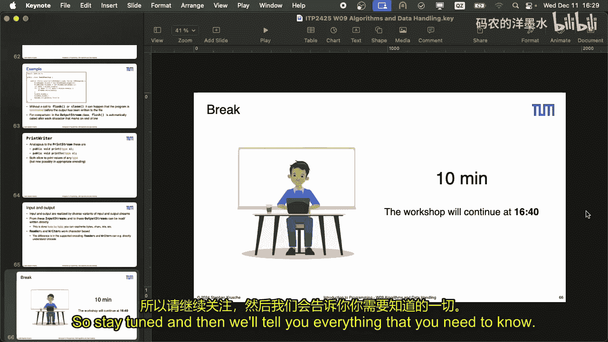

# 【全集】慕尼黑工业大学 计算机编程：从入门到实战 中英字幕 p41 Lecture 41 - 输入与输出 -BV1WFrTBZExY_p41-

Let's continue in our next unit we would like to talk about input and output。

 you've all used it before using the scanner class in order to retrieve input by end users and by using system out print line。

 you have been able to print objects or any other。Elements。

 values into the console to communicate with the end user， but of course。

 Java and also other programming languages offer a much more versatile。

Framework in order to deal with any kind of input and output。First of all。

 input and output is not part of the programming language itself。

 so there are no keywords typically referring to it。

 it's actually more part of the JVM with some extensive libraries that allow you to。

Achieve certain things like reading a file or writing a file quite easily。

 of course the devil is always in the details and it can become quite cumbersome in particular if you need to do error handling because any file access could go wrong。

 any data that you send over the network can go wrong and this is where those libraries can actually help you and this is where also the quality of the different libraries is quite distinct。

😊，We only used very simple aspects of input output so far today we would like to show you a few more advanced and more complex aspects notice that input and output is relevant for any program a program cannot work on its own as always some kind of input and output。

 it can be because you communicate with the end user or you deal with data from the end user so this is relevant for all kind of program。

😊，When it comes to input and output， we often think of it as streams and you will see that we have input streams and output streams。

 The main reasons is that we a program cannot，directectly cover the whole input at the same time。

 you always have to read it step by step or bite by bite or character by character in order to understand what's going on in order to verify that the input data is actually accurate and follows the definitioner and in order to make sure to write the output data properly。

A stream is potentially infinite， but of course we only use finite streams most of the time。

 but it's a potentially infinite sequence of elements。

 and the idea here is that whenever you read something。

 you remove the elements on the left and whenever you write something you add elements on the right and of course if you use arrays。

 this is based on an index that shows to a specific element that an index is said to the right or to the left。

 or even multiple ins。Ideally， if you handle input and output， you always use UTF8。

 that's the standard and that avoids any encoding issues。Luckily， Java supports that， for example。

 in the input stream reader and the output stream reader。Unfortunately。

 not everyone supports that yet， there are still conversion issues。

 there are still websites that can't properly display data or PDFs。

I just had to work with a PDF this week and for some reason it couldn't display a Germanman Ulaud U。

 an employee of mine has U in his last name and we entered this name and then when we printed it the U was suddenly gone and if you want to avoid such issues always use UTF8。

UDF8 is a acquired versatile， and coding， it uses a default size for the most important characters and can then expand to support any kind of character。

 even emojis by using more bytes， and this is all handled internally and you don't need to deal with that most of the times。

There's one important problem that you have to solve and this is how do you represent the data that you're dealing with。

 there are two distinct ways and this is whenever you store them in files whenever you send them over the network or whatever you do with input output。

 you can either store them binary and at。Which means that you use zeros and ones。

As an internal representationer。And this is typically relatively short， but not human readable So。

And user has to read it， or if a developer has to read what's going on in between two systems that communicate with each other using input and output。

 it's super hard for them to understand it， and they would need to convert it into a textual representation first and they need to know the encoding them。

And the second alternative is to store a text shell yeah so every Java program itself is a textual representation。

 yeah you have text， you don't store zeros and ones， and this text is much easier for humans to read。

 but of course also then needs more space。😊，Now with the two different representations。

 we have also different ways in Chava how to handle this。

 most of this is provided in the package Chava。IO， there are also other packages there's an Chava。

niO which is supposed to be a more modern version of input and output handling。

 but we focus on JavavaIO today because that's the most basic and easy one to use。

 of course there are also external frameworks， not integrated within the JVM， but that you can。

 for example， use by checking out gradle and importing those external frameworks into your program and then they also offer more advanced input and output handling。

We have an incomplete class overview here， we only show you the most important ones。

 but basically we have an input stream and an output stream。

 and for the input stream we can have data manipulation or file manipulation。

And for the output stream， it's similar， we can have a data output stream， a print stream。

 or a file output stream and in between we have a few different classes。

 the default system stream objects that you've usedsed so far in the scanner is the system dot in。

 that's an input stream。System。 error is a print stream that can print out errors in red and system out is a print stream that can print out errors in black。

 and those are preconfigured classes for you that you can access using system。 out。

And that already work out of the box， you don't have to set them up。

 but you can also create your own data input streams and your own print streams for your own purposes。

An input stream is a basic class for byte input。It's abstract， it has multiple subclasses。

Nevertheless， even if though it's abstract system in uses this abstract type。

 this is possible due to an exception， this is not normal。

 you can't do that in your own code but Java， the Java internals can do it。

 this is based on a native binding， remember that Java is a highleve programming languages。

 a high-level programming language， singular， it runs on the operating system but the operating system needs to provide certain possibilities so that Java can run and that's not in the Java virtual machine。

And if you have something that should be super fast and super efficient。

 Chava sometimes uses those native bindings that are translated more directly into the operating system。

 and this is one of the examples。Input streamream has a few useful operations that you should understand。

 you can check how many bytes are still available in the input stream， this becomes zero。

 if you have completely read the input stream， you can read exactly one byte from the input。

 and get an input value and then you have to decide what you do with this input value。

 how you interpret it， it could be a character， then it's a national mapping。

 maybe but it could also be something else。And this works until you reach the end of the stream。

And then minus-1 is returned remember last week we talked about bad arrow codes。

 this is one of those examples where you use1 as an  error code and you assume all the other bytes are stored as positive integers and last but not least you can close an input stream notice that close and read can both throw IO exceptions IO exceptions as a superclass that can be many different subtypes or sub categories of IO exceptions in the end。

😊，Input streams， the one that is available system do in would always return 0。

 That's basically some kind of like。Mechanism to prevent yeah using this in the wrong way。

 and then we have subclasses and those subclasses they of course offer those methods but potentially offer additional methods that you can explore then and the two that we have the file input stream and a data input stream they offer specific constructors and those are the ones that you have to use later on for the file input stream you have to provide a string path to the file in the operating system that you want to read so this can look differently on Windows machines then on MacOS machines because they use different path handlings。

And this would then open the file path and then you can read the file a data input stream is basically just a wrapper around another input stream and does not work out of the box。

 so here you for example you can use it in order for to get some network input。Most of the times。

 simple programs only deal with file， input or have higher level APIs to deal with network streams。

Here's an example and some code we want to copy a file。

 how do we do that well we create a file input stream based on the arguments on the first argument that is passed to the main method。

 so the first argument in your command line is treated as a path to a specific file and then we can read the bytes successively using this syntax here while the return type of file read。

Stored in data is not minus1。Which。Would be the end of the file if you have listened carefully。

 you know that。We simply print out the data and convert it into a character。

And this would basically then read。One byte from the file and immediately print this file as a character to the consolezor。

 and at the end we can print another line， and then we've closed the file。

You can try this out on your own in your own playground and pass a path in the argument of the main method。

 and then you see that this will work out any questions regarding this example。

Then this is how you would use it， you can store a file， for example， hello。

tex anywhere in your computer and then you basically copy and paste this into your playground。

 you edit the run configuration in Intelliche if you use Intelliche and you edit this as a little argument here。

 the path to the actual file， and then it would work。

I think we did not do that too often yet so this is just a short reminder how you can interact with the arguments that are passed here。

 of course you could also store the path within the program but then this would be less versatile and you could only use it for one particular file and not for any file this is the main reason why we pass the file path as an argument into Intelliche。

Or into the entire chase run configuration so that it is passed into the main method。

We can also read the whole file。And this is done。By using the method。

Read all bytes and this is much nicer because we don't need a Y loop。

 but of course if you only want to read parts of the file then you still need to use it do it differently。

 but read all bytes the same method that the file input stream provides to us。

 we have to specify the default or the encoding that we want to use and by default we would like to use UTF8。

 of course if your file is encoded differently， this could lead to issues。

Notice that it's unfortunately not easy to find out the encoding from a file。

So your text editor displays that but you only uses heuristics。

 unfortunately there is no common standard that for example。

 the first five elements of a file defined the encoding。

 and this is why it's sometimes quite difficult also to distinguish whether it's a textual file or a binary file。

Unfortunately there's no real standard for that， but here you see an example how to read the whole file and then you have it in a string。

 of course this could be a very huge string if you have a file of I don't know 10 megabytes。

 this could be a problem and then we in this case also just print out to the console to verify that it works。

Any questions regarding this code？Great then we have an output stream。

 basically analog to input streams， but instead of reading。

 we have writing elements or the right method in here。

 output stream itself is also abstract but already offers a few useful operations。

 right basically writes the lowest by of the integer that you pass to the output and then flash forces。

 the buffered output actually to be written out because writing things out to a file or to a network can be slow。

And this is why you are in control of whether you would like to add things to the stream。

Or if you would like to。Sttorore the current elements in the stream actually into the file or into the actual output that you would like to do。

 therefore we have this flush operation。😊，Cl closees the output stream and make sure that it can。

 for example， a file can then be used again by another process when it comes to having a file handle。

 a pointer at the file then typically only one file one process at the same time can write to the file。

 otherwise you end up in inconsistencies， sometimes it is supported that multiple processes read from the file。

 but this can also be problematic so therefore it's always much safer if only one process works with a file and then when the process is done with it closes the file again or another process can work with it。

Again output streamre is abstract， it offers a few subclasses， in particular the file output stream。

 the data output stream and the print stream， and they all use different constructors。

 the file output stream similar to the file input stream uses a path where you would like to write the file to optionally has an attribute Boolean type。

 whether you would like to append to the file， or whether you would like to create a new file or overwrite an existing file potentially。

 you have the data output stream that wraps the output stream and the print stream that you have already used。

Quite often so far and with that we use we could create a program to copy a file here we have two parameters first the original file hello dot text and then hello copy dot text and we have a file input stream for the first argument or argument0 and a file output stream for argument1 and then we use a full loop yeah just for you to see how a full loop would work we can get the length of the file by using the available method on the file input stream and then we iterate over the file until I our index reaches the bys available and we read in the bytes and those are immediately written out using the file output stream we need to make sure that we close both streams and then。

We are done。Any question regarding this code？Some annotations。YeahYou've seen a while loop now。

 now you've seen a four loop， so there are lots of different ways how to handle this。

The class system provides two predefined output streams out and error。

Out is the standard output in black and represents any error output in red。

 so I also sometimes use that if there's too much output。

 then I do the important one with the red so I immediately see it but of course this is not the idea if you have too much output you should probably use a logging framework and those are only for beginners and only for small programs to find out what's going on。

The print stream uses the print and the print line method that you all know already for class types。

 we can use the two string method in order to convert an object into a string and then pass it to a print or print line printline just differs by adding one additional new line character after the output and printSt itself uses the standard encoding of the system。

 this depends on the operating system， hopefully it's UTF8 but it could be the case especially if you have an older operating system。

 I hope' is not the case for you that it's still led in one or something else and this is also something that you could override。

 but again always try to stick to UTF8 otherwise you might get issues。Now。

 this was all for handling buys。Representation did。It's not so easy to understand。 Now。

 we would like to handle characters instead。 And for characters， Chava has different。Classes， which。

Work in a similar way but are called differently and the one in order to read things inputs is the reader and the one for output is the writer class A reader has an input stream reader with a file reader。

Or a bufferuffett Rita。And the writer is further distinguished into a print writer and a file writer。

Let's go through them quickly， the reader again， abstract offers a ready method that tells you if something can be read or not。

 a read method that now reads a Uniode character， not a bitete anymore。And this is again。

 an integer to keep it compatible with the other API and you can then convert this into a character and potentially into a string。

 and it also uses a close method。We have a few subclasses。

 input stream reader is a special text reader for input streams。

 the file reader allows you to read from files。But instead of getting the bites。

 you get the actual characters。And then we have a bufferett reader that can be used in order to read a full line。

 not just one character， but the full line， and this might also be quite helpful。

And then we have a few constructors。Here's an example of how that works。

 we could create a file reader again based on the first argument given to our program。

 and then based on this file reader we create a wrapper around it a bufferett reader。

 and this bufferett reader allows us to the content of the file line by line。

 which is a bit easier instead of reading every character。

And this also allows us to easily read or find out how many lines the file actually has。😊。

Any question too？This code。Then we have output again similar classes to input。

 it also exists for output， the most basic class for the textual output is called writer。

 it has the right method and again the flush and the closed method similar to what we've seen before notice that write exists for different types therefore we had just right type here。

 you can use it for in for a character array or even for a string。

 so it's a bit more versatile and write as abstract， we have a few subclasses。

 the output streamwriter， the file writer again with the path and the print writer that uses an output stream or another writer and wraps around it。

Here's an example where we copy text from one file to another file。

 so we use the file reader again for argument zero and the file writer for argument one。

 both of them would be paths to files in your file system。And then we use another for loop here。

We read until data becomes minus-1， data is the result of file in dot read。And we。

The data that we get from this read operation is immediately put into the right operation。

 so again we copy it character by character， and then we need to close both and then we're basically done with our text copy program。

Any questions regarding。Text to text， copy。Then we have printwriter。

 which is similar to print stream and also offers a print and a print line method again following multiple types。

 so any type is basically possible， but now we have to specify an appropriate encoding。

Input and output are realized by a lot of different variants of input and output streams。

 as you have seen。AndSome of them can be read and written directly。

 in particular input streams and output streams， and this is always done byte by byte。

 and with that we can then read or write bytes， charts， ins and so on。On the other hand。

 the readers and the writers they work character based here we need an encoding。

 otherwise we can't understand what kind of characters we have。

 the underlying file is still in the operating system on the hard disk is still stored in a binary way using bytes right but。

😊，A human person with a text editor can read it and when we know the encoding。

 we also can then read it character based that's the main difference so again。

 input output streams for everything that is spite related。

 readers and writers for everything that is character related， but here we then need and encoding。

Great， and that's it for input output， so if there are no questions。

 we are a little bit ahead of time and can use more time for the presentation of the project work。😊。

So we'll do another short break and continue at。4 40， and then I'll already hand over to Ramona。

 which will tell you all about the project work， so stay tuned and then we'll tell you everything that you need to know。

