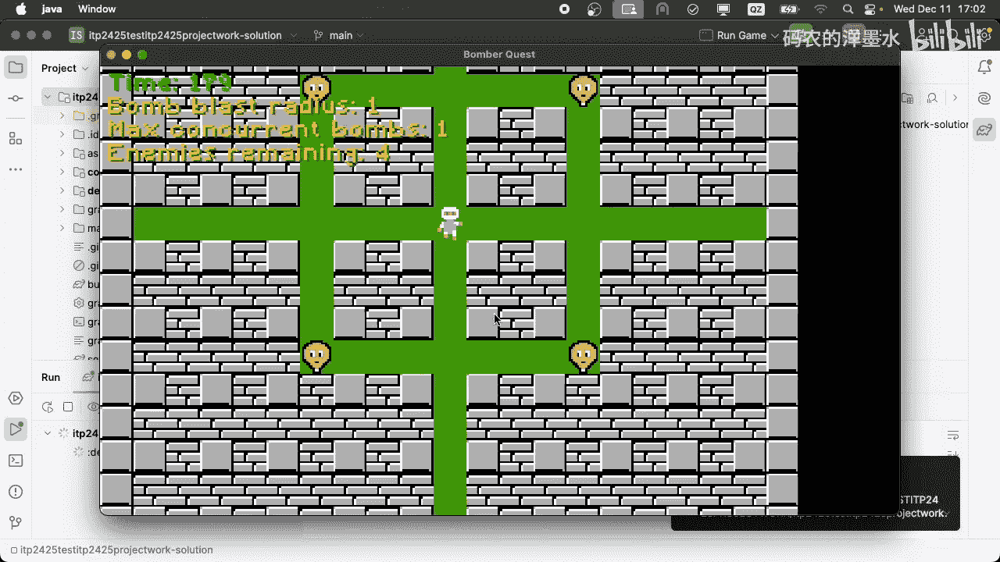
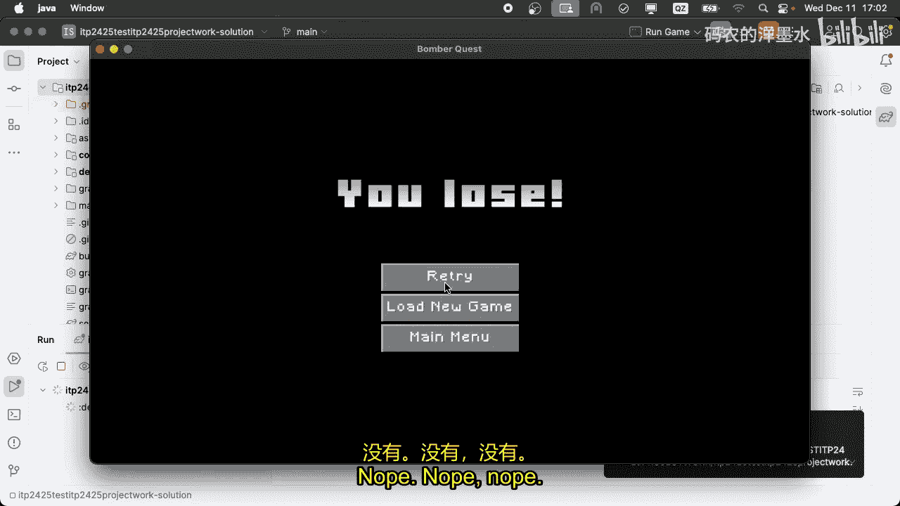
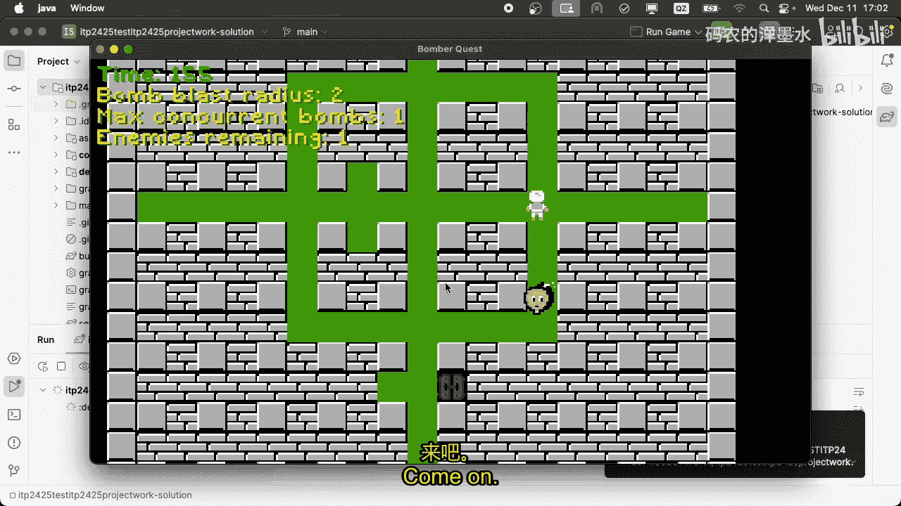
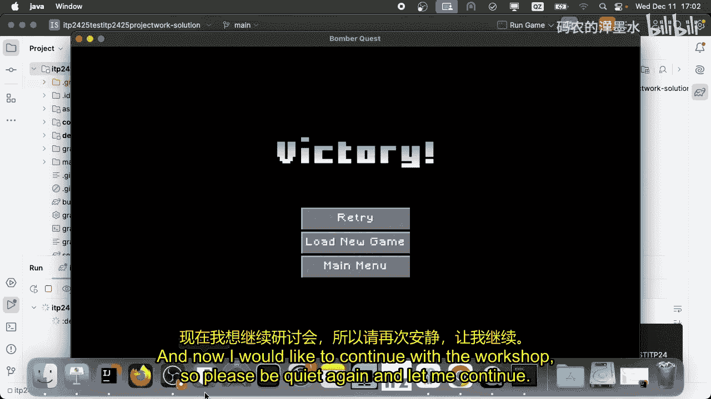
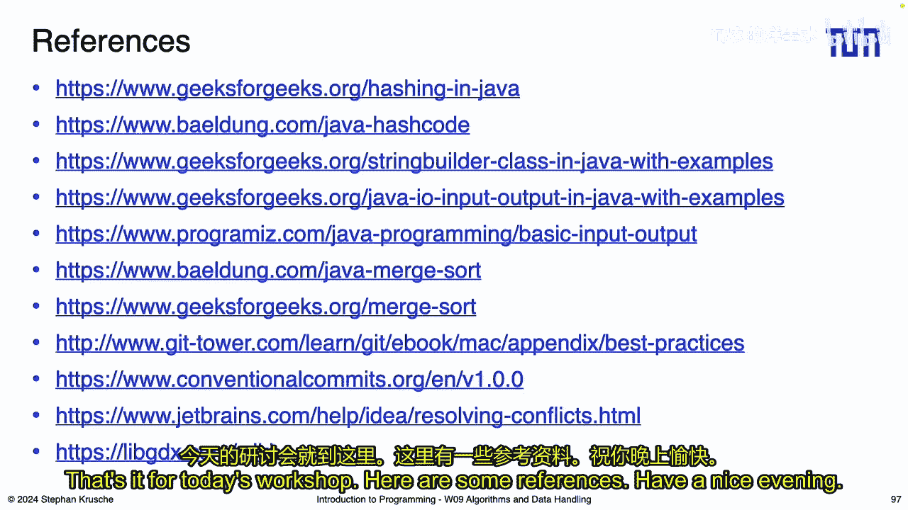

# 【全集】慕尼黑工业大学 计算机编程：从入门到实战 中英字幕 p42 Lecture 42 - 项目实践 -BV1WFrTBZExY_p42-

Then I will continue and I will announce the project work because I think there were already some rumors that we will do our project this year and now here it is。

 so first of all， why we would like to do a cool project。😊。

I would say so far you solved some small problems， you had some tutor exercises。

 you had some homework exercises， and there were all kind of small problems you had to solve on your own。

Kin of in a bit small context。But now we want to do a more significant piece of work。

And there are no more small to dos， but you will design a code structure of a game yourself。

And of course， you will apply all the object orientated concepts you learned here in the workshops and you will apply them to your project and hopefully。

 and I think definitely you can show off to your friends。

 to your family and show them what you achieved。So the theme of this year project will be Boerman。😡。

So I hear some yeah， do a quick answer up， who of you know Sponerman original one？😊，Okay。

 I think we're kind of old right now。Okay， who doesn't Just double check。 Who doesn't know Bmberman。

 Oh， wow， you definitely have to watch a video on YouTube to get the idea of Boerman。

 but you can see a picture on the。Right side of the screen， this is the original bomber man。

And the idea of the game is that you have a maze。And the player has to escape from it。

And the maze has some walls， so it is enclosed by indestructible walls。

 but within the maze there are some destructible and some indestructible walls。

And some enemies roam around， so you can see the nice guys over there。

And they are moving randomly throughout the。Or maybe randomly， maybe they have some logic， let's see。

 but they move within the maze。😊，And the idea is that the player must place some bombs。

 they will explode， and when the bomb explode， they will destroy walls。Of course。

 only the destructible walls， they can eliminate enemies。 And when you。Destroy walls。

 you can locate a hidden exit and or some power ups。You have to find the exit to escape。

And the exit is locked until you also。Defeat all enemies。And I spoiled kind of。

 but the game incorporate some power ups。And with the power ups， you can enhance your， let's say。

 bomb capabilities so you can。Increase your blast radios。

 so you can see in the picture that the bomb currently exploded and you have one field in each direction where it can defeat enemies or the toy walls。

But then you can increase with some power upster。The radius of the bomb。If you know Bomberman。

 then you all know you start with the fact that you can only place one bomb at a time。

But there can be also some power ups that you can increase the amount of bombs you can place at the same time。

And one thing we would also like to add， so this is also a requirement， there is a timer。

 so you're not able to play this game four or five hours。

But you have to find the exit and defeat all the enemies within a specific time。

There are also some gameplay mechanics， so， of course。

There will be a character because the character has to play some bombs and has to eliminate the enemies。

And of course， the player can move around and the player can move in four directions。

 it's simply up down， left and right。Then I just said there will be walls and path。

 just to make sure so the maze consists of these destructible walls and the indestructible walls。

 and between them there will be some free path， so you saw in the picture before the green background。

 this was the free path where the character can walk and also the enemies can walk。And all entities。

 so I'm speaking of character enemies， and I don't know what you will create。

 and they can walk in the three paths so they cannot pass any walls。End。There will be an entry。

 and there will be this hidden exit。Just to be clear。

 each ma has exactly one entry and also one hidden exit。

 so there won't be multiple exits or multiple entries， that's kind of requirement。Like the character。

 also the enemies I'm moving on the three paths。And what's most important is if an enemy touches the character or vice versa。

 if my character runs into an enemy， then the player lose。You already saw the timer。

And the timer will be placed in a so-called HUD， so a heads up display。

 or we can also name it like a status bar where you can see the number of bombs you're currently able to place。

 the bomb blast radios， so like I said with some power ups you can increase the blast radioius。

 that will be to count on timer so the player knows how much time he has left。

We would like to see how many enemies are left in the game。

And an indicator when the exit is accessible。Just a reminder。

 the exit is accessible if you defeated all enemies and you found。The hidden exit。Nice。And。

Despite all the naE ideas we have， we stole from Boumboman。And there are some technical requirements。

😊，We want you to use LiGDX， and this is a game engine， I would say， or a library。

 and it will help you to render all the 2D stuff and to create this game。And don't worry。

 we will provide you with a template。InThe slides they say with a hello world。

 but you will have a lot of functions to get started and to get an idea how you have to do things and where you have to render some stuff。

 so this would definitely help you to get an idea and to get started。

Another technical requirement are the mephies。So we will provide you some map files。

 of course you' are very welcome to create your own map files。

The requirement from our site is that your game must be able to run with any mace you can load from a file。

So maybe you can double check and load some different files if this will work。A common， not problem。

 but a common thing is that the maze will be larger than your screen。

And this means that the player can walk outside your screen and that this doesn't happen。

 you have to implement a camera that follows or that moves with the character。

So that the character is always visible and not outside of your window。

a bit related to the topic is the screen size， so it's important then that when you resize your window of the game。

That is possible that your game ade。So。What I would like to say is don't implement your game for a fixed viewport like full HD。

 so it has to be responsive， that's also a requirement from our site。Last but not least。

 regarding the。First requirements， but there will be a summary at the end or a list we can double check。

And a lot of information in a problem statement， but we want you to do a documentation。

You could use or you should use， definitely you should at Java doc。

 so you can document each class and method with this。And it's。

Relatively easy and inche can help you with that。You see in this example。

 we have the method public end sum。We have the Meth some。And。

What the documentation does is you can see in the first line that there is a description。

In this example it says sums two integers and returns the result。

 so this is the description of the function， and I want you to do this for your functions you will implement in your project too。

 because we have to grade your project and we have to see what you've done and we should be able to get an idea of what you meant to do with your function。

So it's easier for us and it's also easier if think about you're doing this with your partner and you implemented a function。

 it's way more easy to read the documentation。Then to tries to get to know what the function does。

Of course， for this example， it's quite easy， but if you have a complicated or more complicated function。

Then the documentation was very， very helpful。But。Below the description， there's also this at perm。

So you will do a documentation for each parameter and also for the return statement。In this case。

 we just state that the parameter A is the first integer to sum。

 parameter B is the second integer to sum， and of course the return is the sum of the two integers。

These example is quite easy， but just that you get an idea what we will or what we want from you。

And in addition to this， we also want you to add a readM file。

 so the readM file should explain the project structure and how to use and how to start your game or the game mechanics and so on。

This is also really necessary if， especially if you have some special cases for the project that we are able to get us started。

O。Then I will continue with some basic concepts of lipTDX so you get an idea what it is and what to do with it and so on。

 but don't worry you will also get a template and we prepare you with a lot of functions。

So in lipip ChidX， we have。A concept this is called game loop。And this is just。Yeah。

 I think I would say this is just a function and the function is called render， as you can see。

And what this function does， this is。This function is going to be called， I think I have。

Nice animation here， 60 times per second。😊，And by doing this， you get around 60 frames per second。

It maybe depends on the power of your computer， but roundabout you get 60 frames per second。And。

You also get the peri that tell you how much time has passed since the last frame in seconds。

So this is really helpful if you have something that depends on time， like walking of your character。

And then you know how much you have to move from one frame to another frame。

 or how much time has passed。So。Just to sum up a few things what you can and what you should do in this render method。

Is that every time you。Render your game， you can tell a lip GDX， where to put an image。

 where to put your character， where to put your。I don't know， some assets， some ideas， and so on。

Maybe your enemies or the walls and all the things you will have in your game。

You can also use this random method to react to some user inputs。

 so of course you want to move the character and this will happen with the arrow keys。And。

Then you can do something like， hey， the user press on the arrow app。And in a random method。

 you can say then this and that should happen。 This is something you can also do in a random method。

And yeah， the last thing I kind of spoil it already， so you moved the player a step forward。

 that's something you could and should do here or calculate your next step of the enemies。

This is the class structure of a game。So this is the basic structure GDX provides。

And the first layer is something LiTDX calls application listener。

And what the thing is is doing or what's the main function。

Purpose of the application listener is that it's reacting to some events that happen in your game。

This could be something that will happen in the random method I just showed you。

 or so in the slide before。Or this could be something when you re your screen。

 and you also have to recognize animation here， then you also have to adapt your application and you have to react to this event。

The next thing， the next thing is the game。And the game is， yeah， sure we also provided by LpTDX。

 and it's simply an implementation of the application listener。And this game has a couple of screams。

 which so you can see it in the diagram。And when we move on to the screen。

We will have some different screens in your game as well， so because think of a game。

 then you will have some entry screen where you can say start game。

 you will definitely have a gameplay screen where you actually see the game and play the game and。

I figure you will also have some game for Los or won。

 so there should be some victory scream or something like this。This will。

So regarding or depending on the screen， there will be some things active and the graphics will be rendered according to the。

 to the screen。 because in your claimplay， there will be some other graphics than in your。

Cae on scream。But this will be also something we will give you or which you can see in the template to get an idea how this will work。

Okay。Then。Maybe a closer look again to the screen class。

The screen class of LiTDX has also some methods。Of course。

 you can see them here and I think the first one is kind of simple because when you want to show a screen or you want to show the gameplay screen。

 then the method show will be called so that the screen knows， okay， now I'm active。Then of course。

 there's also the random method we talked about already。

 also a resed method with the heightened width of your screen。And yeah， of course， the height method。

 So this is basically the opposite of the show method。 If you show different view a different screen。

 you will hide the actual screens。 So when you switch screens。And last but not least。

 is the dispose function。And。This is so the dis method is kind of important in case you load any resources so you could load some textures。

 you could load some sound sound effects， and so on。

 and you could use this for some specific screens。And what the dispose method will do is it will clean up。

 so this is kind of important。Because you。You don't want that any resources will remain after you switch to the screen and there are not any longer necessary。

Because if you won't clean up your。Texttures， resources and so on。

 and this can cause unnecessary memory consumptions and if we do this a lot of time or quite heavy。

 then maybe this will cause your game to crash and we would like to avoid this。

 this is why we have this dispose method。HI missed I have some nice things here。

 but you can see them on the PDF as well afterwards。Yes， our lip TD X is。Not a new innovation， so。

If I'm not mistaken， I think it was released 2010 or something like this， so it's quite odd。

 but the good thing is so it's still good。And the really good thing is there is a lot of documentation。

😊，LipGDX itself has this wiki and you can see a lot or you can get a lot of information there。

 they also have some getting started tutorials you can take a look at。

And if you need more resources or want to take a look at more ideas and need some images， textures。

 and so on， there is this awesome lipGDX repository。Where you can find a lot of things。

 a lot of links to other resources， and like I said， some textures。Images and so on。

So I definitely recommend to take a look at these two resources when you're working on your project。

Okay， so now comes the super nice part and I hope fingers crossed that this will work。😊。

You will see a live demo。😊，You up。Various。说O。But before I show you the demo， I want to。

I want to say a huge shout out to Michael， one of our tutors。

 because he implemented the sampleA solution。And I really like it。 So， yes。

 that's the perfect reaction。😊，And you have to knock a bit louder when you see the actual sample solution。

 okay？Microphone。So。Oh。So now I can walk around and you'll see this nice guy。

 I can also place some bombs。嗯。😮，And there is a power up。This。Oh。

No， no， no。

。Okay， oh， I found the exit。 That was cruel。This is the rest of the workshop。

 You will look at me playing this nice game。 though。

 I just want to show you that I'm able to win this game Come on。😊。

Okay， and then I can go to the exit， and I won。Yes。

I'm not sure if this applause was for me because I really did a nice job there or it was for Michael。

 hopefully it was for Michael。And no I would like to。

Continue with the workshop。So please be quiet again and let me continue。Guys？And girls。

Let's continue。Now you saw some technical requirements and you saw the live demo。

 what bomberman could look like when you were finished with your project and now I want to talk about a bit about the work modes。

 so what we would like to do and I also think there were already some rumor spread。

That this will be a teamwork。And。Our team or your team will be。You will be in pairs。

 so you and one fellow student will work on a project。

AndThis is because we like you to work together， to get the experience to work in a team。

 to be able to do pair programming。And also to learn how to communicate and again， work together and。

Learn how to split your task， meaningful and so on。In the end。

 there will be also a final presentation in your last tutor group。

And you will present your project to your fellow students and answer questions。

Since we will work in teams or in pairs。I see that this comes with a risk。

 so you have to pair up and maybe you have some problems with your partner。

 maybe this other student will drop out of the course， this is something I do not hope for。

But it can happen。But we want to help you with those problems。

 so if something happens within your team， there are any problems。

 then please come to us and also communicate with us so communication will be a big。

 big part in this project work。Again， if you have any problems， issues， and so on。

 please communicate with us。And we will help you to figure out these problems。

And please do this as soon as possible。 So if you're having trouble。

 don't wait until the deadline comes。 and we're。In the middle of grading your project and then say。

 yeah， my partner， We and I had to do this all alone， No， that's too late， please come immediately。

I told you something about care programming。And care programming is mandatory in this project。So。

There will be some tutorial groups where you So there will be tutorial groups in January like you used to it。

And you have to attend at least two of three two out of three of them in January。

 and you have to do pair programming there。But you are really。

 really welcome to also do some pair programming at home。😊，And to do this with your partner。

 you can meet at home， you can meet at， I don't know the university and also do pair programming there。

But from our side， we will double check if you are in the tutorial group and if you do pair programming there。

The the tutors， let me the tutors calling it and evaluate your peer programming within the tutorial session。

And there will be a time slot， so you have to switch the roads。

 I will tell you about a bit more about the roads in a minute。Every 20 minutes。

We want to do this so that every one of you is the driver and also is the navigator。

 These are the two roles。 I will tell you more about that in a minute。But。

If you have some fear that you say。I'm a better coder than my partner and I want to do this stuff。

And it is better for our project that I will do the work and not my colleague， that's wrong because。

When you're the stronger one， maybe， maybe you're equally， but when you need a stronger one。

 you can learn a lot because when your partner needs to code。

 then you can help and explain some concepts and if you're the weaker one， weaker one。

Then you can learn a lot from your partner。So it's super important that we switch those roles。

I the tutors will tell you this a lot in your tutorial sessions。I will force them to。

 but please ensure that the driver， the one who's working on the code。

 always works on your own computer。And also commits the changes， this is super important。

 so when you switch roles， you also go back to your own computer and commit from you。User account。

So the two roles， we have the driver and we have the navigator。😊，And I hope you're just stretching。

Or do we have a question？Okay。So。What will happen when we do pair programming？

 You both will sit in front of one computer。But the driver will。

Be using the the mouse and the keyboard。And of course， we write the code。And at the same time。

 the navigator will。Explain to the navigator。What and why he is doing。 So like， hey。

 I'm implementing this function because of this and debt。

 And I'm doing this this way because it is better to do it。This way， then the other way。

This is what the driver is doing。And at the same time。

 the navigator is watching the work of the driver make sure that what he is talking about and what he is coding does makes sense。

And have a wider look of all the project stuff and ask maybe some questions or point out some impediments which could happen if we implement some stuff like this。

And。Like I said before。The key。In this course is communication。

 and this is also the key in programming because with communication about the work。

 you will improve the result of your project a lot。This is the idea of pair programming。Okay。

There will be also some slides about the timeline on the organizational stuff。

 but before we come to this， I want you to give you some insights on Git。Because as of now。

 you only use Gi。With a question mark to push to Artemis。

 but now you want to use it to collaborate with some other， so with your partner in the project。And。

On this slide， you can see some common commands that you will need within your project work。

And as far as I know， at the moment， you only used get clone， get Ed， get commitit， and get push。

Maybe do a handwriting， is there any one of you who used Gi before this course？Okay， a few。

But no worries， this is kind of what we imagine。And from now on。

 you will need some more comments to work together。

And on this slide you can also see the comments fetch， mergech， also checkout， and pull。

I will continue with the next slide。 You can read。like description of the comments here。

 but I will use this slide because I think it's a bit easier to follow， hopefully。So。

Before I go into detail with the photo for command。Let's take a look at the four different stages。

 another。Hand raise。Who of you。Was aware of the four stages， workinging directory， staging area。

 local repository and remote repository。Okay。Then we have the working directory。

And this working directory is the。The place where the files are stored locally on your machine。

 This is your machine， your project。There it is。Then we have this staging area。And the staging area。

 you can imagine a space。Where you prepare your chair or where you move。The files you want to commit。

To the next stage。And maybe in other words， you're working on your working directory and you change five files。

And then you think， hey。I like that these five files I would like to commit them。In the next step。

And so you prepare it and you move it to the staging area。This is what you do with GiA。

 so we decided， okay， we changed five files and we want all those five files to commit then we do a GiA。

The idea is that you could also say， hey， I changed five files。But at all。

 I only would like to prepare four files。For the commit。

 So you could do a Git at for only four files。 they will land in the staing area。

 and then you could do a Gi commit in the next for a local repository。

This is something you kind of did the whole chorus when you worked on Artemis。

And the next step would be the local repository。This is。Let's say it's a database。

 it's also stored on your local machine that contains your project's history and committed changes。

And。Like I said before， this can be updated with the Git commitmit。So。

 but these three stages are all local。So what you do there is not visible for your partner。

 but you're working on a project with your partner and you want that all those things are visible to your partner too。

 right？So this is where the nice get push。The iss used， and then you do a gi push。

 and then it goes through the remote repository。 And this is the place where it's visible for your partner。

 too。 This is this。Yeah， the shared repository， which allows us to collaborate。This is one way。

 so you have changes and you want to push them to remote repository。

So then I am your partner and I want to see the changes。

Then I have to somehow get those things on my local machine。

What I need to do first is to do a good fit。You could think about it get fetched like。

Looking for updates。So you do a good fetch。 and then you。

Kind of download the files to your local repository， but they will not affect your。

are your files in the working directory？So I imagine just checking for updates。

And then you would do a gi merge。So you have to change this from your partner。

And you want the changes in your local。Verkin directory。 So you have to merge it。

 and this is the command it merged。And then you get all the changes from your partner。

In your working directory， and then you could move on with a new feature and so on。On the slide。

 you can see this nice command good pull。But it's not shown in the picture on the right side。

But Good pull is a shortcut， so to say it combines the command， Gi fetch and good mech。So this is。

 like I said， a shortcut where you can do both at the same time or not at the same time。

You do good pull and in the background you apply it fetch and get mirror。Right。Any questions？

 I think this is something you have to do。Byuy your own and get used to it。

 and your tutors will be there to help you。And if you have any questions， just let us know。

 ask an Artemis。And we will help you。 And there are also a lot of nice tutorials and YouTube videos where you can double check and maybe get another explanation that is。

An other explanation than mine， maybe that is easier for you to understand than what I said right now。

Any questions so far？It's a short。Picture of what this could look like with the remote repository。

 So we have the remote repository here。And there was this local repository， what is on my machine。

And I can push and fetch to。To push some commodes to add some commodes to the remote repository and I can fetch to see if there are any updates。

Me as a developer， I can work in my working directory and also do some changes and I can merge and committed it with my local repository。

And this can happen。A lot more times， so there are multiple developers and multiple local repositories when they all will work together and then we will have a nice remote repository。

If you want， you could also take a look at the remote repository。

 this will be able since you will work with Artemis。

And then you can see all your changes or the actual current state of the remote repository on Artemis within a web interface。

哼。😊，You saw this before because I wanted to pull the glass changes for Michael。

 so I wanted to pull in Intelliche， Intelliche will help you with this。

 so again pull is the shortcut of good fetch and good merch。😊。

And you can go to the menu bar in in Teleliche， there's this nice menu named Git。

And then there is some point it's called pull。And in the next pop up。

 you have to define where you want to merge the changes。This would be。

Normally there would be some different branches， but for you。

 there will be only this main branch where you work on。So you just specify that you want to pull。

From origin， origin is this remote repository into your main。Branch， so to say。

And then you have to confirm it， and then hopefully you don't need to add a password， you don't know。

 and then you can pull the changes to your local environment。😊，We are going to time。

 this is why I will also show you something。Yeah， no one likes， but it。It will happen。 It can happen。

 Hopefully， it doesn't happen too much。There can be merge conflicts。 So let's imagine。

You work on line 10 in your file， and you changed you changed line 10， and you want to。

Commit this to your remote repository。But in the meantime。Also。

 your partner workeded on the same file， also in line 10。

And then you kind of emerged conflict because。The system does not know which one to choose。

 so what is the correct line 10 if both of you had worked on it。And。

This kind of could look like this， so imagine we have the remote repository where your partner or someone else is always pushing some stuff。

 these are the yellow dots。And then we have the local repository where I am working on and this are the green dots。

 and so we are both doing some stuff， it's nice， and then I think oh yeah。

 I want to push to the remote repository。The problem is， I first have to pull all the changes。

That happened in the remote repository。Otherwise， it's not。I am not able to push my changes。

So now I pull and now。We have， or imagine we have the case that I changed something in lieuteant and also my partner or。

The yellow dots changed also something in this file in line 10。

 so we have this merge conflict we or not we don't know what is the correct one and so we have to solve this。

So that's when I have to check the files and I have to say， okay。My version is the correct line tin。

And then I do a merge commit。 So this is how we call the thing。And then we are able to take this。

and pushush it again to the remote repository， and then we will have the history from my colleague or from all the people that worked on the remote repository or pushed something to the remote repository and also my history。

 my changes，In the remote repository。The problem with merge conflicts are that they are not always that easy that only line 10 was changed so they can be a bit bigger。

But to avoid this， I want to show you some best practices when using it。 The first thing I would。

Really recommend is。To commit and push often your changes。And also。

 if you want to start to work on a new feature。Fetch and merge。

So pull the changes from your partner so you start with a current state。

It's not good if you forget to pull， then you would work with maybe an outdated version。

And it helps a lot before you start on working something new。

Pull everything from the remote repository and start working on a new feature。Also。

 some other best practices is that you should commit related changes。 So please work on。1。

Thing that you can。Combine into one topic。 So don't start to work on T H U D display at the same time and in the same commit while you're working on the。

Explosion animation。 So split this into related changes。 So we' on one topic and work。After that。

 start with a new topic。Also， don't commit。Things that are not finished。

 So when you start to work on a feature， you could。

Slice your features into smaller pieces and then work on smaller features and then you have smaller commits。

But finish your feature。 So when you would like to work on animation。

Don't start to add a function that's called animation。 Do not put any logic in it and commit it。

 So finish your feature。 add some logic to the animation。 and then commit this whole。Feature。

Please test before you're committing。Make sure that it works on your machine。

And you could also test afterwards。Another thing is write good commit messages。

 I have some example a few slides later， this is why I will go through this really quickly。And。

I would also like to mention the last point， so in this project we do not use branches， I just said。

Or I just pointed out when I talked about the Gi pool and the main branch。

 so this will be your only branch and we will work with this。

 there won't be any branches in our project。There are also some resources you can take a look at。

Okay。This was。The part for the get。And no。Now your path to success。It's again， about。

W project you will work on。So the problem statement。

 you will find an artemis exactly specifies the minimum requirements。You have to。Aieve。

For this project。If you do anything that is stated in a problem statement。

Then you will get a score of 100%。But in addition， you can collect up to five bonus points because we want to。

See how creative you are。 So if you implement some functionalities that goes above and beyond the minimum requirements。

 we love to give you some bonus points for this。😊，And we also。Stated here some examples。

In a problem statement， you will see that the enemies should move somehow。AndMaybe that's randomly。

 maybe that's something different or some different approach。

But you could also implement an nice algorithm that enemies。

Super smart and follow you or something like this would be really nice。

 Maybe you could come up with some ideas that the enemies can fight back and also place some poems and so on。

That's just some examples， it's up to you。 you're really welcome to come up with some nice ideas。

The timeline。 So starting today。You'll need to find a team partner and please find a team partner from your tutorial group。

This is super important because you have to do the with pair programming within the tutorial group。

 and this is why you have to be in the same tutorial group with your teammate。

If you're not able to find a partner within your tutorial group because you're 11 people in your group。

 then try to look。For other tutorial groups， because I think there will be tutorials who they face the same problem and there will be a person who is willing to work with you。

Yes， you will get the opportunity to find a partner within your tutorial group。

 so we talk to the tutors they will give you some time。And when you found a partner。

 please report this to your tutor because the tutor will assign you on ArtemIS that you are able to work on the repository。

 that you can both work on the same repository， that's something we have to。Set up anonymousm。

If you're not able to attend the next tutorial session。

 you could also write in your tutorial group chat。To find a partner。We need。

Your teams until Tuesday next week at 8 PMm。And after that。

You can start to work on the Adamous exam the due date for the final delivery of the project is in January。

 it's the 29th of January right before the lecture。

And we will also have the presentation and demonstration of your game in the last tutorial group。

I don't know the exact- I cannot tell you the exact date because it depends if you're on the tutorial group on Monday。

 Tuesday， Wednesday and so on， but it's in the last week and your tutors will definitely tell you。

In the presentation， your tutors will ask some questions to make sure that both of you worked on the game。

And this is something I will。But this is in general。Some important rules I will tell you right now。

Just you see the bonus score again， but there are a lot of grading criteria。

This slide and the next slide， because you can see grading criteria over one of two。

Are super important。These are the things that matter for us。And。It's。It's a lot of text。

But I would really， really recommend。To double check these slides， what are important for us。

 I will state the main ideas now。Because we also have some time。I just said that in a presentation。

 there will be questions and we want to make sure that both of you worked equally on the project。

Because。The main idea again， communication， teamwork and so on。

 so both team members must contribute equally with roughly 50% of significant commits and line of codes。

 we will double check this since we will have your code and your gi history。

We also want you that every team member should contribute at least 10 meaningful commits。

And meaningful in terms of。First， good message， also。A good feature package。

 so you did not do animation and exit and entry at the same time。

And you should use Aremissquit exclusively。So I don't want to see some USB sticks。

 I don't want to see that you've worked on Google Docs or other methods。

We will not take this into account。 So if you use one of these other methods。It's not working。

 so maybe it's working， but we are not able to take this into account for your grade。

It kind of doesn't exist for us。Then we will do the pair programming。

This is mandatory in the tutorial exercise from January 8th to January 29 and again。

You could and should do this。😔，Privately at home at the university and so on， too。

Also do the row switching so in the tutorial groups there will be the tutors and they will tell you hey。

 now it's time to switch the roles， but also do this if you're doing pair programming at home。

 also switch the roles and again ensure that you change the computer。

So that the driver always works on their own computer。For the development。Again。

 the hint work directly on all of us。We don't want to see other systems。

 so if you're used to Git and so on， could be an idea to use GiHub or GitL。

 but that's not allowed for this project。Only Artemis and only the history in Artomus will be evaluated。

 evaluated in this project。Now， just said， commits must have clear descriptive meaningful messages。

 and example is add bomb explosion animation。😊，I don't want to see commit messages like， oh。

 improve functionality of multiple components because I don't have a clue what you did in your commit and also update code to work better。

😊，No， I also don't want to read some messages like fix。Add some code。And so on。

 So please do some meaningful commit。 Your partner will thank you。 I will thank you。

 and also your great will thank you。😊，Commit should also be have a sensible size so they should be small。

 I don't want to see a lot of line of codes that have changed within one commit so if you face the problem that you work on something and it's too big。

 then you should go a step back and take a look if this feature， what you would like to implement。

If you're able to split this down into multiple tasks。And again， I think I just told you this before。

 but commit and push frequently。Not only because you want to avoid merge conflicts。

 but also we want to see a nice and realistic gi history and we don't want you to push everything at the end in one commit this is no。

 please don't do this。Other things are rules and no recommendations。

 so we will use your Gi history to evaluate the project。Now here's the second slide。😊，Also。

 some things about the presentations。😊，I think I。I repeat myself a lot today。

 but it's super important you have to present your project in the last tutorial group session。

Both of you have to demonstrate that they understand the project so we can ensure you both worked on it and you have an idea what is the code structure about。

So you should be both prepared and you both should be able to answer some questions and explain some things and decisions and so on。

Again， the communication thing， if you encounter any problems。

Either with your project partner or with some other stuff with some technical stuff and so on。

 communicate them early to your tutors。And or to us so we can help you and please as soon as possible。

Yes， also the statement， there won't be any exceptions。

For problems that could have been solved earlier。If you could tell us about them。

 or ahead tell us about them。You plagiarism， also something I want to mention here。

 so don't copy code from other teams。We see this。So please write your own code。

 your own original code， and any case of plagiarism will also result in a 5。0。

And for all the students that are involved， not only the students that copied。

 but also the ones that let them copy。If you fail one of these requirements。

 this will definitely result in point deductions up to 100% if needed， yes。ありま。

You can ask AI for help。But like we。Like we recommend the whole courserus。You could ask Iris。

 this would be super。I should do a full stop here。But of course， we are in a real world。

 and you could also ask AI if you're stuck， you could also do the old stuff and go to stick overflow and search for someone who has the had the same problem。

 it's okay。 But if you want to learn。new coding and so on。 don't ask AI at first step。Yeah。

 I did not repeat the question before， so I will do this again。

 so the first question was about AI if you could use AI。

 and the second question or the second thought is that we or when a lot of people use AI。

 that this might result in a lot of plagiarism cases。

I think it's different if you ask AI for one function。

Well if a lot of your project code looks the same， and I also would recommend to double check what your AI suggested you because it's not always best practice。

🤢，It's， yeah。The question was if they have or if you have to cite anything。

I think of the internet just put a link to it。So I just double a check with my team and the answer is anything that comes from the internet。

 you have to put a link on。And marked this。Any questions？Yeah。

It's part- so the project will give you 100 so the project will be 30% of the whole ITP grade and you can get for the project 100%。

😮，And。The presentation is part of it， so we will evaluate the presentation and also make sure that you do 50。

 50% and have the same knowledge so we will take this into account definitely。So the question was。

 what happens if my team member will do some plagiarism because he copied from other。

From your fellow students。And the question is if they both get punished for it。

 my first answer is they should communicate and you should talk to your team member that it's not allowed。

 and yes， you both will get punished for this。The question is。呃。

You have to attend two out of three sessions in January and the question was。

 what happens if we finish earlier， just talk to Michael afterwards。😊，Yeah。🤢，I don't think this will。

Happen。But。WeWe can talk about this， just communicate with me and then we'll see。Any more questions？

Nice。Then we think were。Good in time， so the next step。Like always， you will have。

A tutor group exercises， you will have two tutor group exercises。

 and you can see the names over here。You will also have two homework exercises flying with aircelenia and aircylenia locks。

And regarding the project work。Your task is to find a team partner from your tutorialtiary group。

 it's also a requirement。And report it to your tutor。

 and the tutor will add you to the team project in RMSMS。

And you will have time for this in the tutor exercise， yes。The question was。

 if it's still possible to switch to a tutor group， to an adult tutor group。

 if your partner is from another tutor group。That's possible， But you have to talk to your tutor。

 because if there is one tutor session with。2023，24 people， then it's full。

 But if there is enough capacity， then talk to both tutors。

 the one you go to and the one you came from and。Check with your tutors。

 but in general it's possible， do this up within this week， so before the project starts。

I think this should be possible。 So you have to make sure that you will understand what you did。

Because you have。When we find something like this。Sorry， the question was， if you didn't heard it。

 if you are allowed to use some things you did not learn in this course。

 but you'll understand it if you are allowed to use it in your project， so you are allowed。

 but if we see something like this is，I think it's super。

Possible that we will ask you in the presentation about this code。And yes。但是。Already。Okay。

I think when a project gets going， you will see some libraries that will be。

Maybe be fit for your project。If you want to use a third party library。

 there is a channel on Artemis。 You have to ask if this library is。

Is okay if you can use this library。And then we will give you a thumbs up or no。

 we have some libraries that are okay， but maybe there are some libraries we say， okay， no。

 you're not allowed to use this library。But there is the autoimist channel for this。Okay。

 then we have three articles I would recommend to read。And all this is due until next week。

 December 18th。1 PM right before the lecture。Now it's my turn to do the summary。

You learned that hashing is a really important concept in computer science。😊。

So you needed to map object data to a representative integer value。In addition。

 merge sort is an utter and even faster alternative for sorting。

 and the idea is to merge to sort at lists or a。😊，Into a new sorted version。And the third thing。

 there are many ways to deal with input and output。And in a programming language， not end。

 they deal with input and outputs。Data in a programming language like Java。

That's it for today's workshop， Here are some references， have a nice evening。

